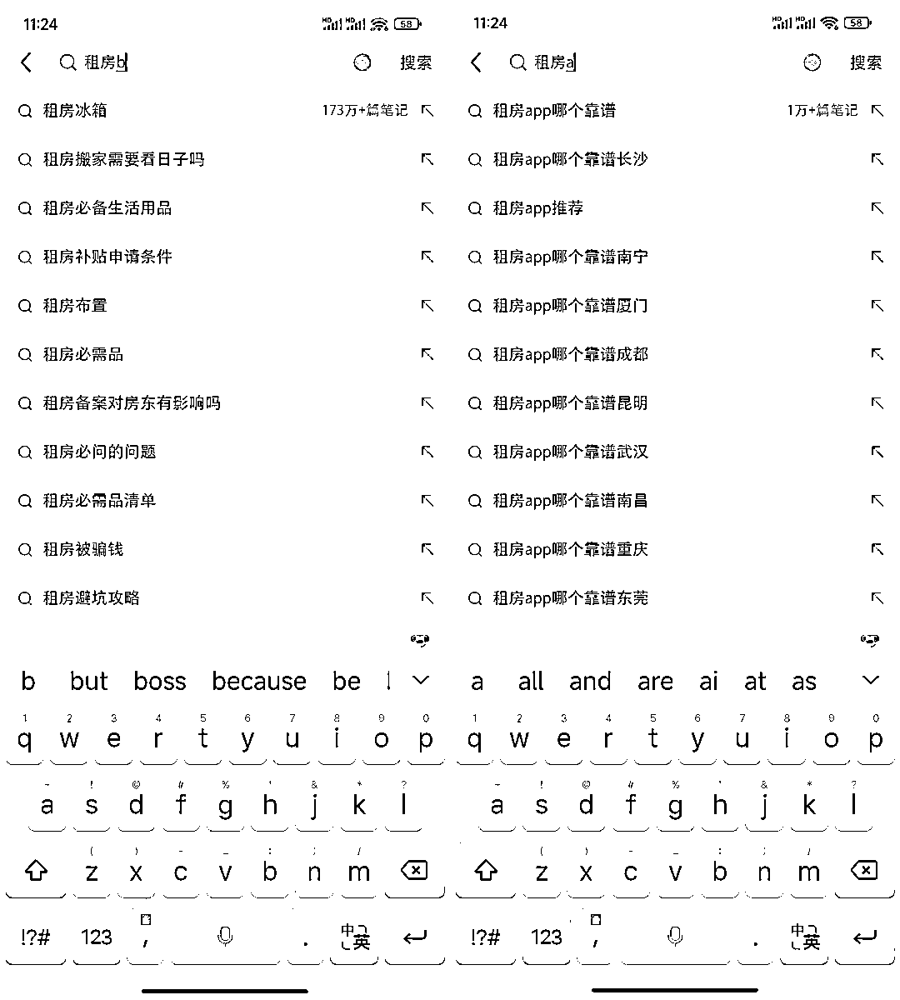
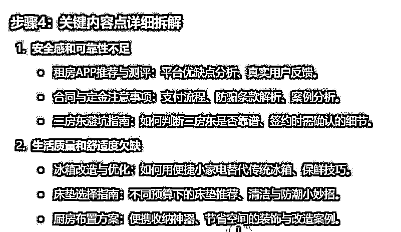
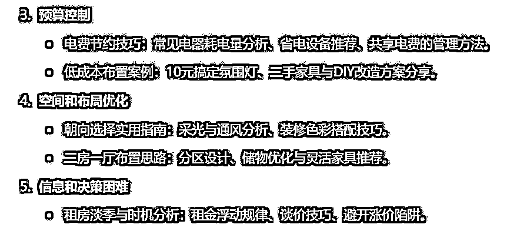
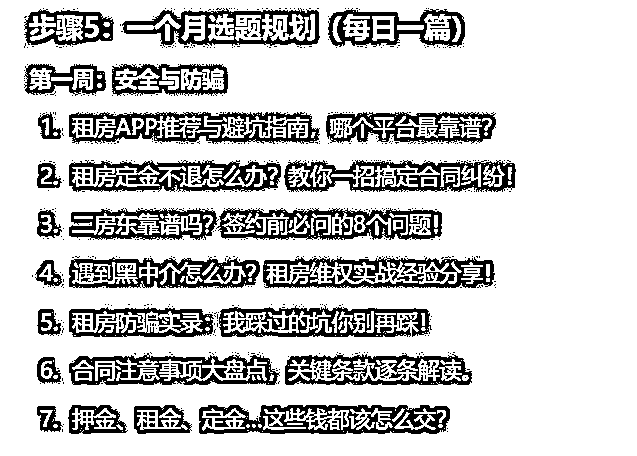

你有没有发现，那些在小红书上把个人IP做得风生水起的人，其实个个都是“人性操控大师”？这本事，跟某些骗子的套路如出一辙。就拿我最近的经历说吧——家里房子挂出去招租，差点让一个“杀猪盘”给套路了。对方自称深圳高管，被派到长沙，公司报销房租，张口就说要一次性付清一年。听起来是不是神仙租客？结果聊着聊着露了馅，被我识破，气得直接拉黑。

回头一查，网上这样的案例一抓一大把。骗子们的惯用伎俩是：先跟你混熟，然后不经意透露点“金融内幕”，诱惑你去买理财，最后卷钱跑路。气归气，但冷静下来，你还真得佩服他们的洞察力——能精准锁定目标客户（毕竟房东普遍有点经济实力），又能抓住目标人群的核心诉求（想快点租出去、想遇到靠谱租客），然后量身定制圈套。

做IP的博主，其实干的也是同一件事：找到你的精准受众，戳中他们的痛处，再喂给他们对胃口的干货。

可问题来了：人海茫茫，上哪儿找这些人？怎么知道他们到底在烦什么？答案就藏在“搜索”这个动作里。

还是拿我那个招租的案例说事。我当初是怎么断定对方是骗子的？就是去搜了一下“帮别人租房、微博联系是骗子吗”，结果真相大白。所以你看，搜索能帮你“捕获”那些正在烦恼的人。而搜索的第一步，就是选对关键词。

假如你是个租房领域的博主，想吸引租房人群、顺便做家居带货，那你肯定会用“租房”当起点。但光有起点还不够：搜“租房”的人那么多，我怎么知道他们具体在找什么？哪些搜索内容跟我的领域相关，能让我快速变现？

这里要分享一个从生财有术大佬“比比先森”那里学来的招：关键词 + a/b/c……还是拿租房打比方，你往“租房”后面依次加上a、b、c，下拉框就会蹦出一堆真实搜索词：

把那些跟你领域沾边的组合词挑出来，大功告成。这些词背后，全是用户实打实的痛点。但新手可能又会哀嚎：光看到词，我还是不知道痛点具体是啥，更不知道咋扩展成选题啊？

别急，这就教你用“搜索+AI”搞定一切，直接帮你锁定人群、批量生成爆款选题。我连“喂饭”级教程都给你准备好了。

## 01 人群痛点+选题提示词

你现在是一个拥有30年经验的营销专家，最擅长从网络搜索词里嗅出用户的真实痛点，并且能结合博主所在的领域和目标人群，给出让人眼前一亮的内容选题。

我是做XXX领域的博主，目标人群是XXXX。我在小红书上搜到大家搜索的关键词如下：“XXXXXX”

请你严格按下面步骤来帮我：

1.先分析这些关键词背后，目标用户到底有哪些痛点；

2.把自己当成目标用户，针对每个痛点，用口语化的口吻提出你会问的问题；

3.思考这些问题能和我所在的领域怎么结合；

4.根据结合点，把每个问题可能涉及的关键内容点详细拆解出来；

5.根据第4步的结果，给我排出一个月的选题，每天一篇；

6.最后再切换回目标用户视角，按痛点强烈程度从高到低排序。

任务要求：
- 第2步要模拟目标用户，用很自然、很真实的口语提问；
- 第4步必须拆分得足够细致，确保把问题的方方面面全覆盖。

## 02 运行过程

我继续用租房博主当例子。我通过加a/b/c等方法，搜到了这些关键词：

租房APP哪个靠谱
租房冰箱
租房必备生活用品
租房床垫
租房朝向怎么选
租房厨房
租房淡季是哪个月
租房电费多少钱一度
租房低成本布置
租房二房一厅
租房二房东注意什么问题
租房付定金要注意什么吗？
租房付了定金不想租了

下面就是AI的实际执行过程。（我用的是ChatGPT4o）

说实话，它提的问题相当到位——我要是代入用户视角，也特别想知道这些答案。

最终它给到了一份完整选题：

太绝了！不到两分钟，一个月的内容选题全齐了。更贴心的是，它还顺手排好了优先级：

照着这些选题去写内容，还怕吸引不到目标用户、实现不了变现？赶紧去试试这个“搜索+AI”的懒人方案吧！