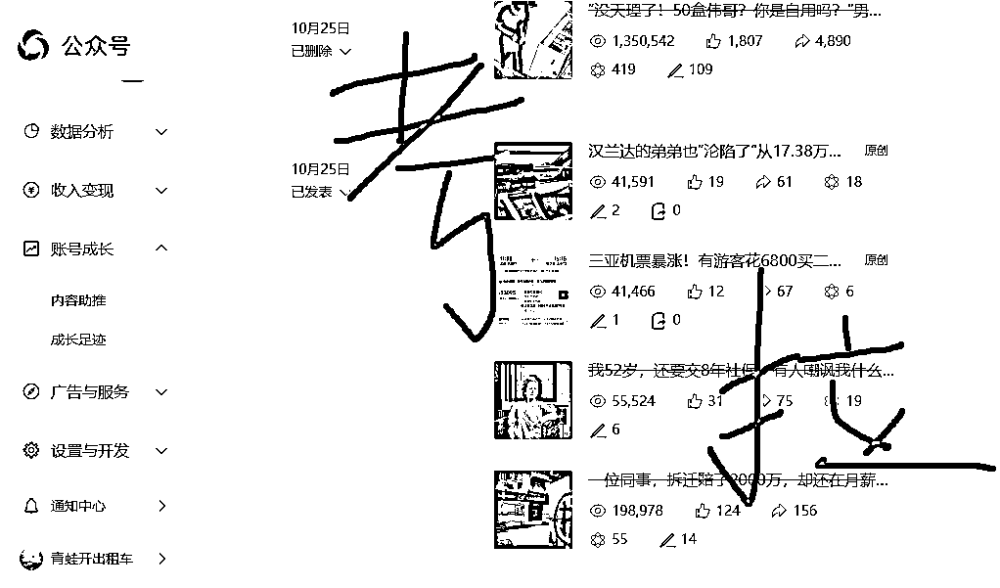
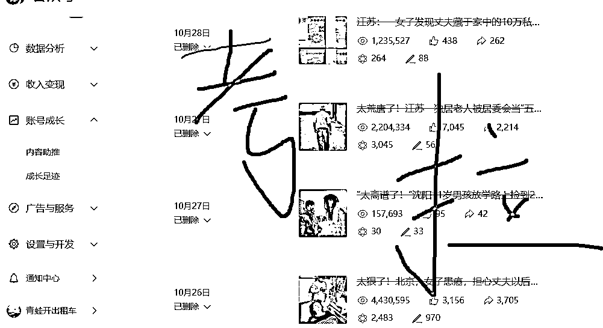
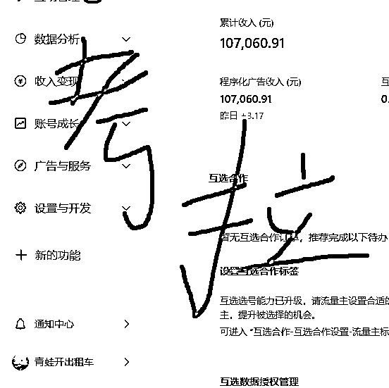
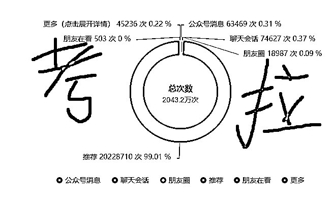
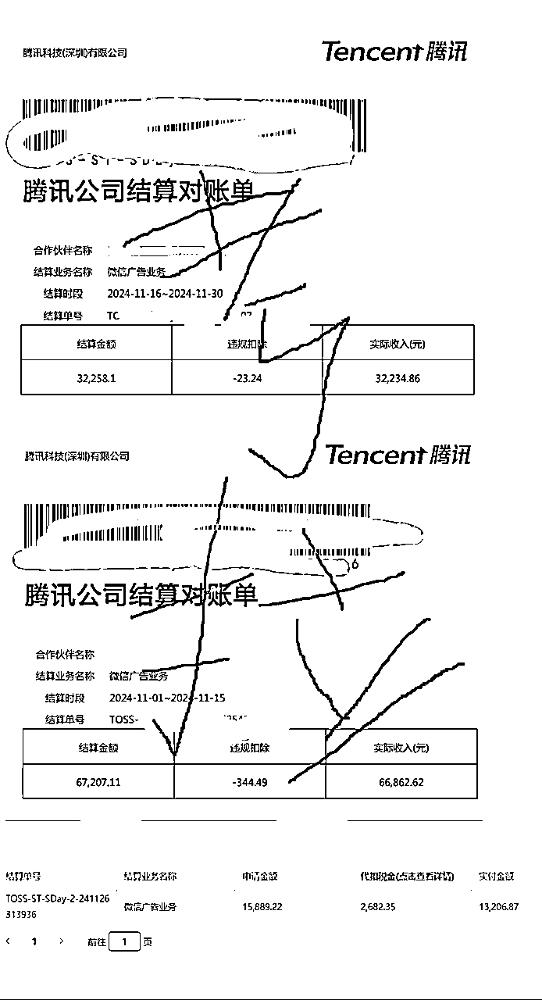

# 👸号爆文一年复盘：我用Python养号，8天赚了10W

我是龙哥，圈里也有人叫我村长。2024年一整年，我基本都在折腾👸号爆文，今天想把这一年的经历做个复盘，也顺便分享一点心得。

先上战绩：10月下旬，我手里的号突然爆了一个，靠“先发Python、再转赛道”的打法，8天收了10W块；那阵子每天阅读量都是百万级。后来11月，我用另一套筛选策略又进了10W多。期间还出现过一天470万阅读、一天到账2.7万的巅峰时刻。

不过，故事一开始并没有这么光鲜。

年初我同时拿20多个号试职场、情感、律文、生肖，最后只有律文跑出一个像样的号——“小雨说法”。这个号3月25日没了，总收益大约3W多，账号注销后连收益截图都没留下来。当时我的做法很简单：去次幂或头条找对标标题，把对标文章整篇复制过来当喂养素材，再用提示词让Claude洗稿。由于只有这一个号在赚钱，我每天都谨慎地选选题，怕它活不长；有流量怕第二天断掉，没流量怕没收入，整个人高度焦虑。后来这号终于死了，我反倒看开了。之后我才明白，公域流量的闸门根本不在自己手里，平台脸色说了算；想做流量主收益，靠一个号长期吃下去几乎不现实。

3月份我参加爆文航海，在群里认识了热心的兔子鱼教练，她分享了很多干货，也让我知道了猫哥的陪跑营。情绪低落的时候，人特别想找个队伍一起扛，所以我4月就进了猫哥的营，从此不再单打独斗。

可4月到5月，行业数据整体惨淡，不少人退出爆文去做其他项目。我也摆烂了两个月，试过别的方向，都没水花。后来看猫哥一直没放弃，6月我又重新捡起这个项目。当时猫哥号召大家做教育号，群友都打满鸡血，我也做了一阵，但没跑出来。复盘原因，多半出在号上：我用的都是发过律文的老号，而且都在同一台电脑上登录过，没做IP隔离，大概率早被风控了。大家说停更一段时间再转赛道，我也试了，没用，这种事确实看概率，只能怪自己运气不行。

真正的转机发生在7月。群里出现一个叫字母哥的圈友，单靠一个号就月入10W。通常账号被大家盯着对标之后很快会废，字母哥的号却一直坚挺。我继续扒他其他号，发现也都很猛。研究来研究去，我找到了一条共性：这些号全都是先发Python内容，再切到其他赛道。一个两个可能是巧合，多个同时出现就不太对劲了。

后来在群里聊到这件事，我决定自己开测。

8月到9月，我先做小范围测试：老号、新号、刷粉时机、转赛道时机，都分别试。因为我以前做过律文，知道什么样的标题容易爆，所以转赛道后统一发律文。👸号养号周期不短，一般要20天左右。中间踩过不少坑，比如等到号有推荐了再刷粉，结果号马上没了，浪费时间，后来我改成起号就刷。假如发满20多天还是零数据，我会先转个赛道试试；转完一周仍旧是零，就注销重来。9月还真测出几个号，一转就爆，单篇能赚2000块，但号往往立刻报废，这就是所谓的一波流。我倒觉得一波流也行，只要起号成功率够高，一个号赚几千块也很香。老号发了一阵还是不行，我统统注销。

关于转赛道的时机，我摸出的规律是：先发2周再转最稳，数据特别猛时10天也行；如果连续3天都有几十个推荐，这号就算不错。7天内就出推荐的号，转赛道成功率反而偏低，我测下来是这样；一般养满20天以上更保险。如果推荐只是个位数，发够20天也可以试着转，反正拼概率，有点反应就值得试。我还见过发20天全零推荐的号，转完赛道照样能跑起来。

后来我把思路跟朋友说了，朋友帮我去收号，我负责运营，号慢慢加到50个。到10月下旬，我转的几个号看起来都像一波流，心里已经想放弃。干脆就胡乱混着发，一天内同时发四个领域的内容。结果其中有个号突然爆了——就是那篇《青蛙开出租车》。

律文数据既然这么好，我就安心主攻律文。接下来一周，这个号几乎天天几百万阅读。8天到手10W，流量随后慢慢归零，像被设了一道10W的门槛。现在这号也掉池了，收益图放在这里：

同一段时间，群里几个做得不错的群友，基本也都是“Python养号+转赛道”的路子。到后来这招在👸号圈子里已经人尽皆知，现在偶尔还能看到先发Python再转律文的号。但律文本身有风险，加上涌入的人越来越多，单价被卷得极低，后来我就不再碰律文了。

群友后来帮我复盘，说那个号能爆的原因有三：一是3月25日以后这个赛道的人少了很多，竞争不卷；二是正好碰上双十一，广告主加大投放；三是那些奇葩社会事件天然有爆款相，平台也更愿意给量。总结起来就是天时地利人和。

做出成绩后，陆续有人愿意把号交给我运营。现在主流就两种模式：代运营是我把写好的文章给号主，号主发到自己账号，收益按6:4分；全托管是号主注册号后把我设为👸号管理员，之后基本不用管，选题、写文、发文全由我做，收益绑定我的对公账户，我拿8成，号主躺赚2成。我更喜欢全托管，因为不用每天和不同号主沟通，沟通实在太费时间；全托管还能给每个号单独定策略，精细化运营，效率明显更高。

最后聊几句运营心得。这个类目做得越久，越觉得像玩概率：运气占比很大，策略只能锦上添花。所以账号数量必须足够，我理想是100个打底；只要号主愿意配合注销重开，理论上账号就能源源不断。起号阶段和前面说的一样，大部分账号都是一波流，只要有推荐我就追更。我习惯每天刷一遍“看一看”，保持对热点的灵敏度。转赛道后的头三天，基本决定一个新号的走向，这三天要发近期最容易爆的热门内容，特别考网感。有些号爆完立刻归零，别心疼，直接注销。

另一种号最磨人：每天稳定几十几百推荐，但就是不爆。这种号只能熬，可能熬几个月才开始见钱。我有个体育号就是典型，前两个月发汽车，一直有推荐但火不起来；后来赶上奥运会，我把它转成体育号，流量才上来，却依然不算大爆，每天几万阅读、单价万100，一天能赚100到200，慢慢攒下2.5W。如果手里能有十几二十个这种“低保号”，收入同样可观。所以我设计了一套筛选策略：每个账号有自己的“命”，这命是算法给的，我要做的只是不断地试，找出它适合的赛道。有时候一天同时发三四个赛道，发几天看哪个赛道有反馈，再慢慢确定方向；如果全都没反应，注销。靠着这套策略，11月又赚了10W多。

如今我也从一个人变成一个小团队：我主攻选题和写稿，发文交给助理，朋友帮我对接号源。第一次带人，短板暴露得很明显：沟通不顺，人也犯懒。起初我以为把活交给员工自己就能躺平，结果员工手里的账号数据很差。立场不同，员工不会像我一样盯着数据调整内容，所以最后我还是每天看账号数据、定发文策略。以前打工时最讨厌写日报，等我当了老板，也开始要求员工每天统计账号数据。员工的打工心态很简单：今天发完拿到钱就行，不会为最终收益负责。而爆文赚钱非常靠题材，有时遇到一个热点，一篇文章直接几百万阅读、赚好几万，这确实需要运气；但在运气到来前，账号够不够、策略有没有准备到位，这些都要提前做足。

关于IP，多说一句。多账号肯定要用IP隔离加指纹浏览器，我也不例外。现在天翼云收紧得厉害，几百个号再用天翼云搭很麻烦，所以我直接在IP平台买IP，指纹浏览器用比特。很多人会去查IP是不是数据中心的，我从来不管，买来就用。这东西我觉得更偏玄学，腾讯的风控你很难猜透，与其纠结IP，不如把精力放在拉人收号、挖掘选题上。我的数据中心IP账号，一样有做起来的。

回头看，从2023年9月参加航海到现在，真的是一路升级打怪：经历过2024年4～5月的行业低谷，也有过一天470万阅读、一天收入2.7万的高光。人生就是这样起起落落，没人会一直待在谷底。一切都有周期，别急着离开牌桌，属于你的机会总会到。