# 得物轻量化变现思路：适合新手的搬运型项目

大家好，我是风小海，👸号同名。

目前人在武汉，进入赚钱圈子三年，做过服装行业，也经历过亏损和盈利。现在时间相对自由，但距离真正的财富自由，还差得很远。

过去一年，我通过风向标中标兑换了赚钱一年的门票。我的优势并不是天赋，而是踩过的坑比较多，积累了一些亲身实践经验。因此，我准备把这些年尝试过的项目逐一整理出来，分享给那些愿意认真生活、认真赚钱的人。

这次先聊一个适合新手的小项目：在得物发布内容，主要通过商品种草赏金获得收益。

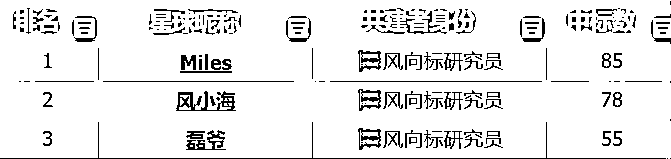

## 这个项目能赚多少？

它的特点是：

- 不需要粉丝基础，0粉也有机会产生收益；
- 每天大约投入1小时；
- 主要采用图文内容搬运；
- 收益通常在每天100—200元左右；
- 实操半个月，累计变现超过3000元。

当然，这不是保证收益，也不是暴富项目，结果会受到账号状态、内容质量、平台规则和执行数量等因素影响。

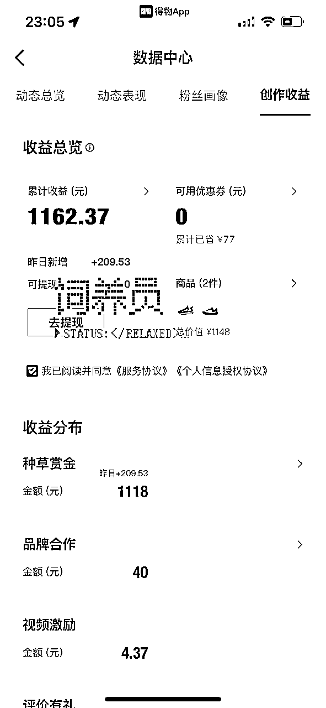

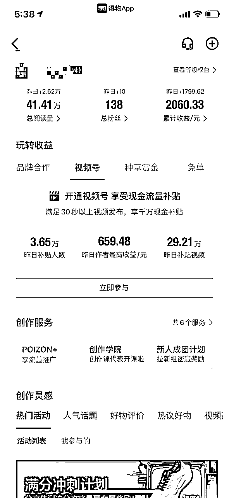

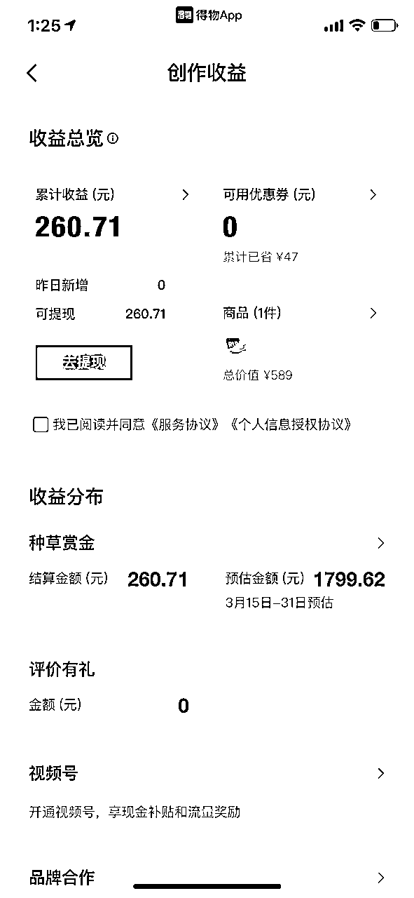

## 得物有哪些收益来源？

目前可以关注以下几类：

### 1. 视频创作激励

发布时长达到30秒以上的视频动态，平台会根据内容质量和所在赛道进行评估，一般在次日结算对应激励。

### 2. 品牌广告合作

过去通常需要100粉丝才能开通，现在的门槛有所调整：连续发布14天笔记，其中至少12篇达到500次浏览，就有机会获得开通资格。

### 3. 商品种草赏金

以前通常需要用户通过达人笔记中的链接完成购买，达人才能获得收益。现在规则发生了变化，只要商品链接产生访问量，也可能获得对应赏金，不一定非要完成成交。

### 4. 平台免单活动

得物每周都会推出免单类活动，完成发布任务后可以获得抽奖机会。

简单理解，就是通过发布内容完成任务，再参与免单抽奖。个人体验来看，平台给出的福利相对大方，目前已经抽到过5双鞋，总价值约1800元。

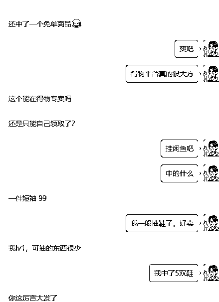

### 5. 无门槛优惠券

完成平台官方任务后，还可能领取多张无门槛优惠券，其中部分大额券的金额可以达到200元以上。

## 得物的规则并不完全透明

得物正在持续拓展社区和内容业务，相关规则仍处于不断调整阶段。

无论是视频创作激励，还是种草赏金，具体计算方式都不算公开透明。我曾多次咨询在线客服和电话客服，但对方也很难给出明确解释。平台版本更新频繁，规则变化速度甚至可能超过客服培训速度。

根据我两个账号半个多月的数据观察，收益表现大致为：

**穿搭领域＞家居领域＞数码领域＞影视解说**

而在穿搭内容中，又大致呈现：

**鞋子＞服装＞饰品**

所以，如果准备尝试，优先从穿搭类内容入手，尤其是鞋类素材。

## 具体操作方式

目前很多人靠搬运视频，获取平台的视频激励。但我实际测试后发现，视频流量波动比较明显，稳定性不够，持续执行起来也比较困难。

因此，我更建议关注商品种草赏金。

很多人觉得种草赏金单笔金额较低，但它的优势在于可以靠数量积累。现在不一定要等用户下单，只要链接产生访问，通常就可能在后续结算赏金。

相比视频，图文内容的制作速度更快。一条图文笔记可能一分钟左右就能完成。如果每天投入一个小时，持续发布一定数量的内容，整体效率会比较高。

不过必须强调，搬运内容存在平台审核和版权风险，不能把收益当成确定性结果。

## 暂时不适合做矩阵

目前得物的矩阵化操作并不方便。

网页版主要支持视频发布，无法直接发布图文笔记，也没有特别成熟的自动化方案。同时，得物账号绑定的支付宝，需要与实名身份证保持一致，提现环节也会受到限制。

再加上平台规则变化较快，批量运营的成本和风险都不低。如果后续有人找到稳定、合规的自动化方案，矩阵操作才可能更容易落地。

## 几个必须注意的问题

### 1. 收益到账时间可能变化

平台的收益发放规则已经调整过，过去可能隔天到账，现在通常会按照平台指定时间统一发放。

因此，如果第二天没有看到收益，不要立刻认为没有结算，更不要急着删除内容。有时晚一两天才会显示，删除后反而可能导致之前的收益无法保留。

### 2. 尽量避免违规

这件事一定要反复强调：不要违规。

得物的收益具有累积效应。你之前发布的内容，只要持续产生访问，后续就可能不断带来收益。即使暂时停止更新，旧内容也可能继续贡献收入。

但如果账号多次违规，尤其是达到封禁标准，即使后续申诉成功，历史内容产生收益的资格也可能被取消。这样一来，账号基本相当于重新开始，流量也可能受到影响。

我曾经有一个账号发布了1000多条动态。春节期间没有继续更新，旧内容每天仍然能带来50—100元左右的收益。后来因为一条内容违规，账号被封，赏金权益被收回。即使之后申诉成功，之前积累的大量内容也不再继续产生收益。

这说明，数量重要，但账号安全更加重要。

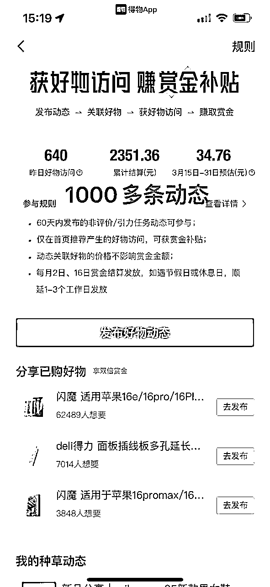

最近新开的账号，只发布了100多条动态，虽然这几天因为其他事情没有继续更新，仍然保持着每天100—200元左右的收益。

在已经出现不错数据的情况下，适当停一停，反而可以降低后续误操作导致账号受损的风险。

这个项目不能只靠蛮力。内容选择、账号维护、风险控制同样重要。真正理想的状态，是前期持续积累，后期让优质内容带来相对稳定的“睡后收益”。

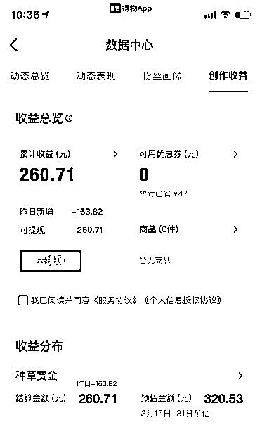

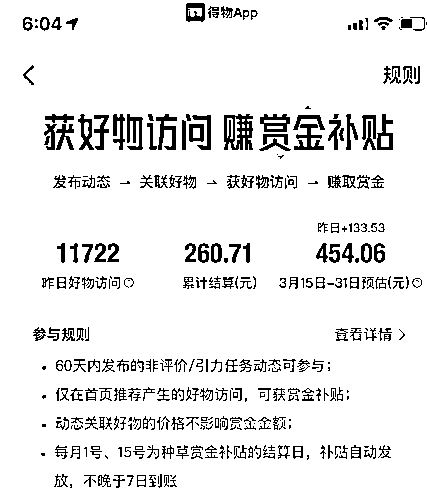

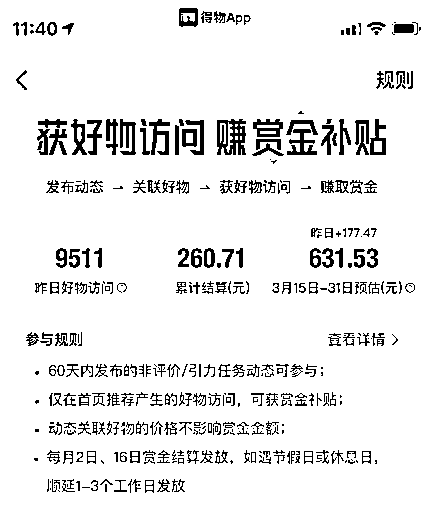

内容选择非常关键。

有些笔记发布几天后就没有动静，有些内容却会持续带来收益。比如下面这条动态，发布4天后，累计产生了52.91元收益，后续仍有继续增长的可能。

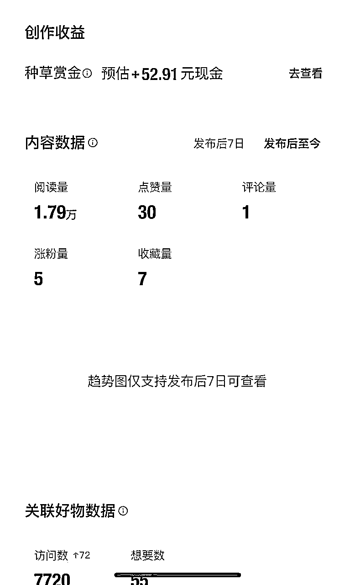

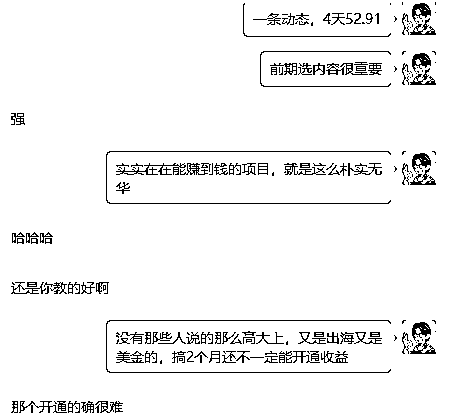

## 搬运会不会违规？

会，而且需要正视这个问题。

得物对搬运内容的审核并不轻，可能出现以下情况：

- 内容被判定为搬运；
- 笔记不再结算收益；
- 账号受到处罚；
- 严重时可能被封禁。

任何技巧都只能尽量降低风险，不可能做到百分之百安全。

既然选择搬运，就要接受它本身存在的不确定性，提前做好账号受损甚至无法继续运营的心理准备。

## 关于违规申诉

刚开始做这个项目的人，由于不了解平台审核逻辑，确实比较容易出现违规。

得物达到一定次数的违规后，可能会封禁账号并收回赏金权益。相关申诉流程和处理方法，需要结合具体违规原因判断，不能把所谓“解封教程”当成绝对有效的保障。

最重要的，仍然是从源头减少违规，避免把全部希望寄托在申诉上。

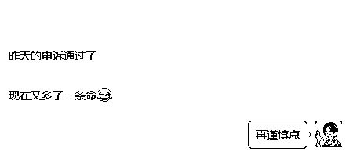

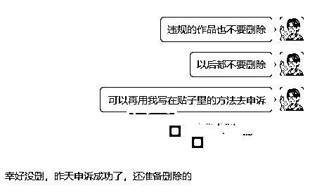

## 为什么后来不再公开项目细节？

主要有几个原因：

1. 很多问题在文章中已经写得比较清楚，但仍然会反复询问基础信息；
2. 部分人缺少经验，直接照搬操作，结果出现素材重复或账号违规；
3. 有人截取、改编文章内容，故意制造信息差，再包装成高价课程甚至“得物代运营”服务。

这类项目真正有价值的，从来不是几条简单操作步骤，而是执行过程中的判断、筛选和风险意识。

截至目前，已经有不少圈友参与尝试，也有人通过这个项目赚回了赚钱门票。但任何项目都需要自己判断，不应该因为他人的案例就盲目投入。

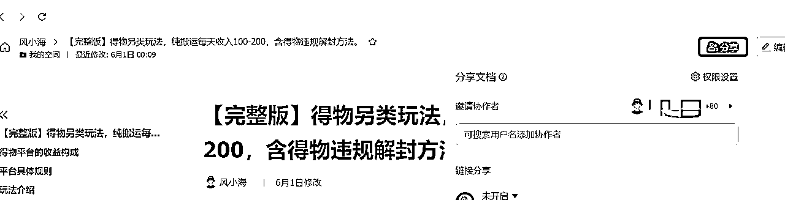

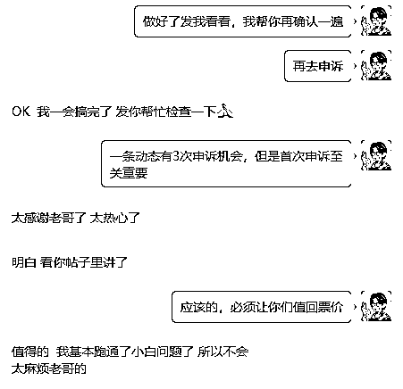

所谓“解封方法”本身，并不应该被包装成高价神秘课程。网上有人利用信息差售卖相关内容，甚至开出几百上千元的价格，大家需要保持警惕。

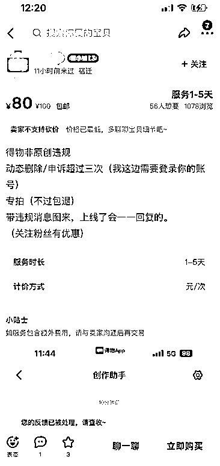

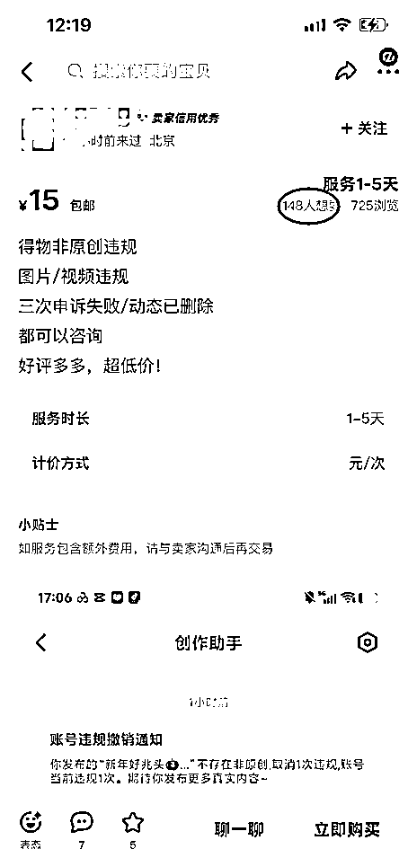

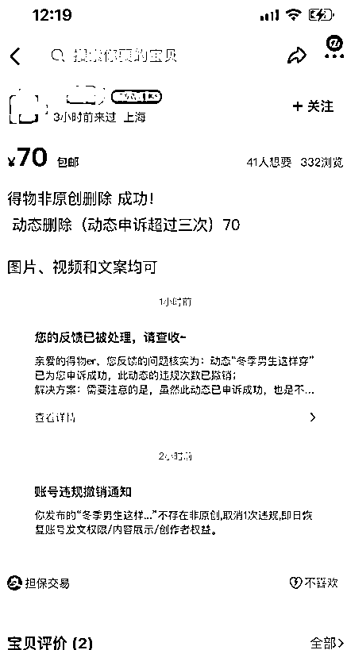

## 给新手的一点建议

很多人刚加入一个赚钱社群时，容易被“白手起家、年入百万”这类内容刺激，短时间内热血沸腾，觉得自己马上也能做到。

但真正执行时才会发现，很多项目门槛并不低，周期也比较长。没有正反馈，很容易陷入焦虑、自我怀疑，随后继续寻找下一篇“爽文”。

以我参与过的项目来看，YouTube分成、AI相关项目等，长期空间和成长性可能都比得物赏金更好。但它们距离实际收入往往更远，例如YouTube可能需要较长时间才能开通收益权限，新手未必能坚持到那一步。

得物项目的优势，不是天花板高，而是启动简单、反馈相对快。对于刚入门的人来说，先通过一个低门槛项目赚到第一笔钱，建立行动信心，也许比一开始就挑战高难度项目更重要。

## 运营心态

### 1. 选择搬运，就要接受风险

搬运不存在绝对安全的方案，要有账号可能被处理的预期。

### 2. 把它当作轻量项目

它更适合利用碎片化时间操作，不建议投入过多资金和精力，也不要把它当成长期事业。

### 3. 不要过度追求涨粉和广告

得物涨粉速度相对慢，广告门槛调整后，新账号也未必能快速获得高质量商单。部分广告的单价只有10—20元，制作过程还比较繁琐，实际性价比未必比种草赏金高。

### 4. 规则会变，行动要快

平台规则随时可能调整，确定要尝试，就尽快小规模测试，不要长期停留在观望阶段。

### 5. 不要因单笔收益低而放弃

大多数内容可能只带来几分钱、几毛钱，偶尔出现爆款，才可能产生10—30元甚至更高的收益。

单条内容的价值不一定高，但内容数量积累起来后，整体收益才会逐渐体现。

### 6. 可以准备多个账号，但要控制风险

如果条件允许，可以准备几个账号，并记录每个账号对应的参考账号和素材来源。

前期可以保持稳定更新，等积累了一定数量的内容后，逐步减少投入时间，让旧内容继续产生收益。

不过，这个项目成长性有限，能够带来的主要是实际到账，而不是系统性能力提升，因此不建议长期沉迷。

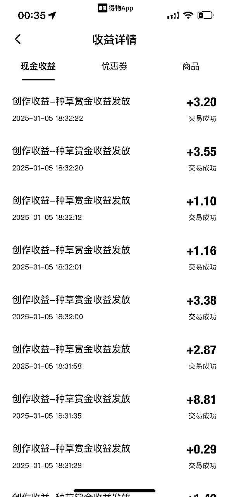

## 最后总结

得物种草赏金并不是什么高科技项目，也不太可能让人一夜暴富。

它的优点是门槛较低、操作简单、反馈较快；缺点是平台规则变化频繁，搬运存在违规风险，收益上限也比较有限。

如果把预期放低，用较少时间进行测试，通过持续发布和内容积累，慢慢形成一些旧内容收益，那么它可以成为新手接触网赚、赚到第一笔钱的起点。

这个项目的核心，不是一次性赚很多，而是用较低成本试错，再通过内容数量的积累，逐步形成被动收益。

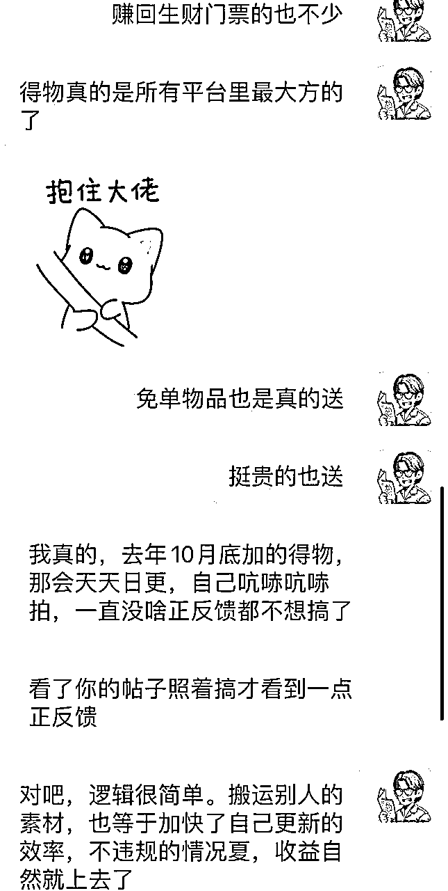

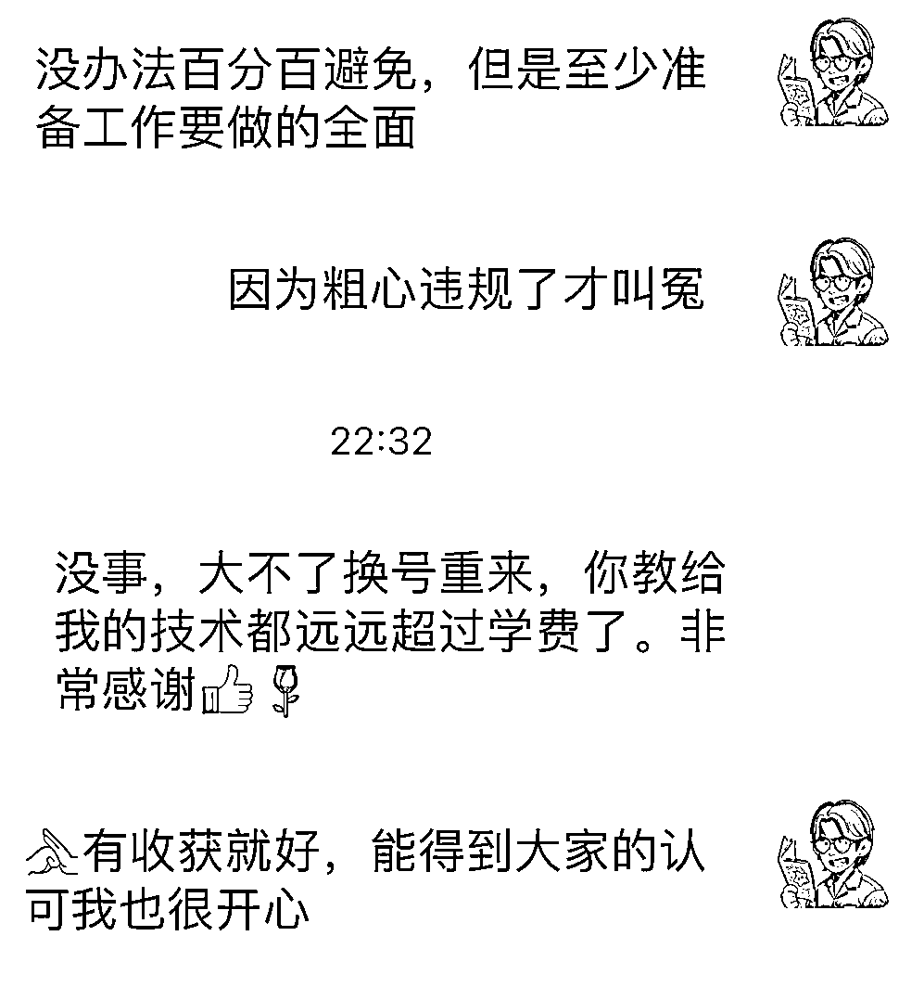

## 写在最后

很多事情并没有想象中那么神秘。

第一，先给项目“祛魅”。再复杂的工作，也往往是由大量简单动作组合起来的。

第二，不要盲目崇拜所谓的大佬。你看到的，通常只是别人愿意展示的一部分。面对爽文式案例，要保持自己的判断。

第三，不要因为暂时不懂就否定自己。人与人之间的差距，很多时候只是接触时间和实践机会不同。

第四，厉害的人也只是普通人。每个人每天都只有24小时，真正的差距往往来自长期选择和持续执行。

第五，遇到不顺时换一个角度看问题。把一手普通的牌打好，往往比拿着好牌却不断犹豫更重要。

如果你只是想尝试一个低门槛、快反馈的小项目，可以把得物当作一次测试。但请务必记住：控制投入、遵守规则、降低预期，并为可能出现的变化做好准备。

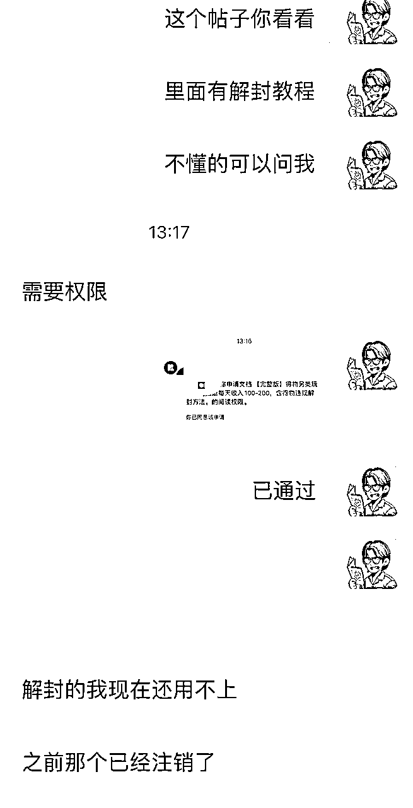

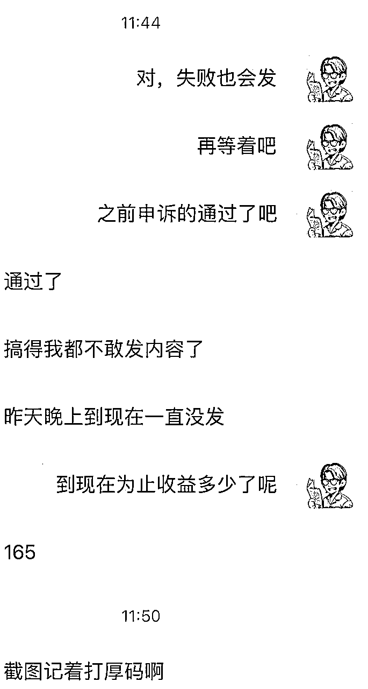

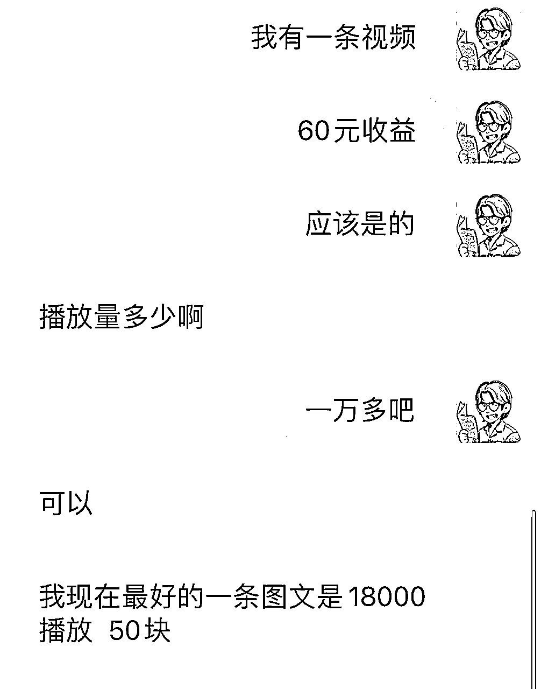

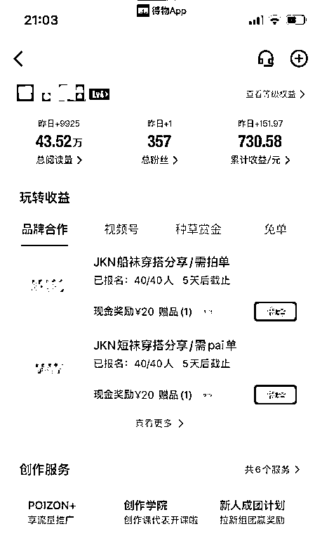

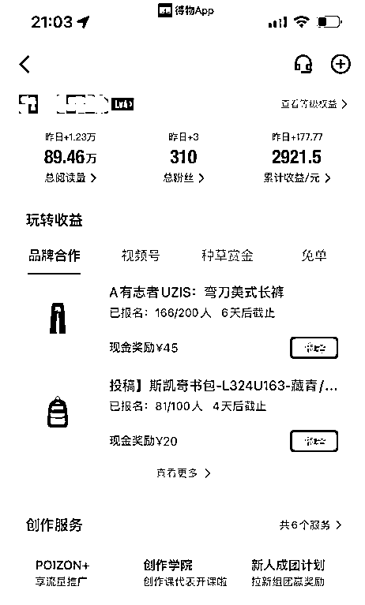

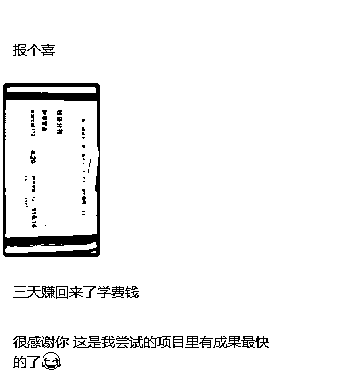

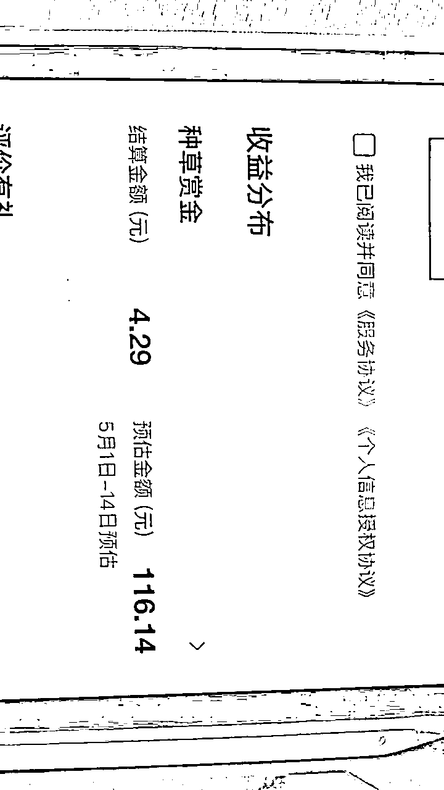

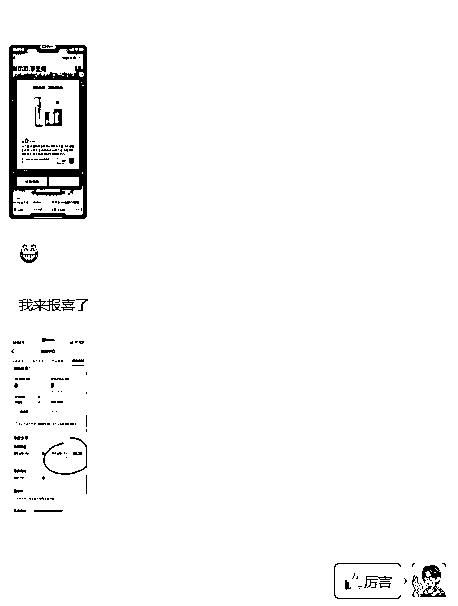

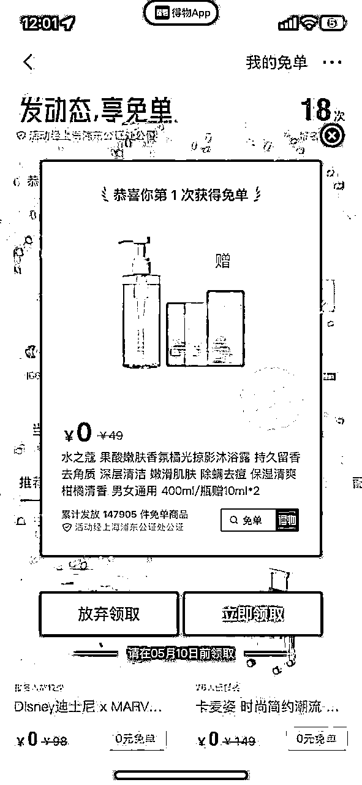

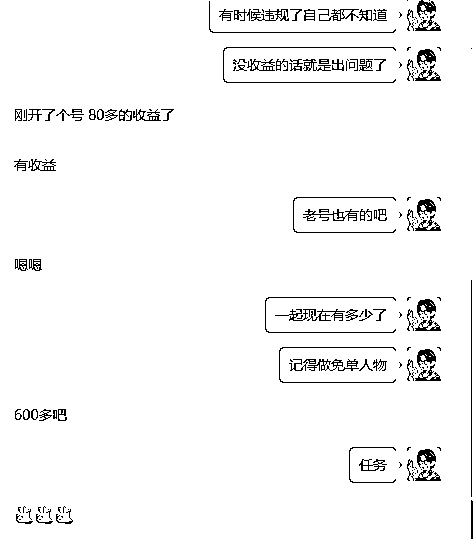