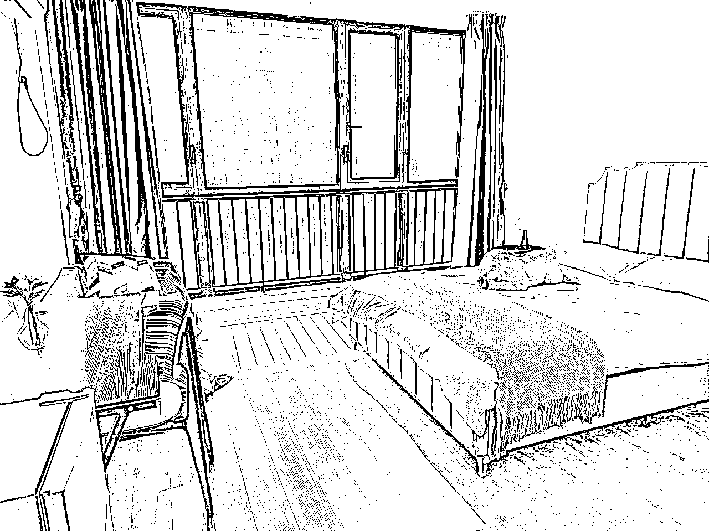
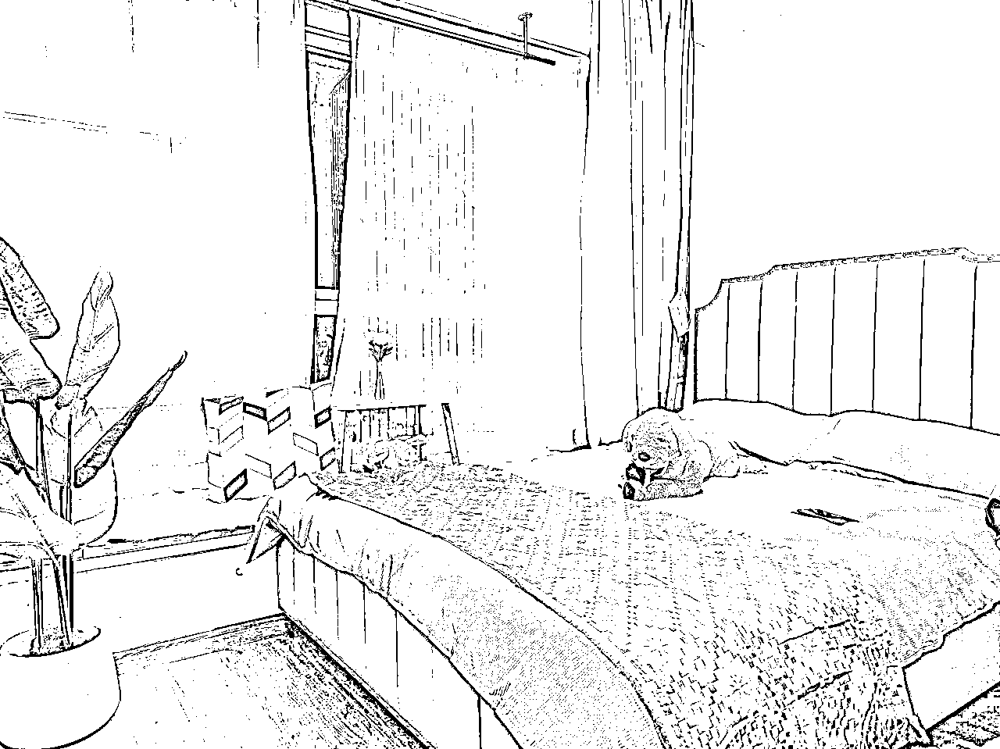

# 00后二房东在杭州：从0到1的全流程避坑指南
作者：龙哥

> 不是标题党，是真实跑出来的经验。

大家好，我是龙哥。昨天跟着有尔姐去赚钱总部“朝圣”了一趟，回来就忍不住想把这几年做二房东的实战经验分享出来。先交代下背景：我是00后，大学来杭州实习时，偶然发现自家亲戚做二房东十多年，收益相当可观。于是我也一脚踩进这个行业，一路摸索、交学费，现在和团队一起朝着千万目标冲。

很多人都觉得，二房东不就是转租赚差价嘛，有啥难的？可真干起来才发现，这里面的水太深了。你要懂市场、懂租客、懂成本，还要会跟房东和租客周旋。从找房源、谈价格，到装修、运营，每一步都是算账，一步没算好，利润就溜走了。关系处理得好，三方都舒服；处理不好，天天都是纠纷。

下面我就按自己摸爬滚打的节奏，把这几年最核心的干货全盘托出。

## 一、找房源：线上线下两手抓

“巧妇难为无米之炊”，没有房源，一切免谈。找房不能靠撞大运，得有策略。

线上方面，我玩得比较溜的有三招：

1. **传统电话打法**：新楼盘一交付，马上想办法搞到业主信息，打电话过去礼貌自荐，说清楚自己是专业二房东，能帮他们省去招租麻烦、维护房屋、稳定收租。语气要热情，被挂了也别灰心，换个角度继续聊。
2. **打造个人IP**：现在都看线上形象，我在抖音、📕发房屋托管知识、改造前后对比、租客日常，经常互动答疑，慢慢就有业主主动来咨询了。
3. **混社群**：加各种业主群、租房群、小区超市群，先潜水观察，等时机成熟再分享点专业见解，比如怎么定价、怎么选租客，展示实力，让业主自己找上门。

线下也有几条路：

- **物业合作**：物业消息最灵通，主动去拜访，送上合作方案，介绍成单给感谢费，平时多联络感情。
- **异业合作**：保安、超市老板、饭店老板都是人脉节点。跟保安递根烟，让他在业主聊出租时帮忙牵线；在超市、饭店贴海报，有人咨询就给老板提成。
- **贴广告**：设计突出“专业托管、一站式服务”的海报，配上实景图，贴在小区公告栏、楼道口、地铁口，记得合规，定期维护。

另外，房展会、新盘交付现场、社区活动也都是发资料、收线索的好机会。

## 二、跟房东谈判：这几个坑别踩

- **价格**：核心是利润空间。房租差价至少要留出30%的利润。比如周边月租6000，就得按8000-9000的出租目标去倒推。谈判前要像侦探一样去摸周边租金和房源优势，拿出一套合理的盈利方案，让房东觉得跟你合作能赚更多，而且明白你为什么这么定价。
- **租期**：不能一刀切。新房拿过来就能租，签三年差不多；老破小要花大成本改造，回本慢，五年甚至更久才合适。要跟房东摆事实讲道理，达成双方都能接受的期限。
- **装修期**：新房改动少，一个月搞定；老房翻新量大，至少要三个月。合同里必须写清起止时间，让房东知道你的改造计划，免得以后扯皮。
- **空置期**：行规是一年免一个月，只付11个月租金。这既是给换租客留时间，也是给自己留经营缓冲。要把这个道理跟房东讲透，让他心服口服。
- **改造事宜**：想做“n+1”隔断来提升租金，就必须提前跟房东沟通。准备好详细方案，包括结构、功能区、风格，承诺按规定施工，获得房东和物业的认可后再动工。

以上几点都谈拢、签好合同，之后才能省心。

## 三、进场改造：别急着动工

先去看竞品。同小区里同行怎么装的、什么风格、配套如何，都要摸透。多看看网上那些高人气房源，学学空间优化和风格搭配。再结合自家房子的特点，定出最优改造路线。

接着做空间规划：整租还是隔断？整租要看朝向、采光和租客习惯，定风格、选家具。隔断要根据总面积算房间数和卫生间数，在私密性和利用率之间找平衡，必要时加个小厨房。

然后定风格、控成本。采光好就做清新奶油风，空间大就上轻奢风；还要看目标租客的年龄和需求。家具批量采购更便宜，但质量要把关，实用美观都要有，浅色家具慎选。

最后是定价。一是看经验，二是盯市场供需变化。初期租金“就高不就低”，留点降价空间。

## 四、招租：线上下齐发力

**线下传统玩法：**

自己直接招租，能第一时间了解租客需求，精准匹配。但中介手里客源广，一定要跟他们搞好关系。平时请吃饭喝茶、聊聊行情，让中介把你的房子放在推荐列表的前面。

佣金策略要有弹性：旺季给半个月租金，淡季给一个月租金，重赏之下必有勇夫，保证房源不空窗。

别忘了小区门口的大妈们，她们是社区里的“消息树”，谁家要找房她们门儿清。单笔佣金不高，但胜在量大。跟她们提一句，房子信息很快就能传遍整个小区。

快递站、超市、饭店、保安也都是流量入口。快递站贴海报，超市饭店放传单，保安帮你留意进出的人，潜客可能就这么发现了。

**线上流量打法：**

抖音、📕、视频号、快手这些平台，人流量巨大。拍个房子全景视频配个BGM就能发，有条件就真人出镜解说，再剪一下效果更好。说实话真人出镜更容易做成个人IP，就是太累，做久了会灵感枯竭。

贝壳、58、安居客这些专业端口呢，来的客户目的性强、精准度高，但客单价相对低，客户认知也比较有限。

## 五、租客管理：售后决定口碑

同行在售后上的差距真的巨大。有人把租客需求当回事，说加个小冰箱小沙发，马上就给办；有人却消息几天不回，只有收租时才冒泡。

“种瓜得瓜，种豆得豆”，你用心不用心，租客心里都有杆秤。

售后态度直接影响续租率和转介绍率。每个租客都是城市里的星星之火，把售后做好了，他们一句话能给你带来好多个客户，而且这些客户特别好成交。

想提升售后质量，记住这三点：

1. **选人用人**：一个好的员工就是售后的金字招牌。他得会做事、会贴心服务。当然，待遇也要有吸引力，让员工觉得付出值得，团队才稳得住。
2. **用专业软件**：比如全房通、寓小二，界面简单，能记录租客入住时间、租期、租金，还能设置到期提醒，避免漏收。房源管理、租客沟通、财务结算一站式搞定，规模大了特别省心。
3. **增值服务**：节假日送点小礼物，组织租客活动，让租客有归属感。对长租客定期提供免费深度清洁，看似小事，却能攒下口碑，促进续租和转介绍。

## 六、案例复盘：有甜头也有教训

先晒几套运营得不错的房源：

软装做好后，整个房子的出租率提升非常明显。

再说说买车买来的教训。口罩之前，我在余杭五常做过一家集中式酒店，最后赔了四百多万。复盘一下，主要原因有三个：

1. 选址失误，周边交通不便，生活配套差，租客住着不方便。
2. 口罩一来，空房率飙升，资金链断裂，入不敷出。
3. 获客能力弱，线上没宣传，线下不主动，就坐在店里等客来，生意越做越惨。

最后只能撤场，装修款都没赚回来。这学费，是真贵。

## 七、当下的市场与未来

现在的杭州，大厂裁员一波接一波，二房东行业卷得不行。装修越做越好，租金越压越低。租客预算变谨慎，市场价格波动大，但也有人才流动带来的新机会——承接大厂人才流入的区域，很可能成为下一个热点。做二房东要提前布局，抢先拿下好房源。

而且大环境再冷，租客对居住品质的要求也没降。所以装修、配套、服务都要升级，把售后做实，才能留得住人、传得出口碑。

## 八、最后想说

不管你是已经在行业里的老手，还是刚想入局的小白，希望这篇文章能给你一点参考。

对老手来说，可能帮你更清晰地看清行业背后的逻辑，以后找房、定价、选房源都更有数。

对小白来说，这就是一份二房东新手村攻略。从前期调研、找地段，到跟房东租客建立信任，再到控成本、应对风险、持续迭代，能帮你少走不少弯路，避开我当年踩过的那些坑。