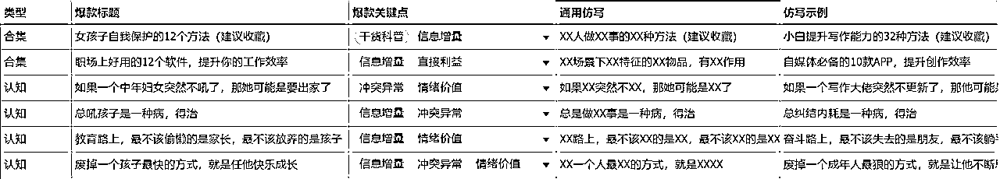
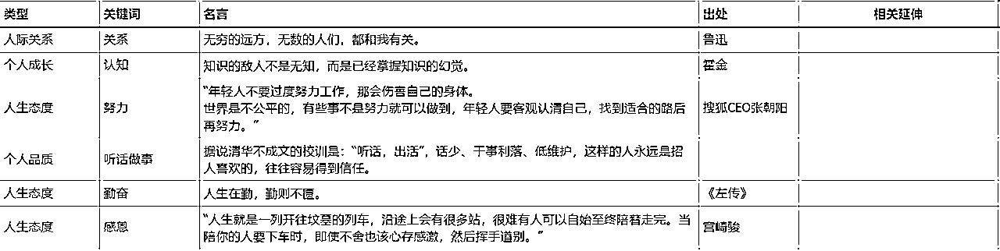
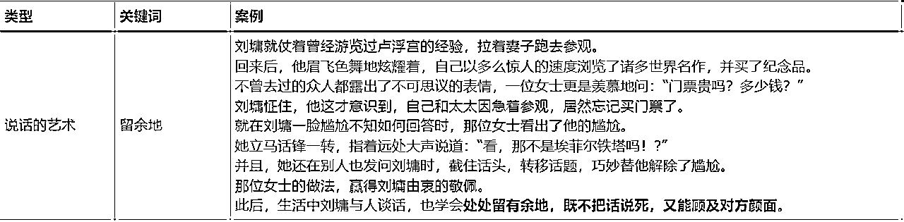
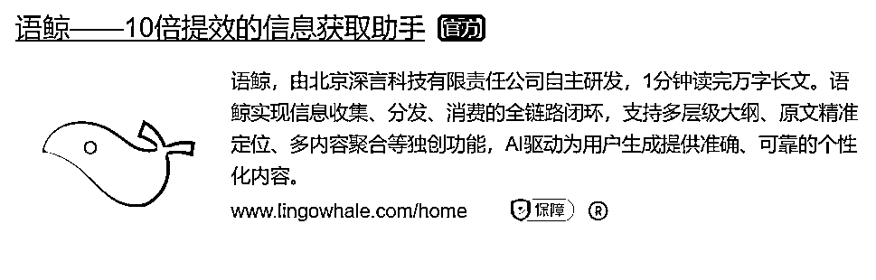

# 半年公众号实战：从爆款流量到IP沉淀，我是如何逐步把内容质感做起来的

> 来源：[https://yxy2hhcyyby.feishu.cn/docx/X2kKdFLuToEOKixhkWlcZVQAnLb](https://yxy2hhcyyby.feishu.cn/docx/X2kKdFLuToEOKixhkWlcZVQAnLb)

生财圈的伙伴们好。

我是开卷，985毕业的写作硕士，六年商业文案经验，现在是生财二期学员。很高兴又在公众号这条线上和大家碰面。

从2024年6月底开始试水公众号爆文，到现在，手头的几个爆文号已经跑出比较稳定的节奏，IP号也在起势。累计涨粉超过2万，变现过5位数，单篇最高收益6000+，单日最好2700+，IP号日均涨粉百来个，私域每天都有进流，11月航海期间靠分销也完成了转化。

之前我整理过一篇复盘：《公众号新手首次航海打出百万阅读，单篇6000+，单号变现五位数，手写也能爆，AI辅助手写也能爆，我做了哪些事》。那是7月对航海期写作流程的总结，后来不少圈友反馈照着做也有效果。

8月我琢磨怎么把0到1放大，9月航海撞上小绿书热度，尝到甜头。10月参加了@梁靠谱发起的公众号暴走计划，正式启动IP号。11月中旬又开启了新一轮航海。

2024年下半年基本把精力全押在公众号上，其他平台和项目都停了。

这半年连续打了三期航海，成活了几个号，也废了几个号，并把爆文号的打法逐步迁移到IP号。越做越确认一件事：公众号值得长期投入。

2025年我仍会聚焦公众号写作，告别短线游击，往擅长的垂类深耕，让账号在产出量和单篇质量上都更稳。

下面结合半年来的实践、思考和卡点，把从爆文到IP的思路梳理出来，给想做内容、想提升写作的朋友作参考。因篇幅较大，分上下两篇。

上篇讲实操方法论，解决“怎么做”的问题；下篇讲心态与取舍，解决“要不要”的纠结。

目录速览：

上篇：实操技巧
1. 选题靠重叠区，重复即价值
2. 标题靠重组玩法，强数据叠加
3. 熟悉四种骨架，文章自己长出来
4. 开头五种套路，留住读者的黄金前段
5. 结尾高能量输出，点赞转发评论一起收
6. 金句做情绪阀门，两招拉满张力
7. 修改稿点石成金，四类难题一次性解决
8. 账号收益看运营，黄金组合缺一不可
9. 素材库当百宝囊，用对就是精准命中
10. 其他小技巧补充

下篇：内容心法 抗焦虑版
1. 是否使用AI？
2. 是否依赖数据工具？
3. 是否需要大量研究写作？
4. 是否换项目？
5. 是否换赛道？
6. 是否设定目标与计划？
7. 是否迎合受众？
8. 是否坚持做自己？
9. 是否抱团共进？
10. 是否追求全面发展？

# 上篇：实操技巧 纯干货

以下是我实操验证过的方法，建议先过一遍《公众号爆文航海手册》再看，否则信息密度偏高。

8月尝试放大的方向后，我最终回到以手写为主的节奏，所以不涉及AI批量起号；10月后不再追热点写什么火写什么，而是扎根几个确定方向，所以下面内容更偏向质感提升与效率优化。未特别说明的点，爆文号与IP号均可通用。

先说个有点玄的点：起号。

我经历过起量快的号，也见过像沉睡火山一样无声的号。现在我基本不纠结起号了，尤其做爆文拿流量主时。

大家说的起号本质是赛道选择与定位。我的经验是，做流量主时，新号先同时测三条线，跑出来哪条就主攻哪条。因为某个赛道当期可能怎么写都不推，测太多线会让标签混乱，系统分不清推送对象。

我曾有一个号，流量起来后贪心一天多篇多赛道，很快就废了。转线时建议小步试水，别一口气上五六个赛道盲测。

如果你做IP，像我一样从零起步，有可分销产品但定位还不深，也建议先把方向收窄到三条来测。我做IP时不确定怎么写，就选了阅读、写作、变现三个方向。

方向是怎么定的？

阅读。因为它能为任何赛道打底，我有方法论沉淀，也了解阅读类IP的打法，爆文号里阅读类爆文不少，写作和变现门槛相对低。对我而言是成本最低的切口，但头部集中，需要强信任和产品支撑。

写作。这是我想深耕的赛道，我在商业文案、微头条、小红书、公众号爆文都有成绩，想把定位延伸到自媒体相关业务。爆文量不算多，但粉丝粘性高，和当下能力匹配，自销分销都行。

变现。这是多平台需求都很强的赛道，小红书素材储备也足。但这条线我早期做爆文失败过三次，信心最弱，主要变现靠分销。

最后跑出来的是第三条，下篇“是否换方向”会补充当时为何不行、后来为何行得通。

分享这个案例的目的是提醒大家精细化运营时，每个方向心里要有数：一是做好预期管理，二是跑出来后能精准加码。对没做过自媒体独立变现的人，这也意味着提前想好变现闭环。

爆文流量主同理，不涉及产品，但要清楚这个号在满足哪类人群的哪类需求。

另外，选方向的前提是能持续供给内容。

IP感强或赛道明确的朋友可跳过这部分，直接往下看。

## 选题靠重叠区，重复本身就是价值

新手建议先看爆文航海手册找对标。选题和对标是互补的，我这里讲的是在锁定对标账号后，如何解决起步期的首批选题。

### 重叠区的执行流程

以职场为例：

1. 挑三个职场方向的对标号，记作A、B、C。
2. 用能导出标题的工具把A、B、C的标题导出来。
3. 集中时间粗看，标记高频出现的问题，比如“出现这三种情况就该考虑离职了”。
4. 三个号里都出现的标题放进选题表，至少凑够30个。注意同义替换、语序调换算同一题。
5. 不够30个，可扩到五个对标号，取出现三次以上的标题；也可以用“职场人际”“加薪/离职”等关键词，在工具里搜近一年高频标题补充。
6. 把30个选题按十篇一组或七篇一组排期。

建议把共鸣最强、印象最深的选题放第一组，写起来吃力需补资料的放最后。先写最想写、最能驾驭的，能减少素材不足对效果的干扰。后面资料有时间补，万一最后几篇没水花，放弃也不亏。

此方法对爆文号和IP号都适用，是我先在爆文号验证、后在IP号复用的手段之一。

### 重叠区的本质

爆款是会重复的。想做爆款，就得接受同一个题会被多人写来分流，也会被同一作者反复写来再分一波流量。不同作者之间的交集、同一作者不同时期的文章交集，都有效。

我早期用数据网站和直接模仿，总觉得差精准度和方向感，后来用重叠区，少走很多弯路，选题浪费也减少了。

还有个“榨干”的小技巧：文章出小爆款甚至大爆款后，去后台推荐诊断看一眼，若推荐曝光超90%，这个题大概率还能再写一次，或做微创新再写一次。很多博主反复写一个主题就是这样来的。

微创新怎么玩？看标题。

## 好标题靠重组，好数据抱团走

6月航海复盘里我提过，不知好标题长啥样时，可先借用一些经典标题，比如《一个普通女孩的十年》《有些人，撑不到天亮了》《稻盛和夫：人的成长，始于三次觉醒》。

但只会照抄会很窄。这个时候可试微创新，即旧元素的重新组合，我称之为：

### 乾坤挪位

用几个个人IP领域的爆款做示范：

爆款1：一定要大量输出：你不是文笔差，而是不知道这4个网站

关键词是输出、文笔、网站，针对想提升写作的人。

变形写法：
一定要大量输出：你不是文笔差，而是不知道这4个APP
一定要大量输出：你不是文笔差，而是不知道这4个写作方法
这是换解法，同一人群同一问题不同解。

再换：
一定要大量输出：你不是写不出来，而是不知道这4个素材网站
一定要大量输出：你不是写不出来，而是不知道这4个写作方法
这是换痛点，同一人群不同问题相似解法。

再换：
一定要大量阅读：你不是读书慢，而是不知道这4个阅读方法
一定要大量赚钱：你不是没资源，而是不知道这4个搞钱信息差
这是换赛道。拆开看套路就是：
一定要大量XX：你不是XXX，而不是不知道这X个XXXX
接下来就是填空。

爆款2：下班后死磕这3个副业，就算裁员也不怕！

关键词是下班后、副业、裁员，针对上班族。

变形：
下班后死磕这3个技能，就算裁员也不怕！
下班后死磕这3个风口，就算裁员也不怕！
换解法。

宝妈死磕这3个技能，就算裁员也不怕！
下班后死磕这3个风口，就算裸辞也不怕！
换人群。

恋爱脑死磕这3个技能，就算分手也不怕！
大学生死磕这3套话术，就算套话也不怕！
换赛道。套路拆开是：
XX死磕这3个XX，就算XXX也不怕！
也是填空。

熟练后，看到的爆款基本都能重组。有些标题拆不了，就在套路库里结合内容增减元素。

比如：
原标题：人一定要刻意研究赚钱
变形后：大学生/宝妈/小镇做题家……一定要刻意研究赚钱
尤其做人群精准账号，把别人的人群换成自己锁定的，只要自洽就行。

先拆解清楚再灵活用。重组不等于对标10W+就能变10W+，只是比干巴巴或自嗨的标题更利于被系统识别，从而拿到推荐。

比如教沟通的内容，《今天见到了一个不会说话的大学生》和《大学生死磕这3套话术，就算套话也不怕！》，后者被推的概率更高。别笑，真的很多咨询师还在用第一种标题。

还没完。遇到大而化之拆不了的标题怎么办？细拆内容。

### 旧瓶装新酒

看到泛泛的标题，要在拆解基础上做联想，尤其是往认知和转化方向联想。

我自己的三个案例：

爆款1：《发财，就是每天循环这5个动作》
对标写法：5种赚钱认知/习惯/思维，纯干货赚流量主。
我写法：销售成交的5步框架，配上带二维码的产品海报，粉丝2K左右阅读就破千。

爆款2：《一个人就能闷声发大财的高利润生意》
对标写法：揭秘小众高利润生意，解析思路，赚流量主或转搞钱群。
我写法：拆解生财大师姐年入千万的关键点，用粉丝能接受的方式呈现，评论区置顶引导看《发财，就是每天循环这5个动作》，没硬插海报也能让感兴趣的人看到产品，阅读3.2W，转发近千。

爆款3：《想赚大钱，你得有人带，有人帮》
对标写法：贵人重要性，搞钱认知+人情世故，赚流量主或转社群。
我写法：写生财圈友做副业时被贵人帮助、做出成绩后又成为他人贵人的故事，评论区放福利引导到私域做项目。阅读1.3W，转发800+，带来几十个咨询。

我知道这三篇直接写硬广数据不会好看，所以结合产品和成交路径赋予爆款标题新含义，可理解为演绎思维+逆向思维的结合，做成软广。

多想想爆款标题跟你的业务有什么关系，用半推半就的方式写，往往能拿到更多流量，这是以前给品牌写软广常用的打法。

类似操作还有，关系类选题“不要高估你和任何人的关系”可以写成人情世故认知，最后转情商课；成长类选题“不要再搞和生存无关的个人提升”可以写成长认知，最后转搞钱项目或赚钱技能课。玩法要结合自身领域琢磨。

## 四种骨架搞定，文章自己会长大

胸有成竹，文章的七成功劳在骨架。

在我这里，有了积累后，选题一确定，文章完成度就80%了。因为骨架定了，观点和素材就知道放哪，只剩下落字和润色。

这四种是我做公众号最常用的，基本能覆盖80%以上常见文章：

### 情景冲突疑问解答结构

源自《金字塔原理》。

情境：交代背景，如职场内卷
冲突：明确焦点，如无效加班、形式主义
疑问：探究原因，如制度、环境压力、认知
解答：给出观点或解法

做爆文收益时很适合分析社会事件，热点文、观点文常用，也是大号常用结构。

IP号里它是典型的解决-转化套路。比如做沟通教练：
情境：婆媳矛盾
冲突：两代人思维和生活习惯差异
疑问：暴力沟通、情绪化表达、难换位思考
解答：一个沟通策略+一套沟通课

开头有场景，中间有获得感，结尾有救命感，成交更顺。

### 三明治结构

即总分总。实际写作里有很多变体，有纯观点、有观点+故事、有创意内容。信息越丰富、排布越清晰，这份三明治越好吃。它覆盖面很广。

我用三明治这个名字是想提醒你：看到喜欢的总分总形式，可以把写作模板记下来，下次直接套用，也是让文章自己长大的好方法。

### 爬楼梯结构

指层层深入的说理或升级打怪的故事。

观点文中递进式很常见，说理逐层深入让人越看越爽，适合热点深度剖析。

故事文中常见的是一个又一个问题被解决，最终达成目标，适合IP出道文和成长故事。

起点终点明确，中间楼梯要衔接合理，才能让人顺着爬上去。

比如观点文：
事件是什么——主要矛盾是什么——矛盾为何激烈——激化后果——引导思考

故事文：
主角原状态——想要什么——得到后发现什么、更想要什么——都得到后生活变化——当下状态

### 拼盘结构

素材丰富、信息密度大、逻辑不强但不凌乱。常见的是盘点、清单、热点、合集。

想写“大而全”内容时，可以用时间/空间/类型/风格等关键词串联。

比如：
IP出道文《一个普通女孩的十年》
干货合集《布局2025：普通女生的顶级自律清单》
图片合集《看！这就是武汉！》
专题合集《请回答1993，中国文艺伤心往事》

某一类人或事本身就有情绪张力，直接用合适方式串联，也能有不错效果。

## 开头五种套路，留住用户

开头写好，读者才会跟着走下去。很多完读率低的文章，就是标题吸进来，开头没进入正题就划走了。

下面是我写作时最常用的五种开头：

做公众号半年，我最大的体会是：爆款不是玄学，而是一套能拆解、能复用的“技术”。这篇文章不聊虚的，把我在开头、结尾、金句、改稿、运营、素材库和日常练习上的压箱底方法，一次讲透。

### 一、开头要抓人，五种方式够用了

读者愿不愿意继续读，前几行字就定了。我常用的开场有五种。

**1. 戳痛点**
让人瞬间觉得“你懂我”。职场人怕加班、怕内卷、怕被裁；宝妈愁时间管理、身材恢复、辅导作业；中年人一边扛着收入瓶颈，一边应付家庭矛盾，身心俱疲。痛点文章天然有代入感，能快速吸引精准人群。想写这类开头，平时就得多积累爆文里反复出现的痛点。

**2. 蹭话题**
人天生爱凑热闹。把微博热门提问、知乎高赞回答直接拿来做开头，对不熟悉的人来说，是信息增量也是情绪增量；对熟悉的人来说，深入分析还会带来思考和互动。比如“你最焦虑的是什么”这种问题，短平快，特别符合新媒体阅读习惯。

**3. 造场景**
用画面感把人拉进来。个人IP文章可以从“昨天跟闺蜜去看《好东西》”这种日常场景切入；人物稿可以直接把人放在冲突环境里；观点文也可以用有画面感的场景开头。这种开场像电影镜头，读者很容易沉浸下去。

**4. 借金句**
名人自带流量，金句自带观点。用“某某说”开头，能快速点燃情绪，也能顺势带出主题。读书、情感、认知类内容里，这种手法几乎是标配。

**5. 玩悬念**
悬念不一定吓人，关键是冲突和反转。比如那篇《都挺好》的爆文，开头用正反对比快速抛出“最吊诡的事”，读者出于好奇就会一路读下去。

### 二、结尾要留人，六种收束任你选

开头决定读者是否点开，结尾决定读者是否愿意转发。写结尾时要带着目标选：你到底想让读者做什么？

**1. 互动式**
适合有争议的话题。用“你更支持谁”“你有什么看法”这类问句收尾，能激发评论区讨论。

**2. 呼吁式**
面对负面消息或待解决的问题，结尾把视角拉高。比如《小小的我》的影评，最后落脚到关注边缘群体，号召大家把目光投向真实的人群。正能量的呼吁容易引发共鸣，转发率通常不低。

**3. 祝愿式**
情感文、故事文、鸡汤文里，如果写的是从苦难走向新生，结尾就顺势送上美好期待。读者被安抚了，自然愿意转发给亲朋好友，一起求个好彩头。

**4. 升华式**
观点文经过层层论证后，结尾再拔高一层，给出一个更理想的境界。读者会有“醍醐灌顶”的收获感，点赞和转发都更果断。

**5. 金句式**
一句值得划线的金句收尾，既让文章余味悠长，也方便读者复制到评论区。如果你写中了大家的心声，评论量自然会涨。

**6. 悬念式**
热点事件走向不明时，可以在结尾抛个悬念，留下猜测和讨论空间。剧情走向、舆论反转，都是很好的悬念素材。

### 三、金句是文章的“情绪开关”

金句的魅力，一在蓄力，二在情绪。它把大量信息、情绪和共识浓缩进一句话，出口就有力量。使用金句无非两种方式：引用和化用。

引用是拿来增强说服力的。心理学家的观点、家庭教育里的古语、商业领袖的判断，都可以直接用。尤其要优先选用那些已经在爆文中出现的金句，被反复划线的句子，说明已经被市场验证过能引发共鸣。平时刷小红书，看到互动量高的句子就随手存下来，这也是一个很灵的金句采集法。

化用则能让观点更容易被接受。顺着原句延伸是正向化用；反向解构则适合吐槽或搞笑文风。想自创金句，平时要对高共鸣句子多做联想和改造，善用修辞，刻意练习。我自己很常用的一个方法是“改写广告语”——广告本身就是传播性极强的话术，网友的二次创作也能带来很多灵感。

### 四、改稿不靠天赋，靠这四招

我刚开始用AI辅助写作时，总觉得机器出稿没人味。后来才意识到，问题不在提示词，而在于改稿逻辑。所有不满意，基本都能归为“乱、水、平、僵”四个字。

**结构乱，就改骨架。** AI在结构上通常不会出大错，反而是手写长文容易天马行空。有些人套用爆文标题却起不了量，往往是爆文层层递进，他改成了平铺直叙，主线丢了。把内容的先后顺序拉直，读者就不至于“云里雾里”。

**措辞水，就改表达。** AI味通常来自满口书面语和假大空，就像朋友突然给你念一份乡镇五年规划。还有一种情况叫“表达降级”：对标的是高考作文甚至深度长文，产出的却是小学作文，好比巴菲特在谈人生经验，你只会背九九乘法表。深度文章的潜台词和热梗，AI和普通写手都容易理解浅了。对策是尽量用凝练的词，一个共识性概念就是一个标签，比如“情绪价值”“认知升级”，别再用一堆解释稀释它。

**节奏平，就改起伏。** 好的文章像心电图，要有高点和低谷。官方报道看得人头疼，就是因为一条直线。无论是古人的起承转合，还是西方的英雄之旅，核心都是让读者有心理波动。AI写稿尤其容易一直平静如水，或者一直张牙舞爪，指令里不强调节奏，它就不会像人一样呼吸。

**情绪僵，就改状态。** 一个没谈过恋爱的人，写不出真正的思念。AI的情绪化表达本质上是语料组合，长期写同一个领域就会变成固定套路。现在很多人不敢表达情绪，干脆把感知力也关掉了，所以写什么都隔靴搔痒。写作者的状态会从字里行间漏出来，想要打动别人，先别把自己活成旁观者。

一句话总结：结构清晰、措辞有物、节奏有度、情绪动人。

### 五、账号运营别偷懒，五个细节影响收益

**互动指令要说清楚。** 点赞、收藏、转发、关注、星标，每个动作都给一个具体理由，可以温情、可以搞笑，也可以有创意。关注和星标则要说明价值，比如“关注有惊喜”“关注不迷路”。

**评论区要打理。** 爆文号可以主动引导讨论，适当放出有争议的观点；IP号如果怕营销感太重，可以把活动信息、粉丝福利放在评论区置顶。

**菜单栏要规划。** 根据你想让粉丝使用的路径来设置，比如按内容分两三个栏目，或者设为“精华内容+活动+联系方式”。

**自动回复要设计。** 关注后的自动回复可以引导加微信，也可以带关键词引导阅读；关键词回复直接指向你想让读者看的重点文章。

**标签要权衡。** 初期打上“职场”“宝妈”“赚钱”等标签，能帮感兴趣的读者做关联阅读。但稳定运营后，标签可能影响文末广告露出，需要自己权衡。

### 六、素材库是百宝箱

我的素材库分三块：标题库、金句库、案例库。标题库管门面，金句库管亮点，案例库管血肉。

爆款标题库长这样：

五列分别是【类型】【爆款标题】【爆款关键点】【通用仿写】【仿写示例】。类型方便按需查找，原句先不改，等拆清楚了再套框架，仿写示例则能直接变成选题。

高能金句库长这样：

五列分别是【类型】【关键词】【名言】【出处】【相关延伸】。类型区分主题，关键词是检索锚点，出处让引用更可信，延伸积累久了就是自己的语料网。

有料素材库长这样：

四列分别是【类型】【关键词】【案例】【可拓展方向】。案例从爆文里复制，可拓展方向记录你能从哪个角度二次解读。框架定了以后，这些素材能填充文章一半以上的血肉，整个完成度基本就到90%了。

这办法看着笨，但坚持半年后会像滚雪球一样形成肌肉记忆。最重要的是，它能解决AI找素材时“炒冷饭”“鬼打墙”的毛病。

### 七、几个立竿见影的小技巧

**用情绪浸泡法。** 写吐槽文前，先刷几集《再见爱人》的吐槽式点评，开着弹幕接收满屏情绪；写搞钱文前，先看几部搞钱纪录片，让渴望先长在心里。悲伤、可爱、搞笑、治愈，都是同一个道理。不是让你带着情绪工作，而是别把感知力关掉。如果是AI出稿，就需要调教它学情绪表达，自己也得有感知力参与改稿。

**快速提升写作水平。** 掌握3-5种核心方法就够了，比如富兰克林写作法、卡片笔记法、金字塔原理。读过一两本写作书的人，用AI了解一下概念即可；一本都没读过的，速读一两本也不会亏——很多书只是案例堆砌。真正最快的方式是写，大量地写，背熟概念远不如自己写几十篇。

**快速提升网感。** 大量读爆文标题。标题是文章思想的最高浓度，很多本身就是热梗或金句。之前用“取交集”找选题时攒下的标题，还能二次利用。别排斥这种表达，就像在北上广叫Lily，回村也得适应被叫“狗莉”。

**拆解文章有门道。** 先拆结构，因为它是骨骼；再拆素材，因为它是血肉，故事、新闻、心理学效应、金句都可以复用。尽量别拆遣词造句和个人风格，那是差异化的根基。拆解时颗粒度越细越好，你会发现很多文章其实是朋友圈文案的组合。比如一条口播文案，先用“这才是让女生脱胎换骨的强者思维”破题，然后分四点：模仿强者、立刻行动、拒绝内耗、自律复盘；每一点都用“观点+方法”或“正面+反面”展开；最后一句“你正在越变越好”上价值，再留下一句“我很优秀”引导互动。拆解时，我会把关键词加粗，用红字标出写作角度和目的，仿写才有方向。

### 八、写在最后

这些方法，其实只占我看过、试过、思考过的不到四分之一。比方法论更重要的，是实战。

做公众号半年，我最深的感受是：最难的不是找解决方案，而是做选择。解决方案到处都是，但每个选择都在磨人心力。下篇我打算聊聊印象最深的10个问题——不一定对，也未必是标准答案，权当交流。关于“要不要大量研究写作”，也会在那里展开。

所有方法提供的都只是可能性，不是唯一解。与其反复研究谁的方法更好，不如用你知道的、你想到的，先去写，先去发。写着写着，路就清晰了。

开了几个月账户，偶尔会冒出一种念头：假如有一个想法合拍、路径也相近的人已经跑到终点，我是不是就不用每一步都走得那么谨慎？如果你也想要一个可以参照的同路人，那么这篇文字里的一些经历，或许能提供一点线索。

心态稳的朋友可以直接划走，别被我这些绕路的故事影响hhh

## 聊一个被反复问起的话题：AI到底能不能用来写稿？

当你开始问这个问题，多半已经遇到了具体的麻烦。看到别人用AI产出爆款，自己试却像在制造废品；明明照着别人的工具、指令一模一样地操作，收益却是天壤之别；甚至越用越觉得自己变钝了。这些体验我都体会过。

我最初也拿AI当过起点，确实能很快得到一篇读起来顺眼的初稿。但改着改着，问题暴露了：我的用词习惯、段落走向，都不自觉地朝着机器的风格靠拢。以前自己从头写时那种情绪的起伏和节奏感，几乎被磨平了。当时还以为是选错题，后来才意识到，只要是在AI草稿上做修改，就会下意识地沿着它铺设的轨道走。要想真正变回自己的表达，只能推翻重写。换句话说，加了AI后，最终的文章反而变弱了，这不是我想要的。

我还花时间看过不少讲AI的内容创作者，有人演示的效果惊为天人，但你凑近屏幕一看，满眼华丽辞藻，内容却空荡荡；也有人宣称某条指令能复制十万加爆款，我照着跑出来的东西，差到让人马上想放弃。这种期望和结果之间的巨大落差反复出现，让我开始怀疑那些热闹的营销是否在透支信任。短视频平台上需要“节目效果”可以理解，但这种效果离真实操作太远，反而让我不敢再往深处探索。

更根本的原因在于，当时我对运营逻辑和写作思路还没有形成清晰框架，再导入AI等于给系统添加新的变量。内容规则、写作方法、AI三者交织，容易让思考越来越乱。如果前两项还能主动控制，不如先把它们做扎实，有了稳定输出和余量以后，再回头研究AI能贡献什么。这样至少能减少消耗，也能更快看到结果。

当然，我的领域里头部账号个个风格鲜明，这种壁垒可能是AI暂时很难跨越的。无论选择哪条路，都能走到赚钱的目的地，关键是别把时间花在纠结“哪种更正确”上。手写的人选择有原创壁垒的赛道，用AI的人选择适合AI发挥的领域，各自按适合自己的方式，赚长线收益就好。

## 聊聊流量查询工具的边界

然后是流量查询工具。之前说过它的一些好处，今天讲为什么我坚持自己刷信息流来找参照。

首先是个人习惯，每天固定花一些时间看别人发布的内容，总能收获一些凭工具推荐无法带给我的惊喜，也更清楚自己适合写什么。

查询工具的麻烦在于，它只会把最拥挤、最热门的结果推给你。那些数据漂亮的文章，短时间内未必能仿写成功；即便用AI帮忙拆解，里面的逻辑关系也很难完整复制，出来的味道总是不对。这种参照物对以原创为主的作者来说，只能看，不好用。

其次，数字容易让人觉得“只有数据好才值得写”。但真实流量并不总是即时反应，我有不少内容是在发布两周以后才迎来阅读高峰。如果一个选题三天没起色就丢掉，很可能是把宝藏扔了；反过来，偶尔撞见一篇十万加，分析不出它的真正引爆点，按自己的理解乱改，反而会把原文最有价值的部分抹掉，仿写就变成了糟蹋。

与其依赖数据做判断，不如把选题能力练成肌肉记忆：

——看标题，即知有没有火的潜质；
——看小标题和句中亮点，即知文章的结构发力点；
——看评论区，即知它满足了谁的需求、还留着哪些缺口。

这三件事熟练了，你对内容的把握就会强很多。

查询工具不是不能用，我更愿意把它当作用来验证灵感的辅助工具，而非决定方向的仪表盘。

## 我曾经在写作研究上绕远路

确认要走手写路线以后，我一度把大量时间花在收集各种写作招数上。买书、翻老号、看当下的热门拆解，那段时间的确感觉自信增长了不少，因为方法不断印证我的直觉，视野也开阔了不少。

但一个月后，我开始觉察出问题。

第一，旧经验消化得越多，留给当下热点的时间就越少。那段时间写出来的稿子和正在发生的话题完全是脱节的，就像是抱着操作手册不下水，永远学不会游泳。

第二，写作类书籍一旦读多了，观点会互相打架。大的框架其实都差不多，细节上却因为各人背景和处境不同而矛盾重重。越研究越乱，差点把人绕进去。

后来我才想明白，想靠更多理论来换取确定性，很可能是一条低效的路。

比较舒服的方法是“以写为轴，每周复盘”。平时专心写，一周花点时间回顾数据，解决本周实际遇到的问题，这比重头学一遍写作体系有用得多。

方法不是不重要，而是爆款文章的逻辑和公文不同。你每天刷到的热梗、在地铁上冒出的怪想法，随时可能成为下一篇的引爆点。如果为了研究套路而切断对读者和生活的感知，反而是最不划算的选择。

回看那段时间，最大的收获不是多了一堆新公式，而是确认了潜意识里已有的判断。想验证直觉，最快的方法是让自己多多发布，感受反馈，而不是继续啃书。

退一步说，即使把书中的方法论背得滚瓜烂熟，没有亲手写过，也只是纸上谈兵。真正的经验，来自反复琢磨爆款、拆解细节的过程。

当然，我并不是拒绝学习。只是提醒你：先动手写，遇到解决不了的问题再带着问题去寻找答案，不要把阅读和理论放在写作的前面。

说白了，市面上写作书里最核心的那几页，可能在项目手册里早就写过了。不要用看起来很勤奋的学习，去回避真正该做的事。

如果你还是想读几本工具书，我最近常用一个叫“语鲸”的阅读工具：

支持PDF和链接解析，可以生成大纲笔记和思维导图。最值得一提的是它的对照阅读功能，熟悉的段落一键省略，真正有用的信息跳原文，像在线翻译一样顺手，做笔记的时间可以压缩很多。

链接：https://lingowhale.com/home

## 关于换项目，我有两种看法

接下来聊项目选择。要不要离开现在的方向，我把它分成两种情况看。

还没跑通0到1的时候，建议先回头阅读我第一次航海时写的经验帖，里面有我踩过的坑，也有从写作变现和其它项目中总结的一点教训。

已经跑通0到1、正在从1迈向100之间找方向的时候，可以听听我留下的理由：去年年底刷到过很多次一句话，“去做真正该做的事，生命会给你回应”。这种回应，通俗点讲，就是你在适合自己的节奏里，不太费力就能往前走；而如果方向不对，人总会体验到事倍功半的无力和无趣。

最后的答案没有人能替你给，只能老老实实去面对自己的感受。不少前辈也在反复提醒，做让你开心的事，别人无法定义你的开心。

我这番话只代表我个人态度——我更在乎工作和生活的幸福感。如果你追求的是利益最大化，那可能需要另外一套精确的商业算法。

## 换方向前，先想清楚这三件事

再看方向调整。很多人换方向的原因很简单——看别人赚到钱了。

真实的结局可能是，换之前每天还能进账十几块，换之后每天就剩几毛钱。这笔账，你换不换？

我自己做过实验。现在这个号的定位，我在2024年7月就试过一次。当时因为写的人多、刷到的爆款也多，就跟着冲了进去，结果一写就熄火。无论是从零养号，还是拿有点基础的老号转身，都只能看着别人热闹，自己连失败原因都找不到。

后来，等自己的号做出一点成绩，我才反推出当初的症结。

同类型的文章，有人做成有人做砸，无非三种可能：

一是存在概率成分，即使你方法熟练、平台规则清楚，也没办法保证每一次都成；

二是平台里同质内容已经饱和，读者在漫长的重复中产生倦怠，等你赶到时，他们早就看累了；

三是平台管制，有些内容可能撞上整顿的窗口期。比如之前一批专门生产焦虑的账号被处理，你以为的切入点，恰好是平台的重点观察区。

如果你对这些变量完全没有预期，看到别人跑得快就追过去，大概率只会一次次落空。

我并不是劝你死守一个没有流量的号。而是说，如果是因为别人的成绩而产生加入的冲动，至少要先把最坏的结果想清楚。想明白了仍愿意试，那就去试。这种经验，会让你下次做选择时更加清醒。

## 目标与计划需要松一点

目标设定这件事，同样有很多误区。

在职场时被老板要求“这个月十万，下个月二十万”，这种思路不要直接搬到内容创作上，因为流量不是按直线爬坡的。第一篇也许只有一千，第二篇就可能突破几万，中间没有等差规律可循。

更合适的目标是：找到水准线以上的选题，把内容做到自己认可的程度。发布之前，谁也不知道它会停在一千，还是冲到十万加。

这个道理我明白得很晚。在那之前，我做号也习惯套用KPI，一旦连续几篇没起色，就开始自我否定，甚至怀疑选题方向和自己的能力。这种紧绷的状态，连一个月都没撑住就想撤退。

要打破它，最好的方式是先弄清整个项目的大盘和细分赛道的真实水位。目标不该来自别人的标准，而应当建立在你对领域有基本了解之后。

定完目标再谈拆解，这时又一个坑冒出来：计划上瘾。比如找了30个选题，发了几篇没动静，马上重新做一套计划；过几天又重复这个过程。你在不停地“找新题—换方向”，却没有给任何一组内容足够的验证时间，这种计划只是看上去在推进。

我自己也这样迷茫过一阵子。流量不好的时候，满脑子都是找新赛点，结果越找越没有方向。

比较可靠的做法是把时间切成七天的段落，每周做一次回顾，只要没有明显异常，下一周继续坚持，直到数据给出判断。除非你在测试中突然发现某类选题连续刷屏，而且自己有能力跟上，那才值得临时转向。

万事开头难，但不要总在开头打转。

## 读者是镜子，不是主人

读者触点这件事，主要有两个阶段容易出问题。

第一阶段是刚开始创作时，你会担心：总写别人写过的题目，我自己的痕迹在哪里？

担心同质化，担心被看作抄袭，更担心失去特点。半年写了近三百篇后，我的答案是：不必怕。研究爆款时，你会碰巧了解自己某个隐藏侧面；当常规爆文装不下你的表达欲时，你还会找到那些冷门但优质的内容创作者——他们未必数据亮眼，却始终丰盛。看着他们，你会明白自己并不是怪异，而是更复杂也更完整。

就像演员在不同故事里活过千百遍，做内容的人也能借笔下的文章体会各种人生。抽身回望时，你对自己的画像会更清楚。

第二阶段则是你在流量中尝到甜头之后。面对人性的暗面或一些悲伤的社会事件，如果只盯住数据，很容易在情绪叙事上用力过猛，最后翻车。轻则被平台限流，重则封号，更可怕的是，你会被那些负面情绪反噬，影响长久的写作状态。

所以，单纯想靠流量获得收益的话，站在读者的角度确实可以帮助你理解他人、充实自己。但也一定要懂得主动去适应不同平台的尺度和规则，守住自己的边界。

## 个人号的核心是真实

最后聊一个很多人问过的问题：做个人号的时候，还要不要保留“自己”？

先给一个不太一样的回答。

如果你的目标只是赚点零花钱，做纯流量号，那么“自己”并不重要，你把自己藏起来也可以。可当你转向个人品牌号时，情况就完全不同。

我有过这样的经历：粉丝加上微信后，直接说“你写的某个观点很打动我”。如果我只是从别处搬内容，那一刻我根本接不上话。

做了几个月个人号，我愈发认同一个判断：所谓个人品牌，就是做一个让人觉得值得信任和托付的人。

纯卖货、纯做号的时候，用户感知不到商品背后的那个人。他们今天会买你的账，明天就会买别人的账，因为“用完即走”本来就是普通用户的习惯。流量不会凭空消失，只会转移，所以爆款号更容易出现涨粉快、掉粉也快的情况。

而个人品牌建立的是更深度的连接：粉丝从你的内容里获得实用启发，也获得情绪上的共鸣，甚至把你的生活状态当作自己未来的样子。她们愿意把困惑告诉你，也愿意把期待放在你这里。这种被托付的感觉，是压力，也是动力。

基于这个理解，我平时会用爆款式的标题和流量词进入公域，但内容一定写我当下真实相信的东西。文字和人一致，陌生人才可能快速信任你，信任到了，成交只是顺带的结果。

## 搭子要选对，否则不如单干

这两年“搭子”成了热词，一个人做事久了确实容易孤单，我也想过要不要找个同路人。

但找之前先想清楚：你是想得到陪伴，还是想解决问题。

如果想要陪伴，那很容易陷入一种循环：你焦虑的时候，真正能共鸣的往往是同样焦虑的人。两人凑在一起，互相倾诉，焦虑并不会减半，反而会加倍。

我有幸参加过几期项目，本以为自己会遇到完美的搭档，后来发现很难。大家都在忙自己的事，思维和节奏各不相同，硬要绑在一起，反而变成互相打扰。

幸运的是，我第一次参与项目时认识的余小欢，一直在给我支援。无论是认知差、AI工具信息，还是圈子里隐蔽的规则，她毫无保留地讲给我，让我的焦虑有了安放处。后来我思路清楚了，也会帮她看看内容，提一些建议。

还要感谢生财大师姐@梁靠谱。从立项到账号积累四千多粉丝，她几乎一直在我前方。每天看着她分享的选题思路和更新节奏，就是一股很强的定心剂，让我相信继续走下去会有收获。

所以关于搭子，我的结论是：如果双方能力相差不大，找那种能各自独立、又能够互相成全的关系；如果差距明显，不如放下身段，进入对方的能力辐射范围去主动请教。最好的模式当然是双向给予，如果做不到，直接付费学习，关系反而简单。

## 别急着补一堆课

最后一个话题，做号赚钱到底需要掌握多少知识？

我承认，现在写内容时用到的判断力来自一个很杂的背景：做过小红书，写过六年文案，接触过心理学、哲学和文学……它们都在某个时刻派上了用场。

但如果有人来问我，是不是该先去系统学一遍这些学科，我的答案是不需要。

具体学什么，我也说不清。不过我特别想对刚起步的人说一句：确立一条主线，其他的一切都会成为礼物。

如果写作变现就是你的主线，那么所有有助于写作的技能会在合适的时间自然靠近你。反过来，为了做号去硬学摄影、剪辑、布景，反而会让人忘掉核心中的核心——内容本身。

如今做号的方式五花八门：有人文字功底强，就把全部精力放在打磨内容；有人对技术敏感，就走技术路线；还有人擅长社交和产品，从关系链入手，也能做出一番成绩。

我理解的“全面发展”，并不是所有能力平均用力，而是以可变现的技能为轴心，允许各种可能性发生。主次一旦颠倒，就会走很多弯路。

## 最后

如果你能读完这篇，应该会察觉我的偏好：执行时尽量细致，选择时保持开放。

写之前我翻了星球里很多帖子，发现大家问的问题，很多也是我此刻面对的。没有唯一答案，只能边走边修正。想起李诞在直播中念过一封信：一个文艺女青年嫁给了一个不读书的丈夫，婚后伴侣用简单粗暴的方式治好了她的“文青病”，两个人幸福地生活了多年。信里最触动我的一句话是：“拥有的，就是最好的。”

不执着于最优解，不迷信唯一解，可能才是普通人摆脱焦虑的方法。

运营这个号半年，最深的感受是，真正难的不是技巧，而是心态。技巧很容易学到，耐心反而成了稀缺品。所以我写的不只是方法，也记录了很多情绪波折。如果你准备在这里投入更长时间，希望我的过程能成为你的参照。

感谢@梁靠谱 带我进入这样的圈层，也感谢各位教练、领队、志愿者一路以来的帮助。2025年，愿我们在公号这条航道上相遇。