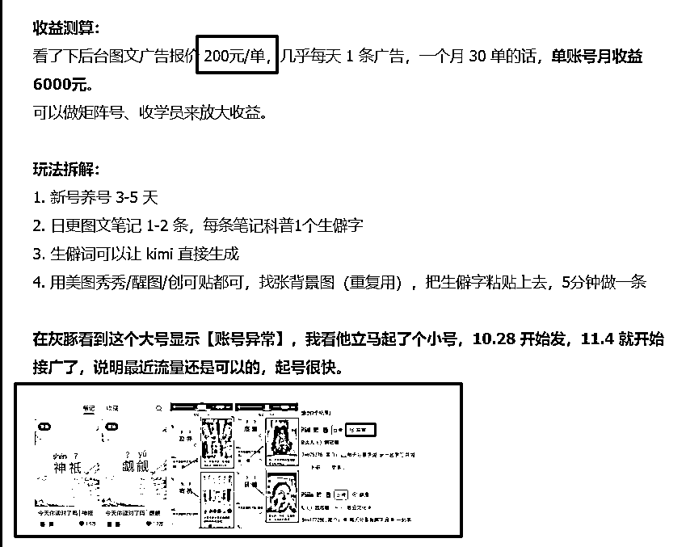
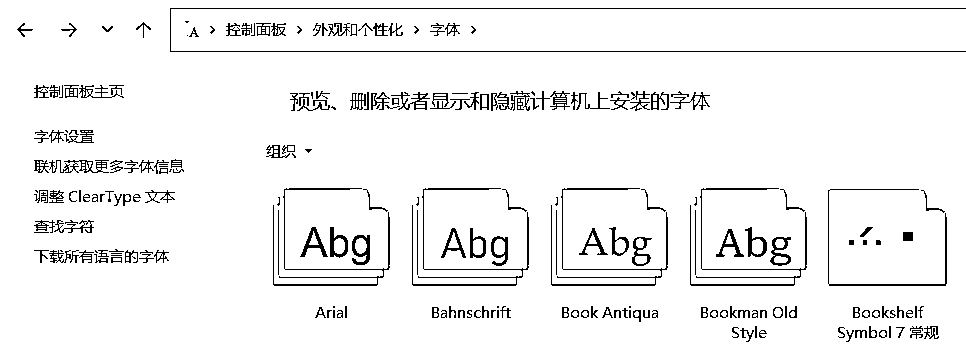
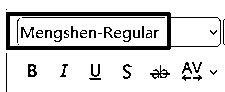
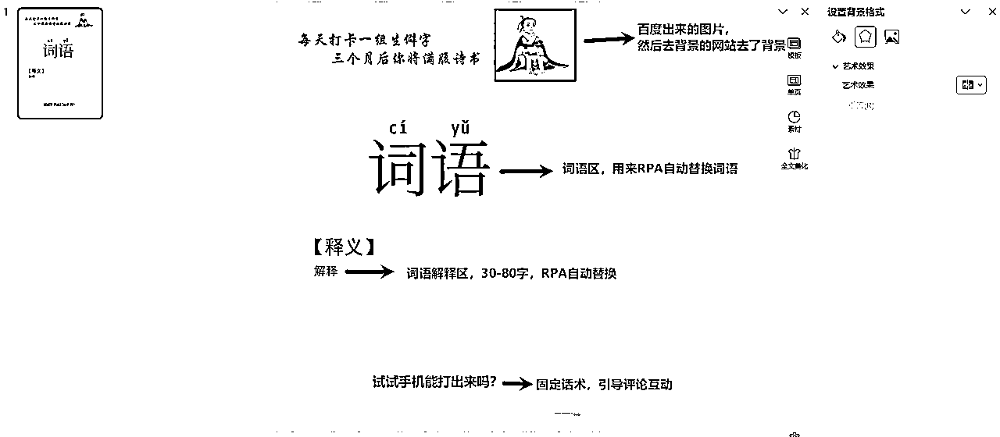
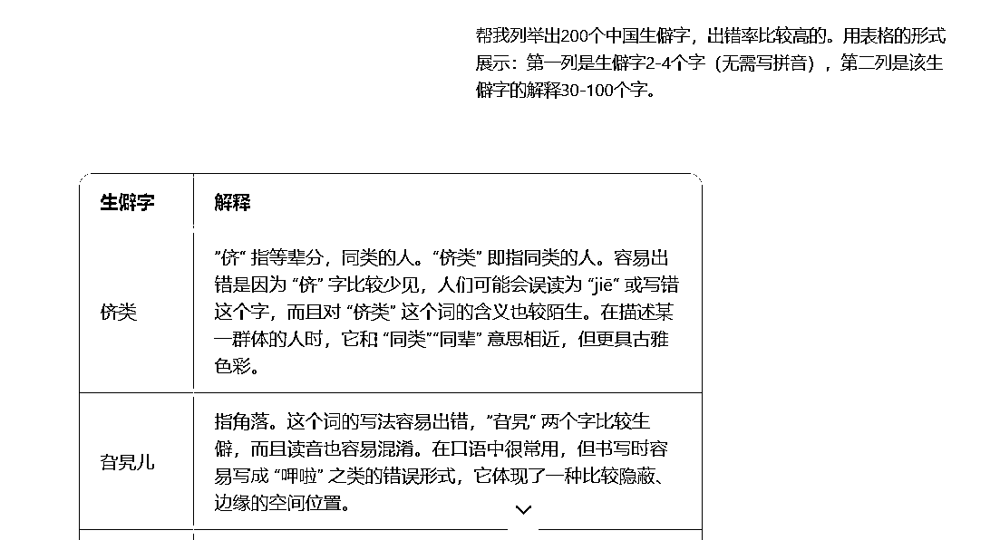
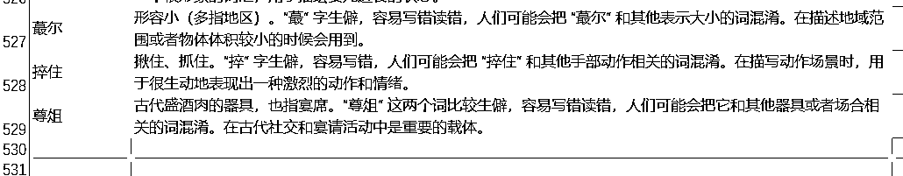
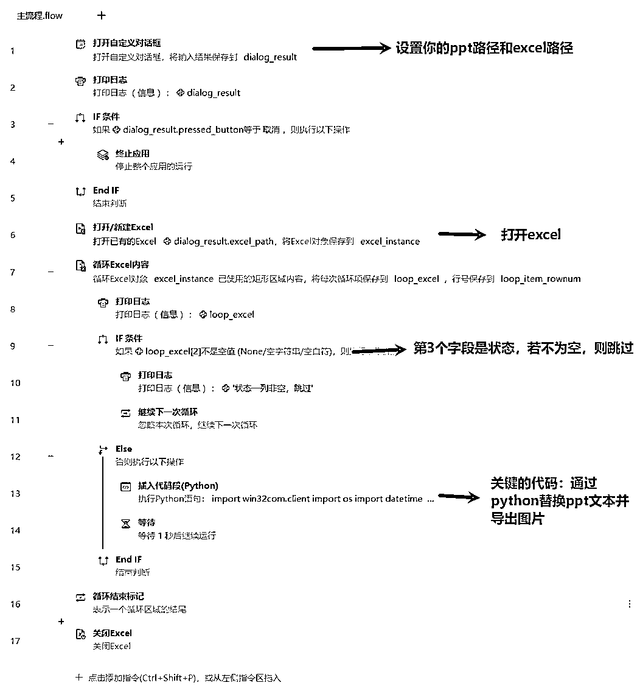

# 用RPA全自动化批量生产【生僻字】图片做📕商单，保姆级工具开发教程（附工具下载）
作者：龙哥

## 用RPA批量把生僻字做成图片，跑通📕商单？这份保姆级教程直接抄作业（附工具）

大家好，我是龙哥，平时一直折腾RPA落地场景，目前已经做了70多款商用RPA工具，加起来100多个RPA应用了。今天想跟大家分享一下最近热度很高的“生僻字”赛道，如何用RPA实现全自动批量出图，顺便把工具免费送给需要的朋友。



这个玩法其实挺固定的，不单📕能发，视频号、抖音也完全适用。所以我的思路就是：让RPA一键接管全部重复劳动——启动机器人后，它自己去excel里逐行读数据，把生僻字转成图片，再按顺序存到本地文件夹。整套流程用影刀+cursor来做。

### 一、生僻字图片是怎么生成的？

我的做法不复杂，核心就两个关键点：拼音字体 + PPT导出图片。

#### 1.1 装一个自带拼音的字体

这类字体很直接，你输入一个汉字，它会在旁边自动标上拼音，所见即所得。我用的是“萌神拼音”这款免费可商用的字体库。下载后安装也很快，拿Windows举例：按ctrl+r打开运行，输入control进到外观与个性化，然后把字体文件直接拖进去就装好了。


想确认有没有装上？去PPT里找到这个字体名字切换一下就能看出来。



#### 1.2 做一张用于替换的生僻字PPT模板

我参考了📕上一堆博主的封面样式，自己也做了一张模板。这里有个重点：词语区和词语解释区里的文字，一定要先写成默认的“词语”和“解释”，这样RPA脚本才能准确定位、自动替换。其余位置你愿意怎么装饰都随便。



考虑到很多朋友可能忙到没空自己搭模板，我做好的PPT模板也会一起放出来，直接拿就行。

### 二、海量生僻字和解释，让AI来搞定

生僻字资源从哪来？答案就是AI。我最早试的是kimi，但问题在于输出到一半很容易翻车，比如同一个生僻字重复蹦出来。后来换成豆包，效果稳定多了，提示词我也放在后面。



叫AI生成一批之后，复制到excel里，轻轻松松几百条数据。一个词语发一篇笔记，几百篇内容不是梦。

```
帮我列举出200个中国生僻字，出错率比较高的。用表格的形式展示：第一列是生僻字2-4个字（无需写拼音），第二列是该生僻字的解释30-100个字。
```

### 三、影刀登场：从excel到成品图全自动

重头戏来了。这一步决定能不能真正批量化。我用影刀做自动化：它自动读取excel内容，替换PPT里的生僻字，然后导出图片。



关键代码部分，其实是用AI写的。如果看不懂也没关系，我同样共享出来。这段代码走了不少弯路，全靠cursor一路debug救回来，感觉效率确实高，不管是写流程还是修问题都快得离谱。



最终成品是这样的。



### 四、工具下载入口

影刀本体：点这里下载就行。

生成工作流：先注册影刀，再去拿工作流，就能在自己的影刀里看到了。链接和密码我放在下面：
https://api.winrobot360.com/redirect/robot/share?inviteKey=bad5fc9f3789d710 （密码：dahuzirpa）

另外还有两个配套文件需要一起下：
一个是PPT模板，建议你拿到后改一下背景颜色和提示文字，免得和我的作品长得太像；另一个是excel，里面我已经整理了500多个生僻字，正常发都能发500多篇了。要是想再扩充，把PPT模板微调一下，再来一轮，不就又攒出500多篇？

```
import win32com.client
import os
import datetime

#功能：打开ppt，替换文本，并导出图片
class PowerPointEditor:
    def __init__(self, ppt_path):
        """
        初始化 PowerPoint 编辑器。

        参数:
            ppt_path (str): PowerPoint 文件路径。
        """
        if not os.path.exists(ppt_path):
            raise FileNotFoundError(f"File '{ppt_path}' does not exist.")

        self.ppt_path = ppt_path
        self.ppt_app = win32com.client.Dispatch("PowerPoint.Application")
        self.ppt_app.Visible = True  # 可见，方便调试
        self.presentation = self.ppt_app.Presentations.Open(ppt_path)

    def replace_text_in_slide(self, slide_index, old_text, new_text):
        """
        替换指定幻灯片中的所有文本框中的文本。

        参数:
            slide_index (int): 要替换的幻灯片序号（从 1 开始）。
            old_text (str): 要查找的旧文本。
            new_text (str): 要替换的新文本。
        """
        if slide_index < 1 or slide_index > len(self.presentation.Slides):
            raise ValueError(f"Slide index {slide_index} is out of range (1-{len(self.presentation.Slides)}).")

        slide = self.presentation.Slides(slide_index)

        for shape in slide.Shapes:
            if shape.HasTextFrame and shape.TextFrame.HasText:
                text_range = shape.TextFrame.TextRange
                if old_text in text_range.Text:
                    text_range.Replace(old_text, new_text)
    def export_slide_as_image(self, slide_index, export_folder, image_format="PNG"):
        """
        将指定幻灯片导出为图片，并返回图片的完整路径。

        参数:
            slide_index (int): 要导出的幻灯片序号（从 1 开始）。
            export_folder (str): 图片保存文件夹路径。
            image_format (str): 图片格式，支持 "PNG", "JPG", "GIF" 等（默认 PNG）。

        返回:
            str: 导出的图片完整路径。
        """
        if slide_index < 1 or slide_index > len(self.presentation.Slides):
            raise ValueError(f"Slide index {slide_index} is out of range (1-{len(self.presentation.Slides)}).")

        # 检查文件夹是否存在，不存在则创建
        if not os.path.exists(export_folder):
            os.makedirs(export_folder)

        # 自动生成文件名
        filename = self.gettimestamp()
        file_name = f"{filename}.{image_format.lower()}"
        export_path = os.path.join(export_folder, file_name)

        # 导出幻灯片为图片
        slide = self.presentation.Slides(slide_index)
        slide.Export(export_path, image_format)
        print(f"Slide {slide_index} exported as {image_format} to '{export_path}'.")
        return export_path
    def save(self, save_path=None):
        """
        保存 PowerPoint 文件。

        参数:
            save_path (str): 保存路径（默认覆盖原文件）。
        """
        if save_path is None:
            save_path = self.ppt_path

        self.presentation.SaveAs(save_path)
        print(f"Presentation saved as '{save_path}'.")
    def gettimestamp(self):
        # 获取当前时间
        now = datetime.datetime.now()
        # 格式化为 yyyymmddhhMMss
        formatted_time = now.strftime('%Y%m%d%H%M%S')
        # 获取毫秒部分
        milliseconds = now.microsecond // 1000  # 微秒除以1000得到毫秒
        # 将毫秒部分转换为字符串，并确保是三位数
        milliseconds_str = f'{milliseconds:03d}'
        # 拼接时间戳字符串
        timestamp_str = formatted_time + milliseconds_str
        print(timestamp_str)
        return timestamp_str
    def close(self):
        """
        关闭 PowerPoint 演示文稿和应用程序。
        """
        if self.presentation:
            self.presentation.Close()
            del self.presentation
        if self.ppt_app:
            self.ppt_app.Quit()
            del self.ppt_app

#ppt_path = r"E:\workspace\rpa\影刀\生僻字\temp.pptx"
#output_path = r"E:\workspace\rpa\影刀\生僻字\output_png"
ppt_path = dialog_result.ppt_path
output_path = ppt_path[:ppt_path.rfind('\\')] + "\\output"
# original_path = dialog_result.ppt_path
# ppt_dir = original_path[:original_path.rfind('\\')]

title = loop_excel[0]
content = loop_excel[1]
# 初始化编辑器
editor = PowerPointEditor(ppt_path)
try:
    # 多次替换文本
    editor.replace_text_in_slide(1, "词语", title)
    editor.replace_text_in_slide(1, "解释", content)
    editor.export_slide_as_image(1,output_path)
    # 保存结果
    #editor.save(save_path)  //注释掉，暂无需保存

except Exception as e:
    print(f"Error: {e}")
finally:
    # 确保关闭 PowerPoint
   if 'editor' in locals():
        editor.close()

```

最后说一句：这个工具从刷到帖子，到确认可行，再到开发落地，陆陆续续花了一个星期。如果觉得对你有用，就帮忙点个赞吧。