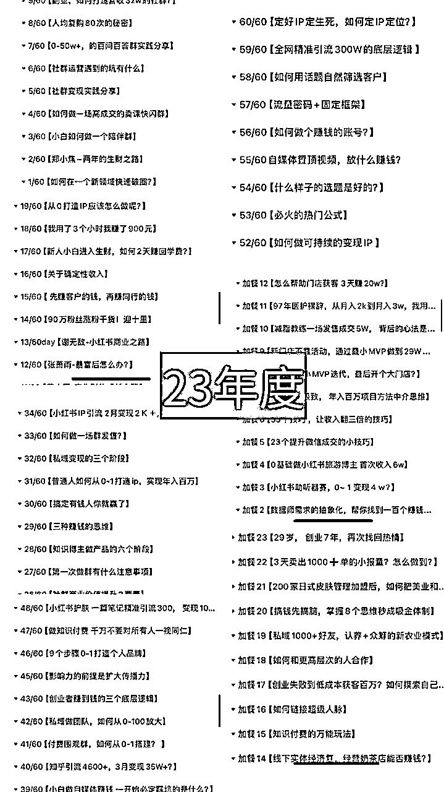
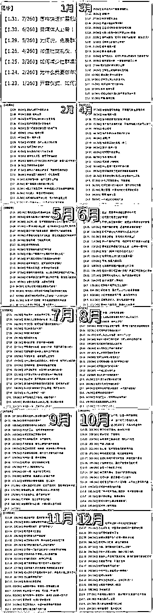
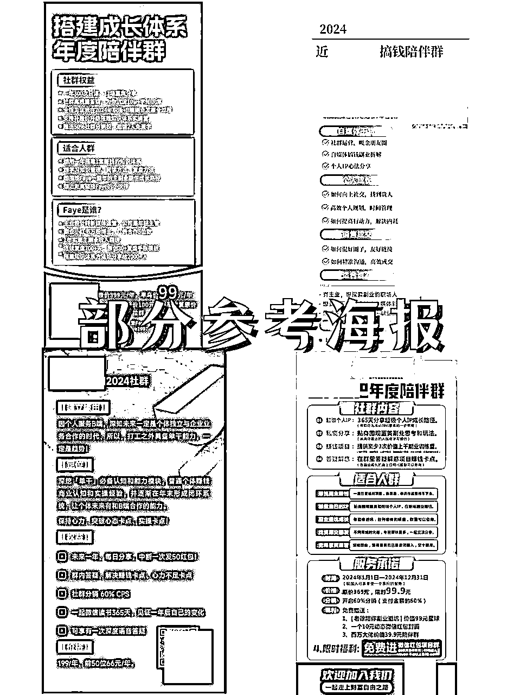
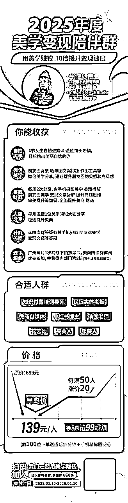
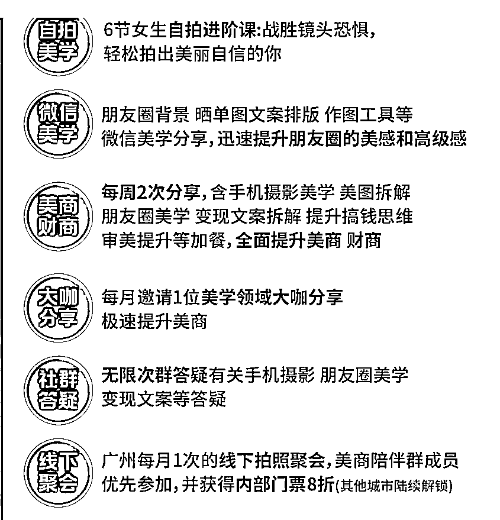

# 小白怎么从零启动一个赚钱的付费陪伴群

我做了三年陪伴群，到现在更新了四百多篇笔记，变现累计大概在5万到7万之间。我不是大神，只是把自己从小白起步做群的实操经验摊开讲。如果你也零社群经验，却想试试做自己的付费群，这篇应该能帮你少走弯路。

（23年度陪伴群精华截图）

（24年度陪伴群精华截图）

整篇拆成三块来讲：

1. 陪伴群到底能带来什么
2. 怎么找到适合模仿的对标群
3. 怎么把自己的付费群从0到1搭起来

* * *

# 一、陪伴群能帮你补齐哪些核心能力

做自媒体能长期存活，靠的是三件套：内容力、流量力、成交力。这三样会跟着你走很久，而且是AI替代不了的能力。我的做法是把重心放在内容力和成交力上精进。

**1. 练出成交力，迈向高客单**

不好意思谈钱、不敢卖自家东西的人很多。如果你想靠自己吃饭，这个心结一定要解。

销售本身很有成就感，一方面带来收入，一方面是真的在帮人解决问题。销售的本质就是先解决痛点，对方才愿意付费。

我自己也走过从月入2万到月入2万再到日入2万的过程。先赚小钱练手感，才能对大钱有体感，也才知道怎么成交高客单。这不是一步到位的事。

今年我主打美学方向的高客单赛道。我不自己造高客单产品，而是去链接有影响力的美学平台，帮他们做获客端，自己只负责流量。我发现做产品不必从零造轮子，直接找定位匹配的平台或产品嫁接，交付端交给别人，你专注做流量，效率更高。

如果你未来想做高客单，可以先用陪伴群来孵化种子用户，慢慢培养成交习惯。

**2. 强化输出力，内容力上来了**

三年前我开始每天发5条朋友圈，坚持了三年，累计四千多条。两年多前开始做陪伴群，至今更新近400篇商业笔记。先有量再谈质。

量变之后，我从以前的输出困难，到现在能随手把想说的东西写出来，表达欲被彻底激活。同时我学会了更有针对性地写朋友圈，会提炼卖点做到被动成交。

更重要的是，持续输出带来了同频的人，合作伙伴、学员、客户都是这样来的。表达力是自媒体人的保命技能，很多博主不是没能力没资源，而是内容力垮了。所以一定要提前练好、保护好内容力。

* * *

# 二、如何找到对标社群

核心路径一句话：先付费对标，再细拆对标，最后拼装组合。

竞争对手永远是最好学的对象。做知识付费也好做实体也好，先把别人的全流程摸一遍再动手。

**01 先付费入场对标**

找你喜欢的人、喜欢的玩法去学，但别找差太远的，不然执行不了。

把别人的好套路搞明白，快速迁移到自己群里，别不好意思，迭代比面子重要。

我入场前就先付费进了七八个同类陪伴群，其中深度拆解5到10个头部群，剩下的中小群就随便感受。

**02 拆解维度清单**

1. **社群目标**  
拆群最怕无脑抄动作。每个动作背后都有目的，不搞清逻辑，照抄只会浪费精力。

2. **内容形态**  
图文还是视频。社群里图文居多，制作成本、投入产出都低。视频反之。
内容方向是综合还是垂直。综合像认知、破圈、创业思维等；垂直像搞钱陪伴群、小红书陪伴群。

3. **海报拆解**  

主题、副标题、定价、卖点、为什么现在买、为什么找他买。

4. **运营模式**  
轻运营：群主自己发，几乎无人力成本。
重运营：团队化，上课、答疑、预告、跟进、布置作业、复盘。

5. **社群权益**  
一句话：付费进来能得到什么。

6. **价格区间**  
陪伴群是引流款，价格普遍在29到200之间。

7. **后端承接**  
引流群最好有高客单去承接，否则流量浪费。

8. **内容来源**  
要以终为始。按社群目标和后端产品来设计内容。比如想招小红书0基础学员，内容就聚焦小红书；想卖高客单营销产品，内容就偏向搞钱打法。

* * *

# 三、从0到1搭建自己的付费社群

**03 拼装组合**

拆完之后把能用的拿来用，不会的先扔掉。下面是我自己的搭建逻辑。

**1. 定位**

定位取决于交付内容和你的个人优势。

交付内容要聚焦，不要贪多。是副业、赚钱思路、时间管理、读书还是美学？我现在就是美学变现为主，今年陪伴群全部围绕这个点打。

核心优势要放进群里。比如我的视觉美学运营做得还不错，就把这个作为今年的主轴。

实在找不到优势，从三个问题找：你坚持最久且最享受的是什么？别人夸你最多的事是什么？你花钱最多学过什么？交集就是你的强项。

**2. 内容形态**

能坚持最重要。我选图文，因为我擅长、喜欢、成本低、可持续。

内容方向偏综合做漏斗筛选：自拍美学、私域美学、审美提升、变现文案拆解、搞钱思维等。

**3. 确定海报**

海报、副标题、主理人介绍、交付清单、价格、适合人群、交付周期、配色风格。

**4. 运营方式**

我走轻运营。每周两次群主分享+每月一次嘉宾分享，无额外人力成本。

**5. 交付权益**

我当时的6项权益：
① 自拍美学6节进阶视频课：打掉镜头恐惧，拍出自信感
② 微信美学：朋友圈背景、晒单图、文案排版、作图工具，提升高级感
③ 美商财商：每周两次加餐，手机摄影美学、美图拆解、朋友圈美学、变现文案拆解
④ 大咖分享：每月一位美学领域大咖
⑤ 无限次社群答疑：摄影、朋友圈美学、变现文案
⑥ 线下聚会：广州每月一次线下拍照聚会，优先报名+内部门票8折

**6. 定价策略**

陪伴群是引流产品，定价别太高，否则门槛高。建议39到199区间，可以做阶梯涨价。涨价节点建议50人一档，既不会太快也不会太慢。

**7. 获客渠道**

两类：一是铁粉转化，认可你的人；二是分销裂变，找小KOL推，素材话术准备好，引导发圈即可。

**8. 后端承接**

一定要有承接。我23年没做后端承接，24年开始付费进高客单社群筛选产品，用自己的优势去卖别人的好产品，赚佣金和影响力。起步没必要自己造高客单，交付重、团队重，不适合新手。高客单最好借势合作。

**9. 团队配置**

新手别找合伙人。我之前拖了大半年，最后决定自己来。起步阶段思路没理清，合伙人只会增加成本。等你不够强时也遇不到很强的合伙人。改找有影响力的嘉宾来解决内容和流量问题。

**10. 更新频率**

我前两年乱更，24年改成周一到周五更，25年打算周更两篇。量力而行即可，新手别做日更，把时间留给做流量。一周2到4更足够。

以上就是我做陪伴群的真实路径，希望对你启发有用。