从0带出1000名视频号主播，我只做对了一件事：把钱分明白

大家好，我是孟哥。先把成绩摆出来——多多视频这边，我用一年时间陪跑了上千名创作者，每个月光发出去的报酬就稳定在六位数，整个项目活下来的利润过了千万线。玩法其实很朴素：他们把站外素材剪好，发到多多视频入口，挂上拼多多的商品链接，有人下单就能拿分成。就这么直接。

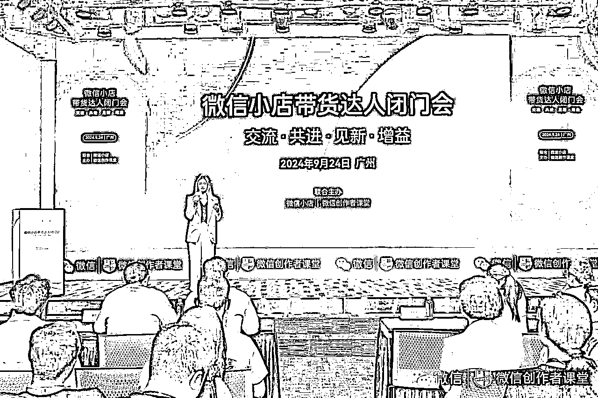

视频号那头，同样是千人以上的盘子，单月成交最高冲到3000万，拿过视频号带货团长总榜第一。2024年9月24日，我以头部团长的身份被微信官方邀请参加「微信小店带货达人闭门会」；之后又在2025微信公开课PRO上拿下「优秀联盟带货机构」这块牌子，是众多服务商里唯一原生视频号带货团长，微信小店·视频号带货团长第一这个认证，官方也给了我们。

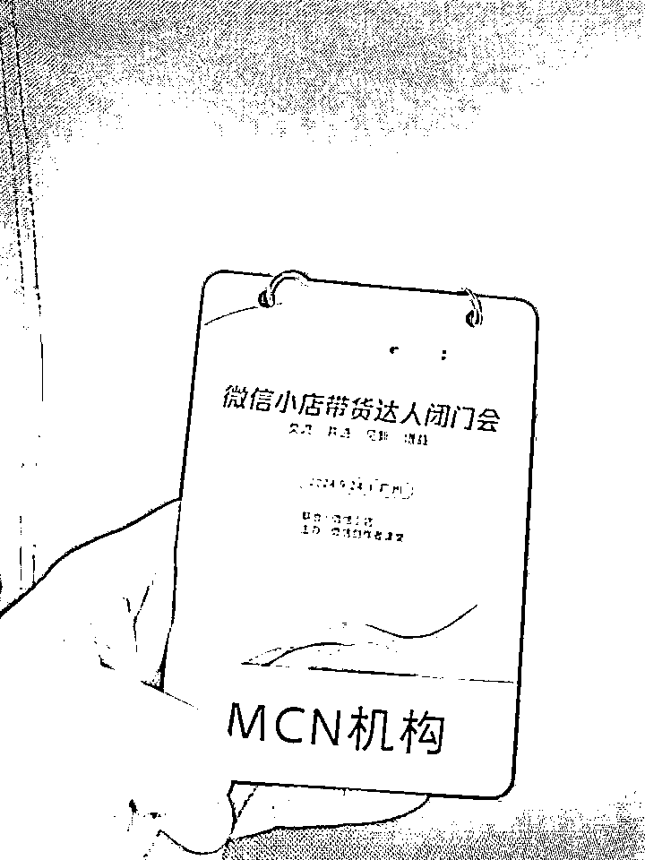

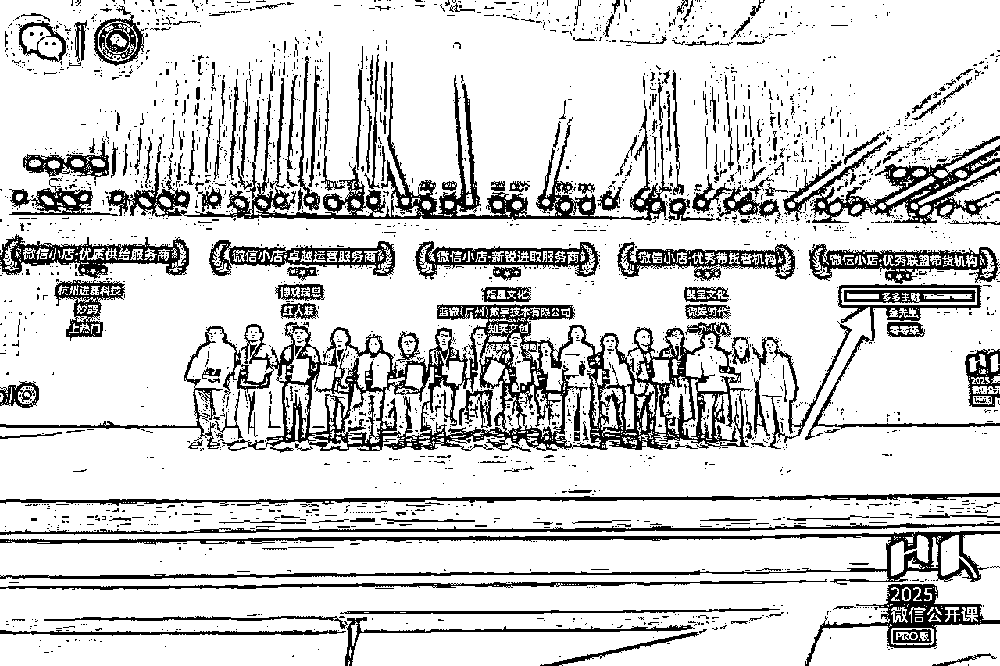

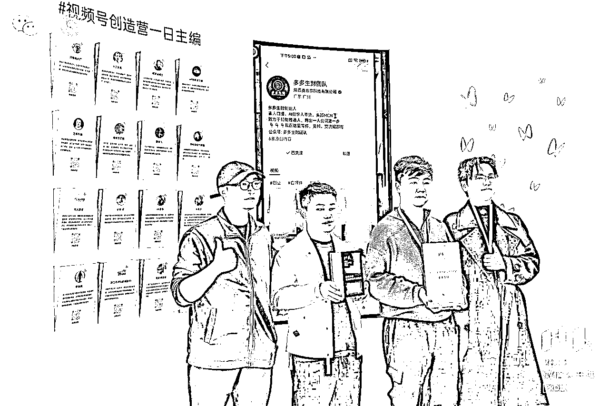

聊点我自己的事。我是00后，农村长大，16岁初中毕业那年，我爸被生意伙伴坑了，资金链断掉，家里一路折腾，他本人还进去了。作为长子，我连丧的时间都没有，脑子只有一个念头：赶紧把钱挣出来，给老爹请律师打官司。

我没有学历，家里也帮不上忙。辍学以后开过餐饮店，做过外卖运营，跑过地推BD，生财里的项目基本都试过一圈。

但说实话，纯靠玩命这条路我走明白了——普通人一天只有24小时，你拼到极限，终点还是别人的起点。后来我进了生财，拼命补认知，折腾了几年才想明白这套打法。真正让我翻身的不是勤奋，而是机制。

按先后顺序讲讲这盘棋怎么下的。

2021年，我进生财的第二年。当时参加航海、刷精华帖，外卖CPS、抖音短视频带货、地推拉新、热点引流都碰过，但认知浅、实战少，只小赚了一点就停了。真正让团队跑起来的，是后面的多多视频业务。

第一版打法：招学员，赚学费

21年底，我在风向标里刷到多多视频带货这个项目，也在这个社群里认识了后来一起创业的几位伙伴，合作到现在。

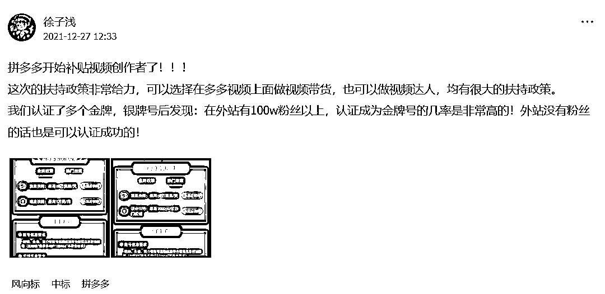

那年我们做得很简单：自己先跑通项目，把步骤沉淀成文档，做成教学产品去招生，学费就是收入来源。

正好赶上风口期，大伙执行力也猛，一边自己下场实操，一边带学员，一年下来到手100万。

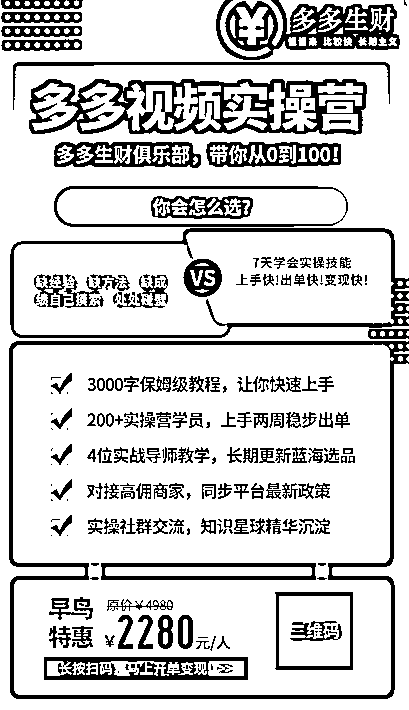

但教了几个月，问题就冒出来了：人越招越多，大家做的素材、选的品难免撞车，自己人跟自家人抢流量，等于亲手养出一堆同行。

这一版的优势是启动门槛低，新手容易上手，成本不高就能放大收益。劣势也扎眼——和学员只有一锤子买卖，没有深度绑定，收入就一笔学费，没有细水长流的管道钱。

第二版打法：零底薪搭档+机构绑定，后来知道这叫阿米巴

多多视频做出实战成绩后，我和合伙人还是不满足：光靠学费，天花板太低。怎么继续放大？

有一回我照常刷文章，看到盗坤写的一个案例：有人零底薪招人剪视频、发视频，自己只管后端，按收益比例分账，靠这套赚了500万。我被点醒了——我们手里正好攒着一大批优质商家和商品资源，为什么不搬到多多视频上？只要低成本找到愿意干的人，帮他们赚到钱，我自然也有钱赚。

于是我们开抖音直播，展示这个项目的样子：不难上手、每天两小时、不耽误主业，吸引想做副业的人来当我们的零底薪搭档。收一笔很低门槛的钱，让对方先有投入感，执行力才会不一样。同时挂靠机构，手把手带他们快速跑起来。真正的核心资源——愿意投流、愿意给佣金的商家——死死攥在我们手里。这样一来，学员刚发视频，商家就投流，对方很快能看到回报，自然愿意长期跟着一起分钱。后来我才知道，这套做法叫阿米巴。

一年后，我们带出1000多个多多视频创作者，做到了平台头部，每个月发出去的分账有6位数，年利润过了千万。

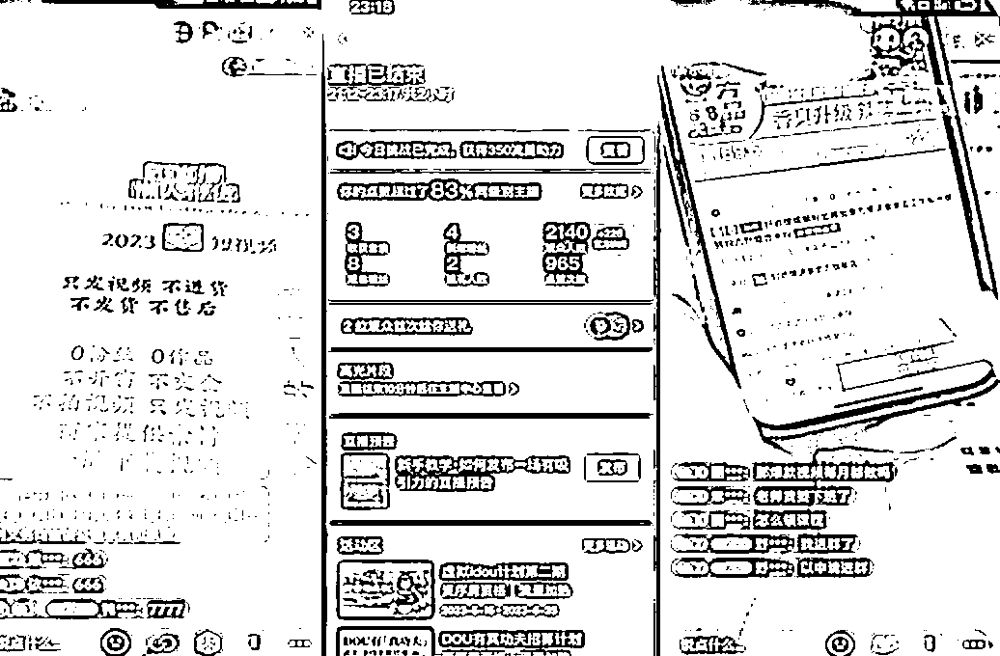

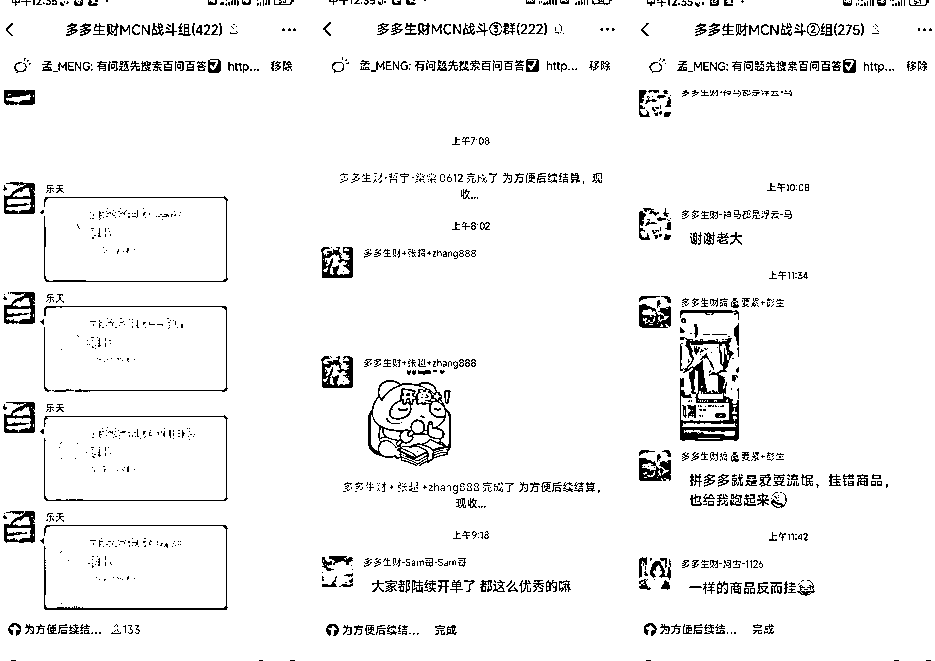

那时候团队一共10个人：交付4个、流量3个、商务3个。轻资产、甚至负成本地把盘子滚大，这个甜头我们尝到了。

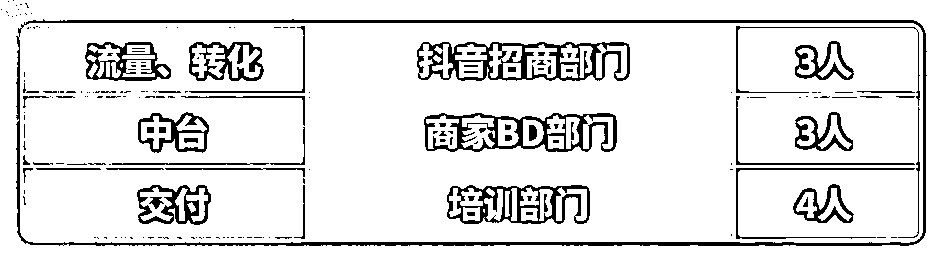

跟第一版相比，这一版多了后端分成，也解决了绑定不深、没有长期收益的难题。但新瓶颈很快出现：拼多多归根结底是购物平台，不是内容平台。多多视频只是平台用来拉留存、提转化的工具，不是主要营收方向，上升空间有限，市场也装不下更多创作者。我们只能换个战场。

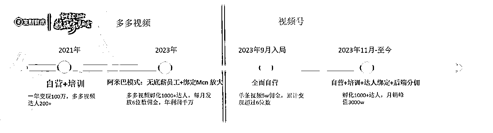

第三版打法：2023年，先自营，再复制

时间来到2023年，我们切进视频号带货。

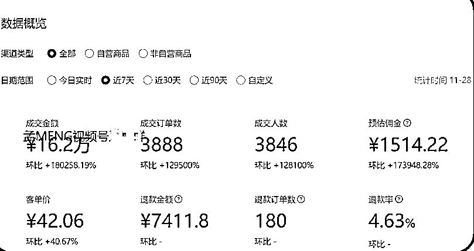

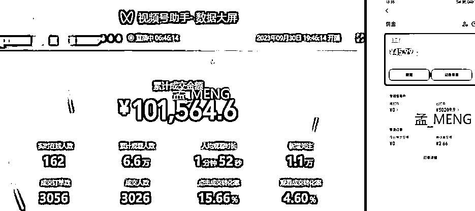

那年9月，团队正式入局，从二次剪辑做起，后来转到真人出镜念稿的方向。最开始跟市面上多数同行一样：自己试款、自己冲量，打出爆款就赶紧放大。

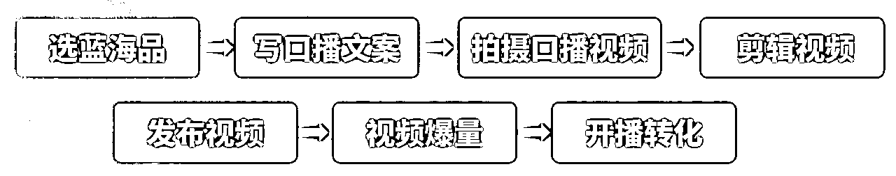

自营的好处很明显：人可控、利润高，赚到的都归自己。

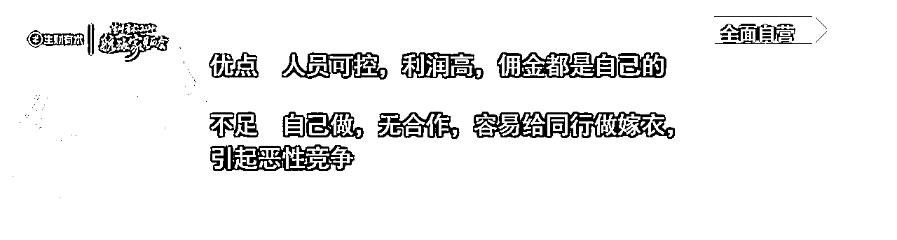

但推了几个品之后，我们发现不对味：我们试出什么品，同行马上能在广场刷到，跟着就上。辛苦测出来的爆款，等于白白给同行送弹药。当时的判断是——必须快速把规模做大，在同行还没反应过来前，先吃掉这个品七八成的流量。

可是扩自营太笨重：人员、场地、设备、账号、管理，样样烧钱，还得扛规则变化、玩法升级的风险，这不是我们擅长的。好在手头有现成的作业可抄——多多视频那套“教学+机构长期绑定分钱”的模型，直接平移过来：招生，让学员跟着我们已经打爆的产品走，我们提供高佣货源，从商家那边吃返点。

第四版打法：自营+教学+长期绑定+后端分账，定稿

2024年，真人出镜念稿的教学正式跑起来。

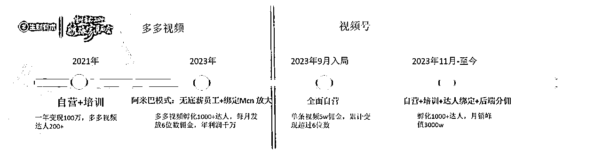

我们没有盲目扩自营，因为心里清楚那是自己不擅长的事，硬碰硬只会被风险咬一口。选择做自己擅长的，把优势放大，才有今天的体量。有句话我一直记着：把短板补到及格，最多是个普通人；把长板磨到极致，才有超额回报。

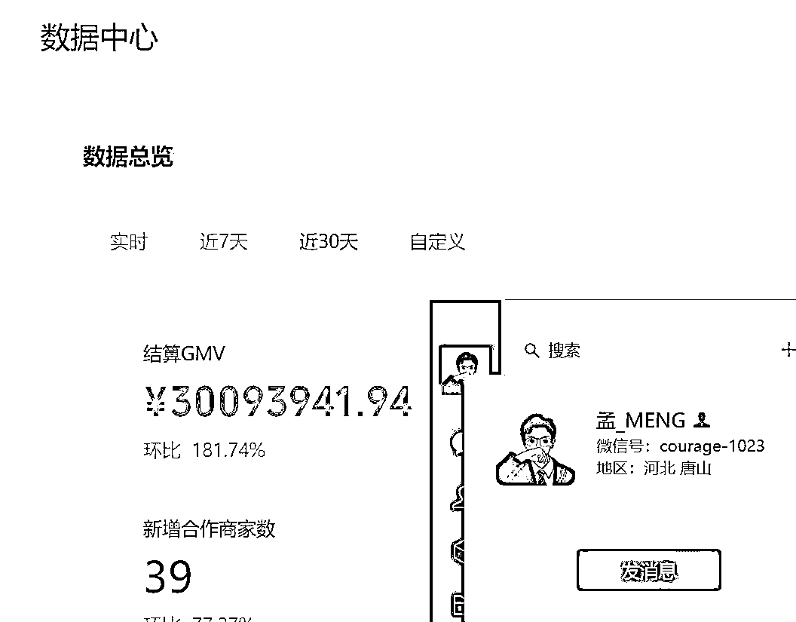

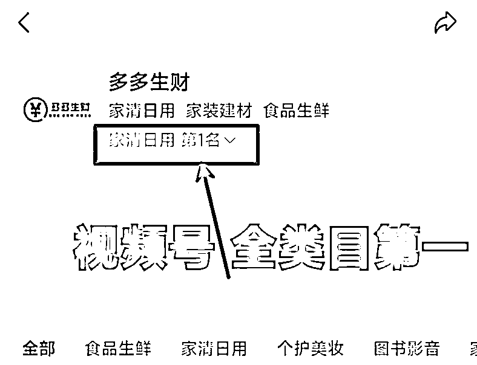

先看一个案例。团队里有个70后宝妈，一条素材跑出600多万播放、6万多成交。

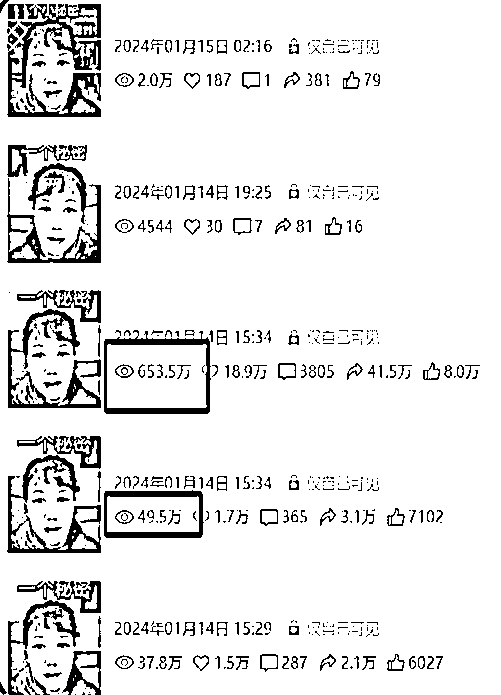

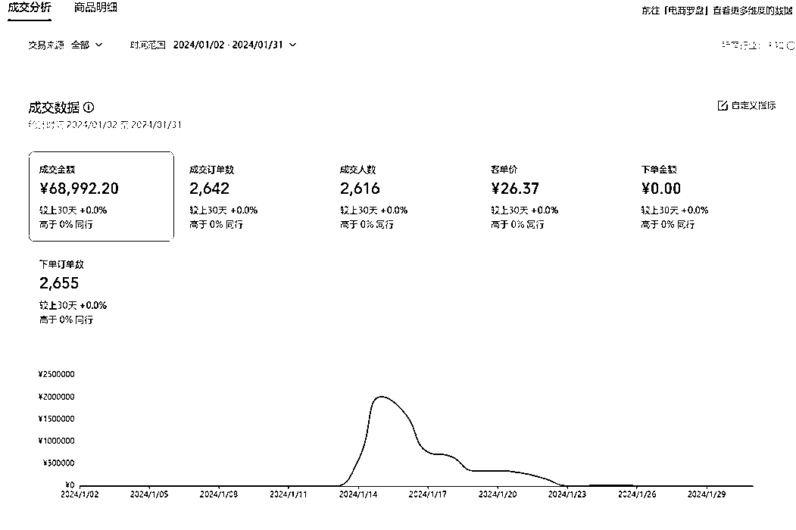

她来参加教学才1个月。一个在家带娃的宝妈，凭什么这么快出结果？靠的就是我们这套带人机制。接下来分三块拆：怎么招到靠谱的人、怎么留住人、怎么管好这个组织。

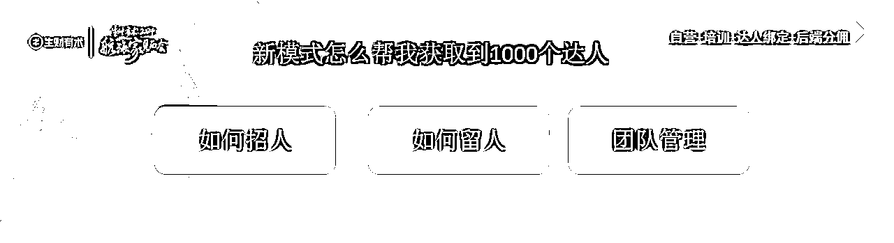

先说招人。

我们做教学，不是冲着学费去的，而是想把我们测出来的爆品利润尽量放大。学员用的都是我们给的爆品货源，盘子整体做大了，我们才有底气找商家要更高的佣金和额外返利。我们既不靠抬高学费赚钱，也不靠压低创作者的分成赚钱。

这条逻辑决定了：我们比谁都希望学员真的跑出来，成才率是关键。视频号这行吃执行力，为了筛出有执行力的人，我们把学费定在2980。市面上动辄6980、3980，这个价格反而成了最有说服力的门槛。

再说留人。核心思路一句话：用分工协作，代替一个人包打天下。

很多同行带学员，喜欢带他们跑通“独立闭环”：找货源、聊商务、选品、写文案、出镜、剪辑、开播……恨不得把所有环节全塞给一个人。这确实能练出完整能力，但效率太低、难度太大、成才率太低。等学员把整套流程磨通，红利早就凉了。我等不起。

所以我的选择是：每个人只做自己最擅长的一环，靠协作把产出拉满。

新人大多没有原创能力，想进场赚钱，基本都得从二创做起。过去二创和出镜是两拨陌生人，二创这边招呼不打直接搬素材，出镜那边发现被侵权就举报形象侵权，两边互相拉黑、互相消耗。这种内耗一旦出现在组织里，就必须解决。我们的做法是主动找原创合作、给他们分成，不白拿人家的劳动成果。利益理顺之后，出镜的伙伴都愿意把素材拿出来共享。多拉一个盟友，就少一个对手，大家一起把钱赚了。

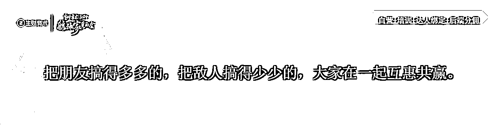

还有一个关键动作：搭分舵，让盘子自己裂变。

我们的视频全靠自然流，账号有存活周期，大爆之后特别容易违规，靠眼下这些人手里的号，根本铺不过来。让学员自己解决账号吧，成本高、沟通累、效率低。但反过来想：一个学员要是能凑到10个号，团队里有两三千个学员呢？账号供给不就解决了吗？

创始团队精力有限，亲自下场招人做交付，肯定顾不过来。所以我们在1000多名创作者里，挑有运营能力的人做分舵主，把教学资料授权给他们，让他们自己去带人。对我们来说，只要大家走的是同一套货源体系，达人分走多一点、我们抽少一点，都没关系。月GMV做到几千万的时候，哪怕只吃几个点的商家返利，一个月也是相当可观的数字。

这套打法跑起来之后，一天同时开播的账号从500多个涨到1000多个，单日成交从50万干到100万，整体业绩翻了一番。我们的收入结构也一路升级：单干→学费→分成→商家返利。前端长出了招生、商务BD和分舵体系，后端的配套也跟着完善：货源、外包剪辑、兼职代播、账号工具，都能给到伙伴们。

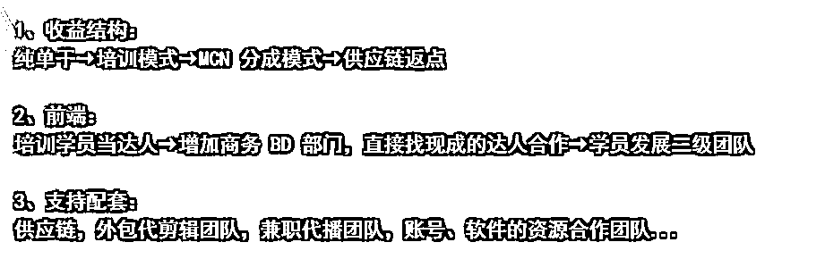

每个月末的颁奖，也是留人的重要一环。按当月的总收益排名，开线上表彰会，前三名一人一台苹果手机，还要请他们上台讲两句；当月踩出新品的伙伴，额外给商家返利奖励。这一招，一方面让上榜的人有获得感、有归属感；另一方面，也让没上榜的人看到盼头——大家都是同一个起点，谁也不比谁强多少，再拼一把，下个站上领奖台的可能就是你。榜样的力量，比喊一百句口号管用。

说到底，我们的收入大头来自商家返点，所以我们必须真心希望创作者能赚钱。想尽办法帮他们多赚，他们能感受到这份诚意，自然会留下来。套路是短期武器，真诚才是长期通行证。

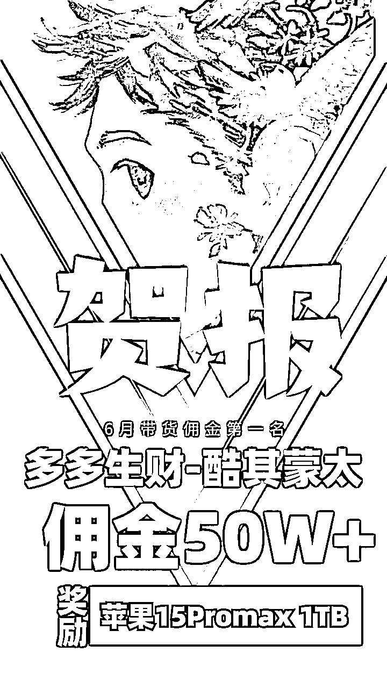

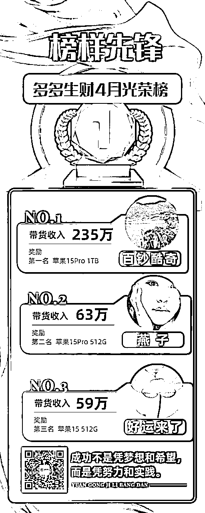

最后聊管理。手里握着1000多个直接合作的创作者，底下还挂着分舵，怎么让这台机器稳定运转、持续增长？我的回答是：把自己变成服务创作者的总后盾，让每个人清清楚楚地知道，留下来能赚到钱。

具体操作是分类管理。主创团队在中台，负责选品、测品、收集文案、分发素材。创作者分成三类，精准服务。

第一类，还没掌握出镜能力的，走二创路线。他们要的就两样：素材够多、分成够高。素材方面，我们每天稳定上新，出镜的伙伴源源不断供给，爆款出来能第一时间跟上。分成方面，我们的团长做到全平台第一、月销几千万，跟商家谈判的分量不一样，能拿到个人绝对拿不到的顶格比例。而且我们走线下T+1结算，相当于给创作者兜底——自己去找商家，可能遇到跑路、拖欠、链接更新慢、分成对不上这些破事，走我们这里，这些麻烦我们来扛，他们只管把视频剪好。

第二类，有出镜能力的。他们做出爆款素材后，自己未必有时间快速放大。把素材交到团队审核，我们安排二创伙伴去做分发，他拿形象分成。哪怕他不主动交出来，广场上也会有人偷着搬，不如大方合作，至少还能分到钱。再往后，我们会把他往垂直方向带，慢慢养成真正的素人IP。

第三类，有操盘打品能力的。这类伙伴不一定出镜，但很会玩矩阵。我们帮他们搭线下小工作室，在本地找同学分工协作，做成抗风险更强的带货小团队。

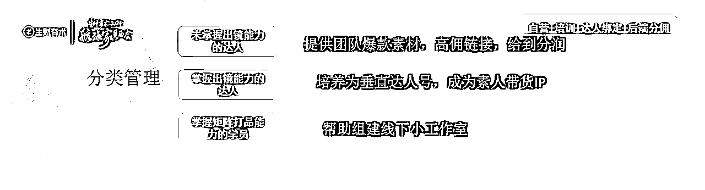

还有一个容易被忽略的底盘——接住流量的人。真人出镜念稿的逻辑是：视频爆了，要马上开播。但现实里，号主可能有空，也可能没空；几个号同时爆，一个人也分身乏术。没有一支能接住流量的队伍，前面做得再好都会浪费。

所以我们组了一支2000多人的兼职接播团队。前期从多多视频积累的盘子里发招募信息，来了几百人；再给这些人分润，让他们去介绍亲戚朋友，或者网上拉人，队伍慢慢滚大。单子多了之后，我们又建立了接单分级机制，保证上来的人靠谱，服务跟得上。

回头看这几年，最深的感受是：把规模做大的关键，不是自己多能打，而是让每个环节的人都算得过账。钱分明白了，人心就齐了；人心齐了，盘子自然越滚越大。

这套路能复制，正因为它的底层不是几个能人，而是一个让所有角色都能受益的结构。

很多人问我，这套直播模式到底是怎么跑通的？其实核心就一句话：让数据说话，用结果淘汰。

每场直播结束后，我们会根据人、货、场的综合表现做一次排位赛。表现亮眼的，直接晋升到一群、二群，享受优先派单的待遇；表现欠佳的，就回到实习群继续打磨锤炼。等到一群二群的人手不够用了，才会从三四五群中临时抽调。这套机制天然形成了一种向上的拉力，主播们哪怕没人盯着，也会主动去学、去练、去优化，因为所有人都明白，想拿到更多单子，就得先让自己配得上那个位置。

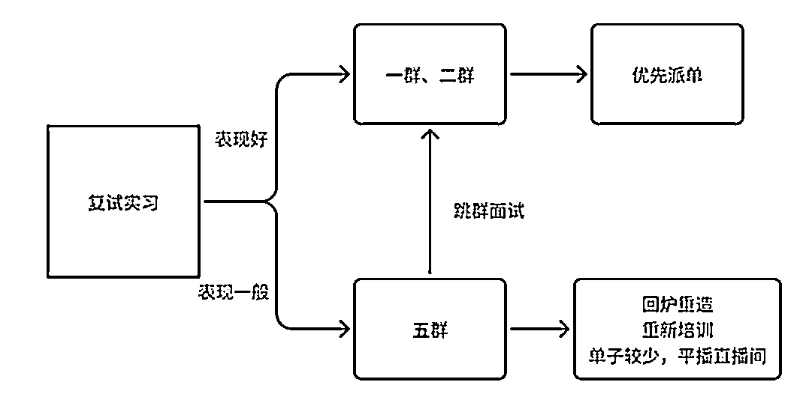

正是靠着这种筛选逻辑，目前我们已经招募了超过2000位主播，每天稳定开播的账号维持在1000个以上。

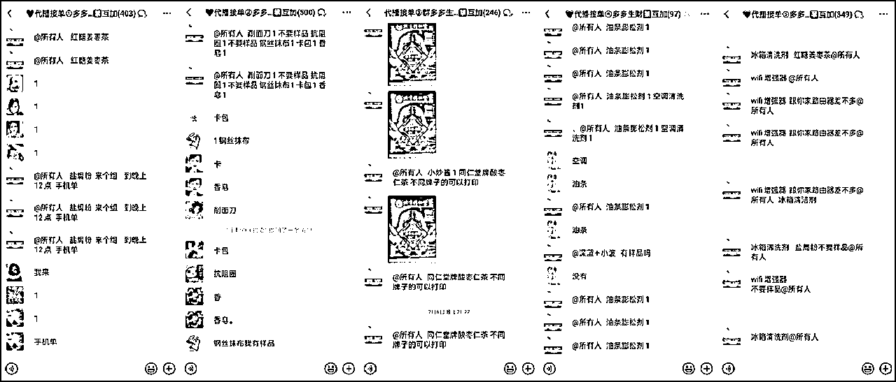

到这里，一个完整的增长闭环就转起来了。团队里上千名学员之间的配合越来越紧密，每个人都有自己的分工，自己承担成本，也共享收益，整个团队的运转效率和内部氛围都有了质的飞跃。哪怕平台偶尔调整规则，我们也能迅速切换打法，平稳穿越项目的生命周期。出镜达人、打品达人、主创团队，三方都拿到了自己想要的结果。

不过，这套模式走到今天，并不是一路坦途。

我们复盘后发现，它能在两个项目上跑通，靠的是三个缺一不可的条件：平台有风口、项目有红利、业务能模块化。假如平台不给机会，市场盘子又不够大，没法做标准化分工，那模式再漂亮也是空中楼阁。所以，选择真的比努力重要，找到对的平台和项目，才是成功的第一步。

具体到实践中，我们也踩过不少坑。比如视频号没有类似多多视频那样的MCN绑定和电商分账机制，我们在管控学员方面缺少抓手；加上早期没有签合同、没收保证金，就有少数学员做大之后选择单飞。再比如二级团队的搭建，确实让达人规模快速增长，但过程也伴随着混乱和麻烦。有些团队长拿着授权的资料在外面展示实力，招生后却交付烂尾，最后学员把账算在我们头上；还有人借助团队的资源和品牌起家，等自己手里有了一批达人，就绕过团队供应链，直接拿达人筹码去谈合作。这些经历让我意识到，快速增长的背后，往往藏着相应的代价。

# 三、回看这段路，我做了这些思考

问题出现了，就要想办法解决。对于一级团队，我做了两手调整。

首先是牢牢握住供应链。选品上倾向非标、高利润的独家产品，比如有特殊资质的农产品、地域性的生鲜。这样一来，学员跟着团队卖这些品，赚得比卖普通商品多，而且离开团队就拿不到货。当他们发现留在团队里收益最大、既省心又赚钱，而单干又累又不划算，自然就愿意留下来。

其次是精细化分级运营。之前我们没有区分学员层次，大牛和新手混在同一个群里，用同一套方式运营，结果大家聊不到一块去，慢慢失去了交流欲望，转头去找别的圈子。如果再给我一次机会，我会把学员按等级分群，不同群讲不同难度的内容，高手和高手进行高质量碰撞，新手和新手一起打基础，彼此都能得到最合适的养分。

对于二级团队，我也会重新设计规则：设置加入门槛，用合同做约束。前期我们就是认知不足，没对二级团队收保证金，才让局面变得被动。以后再碰类似项目，一定会走招商加盟的模式——先审核申请人的实力和人品，通过后收取加盟费和保证金，签下正式合同。合同里会明确要求走公司供应链、接受总部监管，如果二级团队的投诉过多，就要接受相应惩罚。绝不会再像过去那样，门槛低到形同虚设，监管也过于宽松。

# 四、最后说几句总结

创业这些年，我最深的体会是：当一切都欣欣向荣的时候，创始人反而要格外清醒，看到那些潜在的隐患，提前做好防备，而不是只顾着沉浸在一片叫好声中。

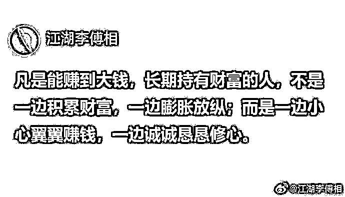

大家刚起步时都是草台班子，但想走长远，就得学会搭高楼。经历过几个周期之后你会明白，自己做的可能只是一门小生意，而不是终身事业。所以我也一直在学习、讨教、实践，希望不断精进。想做成真正的事业、赚到大钱，就必须把团队组织化，把前端、中台、后端独立搭起来。所谓铁打的营盘流水的兵，只要有一套可持续运转的运营模式，不管项目、平台、人员怎么换，都能迭代到下一阶段。

说实话，我这套模式并不高级，还有很多优化的空间，市面上做同类玩法的同行也不少。相比他们，我们团队更像是一个草台班子，为什么偏偏是我运气好跑出来了？我想，这一切的起点，是因为我加入了生财有术。在这里，我看到了无数优秀的大佬分享生财之道，也看到了很多成功的圈友展示出彩的战绩。跟前辈们的成就一比，我的这点小成果真的不算什么，也让我清醒地知道，自己还有很大的上升空间。

是生财有术打开了我的认知，让我见了世面，也激起了我干大事的野心。

你想赚一个亿，手下就得有能赚一千万的人；你想赚一千万，手下就得有能赚一百万的人。没加入生财之前，我连一百万都不敢想，那时候就盼着还完家里的债，再赚个一百万，就能开心得像个称霸全城的男主角一样猖狂大笑。等真的下场赚到一百万，我才发现，在生财的创业者眼里，一百万只是起点，千万、过亿并没有想象中那么遥远。

但走到今天，赚钱这件事对我来说，已经没那么重要了。我早过了要靠钱解决温饱的阶段。因为自己淋过雨，也想为别人撑伞。现在我更想用这套模式去发掘更多项目，帮助那些在主业之外没有额外收入的人、没有固定劳动时间的人、没有专业技能但又不甘平凡的普通人，让他们也能获得一份额外的副业收益。哪怕一开始只赚到一袋盐的钱，也足够有意义。

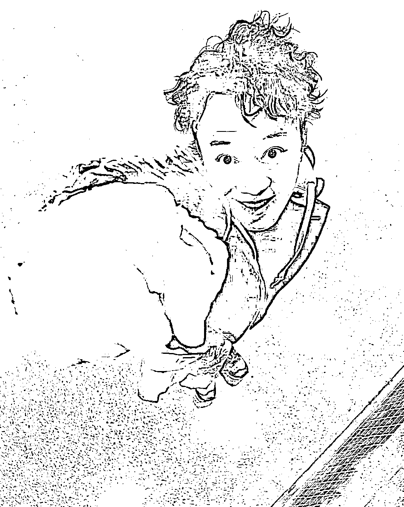

这一路走来，我也真正想明白了一件事：你再厉害都不重要，重要的是你能帮助多少人变得厉害。钱不是赚来的，而是你帮别人解决了问题之后，别人给你的回报。你能帮到多少人，就能获得多少财富。

成人达己，甘为人梯，近我者富——这是生财带给我的热血和野心。我积累的解决问题的能力、学员们的信任、前辈们传授的经验，都比银行卡里的数字更让我踏实，也比买车买房这些物质东西更有底气。

以上就是我今天的全部分享。再次感谢生财有术，感谢每一位圈友的聆听。让我们一起热血生财，一起生财有术！