# Cursor费用太贵？手把手教你配置开源平替方案

**Cursor太贵又不够稳？试试这套开源的Roo-Cline + DeepSeek 平替方案**

最近打开朋友圈、技术群，几乎都在聊Cursor，不可否认它确实挺好用的，我自己也用过。但免费额度一用完，我就没再续费了。一方面国外服务总有点不稳定，另一方面真要深度用下去，订阅开销实在不便宜。后来偶然刷到一个叫 Roo-Cline 的开源项目，研究了一下发现完全可以作为替代方案，今天就把配置过程完整分享出来。

Roo-Cline 本质上是 Cline 的分支，一个跑在 IDE 里的自主编码 Agent，在速度和灵活性上做了不少优化。简单列几个亮点：它可以自动批准命令、文件写入和浏览器操作；每个项目都能放自己的 .clinerules 自定义指令；还能和原版 Cline 同时运行互不干扰；拥有完整的单元测试覆盖；并且也支持 MCP。更给力的是，它不只是覆盖了 Cursor 常见的 AI 编程能力，连命令行交互和基于 AI 的浏览器交互测试都能做。

最关键的一点是，Roo-Cline 可以通过 API 接各种大模型。目前支持的供应商包括 OpenRouter、Anthropic、OpenAI、Google Gemini、AWS Bedrock、Azure 和 GCP Vertex 等，同时也能接入任何与 OpenAI 兼容的 API，或者用 LM Studio/Ollama 跑本地模型。这就给了我们很大的选择空间，既能选性价比高的云模型，甚至有能力的话也能自己部署免费模型。

我这次选的是 DeepSeek，毕竟它最近热度也很高，算是国产模型里的黑马。DeepSeek 的技术报告里有这么一段介绍：

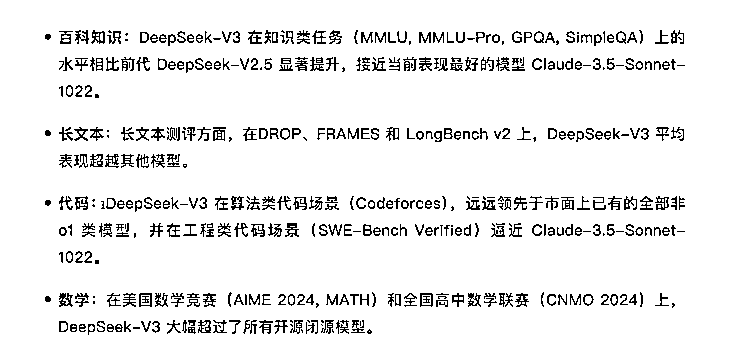

可以看出 DeepSeek V3 的表现相当能打，更关键的是价格非常低。我搜到的报价是这样的：

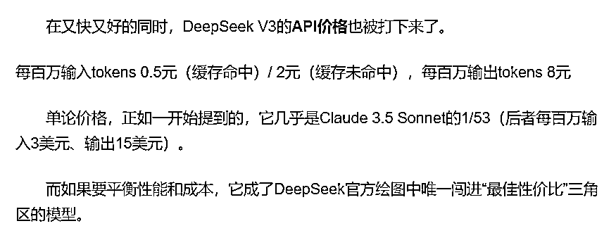

大概这就是它最近突然爆火的原因吧。当然，这些数据看看就好，我自己在线试用过，响应速度很快，回答质量也还不错。所以决定优先搭这套方案试试水。好了，下面直接开始。

**第一步：下载 VS Code**

先去 Visual Studio Code 官网，点击下载按钮：

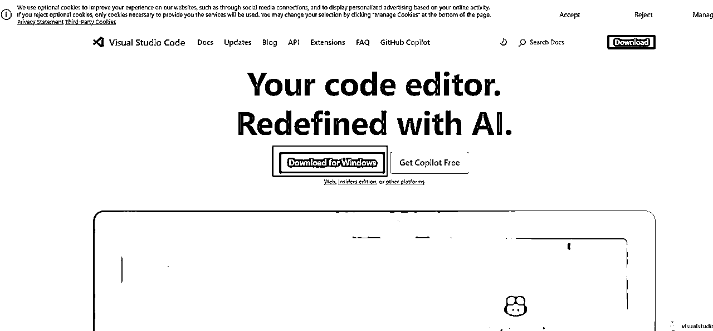

找到刚下载的安装包，直接安装：

**第二步：安装 Roo-Cline 扩展**

打开 VS Code 后，点左侧的扩展图标：

在搜索框里输入 Roo Cline，找到后点安装：

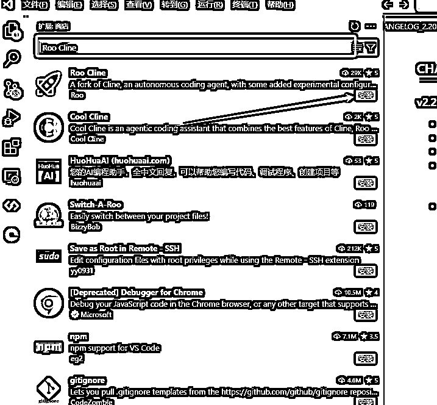

等进度条走完，扩展就装好了。

**第三步：获取 DeepSeek API Key**

打开 DeepSeek 官网（https://www.deepseek.com/），没有账号的话先注册一个。现在新用户注册会送 500 万 tokens，足够用挺长时间；就算后面用完了，目前的价格是 0.1 元/百万 tokens，也非常便宜。

登录后点击“接入 API”：

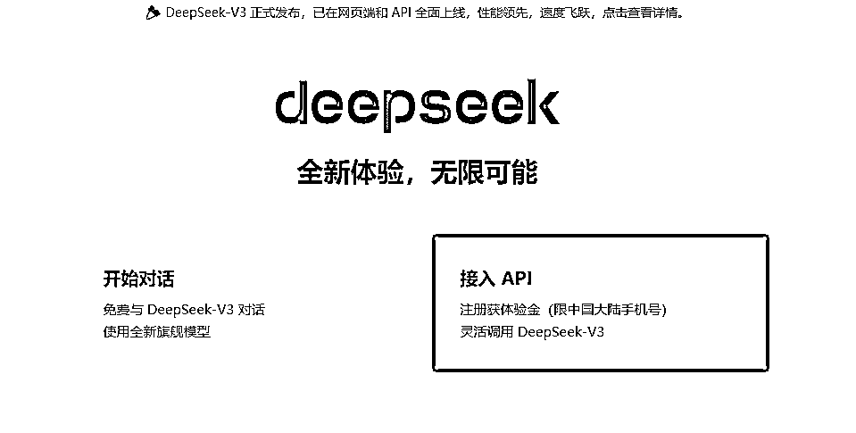

然后创建自己的 API key：

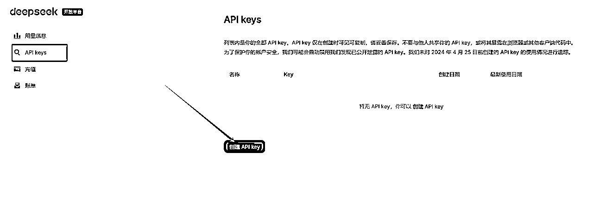

记得先把 key 复制保存好。

**第四步：配置 Roo Cline**

回到 VS Code，点开 Roo Cline 的扩展图标。Provider 选择 OpenAI compatible，Base URL 填 https://api.deepseek.com：

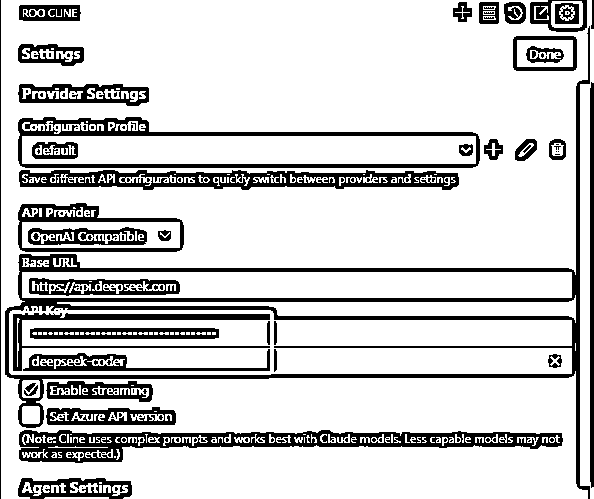

然后把刚才申请的 API Key 填进去，模型选择 coder 系列，点 Done 保存。

接着可以设置一下语言偏好：

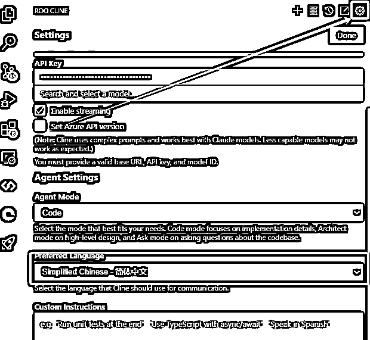

为了给 AI 最大的发挥空间，让它真正全自动写代码，我这里是把所有高危权限都打开了，包括自动编辑/创建文件，以及自动执行终端命令来下载依赖。大家可以根据自己的情况调整：

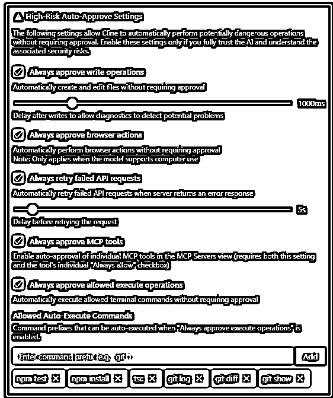

**第五步：实测——写一个贪吃蛇小游戏**

我让 Roo Cline 用 Python 写一个贪吃蛇小游戏，输入提示词后，用 @ 指定 AI 的工作目录，然后点击开始：

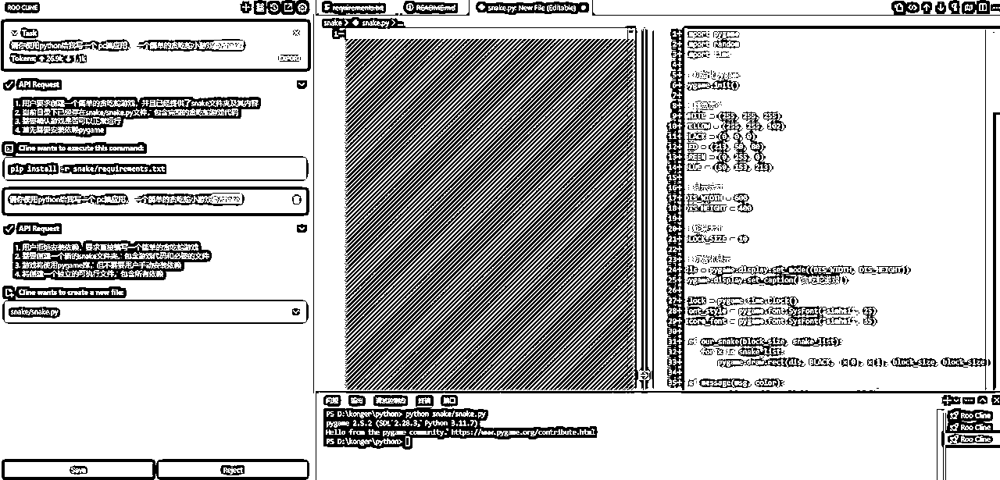

它会立刻进入工作状态，期间不断创建文件，并且每步都会弹出保存提醒，需要手动点保存才会继续。我一路点保存，最后看到完成提示，任务就算跑完了：

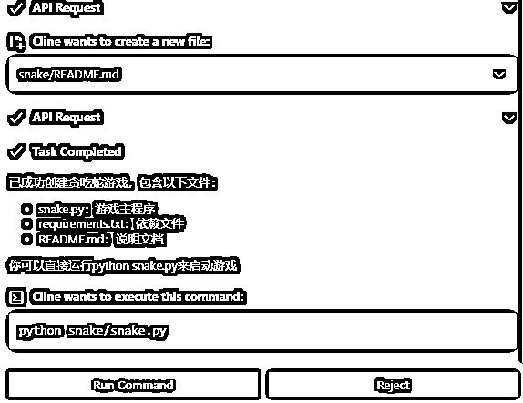

之后直接点“Run Command”运行程序：

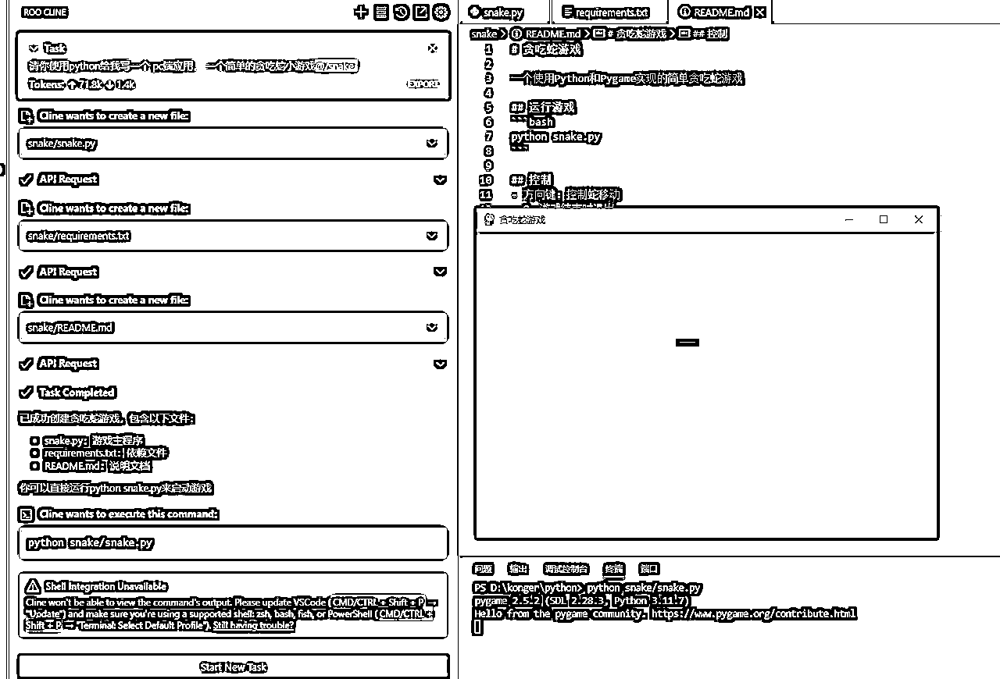

很幸运，一次就成功了。之前也遇到过报错，直接把错误信息丢给它，它也能自己继续修。

**最后总结**

整体体验下来，这套方案生成速度很快，代码逻辑也很完整，我还亲自玩了一会儿，没发现什么问题。用来开发一些独立的小功能完全没问题。至于缺点和局限，等我深度使用一阵再回来补充。大家也可以先上手试试。

我是阿康，专注AI+RPA自动化方向，欢迎一起交流。