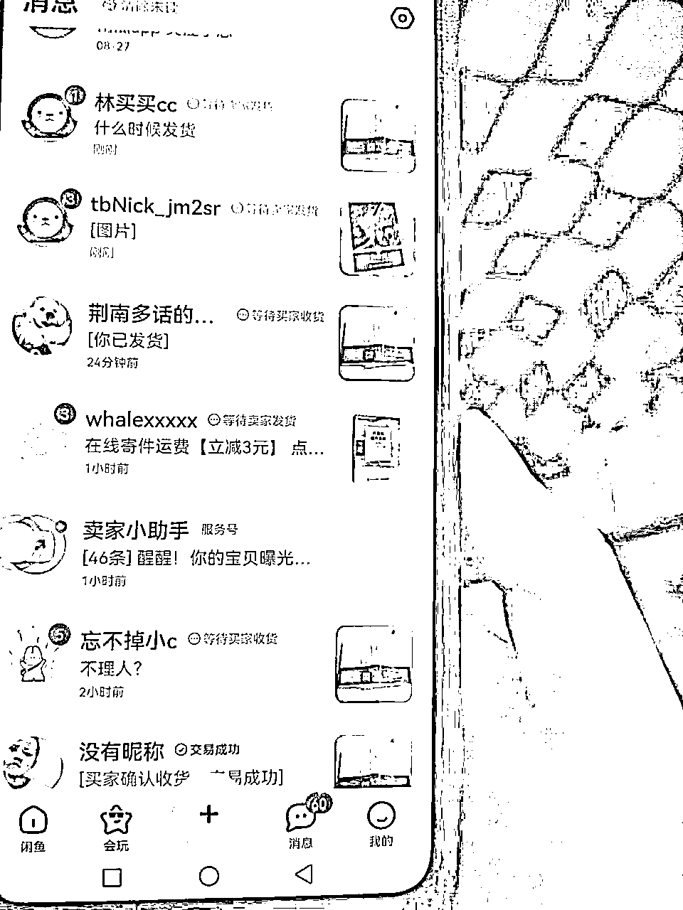
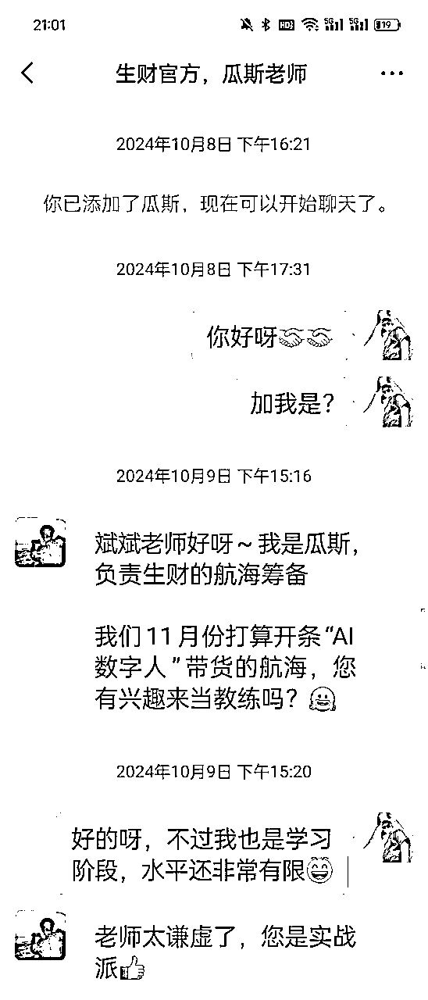
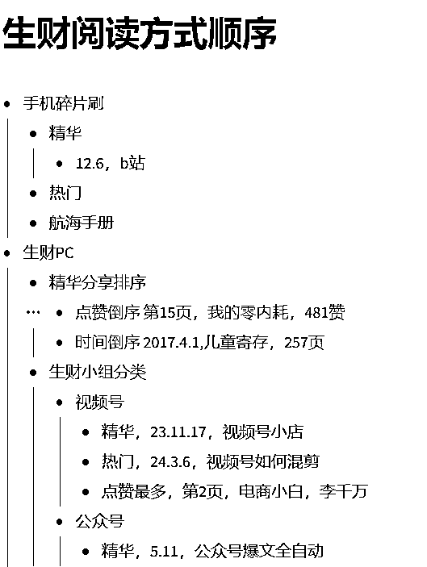
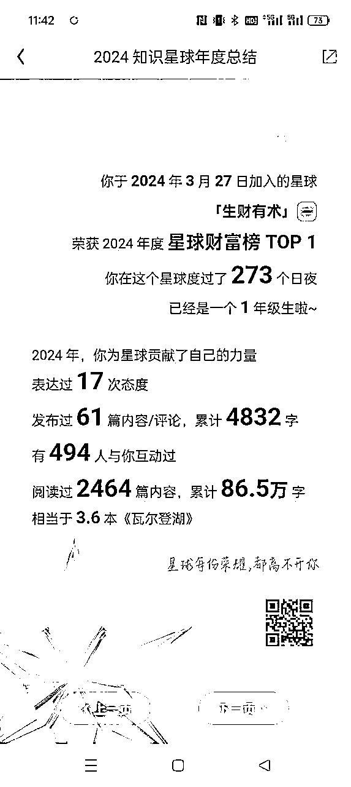
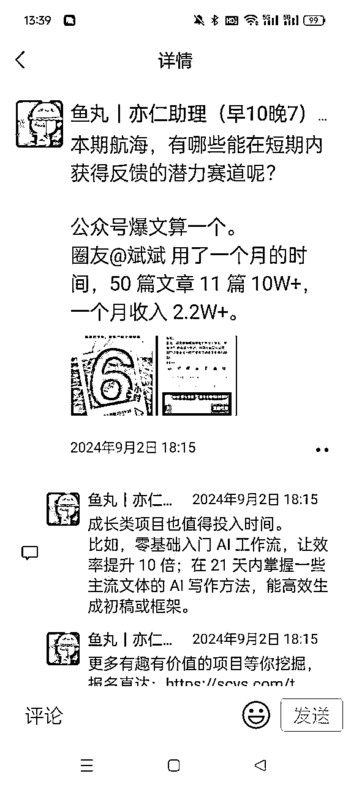
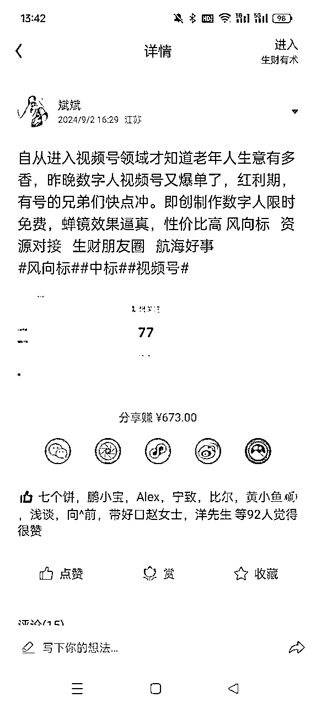
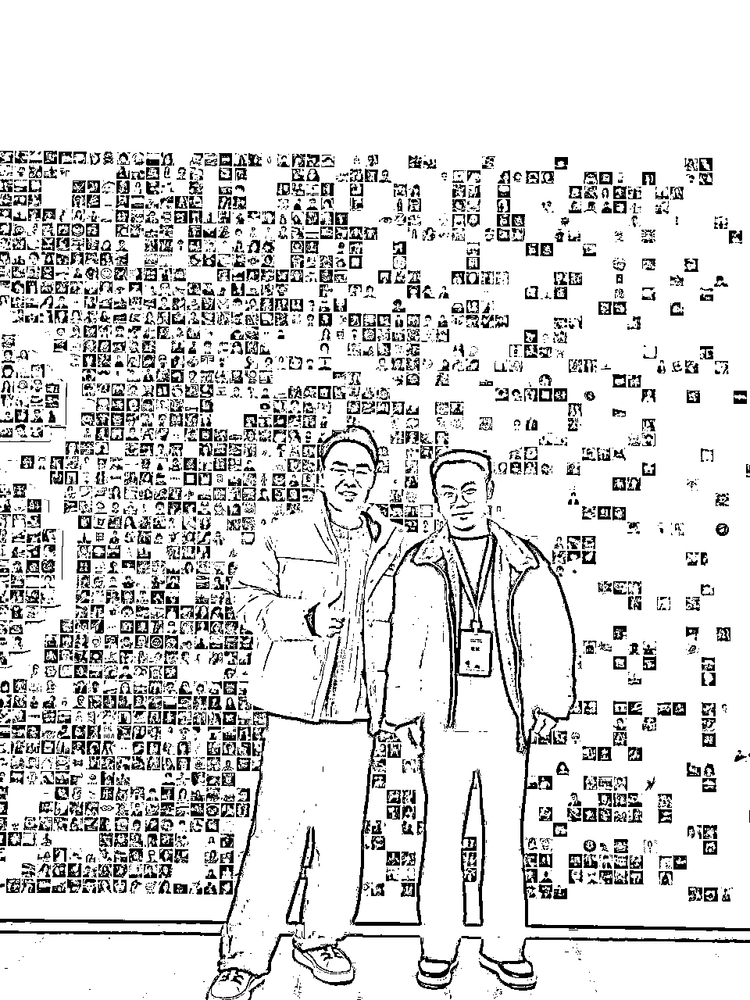

# 副业零起步，他如何在半年内连续跑通多个项目并当上航海教练？

大家好，我是斌斌，去年4月才加入赚钱圈子。短短半年多，我不仅把好几个项目做出成绩，还有幸成了航海教练。我团队里九成以上的伙伴都是在这个社群认识的，真心感谢这片孕育机会的土壤。

在加入之前，我有整整三年没靠副业赚到过一分钱，虽然试过很多路子，所以自称“副业小白”一点也不夸张。

下面说说我在赚钱做过的事：

第一个是闲鱼卖二手书。当时照着航海手册自己操作，一个月大概能赚2000块。说是“躺平式”卖书，没有售前，只管发货，后来觉得售后退货太耗时，就暂停了。

第二个是公众号爆文。同样是先看航海手册，后来跟着爆文航海一起做。第二篇文章就跑到10万+，前后写了50篇，自然推荐的有11篇10万+，累计收入约6万。细节想了解的可以看精华帖：https://wx.zsxq.com/group/1824528822/topic/8855214152245212

第三个是视频号带货。5月和7月都参加了口播带货，之后就深耕这个赛道，单日最高接近一万佣金，还组建了150人的线上打品团队。后来承蒙瓜斯老师邀请，担任12月数字人视频号带货航海的教练，从零开始编写航海手册。

第四个是淘客2.0内测。之前链接到赚钱里的一位大佬，刚好赶上淘宝官方内测，就加入了，目前团队已经300人。

回看这半年，我总结了四个关键做法：

第一，大量输入。

赚钱的内容密度很高，这和共创机制、社群价值观分不开。我的阅读方法是“遍历阅读”——利用整块时间和碎片时间，把所有内容分类：精华帖、航海手册、风向标、小组、资源对接等等。内容太多，不可能一口气看完，所以要分板块、断点续读。

看精华帖时，我会用电脑打开PC端索引站，按点赞从高到低一页页翻。点赞是圈友投出来的，某种意义上含金量和点赞成正比。手机上看帖容易跳位置，电脑新开页签不会断层。

我还喜欢按时间倒序看，越老越有意思。因为当初的预判已经被验证对错了，我会想：那时候我在做什么？文章里的判断到底准不准？哪些底层逻辑到今天还成立？

手机端我会用微信打开索引站，从每月1号往后刷，同时记下看到哪一天、哪一帖。帖子更新快，只追最新会漏，这样能把每个月的都扫一遍。微信缓存好，中间被打断也能回到原位置。

遇到需要决策的情节，我会停下来自问：换成我会怎么做？为什么？差异在哪？还能怎么优化？不断用这种自问自答强化商业感。

看到好帖或细分领域的牛人，我会关注他，找时机链接，再遍历他的内容。

航海手册更是精华中的精华，是官方筛出来的适合普通人操作的项目。我常把近期有用的专题转发到微信并置顶，随手能打开。手册不能当爽文读，而是执行指南，读久了确实容易累，但胜在实用。里面的“高手领航”板块尤其干，比手册深入，打开飞书后会被存进“飞书妙记”，可以断点播放，还能用“播客模式”听着走，我走路跑步时经常听。

资源对接和风向标，我通常周末刷一遍，因为周末没法发帖，正好有时间看。里面宝藏不少，有启发的、可能合作的都先收藏。

知识星球年度总结显示，今年我在赚钱社群读了86.5万字，其实更多阅读发生在索引站，还没算进去。

第二，形成并完善自己的框架。

每个人判断项目都有自己的商业逻辑框架，差别很大。有人一眼看穿本质，有人绕半天还在外围打转。我也在持续修正自己的框架。

比如龙哥老大说过，商业最小闭环是产品、流量、转化，任何项目都能拆进这三要素去填充。

我早年学营销也有自己的框架：抓潜-成交-追销。抓潜可以从视频号、小红书、抖音等平台入手，内容是渠道的一种。给用户什么、要用户做什么，也就是鱼饵，付费也是一种指令。这是我脑中的模型。

拿公众号爆文来说，成交就是读者点文章里的广告；追销就是让对方关注，变成粉丝，反复看文章、反复点广告。那对方为什么要关注？得有理由，最好是无法拒绝的：我会持续日更干货，解决他的情感难题等等。

视频号带货同样能套框架。加速成交靠塑造价值、稀缺感和紧迫感。比如七白饮：从成分上说是七种天然谷物酿制，从工序上说是四十九道手工打造，从类比上说是每100克相当于3杯纯牛奶。价值感立起来了。下播前10分钟不卖了，是紧迫感；最后10单优惠价，是稀缺性。

项目做得多了，就能提炼出框架和树干，再慢慢开枝散叶，持续修正。从案例中来，又回到案例中去。等到了一个阶段，就像戴上3D眼镜看项目，一眼抓住核心：除了红利，是渠道切入好，还是测试放大做得妙？哪里还能优化？这样就不会每次从零开始，而是抓住那些不变的东西。

也许这就是所谓的“网感”。

第三，抱团实战。

“何以赚钱，唯有实战”——这是赚钱的口号。道理很简单：做了才可能有结果，不做永远没有。过程中必然有各种阻力，什么没准备好、没启动资金、没时间……都得克服。记住一句：做了才可能有结果。

但今天重点不是“自己埋头实战”，而是“抱团实战”。一个项目能赚钱，中间有很多核心环节，每环又套着小环节，小环节里还有无数坑。自己全摸索完，太难了。

这就像多米诺骨牌。每一张牌是一个环节，推倒最后一张才算跑通变现。牌的高度、间距都要合适，项目的每个环节也有执行标准。摸索期就像蒙眼玩多米诺，成功了是运气，失败是常态。

很多人做过好多项目，卡在一个环节就放弃，因为一个问题解决不了就搁置。比如数字人视频号跳人脸验证，不知道怎么申诉，号就废了；几个号都这样，项目就黄了。其实有办法申诉，成功率还不低，只是一般人不知道。但有人知道，一句话就能填上坑，这就是抱团的意义。

项目里的坑，别人大概率踩过。相互借力、多问一句，跑通概率就成倍增长。更何况现在市场变得太快，玩法几天就变了，抱团能共享资讯、共享最新玩法，避免重复踩坑。单个项目无法穿越周期，但一直在前进的团队可以。

赚钱这个圈子本身就是一种抱团，分享最新风向标和商机。航海则是更深层的抱团，手册加教练，一起实战。空口无凭，只有自己看到像自己一样的人做出结果，才会真正相信，然后更有执行力，进入正向循环。

随着水平提升，抱团的圈子也要升级。只有同一层次的人，才能碰撞出更有价值的东西，不然就变成单向输出，不持久。

第四，越分享，越幸运。

互联网时代，链接才能产生价值。想被链接，得先让人知道自己是谁、能干什么。分享就是最好的方式。

我因为分享公众号爆文心得拿到了精华帖，认识了很多写公众号的人，互相学习，写一篇文章的时间从一小时缩到十分钟。还得到鱼丸的转发。

因为分享视频号数字人风向标被选中，几百个圈友来链接，一起搭起了百人线上打品团队。

后来我又发帖免费带百名圈友做视频号数字人带货，变现率30%+，链接是：https://t.zsxq.com/VpaX3。瓜斯老师因此找到我，让我参与12月那期航海。

也是因为之前的分享，我进了传术师群，参加线下聚会，还跟龙哥老大和神秘大咖合了影。

在传术师聚会上，龙哥老大讲的主题正是“越分享越幸运”。他自己也是因为持续分享，被曹大转发，很多人希望常看到这样的内容，才有了龙哥盟社群。明白老师也一样，持续分享后被涛哥等大佬转发，才有了今天。

我差不多看了500篇精华帖，认识了很多人。虽然他们不一定认识我，但我大概知道谁擅长什么、有什么资源，需要时能第一时间找到对方。每一篇真诚利他的帖子里，都是一个活生生的人。

无数例子都在印证：越分享，越幸运。

最后，再次感谢赚钱平台，让一群想搞钱的人聚在一起，迸发出巨大能量，也让曾经迷茫的我知道该往哪走。2025，一起龙哥盟。