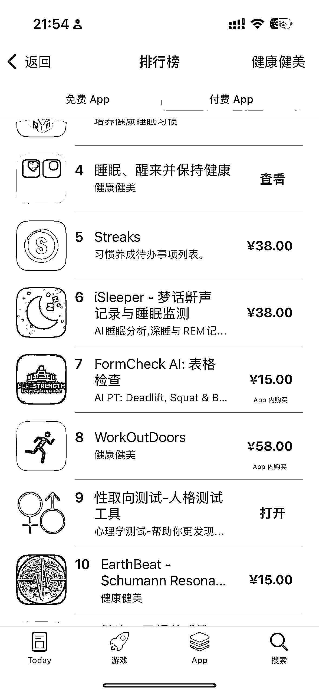
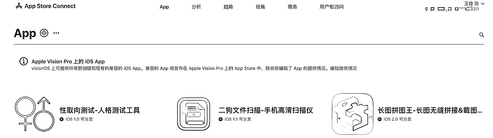
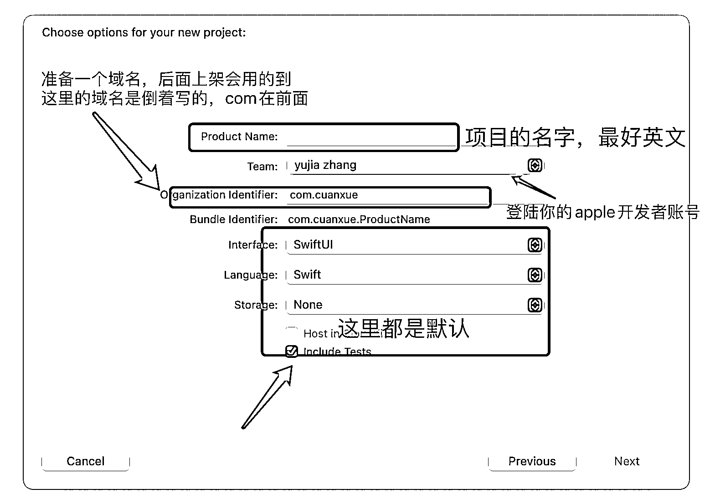
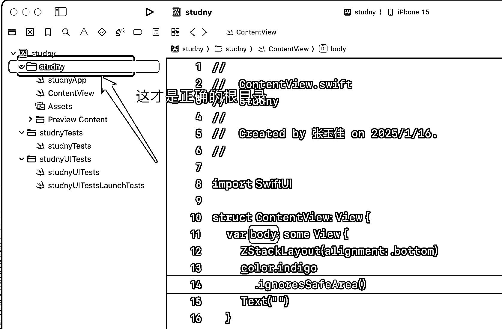
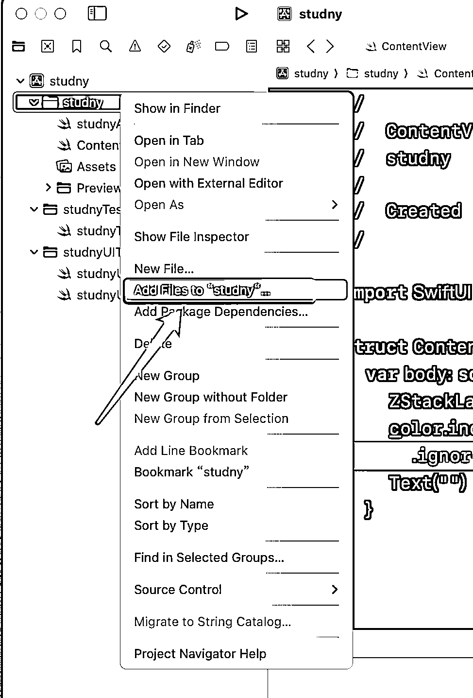
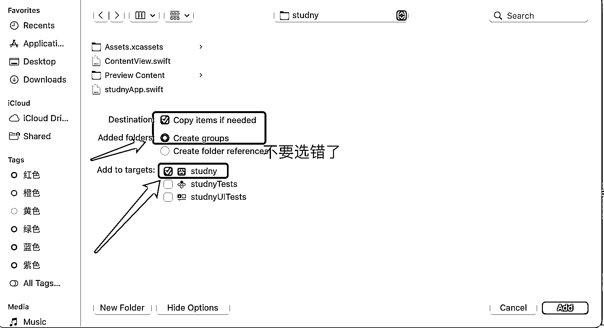
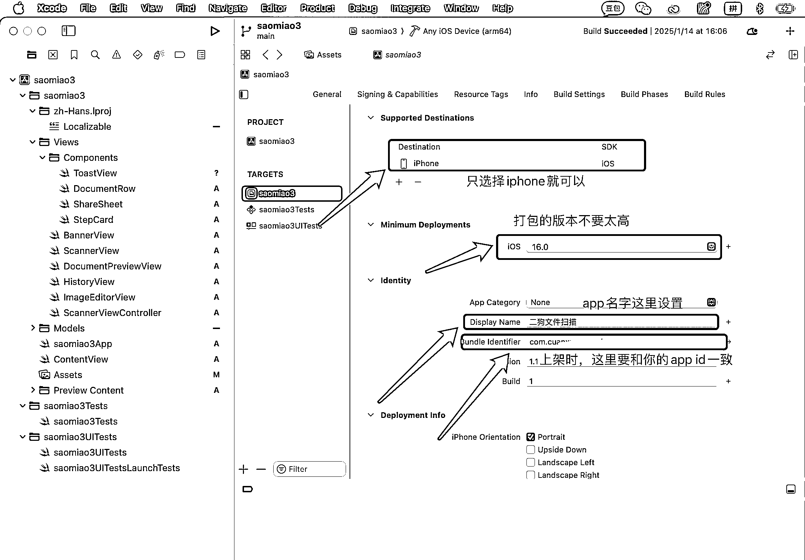

# 七日速成：借助 Cursor 我把三款 iOS 应用送上了 App Store

> 原文：[`www.yuque.com/for_lazy/zhoubao/ir01u9ut8su6ydwr`](https://www.yuque.com/for_lazy/zhoubao/ir01u9ut8su6ydwr)

## 一周三上架，零基础 iOS 开发实战记录

作者： 黑帽子

日期：2025-01-16

打个招呼。去年十二月参加完赚钱的 Cursor 大航海训练营后，我就开始用 Cursor 探索软件开发。到现在算下来，短短七天时间我做出了三款 App，并且全部通过审核上线。这是我的第一次 iOS 开发，中间踩的坑非常多，但靠着不断查资料、反复和 AI 沟通，问题一个一个被攻破。今天把这段经历整理出来，供大家参考。

。。。我做的那款性取向测评 App，今天早上刚被放出来，一看竟然冲到健康与健身付费榜第九名。。

 YP4fMyp)

目前这三款产品还没有产生营收，不过开发效率在肉眼可见地提升。最近完成的一款，从灵感到编码、调试、上架，总共只花了约八个小时。我觉得变现应该不远了，现在已经在提交 Google AdMob 的申请，只是海外节点抓取 App Store 信息比较慢，还在等待审核。

先说说我的背景。

我算是典型的开发门外汉，英语也不灵光。对编程的认知基本停留在用 WordPress、宝塔面板这类现成系统搭博客网站的层级。初次使用 Cursor 做开发，起步阶段的阻力非常大。

在航海营里跟着导师和手册，我先尝试做了贪吃蛇、图片压缩这类小工具。说实话，手册我翻了好几遍，用几句指令就能搞定的小玩意，我反复折腾了好几次才跑通。回过头看，当时犯的错很低级，主要是开发环境装错了、依赖丢错了目录，导致一直报错。把报错日志丢给 Cursor，它也解读不了，那段时间对自信心打击不小。

后来为什么锁定 iOS，而不是继续做网页、安卓、浏览器插件或微信小程序。

先谈做网站。用户留存难，流量主要靠 SEO。百度现在抓取严格，不备案基本不收录；Google SEO 周期又长，正向反馈来得慢，我怕还没回本就坚持不下去了。站外推广的话，网站的留存也撑不住，PC 和移动端的流量差距摆在那，所以果断转向移动端。

移动端里，我先排除安卓。两年前朋友帮我做过一个任务平台 App，我知道安卓上架流程繁琐，成本也不低，软著代办就要三百块，周期三四周。更麻烦的是兼容性，不同安卓版本、不同机型问题多，我没有能力去解决，直接放弃。

微信小程序也不考虑。留存差，很难通过搜索获得流量，只能靠主动投放和微信社交裂变，难度很高。而且个人资质开发限制多，我前两年在微擎买的小程序源码，没过一周就被封了，还是个很简单的打卡小工具。

最后的选择就只剩下 iOS。

做 iOS 的门槛，首先得有一台 Mac 和一台 iPhone。手机我一直用苹果，Mac 是从角落里翻出来的一台 2018 年的 Mac Pro，8 核 8 GB 内存 128 GB 空间 i5 处理器。配置比较老，同时开三个应用就明显卡顿。

第一个难关是 Apple 开发者账号，年费 99 美元，约合人民币 688 元/年。注册时提示账号异常无法注册，我找了大量教程也没解决。后来给 Apple 客服发邮件沟通，才发现八年前我注册过一个 Apple ID 并已实名，后续再注册的 ID 都无法通过开发者实名认证。好在从旧手机里找回了当年的 ID，这才顺利缴费通过。

关于开发者账号，我总结三点：
（1）尽量用同一台苹果设备从头注册到底，不要中途换机器。
（2）不要用登录过三个以上 Apple ID 的设备去注册，会被判定为公共设备。
（3）一定要用最早实名的 Apple ID，忘了的话苹果客服也不会告诉你，基本就永远注册不了。

账号也可以找人买，但买的账号次年续费是别人的支付信息，续不上就会导致已上架的应用被强制下架，能自用就自用，实在不行用家人的试一下。

第二个难关是开发环境。

iOS 开发需要 Cursor 和 Xcode 配合。流程是先在 Xcode 里新建项目，再让 Cursor 打开 Xcode 新建的目录。

 images.zsxq.com/FgWDu8KMxx6hK6asoh4UKR6ctMSG) images.zsxq.com/Fi7kmGvIXhfblW1HxmHPqiH_DMya)

这里有个史诗级坑：目录层级。

用 Xcode 新建项目后，目录下会形成三层结构。以我项目“paizhao”为例，paizhao 文件夹下还有同名子文件夹 paizhao，以及 paizhaoTest、PaizhaoUItest。

如果你让 Cursor 打开的是外层的 paizhao 文件夹，而不是里面的同名子文件夹，那么后面写的所有代码都是无效的。Xcode 打包编译的是子文件夹里的内容，只有代码放在那里才会被打包。

第二个史诗级坑：文件关联。

Cursor 写完代码回到 Xcode，经常发现文件一个都没出现。问 AI 也问不出原因。原因是 Cursor 的打开方式和 Xcode 不同，Cursor 新建的文件不会自动同步到 Xcode。每次 Cursor 生成新文件后，必须手动回 Xcode，右键对应目录，选择 Add Files to “xxxx”，手动把文件加进来。

注意不要勾选默认的 Create Folder References，要选择 Create Groups，否则文件加进去了也会编译失败，Cursor 也不提示这是原因。

第三个坑是数据线。iOS 真机调试需要在 iPhone 开启开发者模式后用数据线连 Mac。我试过淘宝 9.9 包邮的廉价线，根本连不上，最好用原装线。

再说下用 Cursor 开发的心得。

（1）功能越复杂越要拆分。登录、注册、支付这些对新手不友好。我发现 Cursor 一旦代码量超过两三千行，就容易“失忆”，效率暴跌，还会把之前的逻辑删掉。复杂业务要拆开做，先把最核心的基础功能跑通。
（2）别全靠 AI。一定要自己理解业务的逻辑和流程。AI 有时惊艳，大多数时候做不出想要的效果，特别是图形界面调整，改来改去也改不动。
（3）提示词是关键。做项目时一定要先建一个 cursorrules.md 的技术说明文件，再配上功能和页面设计的产品说明文件。随着 Bug 增加，Cursor 需要靠这些文件理解产品。上下文有字符限制，写不好提示词就用 Chat 模式先沟通清楚，让 AI 帮你把需求整理成提示词，效率会高很多。
（4）主要时间都花在编译报错和功能修复上。别被“一小时做一个 App”的说法带偏了，代码超过 2000 行后，光修 Bug 就要一两个小时。功能稍微复杂点，代码量很容易就破 2000。

最后说上架。

我目前的上架还算顺利，没遇到大家说的 4.2 问题。4.2 大概就是同质化严重被拒。

上架经验几点：

（1）隐私协议可以直接借鉴修改。在 App Store 找个同类应用，把它的隐私协议复制出来，扔给豆包之类的 AI 改一改再粘贴。核心是把 App 使用到的权限写清楚，比如相机、相册、WiFi 等。没有自己的服务器，用腾讯文档也能先撑着。
（2）最好有个自己的服务器。上架时要填营销网站链接，虽然可以空着，但后面挂 Google 广告就需要服务器放 ads.txt 文件，里面放你的 Google ID。腾讯文档实现不了。
（3）打包时注意两个细节：iOS 系统版本别选太高，否则低版本用户下不了。这个在 Xcode 的蓝色图标里可以设置。

另外发布平台只勾选 iPhone，把 iPad 等全部删掉，否则要多做一套预览图。

想到哪写到哪，可能不够全面，有问题评论区再聊。

* * *

评论区：

老彭 : 好久不见，黑帽哥

黑帽子 : [旺柴]

吴海晖 : 厉害呀。我尝试安卓 apk 都没搞出来。有时遇到问题怎么也解决不了。就直接卡死了。

Anna 碧海心 : 厉害👍高手👍