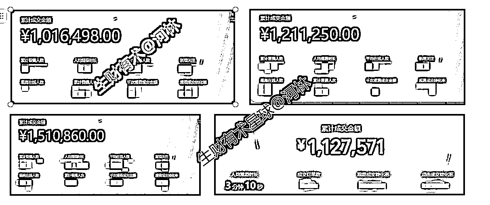
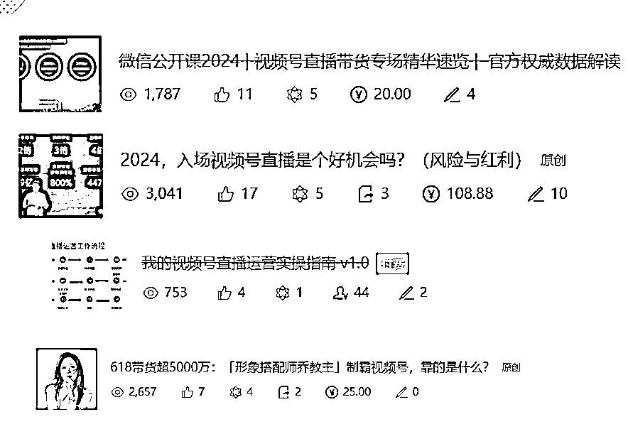
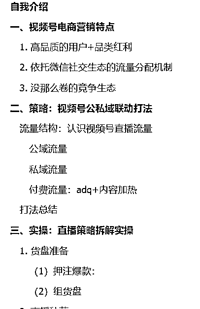
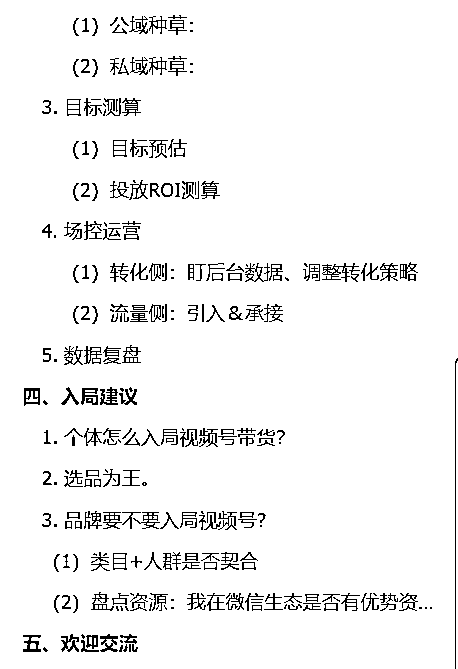
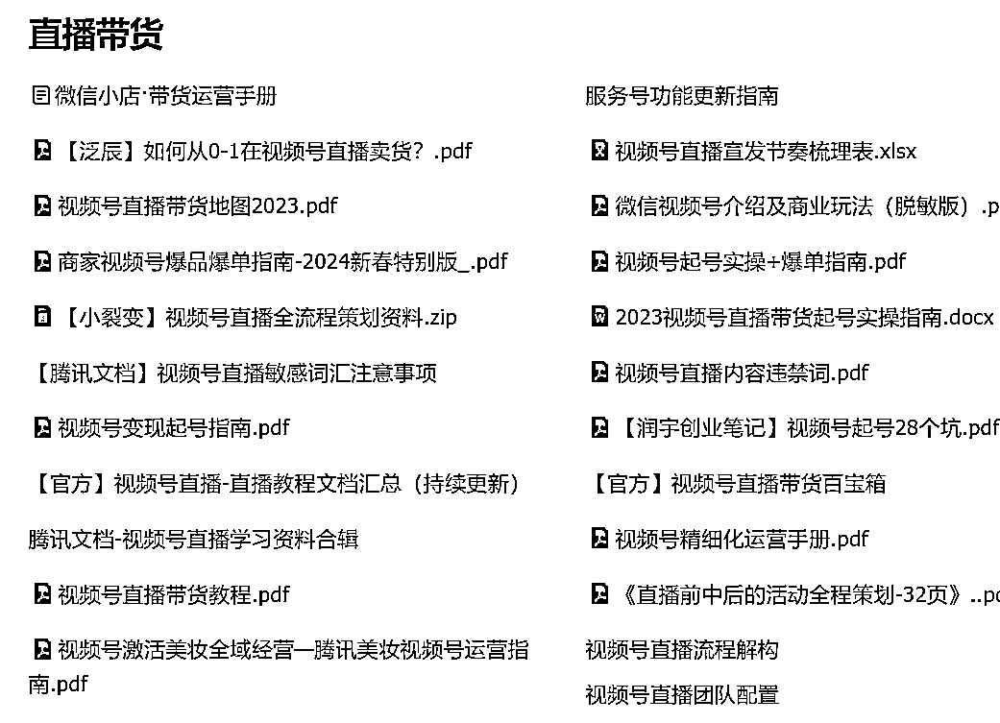
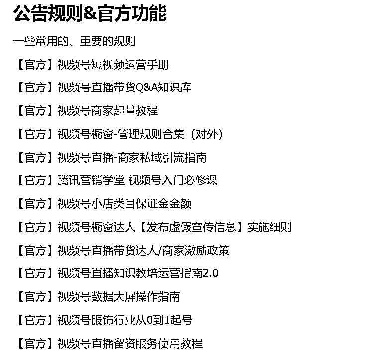

# 河林：视频号直播实操复盘与 2024 年度盘点

> 原文：[`www.yuque.com/for_lazy/zhoubao/yc1cqr86spg3yeyu`](https://www.yuque.com/for_lazy/zhoubao/yc1cqr86spg3yeyu)

## 河林谈微信视频号直播运营心得及 2024 回顾

作者：河林
日期：2024-12-30

赚钱的伙伴们好，我是河林，是个在赚钱圈里混了两年的新人发帖者。

先简单做个自我介绍，我是河林，1998 年出生，杭州驻点，运营行业从业四年。目前身兼两职：一边负责微信视频号直播的整体操盘，另一边做互联网营销方向的内容输出。

从 2022 年起，我先后服务于一家头部母婴内容集团和一家聚焦女装达人的视频号头部MCN，岗位覆盖直播带货的项目管理、现场执行与中控跟播。截至现在，参与统筹的直播场次接近三百场，品类横跨全域，其中诞生过数个单场破百万 GMV 的项目。

个人习惯做复盘拆解，擅长把营销案例拆开讲。长期为 01 裂变、鸟哥笔记等行业媒体撰稿，也在自己的公众号上连载过几篇关于视频号直播的分析文，阅读表现还不错。

2024 年落幕，这篇输出既是我个人过去两年多的阶段性复盘，也是入驻赚钱两年以来想为社区做的回馈。文章会围绕六个议题展开：

1. 视频号直播电商的生态特征
2. 公域与私域联动的打法思路
3. 百万级 GMV 专场的拆解
4. 新手入场的建议
5. 运营资料库免费开放
6. 全文不含任何付费课、带徒、社群推广

大纲结构：

适用说明提前说清楚：

1. 本次经验主要针对 5 人及以上、人员配置比较齐全的正规化带货直播团队。
2. 对于单兵作战、野路子玩法不适用。若你想了解无人直播、半无人直播、口播带货、剪辑短视频等更轻量的入门方式，建议去赚钱精华区看看，前辈们分享得很细。
3. 每个人对视频号的认知和阶段不同，我的视角难免偏科，覆盖面无法做到 100%。阅读后如有疑问，欢迎在评论区留言，能回答的我尽量回复。

正文配图与文字量比较大，受平台排版限制，完整版请跳转飞书查看：[`jid6vvjfdm.feishu.cn/docx/R9zfdm4Q2oVMS2xDneccJdkInxh?from=from_copylink`](https://jid6vvjfdm.feishu.cn/docx/R9zfdm4Q2oVMS2xDneccJdkInxh?from=from_copylink)

另外，我把过去一年持续沉淀整理的视频号运营资料库放到文末，作为 2025 新年的小礼物免费开放，欢迎自取。

全文无训练营、无收徒、无付费社群，纯干货分享，希望对正在做视频号直播的同行有参考价值。