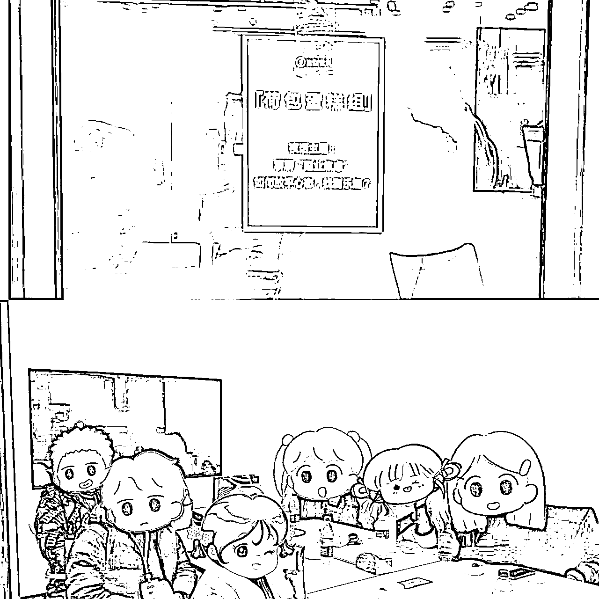
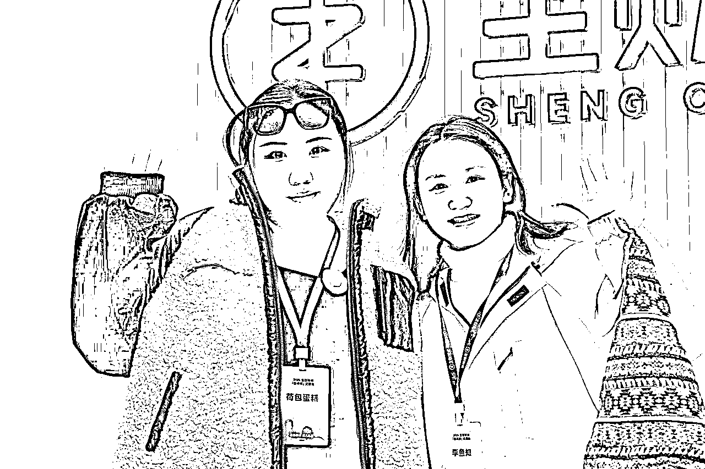

# 荷包蛋组夜话复盘 | 副业焦虑怎么破？先把心态调过来，再去找乐趣

> 来源：[https://lv9qj6hfr4z.feishu.cn/docx/JoF8dZ7yHoo7ikxxcZ7cBCV0nMb](https://lv9qj6hfr4z.feishu.cn/docx/JoF8dZ7yHoo7ikxxcZ7cBCV0nMb)

布道传术 成人达己

上周六的传术师线下见面会在赚钱新办公室举行，我有幸参与并担任荷包蛋组组局官。带着组里的六位伙伴，我们围坐下来聊了一个夜话主题：【聊聊“副业焦虑”：如何放平心态，找到乐趣？】

六个人，六条完全不同的副业赛道，公众号、闲鱼、YouTube、AI等都有涉猎，年龄从80后跨到00后，主业和副业的体量也各不相同。明明已经在各自领域尝到了一点甜头，大家却都卡在了同一个坎上——焦虑、内耗、疲惫。

更意外的是，现场至少四五个人都坦言自己看过心理医生、做过专业咨询。那一刻我才真正意识到，副业焦虑不是个例，而是正在发生的大规模情绪困境。夜话成了我们互相拆解困境、寻找出口的场。

# 一、我们聊了什么

白天刚被大佬们的信息轰炸完，晚上直接进入夜话环节。我作为E人组长，带着五位I人伙伴聊副业焦虑。

大家背景跨度极大：行业不同、赛道不同、起步时间不同。但聊了两三个小时后发现，焦虑的底色惊人地相似。情绪管理和心态调整，已经成了阻碍我们前进的第一道屏障。

# 二、四个让大家共情的焦虑陷阱

## 1. 好学生思维，是副业起步的最大刹车片

组里几乎都是名校出身，重本、一本、211、985扎堆。也正是这份优秀，让他们的思维变得很固化。赚钱之前，几乎没人想过人生还有第二套打法，默认的人生脚本就是：好好读书、找好工作、给老板打工。

这种好学生思维有几个典型特征：

* 目标单一且听话。只认“好成绩好学校好工作”这条路，对其他可能性视而不见。
* 过度依赖规则和权威。习惯等指令、等评价，很难为自己主动争取。
* 对风险极度恐惧。稳定感压倒一切，创业和试错被当成不负责任。
* 缺乏探索欲。只会找标准答案，不会为自己开新路。

两个案例让全组都沉默了。

案例A：他帮公司搭了一套年GMV破百万的产品，忙活了小半年，最后没分到一分钱利润。老板画饼，他就默默等。好学生式的责任感让他觉得“这是我该做的”，谈判和争取的意识几乎为零。

案例B：在一家公司稳定工作了20年，从执行做到管理，拿着死工资。直到离职那天才发现，整整二十年里，他从未为第二曲线做过规划。

觉醒的关键，是先拆解认知。好学生思维让我们把付出等同于理所当然，把回报寄托于“自然分配”。要走出来，就得重新定义成功，敢于从规则里跳出来，用行动建立自我意识。

## 2. “我不配”三个字，偷走了多少机会

不配得感，是组里最隐蔽也最致命的问题。

案例C是一位有15年经验的老程序员，技术非常硬。第一份工作因为招人招出了新领导，自己被挤走。第二份工作，老板三次主动提出晋升加薪，他三次都拒绝，觉得自己“没管理能力”。问他如果还有第四次会不会放弃，他说“绝对不会”。那三年的后悔，成了他最深的内耗。

为什么会这样？

* 底层自信不足。把成功归因于运气，否定自己的核心价值。
* 完美主义绑架。觉得没准备到100%就不敢接。
* 缺乏正向反馈循环。越拒绝，越觉得自己不行。

破局的方法很朴素：先承认自己的价值是挣来的。把认可拆成小块来积累，接受一次赞美、完成一个小管理任务。允许自己不完美，用行动而不是想象去证明自己。外部反馈也是很好的解药，多听一句“你很适合”，比自己憋三个月管用。

## 3. 赛道焦虑：东一榔头西一棒槌，什么都做不好

很多人的副业状态就是：今天看公众号，明天玩AI，后天想做闲鱼，最后哪个都没成型。主业副业时间打架，正反馈迟迟不到，焦虑感指数级上升。

组员D给我们上了一课。他从小应试教育长大，做事极度专注，只深耕公众号流量主赛道，日更从不间断。前三个月零收益，第四个月一篇爆文入账5万+。反观我自己，半个月赚一元就放弃，换项目如换衣服，最后竹篮打水。

核心问题就三点：方向不清、缺乏正反馈、时间失控。

解法是专注与分配并重。选一个短期能有正反馈的赛道猛攻，同时给真正热爱的事留20%的时间。用二八定律分配精力，给自己定一个3个月试验期。扛过前期的“零回报期”，坚持本身就是稀缺优势。

## 4. 关系内耗：身边的人在拖你后腿

人际和两性关系，是被低估的焦虑放大器。

一个摆烂的伴侣、一个总拿你比较的圈子、一个到处内卷的同行群，都会把你的能量迅速耗空。我自己就经历过，被同行优秀表现反复对比带来的焦虑，现在学会了屏蔽无效信息。

调整思路是：远离消耗型关系，找到双向成就的伙伴。管理对比心态，把别人的优秀变成学习样本而不是否定自己的证据。给自己设定清晰的工作生活边界，按自己的节奏走，不要被别人的“快”绑架。内在建设靠学习、运动、冥想来支撑，情绪稳了，决策才清。

# 三、夜话给我的总结

这次夜话让我更清楚地看到，副业焦虑不是单一问题，而是思维固化、自卑、迷茫、关系消耗叠加的结果。

它不可怕，它是成长的信号。

放平心态，找到乐趣，本质上是四件事：打破好学生思维的惯性，重建自我价值感，选定赛道深度深耕，优化关系减少内耗。

副业不只是赚钱工具，更是探索人生的第二曲线。愿我们都能在试错中更清醒，在坚持中找到节奏，在探索里体会真正的乐趣。

