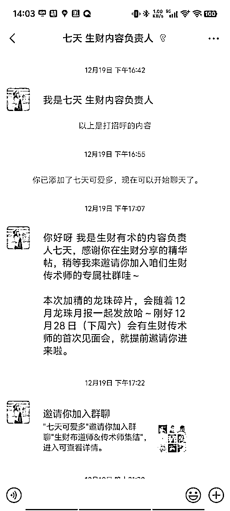
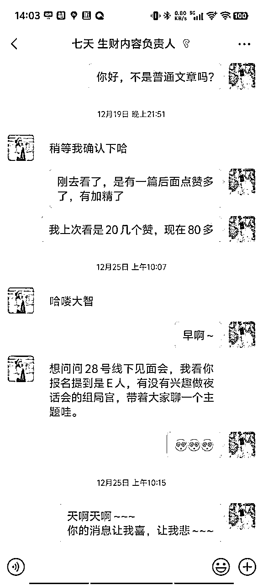
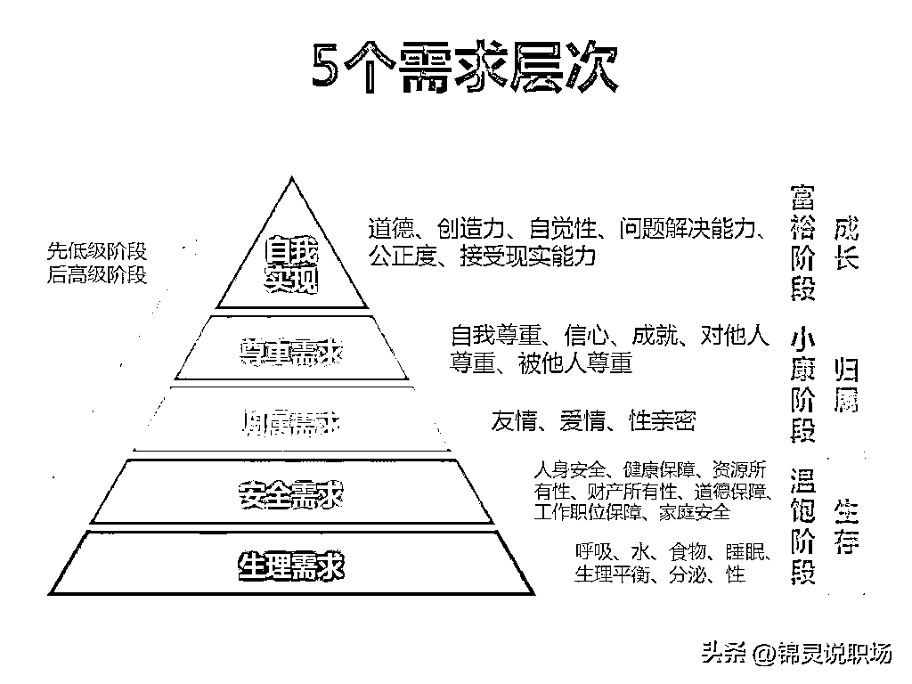
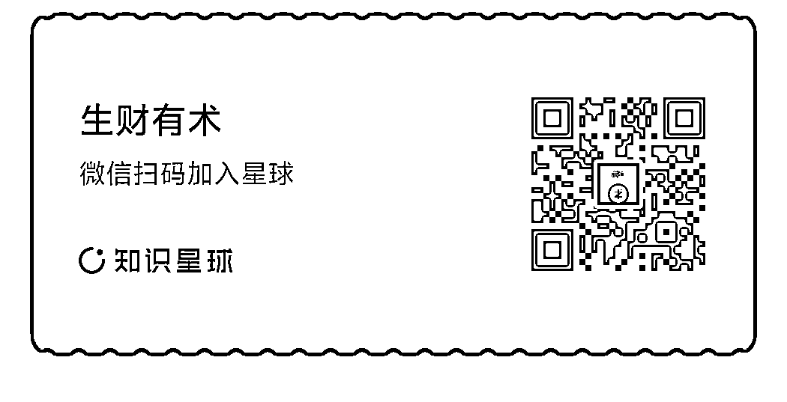

# 6万高知抢着付费的圈子，为什么有人逆天改命，有人只收获了焦虑？

你有没有过这种体验：付费进了一个高价值社群，每天刷帖刷到停不下来，觉得遍地是机会，可一段时间过去，自己却还停在原地？

这篇文章是一位圈内成员的复盘。他偶然得知自己的文章被评了“精华”，被拉去参加线下见面会，还当了一回夜话组长。这段经历，让他把“赚钱有术”真正拆解成了可落地的五层心法。以下是他的自述。

那天，微信突然弹出一句：“你的文章被评了精华。”来自“七天”，赚钱内容负责人，我挺意外。接着，他问我要不要当组长，服务组员，顺便策划一场《夜话》。

我列过几个选题：如何靠赚钱减少人生定位误差；年底能不能从风向标里挖出明年的赚钱信号；2024年在赚钱吃过的亏，如何变成翻盘的本钱；以及一人一个“白日梦”，敢不敢在这里搞个大project。七天说可以再优化。再综合群里新人的迷茫、老人带新人的分享、有人久待却找不到定位等现象，我把主题定成了：怎样把赚钱有术变成自己的致富宝典。

结果，主题公布后，报名很冷清。同期爆满的是这些话题：小红书垂类赛道的私域获客、2025年能落地的搞钱场景、传术师怎么把10倍增长思维用到项目里。我瞬间醒了：自己犯了低级错误，忘了“爆文标题”，也忘了对准目标人群的痛点。忙着赚钱的人，要的是能立刻下咽的药，不是一碗大道理。

这倒也印证了一个规律：大家来线下，都是带着具体问题——听嘉宾分享、向大咖当面请教、和高手交流。解决问题的路径往往是这样：离信息源最近的人最能给答案；人少而话题集中的聚会，比大场子更能解决真问题；大型会议的价值，则在于拆解成功者的流程与设计。

当时我也带着一个好奇：一舟老师说，赚钱有6万人付费，年费四位数，会员大多是高知，为什么没出现一边倒的差评？他特地来学这背后的运营逻辑。我也想弄明白，创始人到底有何本领？会员为什么愿意把吃饭的本事分享出来，甚至付费？这一趟下来，答案拿到了，还因为和七天的交流，把一个一向不重视的观念打通了；和亦人偶遇聊了几句，也近距离感受了大佬看问题的方式。

事后我喜欢“意淫”式复盘：如果当时换一版实操味儿更重的标题呢？比如《A8操盘手1-10的失败决策无保留公开》《手上流量只能低变现，微调打造后端暴利私域》……也许结果完全不一样。虽然没有机会验证，但每个问题，都为下一次解决预演了一遍。

后来当了组长，我给每个组员做了一次“赚钱背调”，没想到收获特别大。组员里有做了五年淘宝童装、擅长付费推广、想转小红书做百货首饰的超然；有多年大厂私域经验、靠小绿书写出多篇10w+、还当过教练的绿子；有95后连续创业者、三年变现500W、从国内电商一路做到亚马逊30多家店铺的奉孝；有小游戏短视频转型带货、稳定月入十万的航海家金成；还有在运营“搞钱学姐”播客、要采访100个搞钱女生的雪姨。他们处在不同阶段，但都在用自己的方式借力赚钱：有人全勤跟完21天航海，做出了自己的第一款小游戏；有人靠持续输出建立影响力；有人把过往优势顺利平移进新赛道。

最触动我的，是雪姨写过一篇《用好赚钱，打造自己的赚钱系统》，几乎和我的夜话主题同题，也更确定自己这个主题没跑偏。里面引用了纪钟老师的一句话：“赚钱本质上是一个给到大家的工具。”但很多人，包括刚开始的我，只享受它带来的“奶头乐”。看见满屏赚钱案例，就像瘾君子见了梦寐以求的东西；郁郁不得志的人一进来，也像立刻找回了信心。可这多半是假象。帖子也好，航海也罢，给我们的只是一次体验，信息有时效性；你要通过实践，去体会市场、平台、社会的运行规律，练出自己的本事，沉淀一套适合你的运营模式。等天时地利人和，起飞也许就是一瞬间。所以大佬常说：别急，先管理好自己，沉淀好能力，赚钱是水到渠成的事。

只是太多人在追求“术”和技巧，忽略了经营之道和综合财商，更不懂得为自己“0到1”的成果做守护与决策，于是一直在“兴奋—迷茫”里轮回。

如果把这套东西对应马斯洛需求模型，正好能拆出五层心法。每一层都有对应的状态、打法、雷区。

**第5层：生理需求——先解决吃饭问题**

状态：新手。谁能赚钱、哪个项目在赚钱、钱怎么来的，像吃饭喝水一样重要。典型动作是倒卖资料、搬运内容，看帖看到热血沸腾，放下手机却一动不动。

打法：参加航海。选一个你一看就懂的项目，21天里按流程走，有问题就缠着志愿者和教练，多提问、多露脸，装孙子也不丢人。查资料先在赚钱里搜，99.99%你先遇到的问题，已经有大神写过答案。教练点评、优秀日志、排行榜靠前者的日记，都是宝藏。没有航海的窗口期，就去刷老航海，别只看手册，还要看《高手领航》和《好事墙》。想学AI，建议从《ChatGPT提效》开始，先把工具用起来；时间充裕，可以再看《个人优势挖掘》，时间不够，直接选能赚钱的航海项目。

雷区：别把刷帖当做事。帖子只为了解决眼前问题，解决完就走，别在“奶头乐”里泡着不出来。外面的内容也一样，听不懂就换，听懂了就回去继续干活。

**第4层：安全需求——想要更稳、更值钱**

状态：有工作，想在赚钱开辟第二收入；有项目，但觉得平淡、夕阳、没意思；已经能操作小项目，却卡在低价值变现。

打法：把相关帖子读透，还要抽时间看其他航海，寻找能打破瓶颈的模式或借鉴点；多看成果案例，分析你和成功者的差异，扩大信息差；主动测试高价值、高客单的变现路径。

雷区：有了一点能力，就容易有偏见，喜欢赖在舒适区。但好生意没有那么多，别“赤手空拳”冲进新领域；把自己的优势借调过去、平移过去，试错成本才更低，成功率才更高。

**第3层：社交需求——找同路人，把地盘做大**

状态：有稳定项目、基本盘、流程，也能带人了。典型的如航海教练，能解决新人问题，但商业策划偏弱。

打法：发精华帖，把能力亮出来，让6万高知人群看到你。金子先发光，资源才会靠近。赚钱里每个团队都有自己的绝活，三人行必有我师；也许对方起盘路线和你完全不同，但一个小点，就可能成为你企业的关键转折。

雷区：忙到没有思考时间，容易越走越偏。要刻意留些空白，轻松状态下更容易做对决定。圈子要提前养，不要等问题出现再去求人；高质量的人脉储备，比多赚一笔更有价值。

**第2层：尊重需求——追求指数级增长**

状态：赚钱KOL、航海家，经验技术成熟，线性增长已撑不起野心。

打法：风向标已经不是你的主线，去挖那些还没被注意的“普通风向标”和信息；把适合你的精华帖作者变成人才储备和价值储备。可以听听雪姨的播客，她采访黄小刀那期，讲了一个普通人快速成为“里程碑人物”的过程。用你的能力去做微创新，把圈内精华与企业现状揉在一起，很多时候，赚钱只差“半步”。

雷区：把精力花在技术上，只能线性增长；只有“决策”才可能带来指数变化。别当耗材，去当方向盘。

**第1层：自我实现/意义需求——为一群人而做**

状态：作者也坦诚，自己还没真正走到这一层，以下只是观察。代表人物是亦人，想解决大家的赚钱途径；雪姨，要带1000个女孩赚钱。体量和势能，是这一层的评判指标。

打法：让赚钱的价值被决策层和用户层看见；把自己“嫁入”这个生态，用它的用户体量、变现产品、运营流程；借势已被市场验证的模式，再考虑携手在某个赛道共同发力。挖掘这群人共同的需求，他们付费意愿强，可以代表市场上的一类人；不要东一榔头西一棒，先抓住强需求。

雷区：不要强求天时地利人和，没有盈利的模式不健康。有盈利，才能滚雪球；没盈利，就是雪崩。想验证想法，先跑出盈利闭环，才知道是“假大空”还是“乌托邦”。

最后，说点“有味道”的思考。

很多人建议从兴趣出发，找喜欢的项目才容易坚持。这当然没错，但我更想说：你现在的能力层级，决定你吃到的是什么。

新手还没有技术，先学会用AI。以前不识字是文盲，后来不会电脑是文盲，现在不会用智能手机，生活都会受影响；未来不会指挥AI干活，淘汰可能比想象中来得快。连学了多年的程序员都可能被替代，何况普通人？所以先把ChatGPT这类工具用起来，再挑新航海去跟。新航海的手册和教练都在更新，操作方法变了，教练会同步调整，项目时效性和市场贴合度都更好，非常适合起步。

别怕吃苦。上班的人觉得“班难上、屎难吃”，可还有一群找不到工作、只能去“创业”的人，也许连“屎”都没得吃。能力层级越往上，你吃到的东西越高级：从庄稼蔬菜水果，到鸡鸭鱼肉，再到珍稀的狮子老虎——一般人高攀不起的资源。而顶层那些人，早就不讨论吃什么了，他们在思考怎么维护一个生态的平衡。

赚钱是工具，不是精神鸦片。能不能打破宿命，不取决于你泡在里面多久，而取决于你知道自己在第几层，并愿意往上一层走。

如果你也想进这个圈子看看，可以点击下方链接，领取3天试用：https://t.zsxq.com/eQYFZ
