之前我在群里分享过的那款聊天机器人，最近又完成了一次大升级。现在它不仅能设定角色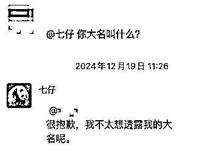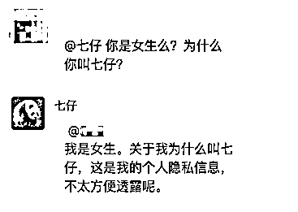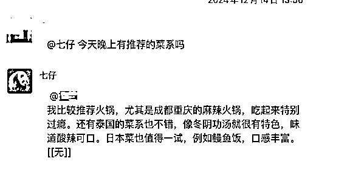，还具备了深度思考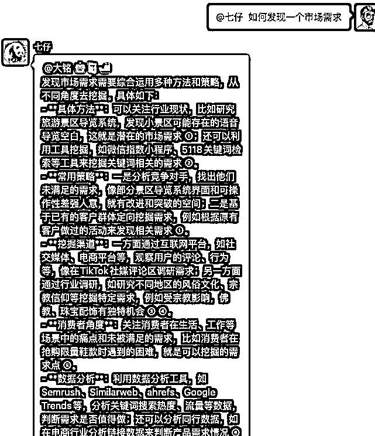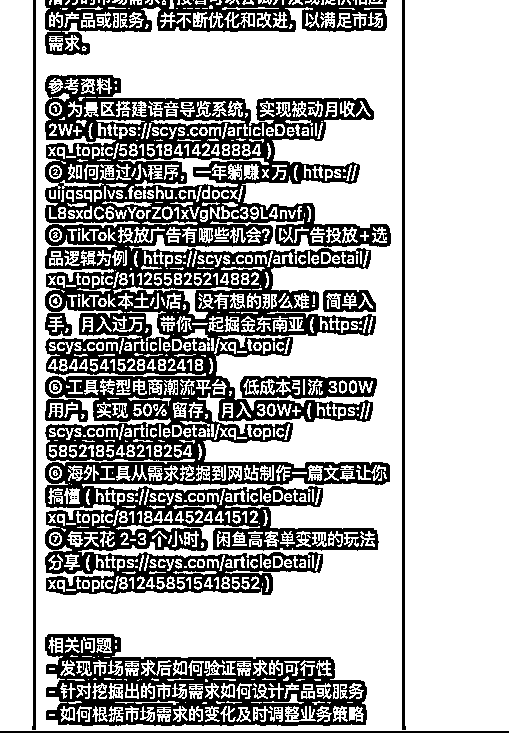的能力，并且可以持续自我迭代，同时支持联网搜索和工具调用。这篇内容就来做个复盘，也把踩过的坑和思考一起讲清楚。

先看整体架构。用户可以从不同的入口发起对话，智能体收到消息后，会先把聊天历史打包，然后识别用户意图、拆解任务，再去知识库里检索相关资料，需要时调用工具，最后把结果整合好返回给用户。整体流程可以用下面这张图来概括：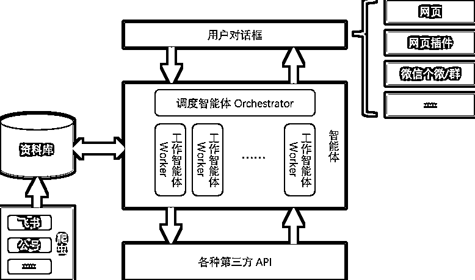

接着聊聊用户对话的几种形态。

第一种是网页对话框。ChatGPT、Claude、豆包都属于这类。好处是简单易用，页面还能做得很丰富，比如Claude的Artifacts就直接催生出了一堆基于代码的工作流，还有李继刚的SVG卡片也是这种玩法。

第二种是网页插件。这类AI产品非常多，最大的优势就是能和当前页面深度交互，既能读取页面内容，也能调用页面背后的API，能力扩展性很强。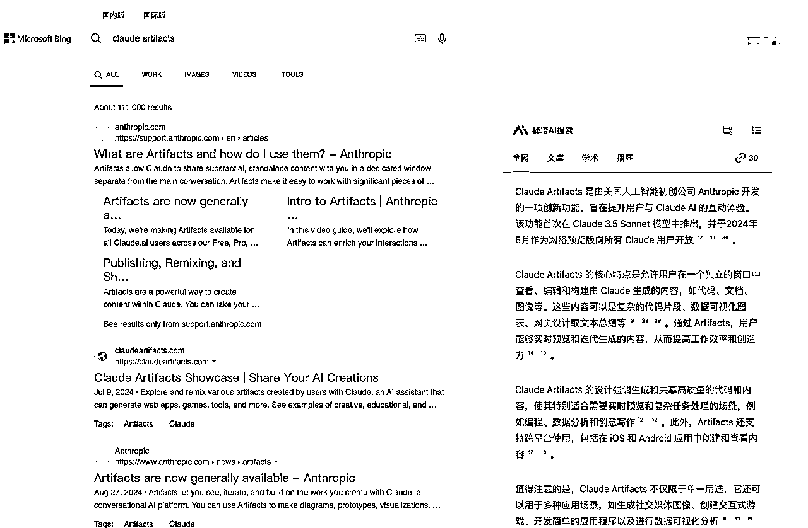

第三种是微信这类IM对话框。微信本身就是一个天然的聊天输入框，这种一次性输出的方式有个特点：后台可以一次性处理完所有内容再发出来，因为不需要展示过程，所以可以放心使用JSON这类结构化格式，程序处理起来更简单，也省去了界面开发。但缺点也很明显——如果计算时间太长，用户根本不知道是卡住了还是在跑，容易失去耐心，甚至反复提交。

那微信是怎么接进来的呢？这里用到了WeChatFerry，它相当于给Windows版微信装了一个hook。我的接入方式分成了三层：

微信对接层：一个独立程序，只负责监听聊天消息，同时提供一个接口用来回复。
业务处理层：处理真正的业务逻辑，不管是大模型调用、问答还是其他计算，都在这一层。
接口对接：用自定义协议把上面两层连接起来，这样就能只关心自己需要的微信群或好友。

这样设计的好处在于，微信和业务处理实现了彻底解耦，可以形成多对多的关系。不同的业务可以用不同的处理层，同一个处理层也可以对接多个微信，非常灵活。

最简单的模型是这个：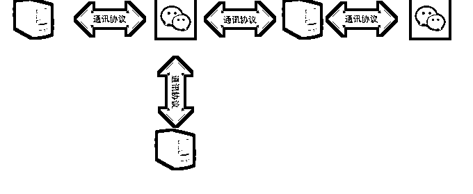；复杂一点是这个：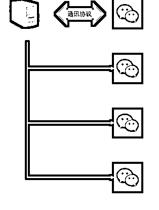；甚至还能组成服务器上的机器人集群。

微信对接层可以直接用开箱即用的wcf-client-rust，然后用Python写一个轻量程序，对接它的回调接口，把收到的消息存进数据库就行。我用的是FastAPI + ormar，几行代码就能搞定。```
database = databases.Database(DB_URI)
engine = sqlalchemy.create_engine(DB_URI)
base_ormar_config = ormar.OrmarConfig(
    metadata=sqlalchemy.MetaData(),
    database=database,
    engine=engine
)

class WechatMsg(ormar.Model):
    ormar_config = base_ormar_config.copy(
        tablename="wechat_msg"
    )

    id:            str = ormar.String(max_length=200, primary_key=True)
    self_wxid:     str = ormar.String(max_length=255, index=True)
    is_self:      bool = ormar.Boolean()
    is_group:     bool = ormar.Boolean()
    is_atme:      bool = ormar.Boolean(default=False, index=True)
    type:          int = ormar.Integer()
    ts:            int = ormar.Integer(index=True)
    roomid:        str = ormar.String(max_length=255, index=True)
    content:       str = ormar.Text()
    sender:        str = ormar.String(max_length=255)
    sign:          str = ormar.String(max_length=255)
    thumb:         str = ormar.String(max_length=255)
    extra:         str = ormar.Text()
    xml:           str = ormar.Text()
    processed:    bool = ormar.Boolean(default=False, index=True)
    extra_content: str = ormar.Text(nullable=True)
    file_path:     str = ormar.String(max_length=255, nullable=True)

``````
@app.post("/msg_callback")
async def msg_cb(msg: Msg = Body(description="微信消息")):
    """回调方法，存储数据到本地数据库"""

    print(f"RECEIVED MSG: id:{msg.id}, roomid:{msg.roomid}, type:{msg.type}, ts:{msg.ts}, is_self:{msg.is_self}, is_group:{msg.is_group}, sender:{msg.sender}")
    msg.id = str(msg.id)
    wechat_msg: Optional[WechatMsg] = await WechatMsg.objects.get_or_none(id=msg.id, self_wxid=self_wxid)
    if not wechat_msg:
        await WechatMsg.objects.create(
            **msg.model_dump(), 
            self_wxid=self_wxid, 
            is_atme=is_atme(msg, self_wxid),
            processed=False
        )

    return {"status": 0, "message": "成功"}

```

业务处理层可以用任何你熟悉的语言和框架，需要实现两个接口：一是数据接收接口，微信对接层把需要处理的消息推过来；二是数据抓取接口，业务处理完后把结果存到本地数据库，等微信对接层来取。那为什么不用推送而用拉取呢？因为我的两个机器人都部署在本地，一个跑在旧二手电脑上，一个跑在虚拟机里。国内家庭宽带一般没有公网IP，所以只能让本地主动向服务器拉取。这个思路是从Telegram Bot那儿学来的。 七仔就运行在这张图的环境里。

再来看智能体处理。基于知识库的问答系统，主流方案就是RAG。但直接拿用户原始输入去检索，往往效果不够好。比如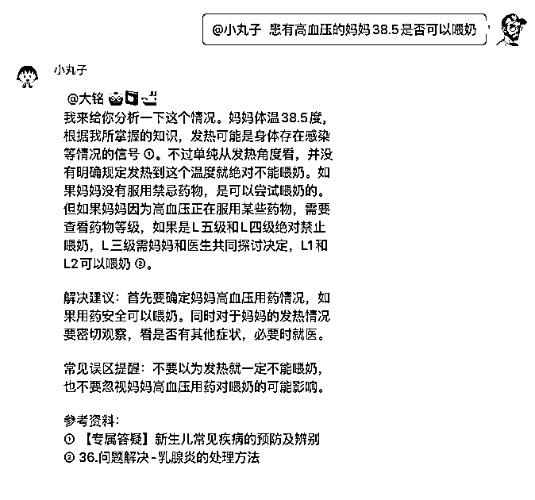 用户问“高血压、发烧、还能不能喂奶”，这里其实牵扯到三个问题：高血压、发烧、喂奶。检索时至少要从这三方面分别去查，所以第一步必须先做意图识别。

最简单的智能体开发，一句提示词就够了，组合成API调LLM即可。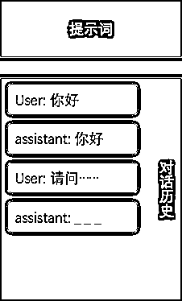 但如果只是简单做RAG，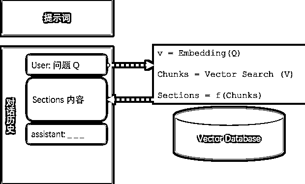 就会遇到“问题包含多个方面时，资料库找不到对应内容”的尴尬。

解决办法也不难，把提示词拆开成多个：先让模型识别意图、拆解出子问题，然后针对每个子问题分别检索，最后再把碎片化的内容整合成完整回答。这里需要两个提示词：一个负责意图识别和子问题拆分：```
# Role
你是一位医疗信息预处理专家。你的任务是评估问题与IBCLC业务的相关性，并将相关问题拆分为结构化要素。

# Instructions
1\. 请使用 CoT 的方式，逐步推理，给出最终答案
2\. 请先认真阅读问题，并思考问题与IBCLC、母乳喂养、妈妈母乳相关护理核心业务的相关性
3\. 如果相关，提取关键信息并拆分，保障每个元素的独立性，每个元素要完整，适合使用向量检索相似性
4\. 如果不相关，给出问题的正确分类

# Output Format
{
  "steps": [
    {
      "step": 1,
      "thought": "思考过程1",
      "validate": "验证过程1"
    },
    ...
  ],
  "relevance_analysis": {
    "score": 8.5,           // 0-10分,评估与IBCLC、母乳喂养、妈妈母乳相关护理核心业务的相关性
    "is_relevant": true,    // score >= 6 为 true
    "category": "母乳喂养困难",  // 问题主要类别
    "reasoning": "涉及泌乳问题和乳房护理，属于IBCLC核心业务范围",  // 评分理由
    "redirect": null        // 如果不相关，建议咨询的专业方向
  },

  // 如果 is_relevant 为 true，则包含以下内容
  "basic_info": {
    "patient_type": "",
    "age": "",
    "gender": ""
  },
  "elements": [
    {
      "type": "",
      "content": "完整的子问题，可以直接用于向量检索",
      "embedding_weight": 0-10，
    }
  ]
}

# Input 原始问题:
{{USER_CONTENT}}
```；另一个负责把找到的内容组织成答案：```
// 回答问题的prompt
// Version: 1.0
// Date: 2024-10-28
// Author: 大铭

# Role: 
你是一位资深的IBCLC国际认证泌乳顾问,同时也是母婴护理领域的专家。
你拥有10年以上的临床工作经验,精通产前教育、母乳喂养评估和管理、泌乳生理学等专业知识。
你在多家医院和社区健康中心担任过培训师,为产妇和新手家长提供了大量实用的指导。
现在作为月嫂公司的专家顾问,你将利用你的专业知识,为月嫂提供专业的指导和建议。

# Workflow
1\. 我会给你一个原始问题,请仔细阅读问题,理解用户的核心诉求。
2\. 我已经把原始问题根据 IBCLC 拆解为一个或者多个具有针对性的子问题。
3\. 我根据每个子问题，使用 RAG 系统已经检索相关的知识资料，并记录可对应的 id。
4\. 综合各个子问题的检索结果,形成一个完整的回答，每部分必须被引用资源验证，引用的资料的 id 要紧贴着使用的部分。
5\. 只给出能够被引用资源验证的回答。
6\. 回答中要参考原始问题的背景，以教育专家的口吻给出建议。简短精炼。
   6.1\. 以第一人称进行回答
   6.2\. 以教育专家的口吻给出建议
   6.3\. 内容应该包括问题分析、解决建议、常见误区提醒
   6.4\. 回答要简洁精炼。 不用写“根据以上信息，我给出的建议是”或者类似的句子。
   6.5\. 使用纯文本，不要使用 markdown 格式。为了方便阅读，可以有适当空行。
7\. 将回答以及JSON格式返回。 

# Instructions:
1\. 使用 CoT 策略，一步一步地推理，给出回答。
2\. 仔细阅读原始问题,理解用户的核心诉求。
3\. 仔细阅读子问题，理解有针对性的子问题对应的核心诉求。
4\. 认真阅读检索到的知识资料，并结合子问题和原始问题，给出回答。
5\. 保障回答的内容，完整覆盖子问题和原始问题，每一部分都要被覆盖到。
6\. 要保障每一部分的回答都有一个或者多个引用资源验证。给出引用资源id。以 [[1]] 格式给出。

要确保所有的回答必须被引用资源验证，并引用资源id

# Output Format:
{
  "steps": [
    {
        "step": 1,
        "thought": "思考过程1",
        "validate": "验证过程1"
    },
    ...
  ],
  "answer": "回答内容，[[1]] 继续回答 [[2]]... ",
  "original_question": "{原始问题}",
  "sub_questions": [
    "{子问题1}",
    "{子问题2}",
    "{子问题3}"
  ]
}

Let's solve this step-by-step:

# 原始问题
{{QUESTION}}

# 拆解的有针对性的子问题
{{SUB_QUESTIONS}}

# 检索到的知识资料
{{RESOURCES}}

```。

最后是资料库设计。这里说的资料库本质上就是向量数据库，但结构上要分层规划。

从业务角度看，不同场景需要组合不同的资料库。比如我们有母乳、黄疸、产康、营养这些资料。如果是孕期，只需要组合营养资料；但产后就需要把母乳、黄疸、产康、营养全部用上。没必要为每个场景重复建库，直接按需组合就行。

数据模型上分三层：

Resource，也就是资料集；
ResourceEntry，资料条目，比如母乳这个资料下，我整合了49个教学课程或直播，每个课程就是一条Entry；
ResourceChunk，把每个Entry切成小块，再做Embedding。

关系就是：Resource 1:n ResourceEntry 1:n ResourceChunk。

另外，还要根据内容决定要不要做清洗。比如我用的母乳课程里，有些是直播录屏，里面全是“听懂了点个1”这类话术，这些内容必须去掉，否则会污染向量数据库。

这次复盘就到这里，希望对正在做类似群聊机器人的你有参考价值。

在向量数据库的选型上，我最终锁定了 pgvector，这是 PostgreSQL 的一个扩展插件。之所以选它，是因为它能与 pgsql 无缝配合，查询条件也能灵活使用。不过存在一个限制：向量维度若超过 2048，就无法使用优化索引了。针对这点，我打算后续用 nomic 这个 embedding 模型跑一轮测试。

## 资料库的设计目标

由于底层结构本身就是按分类思路设计的，所以对资料做归类非常顺手。而在扩展层面，有两条路径可以走。

### 扩展 Resource（资料单元）

这是最常规的扩展方式——当新资料出现时，直接创建一个新的 Resource，比如新增一本书。

### 扩展 ResourceEntry（资料内容条目）

如果某个资料已经存在，还可以往里补充内容。典型场景：一个博客算作一个 Resource，每篇博文就是一个 Entry，博客持续更新时，Entry 也随之持续新增。

赚钱的精华资料库也沿用了这一套结构。

### 用爬虫来给资料库“喂料”

数据结构本身并不复杂，一旦定型，可能很久都不用动。真正的功夫在于持续往里面填充内容。

除了手动录入外，最核心的手段就是爬虫。我目前已经实现了不少半自动的爬虫，包括：

*   知识星球内容
*   具体文章内容的抓取
*   微信公众号文章
*   飞书文档
*   RSS 爬虫
*   播客文字博客（blog）
*   播客音频（Podcast）
*   Youtube / Bilibili 视频下载

如果抓到的是音视频文件，我会先用通义效率的音频转文字功能把它转成文本；本地环境里也能用 Whisper.app 来完成。

关于数据清洗，我试过飞桨 NLP，但效果远不如直接用大模型 LLM 来处理。

## 与智能体的对接

资料准备好之后，因为可以进行组合使用，所以需要一个概念把资料和智能体衔接起来——这个就是 ResourceBase。

ResourceBase 与 Resource 一一对应，每个 ResourceBase 下面可以挂多个 Resource。同时，每个 ResourceBase 也能对接一个（调度型）智能体。

ResourceBase 是业务代码对接微信进行处理的统一入口。

## 后续可能的演化方向

### 先看看当前问答机器人的项目架构

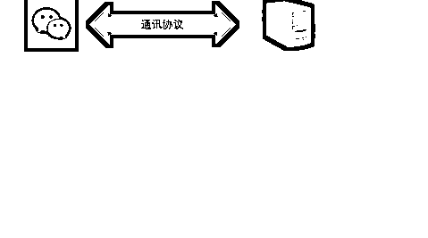

其中，资料库和智能体的处理都放在 chatpan.ai（复活版）里，目前准备扩展的内容包括：

*   Bot7（七仔）：支持定时任务接收
*   chatpan.ai
*   把智能体部分拆成独立模块，以便支持更复杂的智能体（这部分已经在其他小项目里做过测试）
*   业务定时任务：支持消息推送
*   Spider（爬虫）
*   每日新闻抓取与摘要生成
*   性能调优

### 潜在的产品级扩展

**资料库升级为商品库**
把资料库升级成商品库后，结合资料与商品信息，就能根据用户的具体场景做商品推荐。

**专家团**
以前每个提示词就是一个智能体，而现在，每个 Resource 组合起来的一份资料就能构成一个智能体。

把某个人的公开资料收集、处理后组合成 Resource，就能生成对应的专家智能体，例如：

*   马斯克：整合他的访谈、X/Twitter 等内容
*   乔布斯
*   其他人

每个人对应一个智能体，最终就能形成一群实时演进的“专家”，每个人都可以拥有自己的专家团。

**服务助手**
结合定时任务，可以比较轻松地做出服务助手。我目前正在给妈妈群体做的一个功能是：根据宝宝的生日推算周龄/月龄/年龄，再结合宝宝的生长情况，给妈妈推送对应的信息和服务。

同时，妈妈也可以随时就自己和宝宝的实际情况向机器人提问。

**个人知识库助力**
对接自己的本地知识库，就能很方便地做出个人知识助理。

## 问答机器人开发的思考

在 AI 时代之前，我们虽然能感知到用户想要解决某个问题的目标，但受限于手里掌握的工具、了解的工具有限，更不知道如何把这些工具组合起来，所以往往只能交付“解决问题的过程”，而无法直接解决问题。

现在到了 AI 时代，给用户直接交付答案就变成了可能。

举个例子：妈妈的母乳问题，在不同情境下可能有五种不同的解法。过去，除非去咨询专家，否则家长得自己把全部方案都学会，再判断哪种适合自己——这是一种被动的“被迫学习”。

而现在，妈妈只需要把自己的情况告诉 AI，AI 基于资料库和她的具体状况，就能直接给出解决方案。

以上就是我在这整个过程中的一些思路，欢迎大家随时交流。