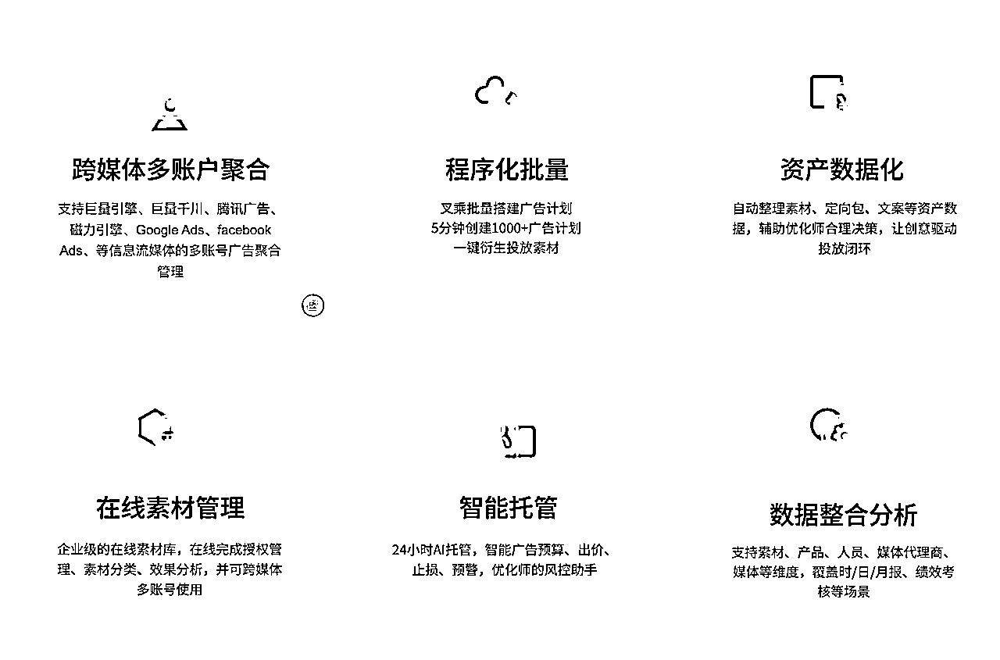
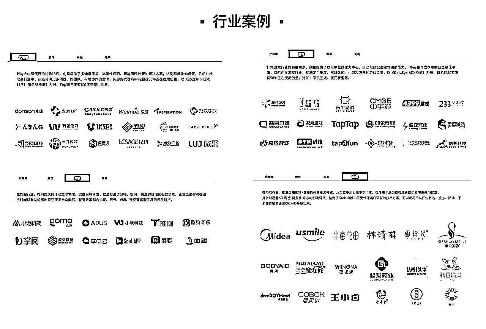
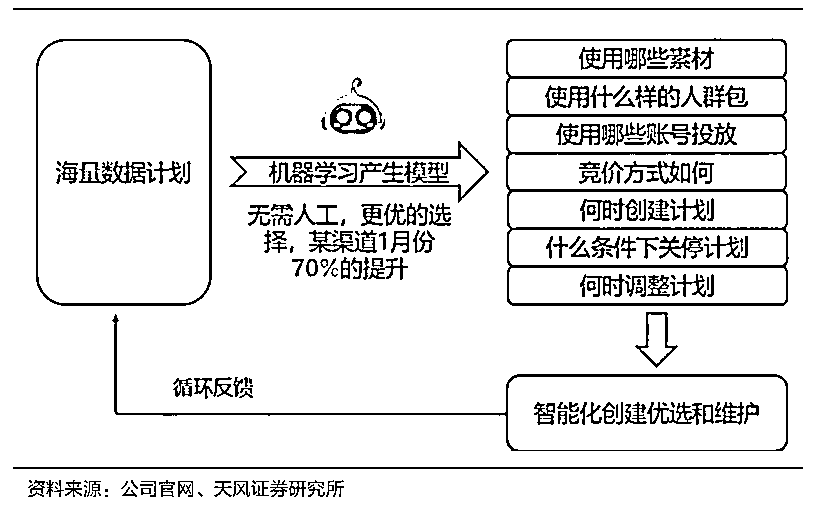
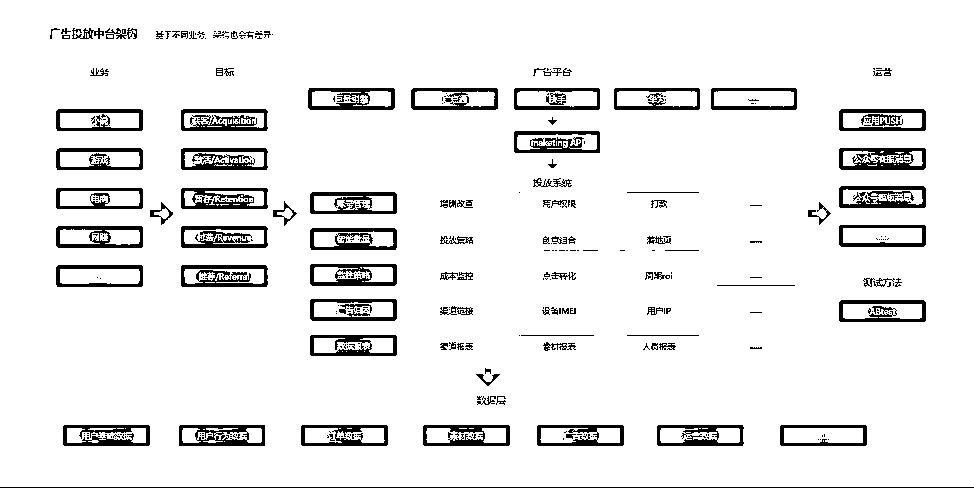
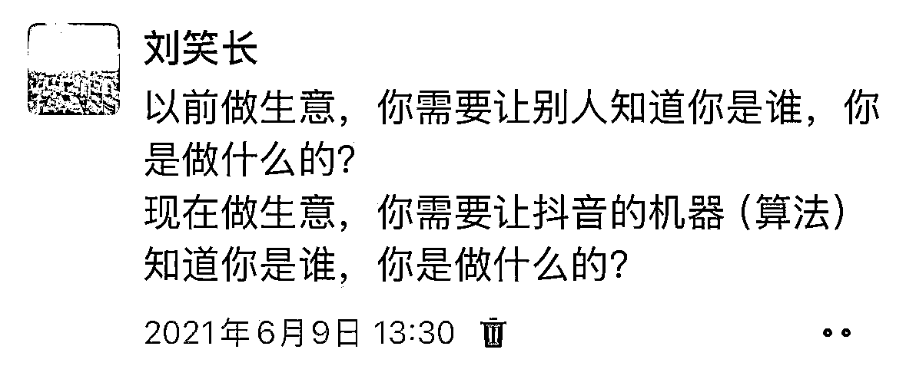
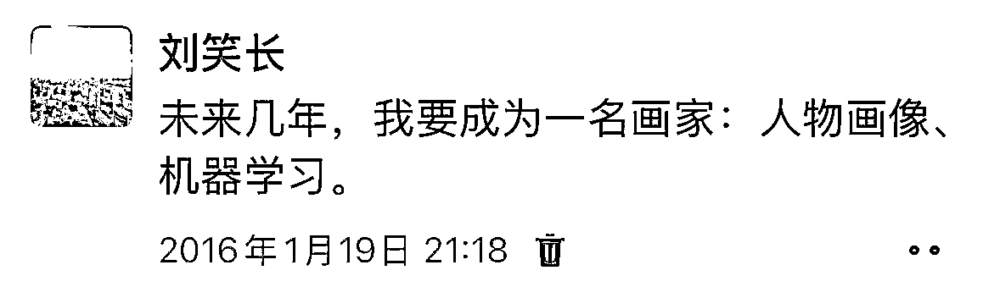

# 从 0 到 1 跑通日投 300 万、7 天 ROI 提升 10%+ 的 App 智能投放闭环

> 来源：[https://wandouyin.feishu.cn/docx/Rc3hdHtBJoz5IGxQcoHcIDxjnzh](https://wandouyin.feishu.cn/docx/Rc3hdHtBJoz5IGxQcoHcIDxjnzh)

大家好，我是刘笑长。爱笑，擅长做增长。

当下 AI 应用开发热度空前，几分钟到几天就能搭出一款网站或 App 的文章铺天盖地。但产品上线之后，规模化盈利才是真正的考验。

龙哥在《AI应用：从百万到亿级收益的超级机会》中也反复强调广告投放的价值。很多头部团队在成长过程中，都把投放从可选项变成了必选项。

圈内老话说：“我知道一半广告费浪费了，就是不知道是哪一半。”这篇文章想把广告钱的去向、浪费的根源、以及如何用系统化方法搭建一套以 ROI 和消耗为核心的智能投放体系，讲清楚一些。希望对做 AI 应用和投放的同学有帮助。

这是 AI 应用系列的投放篇。

# 开场思考

先自问几个常见困境：

* 在赚钱有术看到灵感，借助 Cursor 几天就把产品做出来了，却卡在推广变现上？
* 想快速验证产品闭环，却不知道流量怎么来、钱怎么回？
* 清楚变现逻辑，但作为小微企业或超级个体，预算有限不敢投放？
* 想找代理商、代运营或发行方合作，却不懂怎么甄别？
* 投放已经启动，却看不懂数据、不会解读、更不会优化？
* 看哪些指标、指标背后反映什么产品趋势？
* 投放跑顺了被同行盯上，想放大规模却发现流量变差？
* 放量节奏、平台算法、合作方当季目标都摸不准？
* 跑到巨量、磁力、广点通 Top2，ROI 却被压到微利？
* 规模和利润怎么平衡？怎么精细化抢量？怎么在媒体和渠道间博弈？
* 平台自己也做同类产品，第一方、第三方人群包还能不能用？
* 如何与狼共舞，和既是裁判又是选手的平台共存？利润流失到哪里？
* 听说过投放矩阵和精细化运营，却不知从何入手？
* 组织怎么搭？目标怎么定？里程碑怎么拆？LTV 怎么预估？策略怎么迭代？
* 当平台把旗下相似产品打包卖掉，你的利润率已回不去时，如何在成熟市场活下去？

好的问题比标准答案更有价值。答案容易搜到，但能串联思考框架的问题才能带来成长。下面结合几年在巨量引擎、磁力引擎、腾讯广告累计投放数十个小目标的实践，分享一个广告人的方法论。

# 一、智能投放系统是什么

## 1、基础名词

| 名词 | 说明 |
| 巨量引擎/巨量广告 | https://business.oceanengine.com/site/index |
| 巨量引擎开放平台 | https://open.oceanengine.com/labels/7 |
| 磁力智投 | https://ad.e.kuaishou.com/ |
| 磁力引擎开放平台 | https://developers.e.kuaishou.com/ |
| 腾讯广告 | https://e.qq.com/ads/ |
| 腾讯广告开放平台 | https://developers.e.qq.com/docs/start |
| 空耗 | 钱花了没带来有效用户，或带来的用户不符合画像 |
| 归因 | 追溯结果产生的原因。在移动推广中，用于判断用户下载、激活、再打开等行为的来源渠道 |
| 归因模型 | 最终点击：把转化全部计入用户最后一次点击的广告和关键词 |
| 归因窗口期 | 广告展示或点击后，回溯期内产生的激活计为非自然流量归入渠道 |
| 优化师 | 也称广告投手，负责投放执行 |

## 2、系统形态

想直观看懂智能投放系统，可以看下面链接。

创量_智能广告投放系统

创量是业内较知名的第三方 SaaS 投放平台，同时被字节巨量引擎开放平台和快手磁力引擎开放平台官方推荐并持续存续。

| 对比项 | 普通投放后台 | 智能投放平台 |
| 投放方式 | 在巨量、磁力、腾讯各自后台操作 | 通过 Marketing API 统一操作 |
| 建量效率 | 单次新建数量受平台限制 | 一次可批量创建 N*M*Q 条，效率提升数倍 |
| 盯盘效率 | 多账户多广告分开查看 | 数据聚合+自定义规则+消息推送+程序化操作，效率大幅提升 |
| 资产沉淀 | 数据分散在各平台 | 人群包、定向包、文案、素材沉淀为企业资产 |

核心价值可归纳为：

1. 一平台管控巨量、磁力、腾讯多媒体多账户矩阵
2. 通过 API 而非后台操作创建广告
3. 自动化批量建量，提升建量、盯盘、投放中自动化效率

本质是提效。把重复性工作交给系统，解放优化师去做系统无法自动化的思考、研究和测试，最终提升投放结果。

这只是初级形态。若要实现数据安全、前后端链路打通、基于 App 内行为实时调整策略、跟上平台新能力，实现资金和流量可控，就必须自建系统。

大量日耗巨大且需长期买量的团队，都自建了内部智能投放系统。比如业内熟知的量子-天机。

## 3、系统价值

智能投放系统以消耗提升和 ROI 提升为目标。通过 Marketing API 打通前端投放数据和后端 App 内关键行为数据，以更短周期评估效果，极限拉升感知效率和决策效率，实现 7*24 监控，对异常广告及时预警并自动调控：暂停、删除、调预算、调出价、新建。

**价值一：全链路数据颗粒化，打通公域、商域、私域**
多数企业数据割裂成孤岛，看不清用户从哪来、做了什么、未来会怎样。系统需做到 90%+ 用户全链路可追踪。

举例：用户是否来自投放、自然搜索或裂变？哪个视频素材、哪个媒体、哪个广告位？激活前点击几次？是否老用户回流？首次在线时长、首日在线时长、启动频次、是否完成新手任务、点击了哪些关键按钮、次日/三日留存、是否进入付费页、当日是否付费、付费金额、R 用户分级、3 日付费率、LTV7 预估等。

数据不仅是原始值，还有复合计算和算法预估。当颗粒度足够细、认知足够清，才能在流量波动时从容应对，像庖丁解牛般游刃有余。

**价值二：矩阵化投放，一站式管控**
要占领市场，必须在字节系、快手系、腾讯系及各大应用商店投放，测试不同广告位、定向、出价、素材、落地页。平台对单次建量有限制，数据也难以聚合。

智能系统通过 API 实现矩阵化投放，统一看板、7*24 盯盘、策略联动。人效和投放效果同步提升。

**价值三：经验沉淀，操作可追溯**
过去优化师在平台操作，Leader 只见结果不见过程。现在在智能系统上操作，创建、调控的每一步都可追溯、可复盘。

系统设置防错机制、素材搭配算法等，初级优化师也能达到高级水平。并可 24 小时盯盘，异常时通过飞书等推送提醒。一个优秀优化师可管理一个媒体平台，降本增效明显。

**价值四：洞察大盘，顺应平台算法**
通过全账号消耗速率等，可感知大盘流量趋势，据此调整策略。

要把平台算法当作“人”看：有人性就有优点缺点。顺应优点才能获流量奖励。同时也要把系统当作“机器”看。平台本质是算法机器，持续进化追求全局最优变现。机器与机器博弈才有机会。

**价值五：投放驱动产品迭代**
新范式是投放-迭代-投放闭环。通过数据可知哪些素材偏好对应哪些 App 内行为。很多素材领先于产品功能，若点击高且内表现好，即可快速迭代上功能。需要前后端实时打通、高效 AB Test。

**价值六：ROI 与消耗双提升**
一切为了消耗，一切为了 ROI。高 ROI 的消耗才有意义。要成为 Top，必须两手抓、两手硬。

打通数据、提效、沉淀经验、洞察大盘、驱动产品、提升消耗。智能即把自动化、实时性、准确性拉到极致，从数字化走向数据化，用算法挖掘数据趋势，及时调控。

# 二、搭建方法

## 1、可落地的 SOP

从零搭建可执行流程：

* 全链路打通：投放前、中、后数据统一，建立内部指标体系，通过 Marketing API 投放
  投放前：媒体、广告位、定向、出价、素材
  投放中：完播率、点击率、转化率
  投放后：激活、付费、在线时长、使用频次
* 评估体系：科学评估各媒体、广告位、素材带来的用户价值
  媒体：巨量、磁力、腾讯
  广告位：抖音、优量汇、穿山甲、快手、快手联盟
  素材：录屏、解说、真人、图文/视频
  支持小时级素材效果分析
  评估获客成本、LTV、留存、投变 ECPM 等
* 智能监控：7*24 盯盘，自动处理空耗、学习期失败、低 ROI、低消耗广告
  空耗：学习期结束后投放 N 小时，当日消耗 > 单用户成本 *2~3 且 0 激活
  学习期失败：投放 >6 小时，消耗 < 单用户成本
  低 ROI：当日消耗 > 单付费用户成本 *2 且 首日 ROI < 昨日均值 *0.3
* 智能预算：从局部最优到全局最优，跨计划、跨账户、跨渠道分配预算。ROI 高的广告自动增预算
* 智能归因：提升 Android/iOS 归因准确率，识别来源渠道、广告、素材。可动态调整归因窗口期，减少浪费，优化归因模型准确率
* 智能创编：全生命周期托管，自动创建、停止、删除。及时补量
* 智能报表：日/周/月报，环比同比仪表盘。按优化师、素材师、媒体、广告位、出价等多维度联动分析
* 智能创意：监控竞品素材趋势
* 智能风控：识别刷量、流量造假、劫持、异常波动并干预

通过 API 接入三大平台，可在投放当天甚至数小时内评估效果，并做预算、出价、启停调控。差的停，好的加量，实现 ROI 不降反升的前提下放大消耗。

## 2、效果评估核心

**LTV 预估**
这是系统里最难的技术点。需在用户进入当日甚至 6 小时内估值，进而算 ROI。

思路：找出 App 关键行为，建立与 LTV7/LTV30 的映射。

例如用户 30 秒内退出，可用“首日/首次在线时长”作为关键行为，基于历史数据估算其平均 LTV。实际需找到 10~30+ 个关键行为建模，召回率随之提升。

**ROI 波动排查**
流量或数据波动时，要整体看：

产品是否上新功能？数值是否调整？App 是否 Bug？广告平台是否异常？

大公司里投放、产品、研发常为 ROI 下降互相追责。有智能系统后，可用 AB Test 快速定位问题。渠道质量、数值、甚至商品品质和价格都会影响充值。及时监控、定位、解决可减少浪费。

## 3、实战策略

每个小技巧都能省钱提 ROI。

**创建策略**
账户冷启动、素材冷启动、素材搭配、出价策略，都是从问题中总结的应对方式。需 AB 测试、持续迭代。

**调控策略**
沉淀自动化规则，实现 7*24 监控：

* 通过归因清晰来源质量，暂停 ROI 低于均值的渠道/广告位
* 自归因或智能归因回传，排除“打开 X 秒退出”的低质用户
* 及时关停消耗 > 平均获客成本 *2 且投放时长 >N 小时的广告
* 5 秒完播率 <50% 的素材/广告及时关停
* ……

# 三、投放知识补充

### 深度出价

广告投放做到一定阶段，很多人会陷入一个纠结：到底该盯哪些指标？首日ROI、7日ROI、激活、激活付费、激活留存……其实在把这些单一目标玩明白之后，不妨往双出价的方向走一步，往往会有惊喜。

我们一个个来看。

**一、素材本身就是最好的定向**

现在各大广告平台都在推“智能定向”，甚至喊出“定向已死”的口号。本质上，算法比你更懂用户。你的素材是什么调性，平台就会把它推给什么样的人。与其纠结人群包，不如把功夫下在素材上——素材，就是你的定向。

**二、素材+定向，做千人千面**

假设你要投广东，素材里来一句粤语，投福建，换上闽南话——同样的画面，只是音频变了，转化可能就天差地别。标题文案同理，配合地域、人群、场景做细分，如果搭建好了批量自动创建系统，这一切都能轻松落地。前端后端链路打通后，可以针对单个元素做ABTest，对比跑出来的投放数据，一点点迭代出更优的策略。

**三、盯紧竞品的素材**

别自己闷头拍脑袋。想快速找到感觉，直接去广大大、热云引擎这类广告营销情报平台，看同行在投什么素材、什么策略，提炼里面的核心元素，化用进自己的创意里。

**四、用好RTA，减少每一分浪费**

当你的用户积累到一定量级，就该上RTA了。它可以做到：

- 控制展示频次，比如一天最多推3次；
- 过滤老用户，比如30天内不反复骚扰，超过30天的再召回；
- 识别大R中R小R，实现高价抢量，精准买高价值用户。

**五、未来：像聊天一样做投放**

商业竞争这场游戏，一关比一关难。但就像悟空明明一个筋斗云就能到西天，还得老老实实走完九九八十一难——那些看似绕远的路，终究会变成你最值钱的履历。借用那句话：“那不是我的黑历史，那是我的来时路。”

8年前，我就意识到：只要用户画像足够清晰，广告就能在短时间内帮你搞定海量用户。

3年前，ChatGPT还没问世（2022年11月才发布），我就幻想过用Siri做一个聊天式智能投放系统。对话大概是这样的：

问：hi，Siri，帮我建一批广告？
答：好的，已按昨日最佳定向、出价、人群和素材完成了创建，新增总预算10W元，需要调整吗？

问：不用。昨天数据跑得怎么样？
答：昨日共创建广告1578个，自动关停290个，三大平台总消耗156W，激活用户9876人，其中老用户2025人，老用户首日ROI 15%；纯新用户7851人，首日ROI 9%，整体稳定。

问：有没有发现什么趋势？
答：近期腾讯视频号广告位买量价格偏低，充值率一般，但这块广告位的整体ROI比其他广告位高出约5%。

问：把这些趋势整理成图表，发给各BU负责人吧。
答：好的……

随着ChatGPT大模型、RAG、本地知识库和数据库技术的成熟，这个场景正在离我们越来越近。像聊天一样建广告、看广告、调广告——这不是科幻，是马上能摸到的现实。

**六、写在最后**

一套智能投放系统，本质是由多个智能模块共同构成的一个“中枢系统”：近实时地生产数据、流转数据、消费数据，把企业最核心的数据资产串在一起。数据就是企业的血液，健康的企业必然拥有健康的数据。每天对数据做一次“体检”，这是智能投放系统带来的最大改变。

投放前、投放中、投放后，全程靠数据说话：用数据发现问题，用数据捕捉趋势，用数据驱动增长。

今天的广告投放，已经是一门庞大而精密的科学。雷军有句话我很认同：“99%的问题，都有标准答案，找个懂的人问问。”这篇文章能写的、想写的还有很多，篇幅所限，先聊到这里。

如果你在广告投放上有什么困惑，欢迎在评论区留言互动，我一定知无不言。只要是我擅长且验证过的方向，也会把可落地的执行方法毫无保留地分享出来，或许能帮你把消耗和ROI再往上提一提。文中有不对的地方，也欢迎指正，我会及时更新迭代。如果觉得有启发，顺手点个“赞”，让我看见你。

愿大家获客有道、投放有术，在这波AI应用浪潮里赚到足够多的钱💰。

感谢赚钱有术，一起赚钱有术！