# 1月9日 用Cursor打造专属手机桌面文案壁纸生成器

> 来源：[https://yaltjddz906.feishu.cn/docx/FrzVdJbo4oiRtIxyllAcGBTonbb](https://yaltjddz906.feishu.cn/docx/FrzVdJbo4oiRtIxyllAcGBTonbb)

今天读完了明白老师的一篇高赞文章，主题是关于赚钱时如何让认知与行动真正统一。读完之后，感触颇深。文章戳中了一个核心痛点：很多道理、方法我们并非不知，可就是做不到，原因不在能力，而在惯性。行为上习惯性的拖延、情绪上的本能反应、思维里的固有模式，都在无形中拖住了我们前进的脚步。想要破局，一个很妙的思路是把正向提醒植入视线范围，反复曝光，然后通过密集的重复训练一点点替换掉旧惯性。作者也提醒，周遭氛围与大人的言传身教，会在不知不觉中塑造我们和孩子的习惯模式，想改变，就得从日常小事着手，靠长时间的坚持去沉淀。

关于塑造习惯的具体做法，文中提到的一个技巧让我很受触动：刻意去建立好的行为模式，把高质量的方法论和内容要点打印出来、贴在随时能看到的地方。比如每天对着电脑，一抬头就能看见墙上的这些文字，日复一日看上无数遍，人自然会被这种高频的积极暗示笼罩。再把大块时间拿出来做专项练习，认知、眼界、技能、经验的增长就会呈现指数级飞跃。

看完之后我忍不住琢磨，除了打印贴墙，还有什么载体能让我们天天与这些高质量内容相遇？转念一想，手机不就是最贴身的那块屏幕吗？几乎人人都机不离手，如果把锁屏壁纸利用起来，每天一亮屏就被好内容“洗”一次眼睛，那提醒效果肯定不输给墙上的打印纸。说干就干，我先尝试用美图秀秀DIY壁纸，结果磨了半个多钟头，做出的图始终不如人意。

这时我突然记起在赚钱航海报名过的Cursor特训营，索性换一个思路：让Cursor来写一个自动生成壁纸的小程序，这样岂不是一劳永逸？于是马上打开编辑器，着手实践：

1、我给出的初步需求是：想要一个能输入文字、自动生成手机壁纸的工具，壁纸背景色可选择，文字能居中展示，排版样式也能调，还请它为我这样毫无编程基础的人规划一套开发流程。

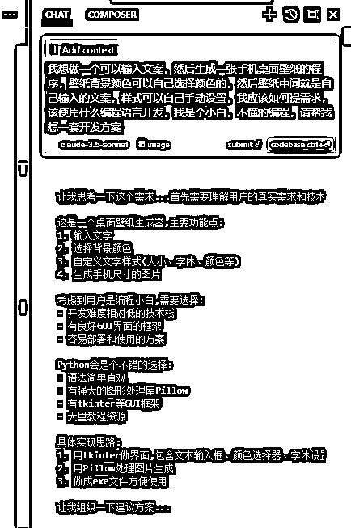

Cursor给出的方案非常贴心：

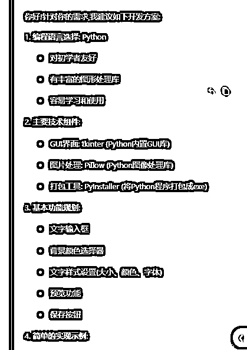

2、随后我补充指令：请按照既定路线，一步步带我完成构建

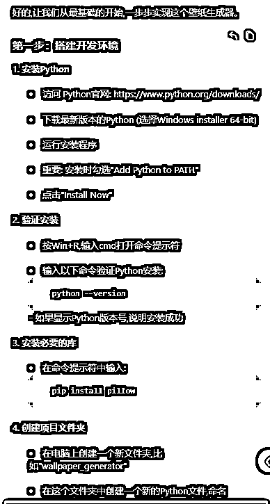

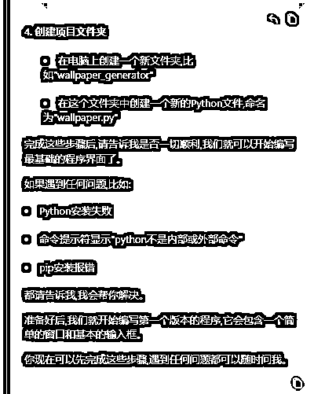

接下来的操作就顺畅多了，照着它的指引逐步执行，遇到报错就把异常信息完整丢给它排查。想要增加新功能、或者让某些体验更顺手，直接口述需求，它就能迅速调整代码。大概耗费了一个钟头，界面便初具雏形：

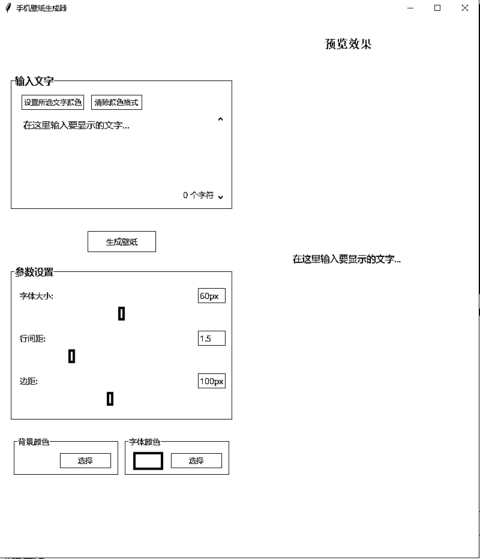

这个小工具的最终能力如下：可以键入任意文字内容，并让文字居中展示在背景上；支持设置字号大小、字符间距、留白边距、背景色与文字颜色；前三项参数既可拖动调节，也可手动键入具体数值。最方便的是，能够选中部分文字单独修改它的颜色，右侧的预览窗口会即时呈现最终视觉效果。

效果展示：

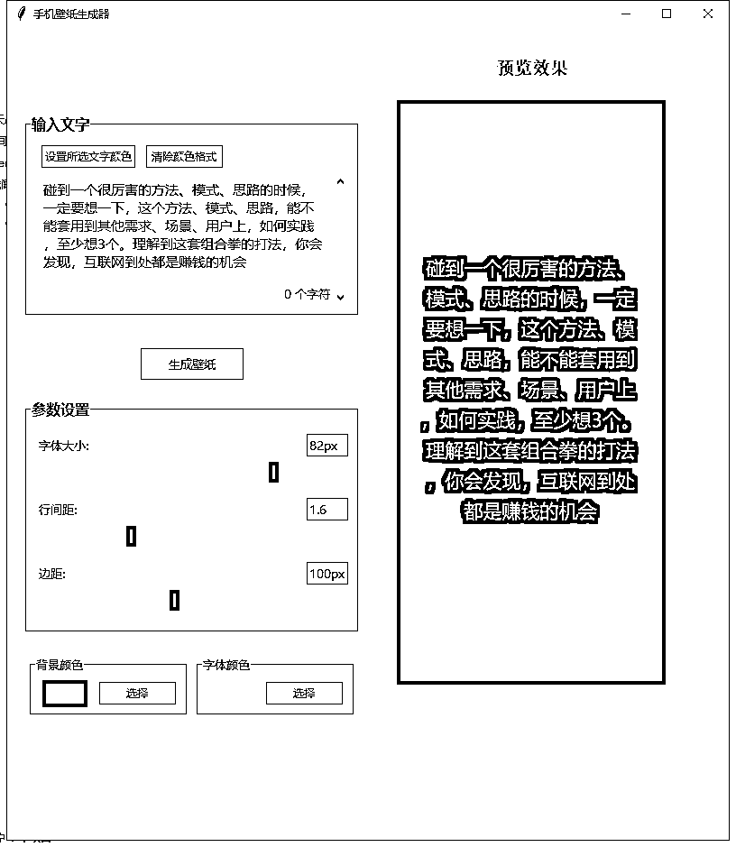

生成的图片效果如下：

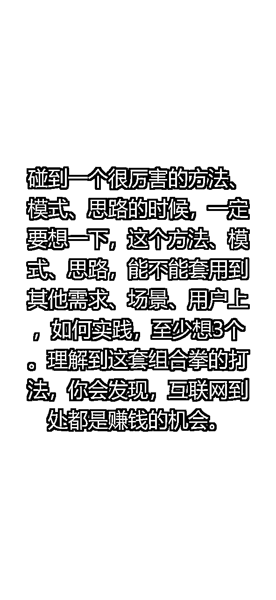

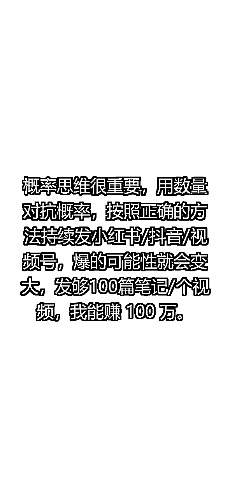

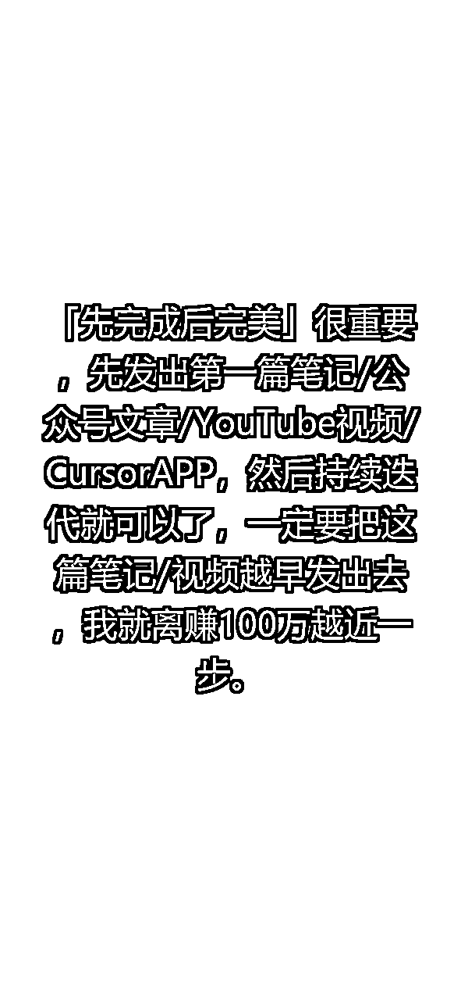

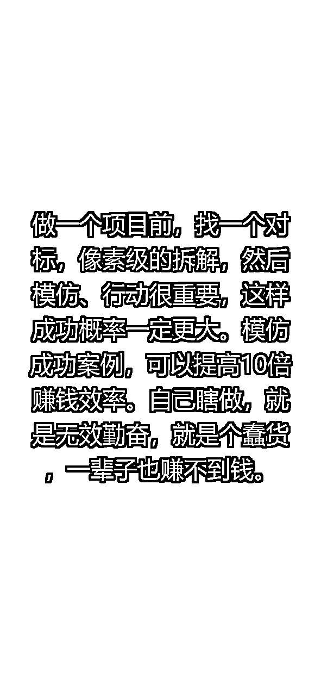

我将这些成品应用到手机的锁屏界面，实拍体验如下：

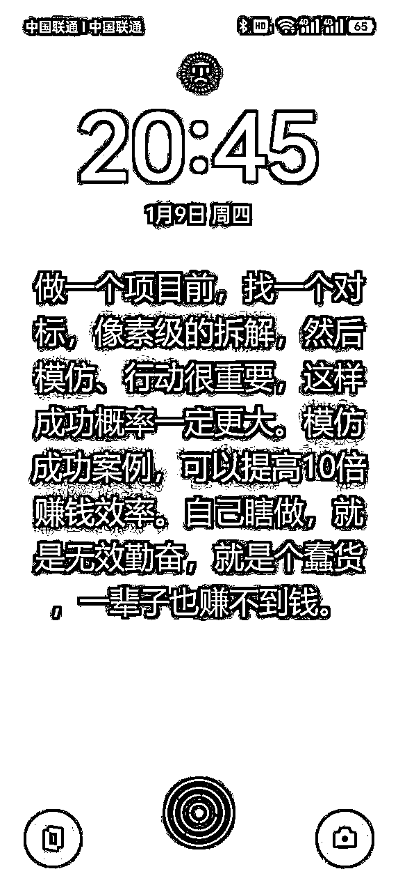

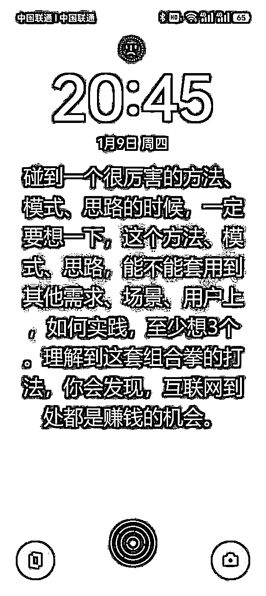

现在每次点亮屏幕，就会看到一张新壁纸；锁屏之后重新唤醒，又会自动切换另一幅。这不就把明白老师倡导的“把方法放到眼前”落到了实处吗？高频接触带来的提醒效应，会让好习惯逐渐长进肌肉记忆里，重复到一定量级，自然会发生质变。

最后，我将项目封装为可执行的桌面程序，使用的指令是：如何将这份代码转换成.exe文件，使用时不依赖命令行

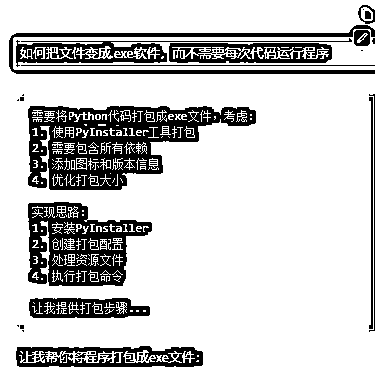

按步骤操作完毕，便得到了一个双击即可打开的应用，以后再想生成壁纸，无需再经历漫长的启动代码流程了。

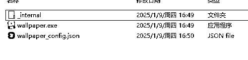

这算是我头一回基于真实场景里的需求，借Cursor从零攒出一个可用的小工具，也算把之前在航海营学到的基础知识真正落地了。复盘写得比较随性，还望各位不吝指点。