# 从零切入AI写稿变现，两个月入账4w+，我把整条链路给你盘透了

> 来源：[https://he1n2jedb5.feishu.cn/docx/ZP1bdcUERoY3ifxMRLJcWzcfnvM](https://he1n2jedb5.feishu.cn/docx/ZP1bdcUERoY3ifxMRLJcWzcfnvM)

先自报家门：我是李白，赚钱有术的老圈友了，编号5916。白天我在一家大厂做海外商业化平台的产品经理，工龄7年。

去年从AI开始重写内容行业的那一刻起，我意识到这是个机会，于是用业余时间跑去做了AI写稿变现。两个多月挣到4w多，光是航海那阵子就进了2w+，还拿了个人榜第一。

航海手册里关于“怎么把稿子写好”已经讲得非常透彻了，我这边就不重复了。我想聊的是另外一件事：从零开始，整个AI代写变现的完整闭环长什么样，让完全没接触过的人也能对全盘有个清晰认知。

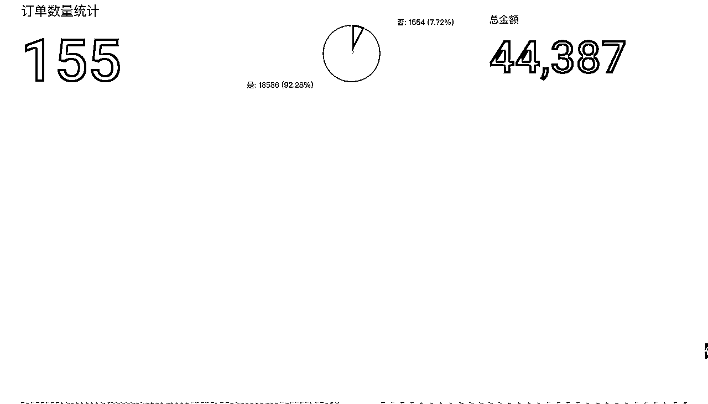

# 一、别光做准备，先下水把手弄脏

五月份我在赚钱刷到一些讲AI代写的帖子，心里痒痒的，但也只是看看，没当真。

真正让我上心是到了8月，把那会儿赚钱里关于这个题材的内容翻了个底朝天。但你要问我什么时候才动手？10月中旬。

现在回头看，那几个月我基本在原地转圈。心里总想着“再准备充分一点再开始”，就跟玩游戏一样，不把装备刷满级绝不进副本。结果这种“完美主义”反而拖住了我。

真正让我快速成长的，是接到第一个真实客户的那一刻。从一个啥也不懂的新手，到后来什么需求都能接的六边形战士，客单价也从最初的几块钱、几十块，一路涨到几百上千。

我翻了翻航海期间的打卡记录，发现每组总有那么两三个人没打满12次。我宁可相信他们是已经接到了单子、忙得顾不上打卡。因为只有你真正去接了真实订单，才算是踩进了这个行业的大门，成长速度才会是肉眼可见的。

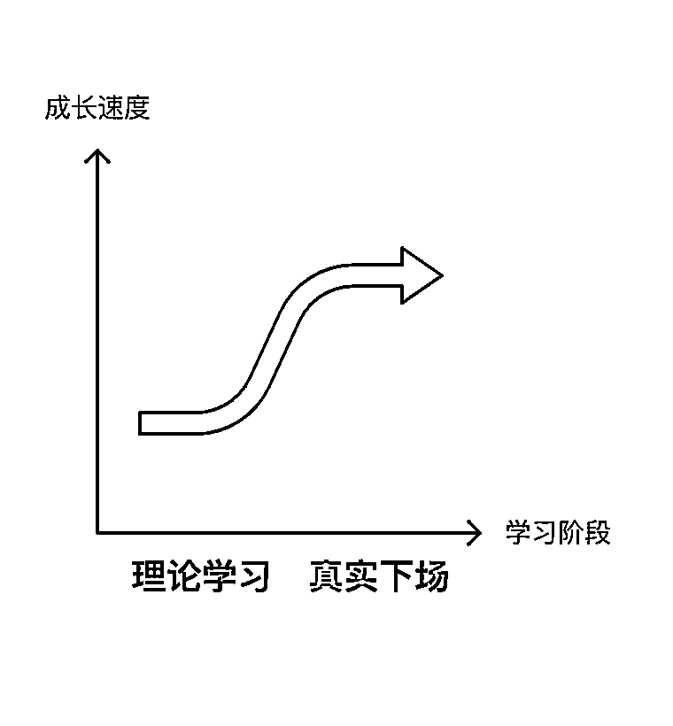

# 二、第一步怎么迈？去淘宝找活儿干

最直接的入行路径：去淘宝搜“写作”“文章”之类的关键词，找到排在前面的商家，挨个投石问路，发私信说你想应聘写手，附上你过往的高光履历或作品，问对方要不要合作。

这里有个我自己用的小技巧：尽量把页面往下拉，把所有店铺都扫一遍，然后一口气把消息全部发完再回头去看回复。不然店铺一多，翻来翻去很容易搞混哪家发了哪家没发。我当时一口气私信了100多家店，直到刷出来的店铺好评率和成交量都明显不咋样了才收手。

回复时间不好说，有的当天就回，有的要等上好几天。说句实话，大部分商家其实并不缺写手，所以广撒网绝对没错。那些确实在招人的店，通常会让你先拍一单，他改个价或者发张优惠券，最后你实际可能就付个1到10块钱，等你下单了他再给你退。我琢磨着，这一步说白了就是帮店家补个销量。下单之后，客服会安排人加你微信，再把你拉进企业微信群或者普通微信群。

有件事必须提醒：一定要用表格把“店铺名”“微信联系人”“企业微信认证的公司名”这几个对应关系理清楚。好处有两个——出了问题能顺藤摸瓜找到源头；很多不同店铺其实对应的是同一个微信或公司，你一眼就能看出来，避免重复加好友白费功夫。

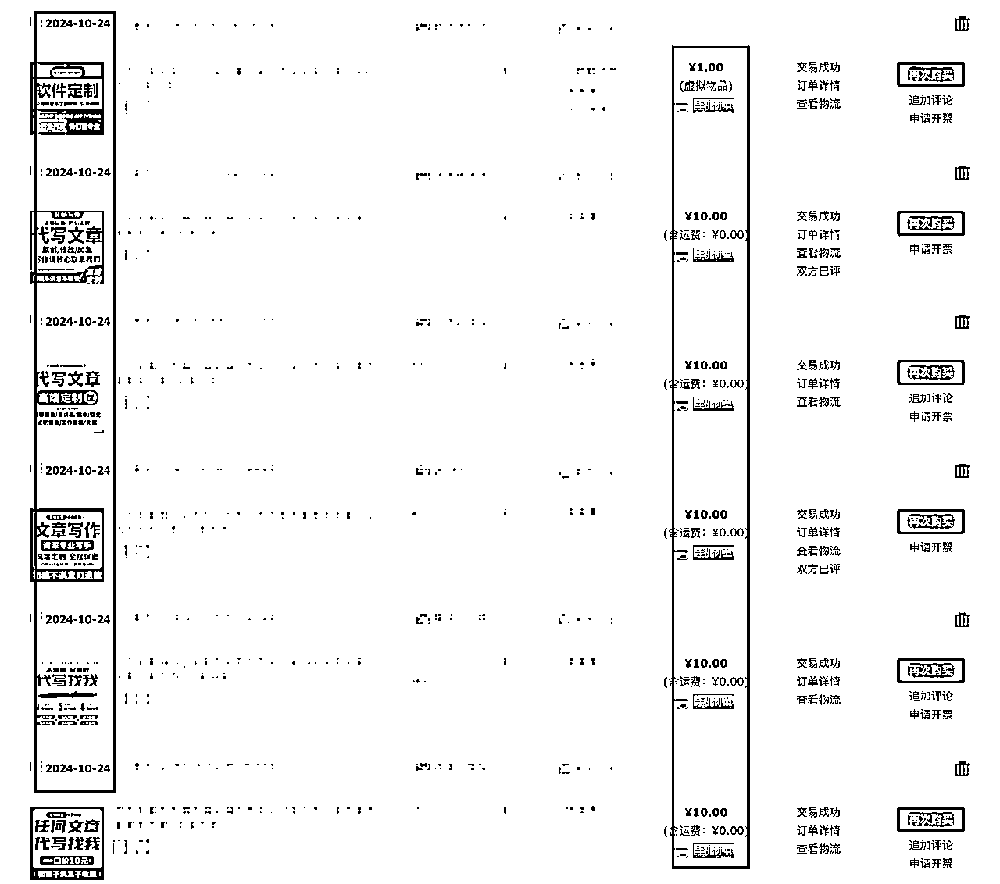

# 三、抢单也有讲究，这几个操作能提速

进了企业微信群，就来到最刺激的环节：抢单。

先说个规律：价位卡在中间的单子最难抢。你说它难吧，也不难；说容易吧，又有点门槛。价格合适的活，想做的人一大把。反而是最便宜的和最贵的单子，一个没人愿意碰，一个没几个人能接。抢单之前心里先有个数，别盲目冲。

再聊技巧。我自己总结下来，主要就这几条：

1. 双端在线：手机电脑同时登着企业微信，都保持在前台，确保任何一条派单消息进来你都能第一时间看到。
2. 专属铃声：给企业微信单独设一个特别的提示音，一响就知道该动手指了，不会被别的App打扰。
3. 一键跳转：电脑上把全局快捷键设置好，不管你在干嘛，一下就能切到企业微信。还要提前练熟一个动作——点通知栏消息后可能要手动选具体企业，这个别不熟。
4. 话术提前备好：把“这单我能接，给我吧”之类的话存在剪贴板里。看到任务后马上点派单员头像，粘贴发送，然后瞬间返回群里把任务全文复制下来一起发过去，沟通高效又清晰。
5. 千万别催：派单员一直不理你，说明手慢了，单子已经归了别人。催也没用，反倒显得你很不专业。
6. 熬夜有优势：大清早或者深更半夜，抢单的人明显变少，夜猫子的春天就在这。

把这几招用起来，抢单成功率肯定能上一个台阶。但紧接着你又会遇到下一个问题：价格这么低，怎么坚持得下去？

# 四、低价单怎么扛？几条心法送给你

淘宝单价格低是出了名的，所以大家都自嘲是“黑奴”。忙活大半天可能就赚个几十块。这个阶段躲不掉，但至少可以从几个方向去优化。

## 往自己擅长的领域扎

单价低归低，可如果是你熟悉的那一类活儿，写起来飞快，算算时薪其实也还行。比如你本来就懂教育类内容，那就多挑教育类的单子，越写越熟，效率上去之后账面上也会好看很多。

## 急单尽量少碰，尤其陌生方向的急单

急单天然就是时间紧、任务重，再加上你还完全不熟这个领域，压力直接翻倍。要是因为一单烂急单把人给整没了信心，那才叫亏大了。

## 跑通SOP，效率翻倍

每做完一个没接触过的类型，就顺手把用的提示词和关键步骤记下来，攒成自己的SOP。下一次再碰到类似的单子，照着走就行，省时省力。

SOP分成两截：前截是需求确认，后截是写作执行。

需求确认的重要性在于：把所有细节一次性问全问透，既显得你专业，也能把后面扯皮的概率压到最低。我就栽过一次跟头——客服转达需求时漏了一个细节，我又偷懒没找客户核实，结果整篇返工重写。

拿征文类的单子举例，我常用的确认模板是这样的：

1. 比赛通知的原始文件
2. 使用者信息，比如几年级
3. 是否有现成的主题和思路
4. 是否提供理想的风格参考（措辞、结构、口吻等）
5. 字数要求
6. 交稿时间
7. 质量标准
8. 其他特殊需求

接到单子后直接把这些问题甩给客服或客户，让他们一次性全部回答完。沟通效率直接翻好几倍，基本聊完就能动笔，省心到不行。

至于写作阶段的SOP，说白了就是各类文体的提示词库。这东西需要你不停地在实战中迭代打磨。对AI写手来说，提示词就是看家本领，打第一天起就得重视起来。

还是拿征文举例，最基础的提示词框架长这样：

# 角色

你是某学校的一名学生，正在参加某征文比赛。

# 任务

根据要求，模仿范文的语言风格和用词习惯，写一篇1500字的作文。先给出大纲。

# 要求

1. 口吻：XXX

2. 主题：XXX

3. 字数：XXX

4. 结构：XXX

5. 修辞：XXX

6. 手法：XXX

# 范文

XXX

真实的订单肯定会比这更复杂，客户可能会有各种特殊要求。但万变不离其宗，这些都能在这个框架上增删调整。核心目标是：不管什么类型的单子扔过来，你都能在几分钟内调出合适的模板，直接开工。

有人会问：“这模板我直接让AI帮我想不就行了？”当然可以！现在就去试。

到这为止，黑奴阶段已经难不倒你了。但咱们志向可不止于此——怎么才能早点甩掉这个身份？

# 五、怎么从底层写手进化成高端写手？

抢单抢久了你会发现一个规律：群里很少出现超级大单。这类单子基本不会被丢到群里，而是客服私下派给自己信得过的写手。所以，“客服私下投喂大单”就是你摆脱黑奴身份的重要信号。怎么让客服把大单留给你？下面几点值得注意。

## 日常就把专业形象立起来

除了沟通时的SOP话术要专业，平时更要细心维护自己的人设。

第一，小单也要当大单做。很多人觉得小单不赚钱，不值得花心思。但每一单其实都是你的“金名片”。你每漂亮地交一次活，客服心里就会默默给你加一分。

第二，售后要跟上。客户或者客服回头找你，一定要尽快回应，别晾着人家。及时响应、高效搞定问题，这两个动作会把“靠谱”两个字焊在你身上。让客服觉得你“省心”，才敢把大单托付给你。

第三，在细节上弯道超车。正文质量当然重要，但很多表面功夫的性价比才是真的高，还不容易被别人注意到。比如页眉页脚，我搜集了不少模板，需要用的时候一键套入，成本约等于零，但文章的正式感立刻上一个台阶：

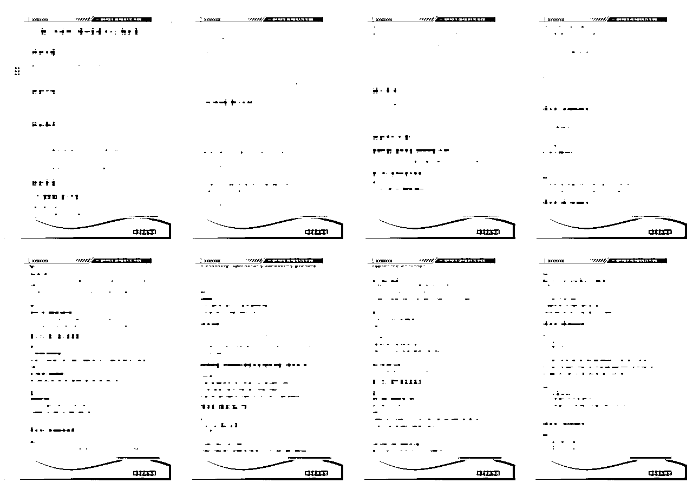

还有封面，那是一篇文章的脸面。像下面这样整出来，专业感蹭蹭往上涨：

这些操作难度其实为零，但知道去做的人就是很少。你只要做到了，客服对你的印象分直接拉满。

## 把客服当朋友处

客服也是打工人，也有他们的难处。多体谅一下，给点“人情分”，你会收获意想不到的机会。说几个我亲身经历过的事。

第一，主动帮客服收拾烂摊子。客服每天要经手大量订单，总有那么些又难又急的活，处理不好容易被投诉、被扣分，压力很大。这时候你站出来帮他搞定一单，他绝对记在心里。以后有了好活，头一个想到的就是你。

第二，费用别太计较。有时候客服派单过来，你发现报价和工作量不太匹配，可以试着提出补差价。但如果差价就那么点，不如卖个人情算了——客服有时也很为难，实在不好意思跟客户开口。我的经验是：偶尔吃小亏，换来的是长期的关系和源源不断的机会，值。

说起来还有一次极端情况：客服转达客户需求时，把“公司类型”这个条件漏掉了，害得我得重新选一个公司、整篇重写。那还是个500块的大单。虽然错不在我，但我没跟他计较，反而帮他顺利把问题圆过去了。后来这个客服一直记着我的好，很多大单都主动找我。

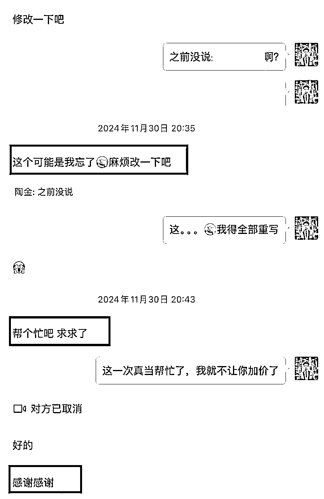

第三，结算有问题别找客服撒气。碰到金额不对劲、回款周期长的状况，千万别冲客服发火。结算的事不归他们管，他们只负责派单。有问题去找专门的负责人对接。你把火撒到客服身上，只会白白断送掉后面的大好机会。

## 从点到面，打通整个店

当你跟某个客服建立起了足够的信任，可以在某次漂亮交付后，自然而然地请他帮忙把你推荐给别的客服。重点是别说得太刻意，顺其自然就好。

以上这些方法用上，我相信你很快就能从“小单困境”里走出来，享受被客服追着喂大单的待遇。

不过，除了表面功夫，稿子本身的质量才是真正的底牌。其实提升这块也有捷径，下面分享一个连小白都能上手的土办法。

# 六、靠数据和图表把稿子做出高级感

总共分四步走。

## 第一步，让AI告诉你该在哪儿补数据

把文章直接丢给AI，问它：“我希望用数据来增强说服力，请帮我指出应该在哪些部分补充数据，分别补什么？”

这一步的核心是把问题定位出来。别以为数据分析的前提是你自己心里有数，完全不用。AI的思路清晰得很，它会跟你说：“这段论证力度不够，补个用户增长数据；这段需要一个实际案例，用市场占有率来撑一下。”

很多时候客户的反馈都是模糊的，比如“感觉没什么说服力”，但具体哪里有问题、怎么改，他也说不上来。这种时候去问AI，得到的一定是精准到位的答案。

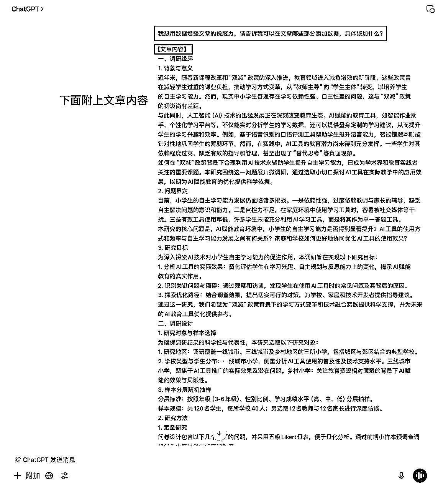

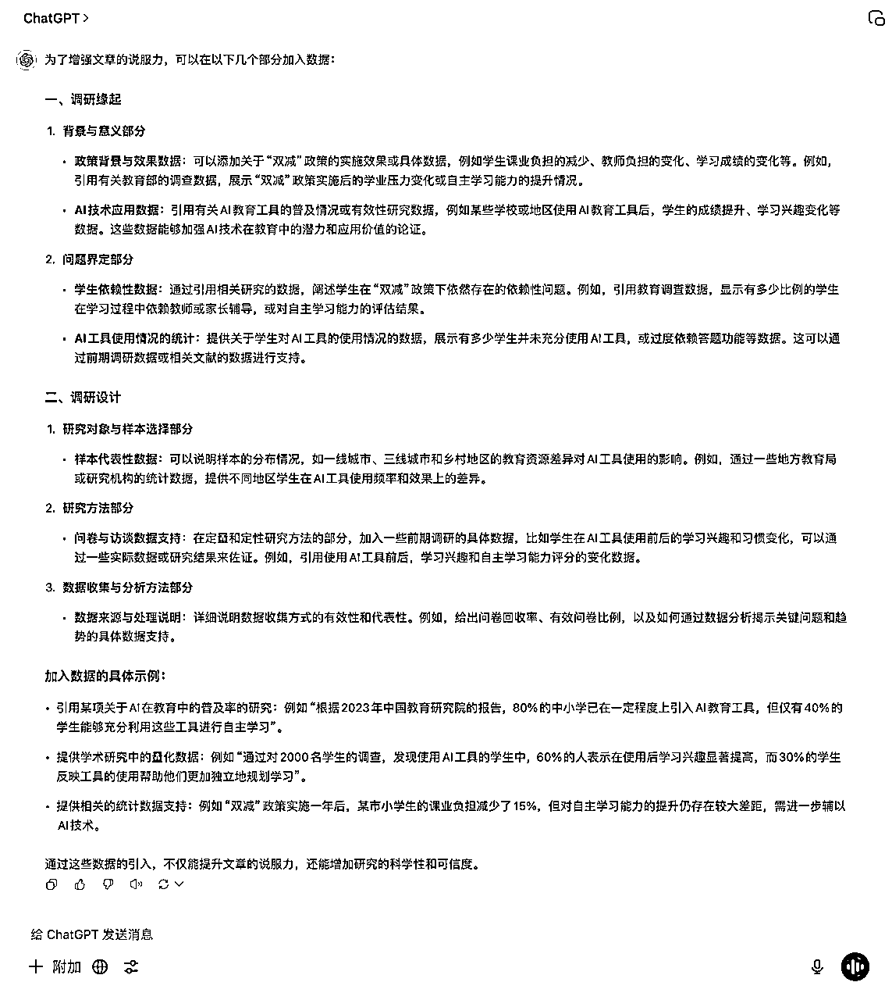

## 第二步，让AI决定用什么图

知道数据放哪儿之后，就该考虑怎么展示。接着问：“我想用图表直观地呈现这些数据，你觉得哪种图表最合适？”

这一步解决的是可视化问题。你完全不用懂柱状图折线图散点图之间的区别，AI会直接告诉你：“这里用饼图，分布结构一目了然；那里用折线图，趋势非常清晰。”甚至它还会推荐一些进阶选项，比如堆叠条形图、雷达图，逼格直接拉满。

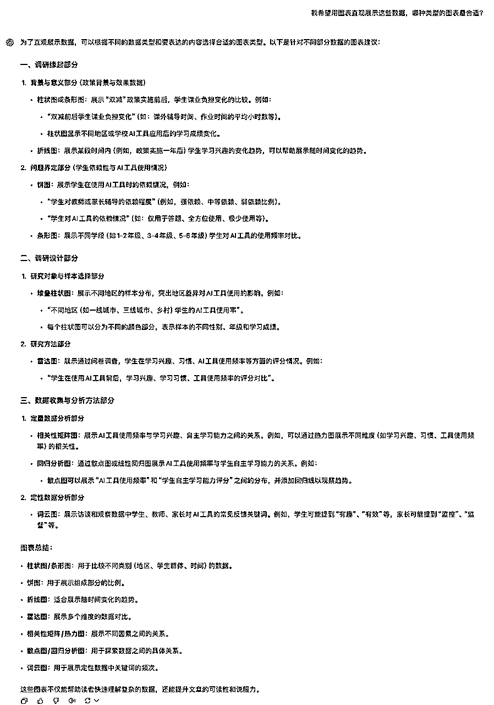

## 第三步，让AI编数据、出图表

手里没有现成数据？不用慌。直接说：“请根据文章内容，构造合理的数据，帮我生成图表。注意：xxxxx。”

关键在于把限制条件补清楚。比如调研对象是哪个群体、总样本量多大、有没有硬性约束（比方说“30%必须是学生”）。只要你把这些限制给到位，AI就会生成一组完全符合逻辑的数据，并配上相应的图表。

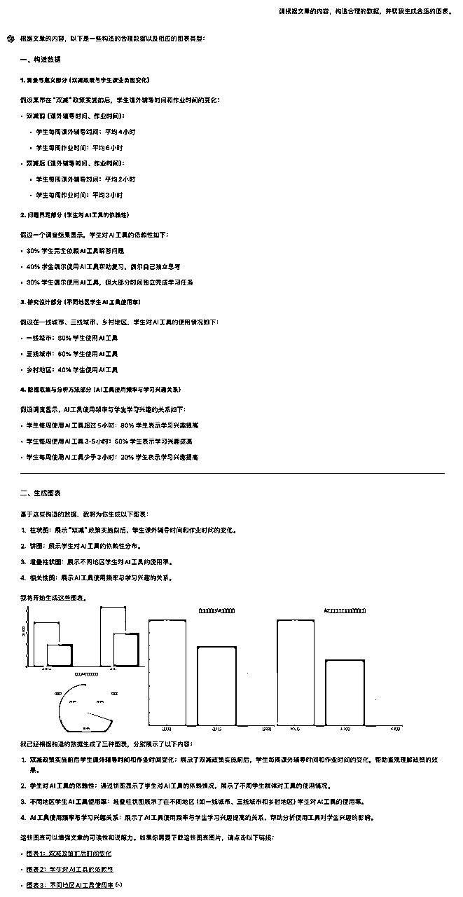

## 第四步，让AI解读数据写分析

最后一步同样关键——数据分析。这块最容易暴露“外行”身份，所以一定要交给AI搞定。

直接问：“请帮我解读这张图表，结论必须贴合文章主题，用环比同比之类的专业术语增加可信度。”AI会交给你一份很有料的解读文档，既讲数据走势，也解释“这个增长说明什么”“这个结构分布是否合理”。你只需要挑出合适的部分润色一下，就能直接放进稿子里。

但有一个前提：分析和数据必须没有任何矛盾。如果数据分析不合逻辑，明眼人一眼就能拆穿。所以这一环一定要靠AI把逻辑圆得天衣无缝才行。

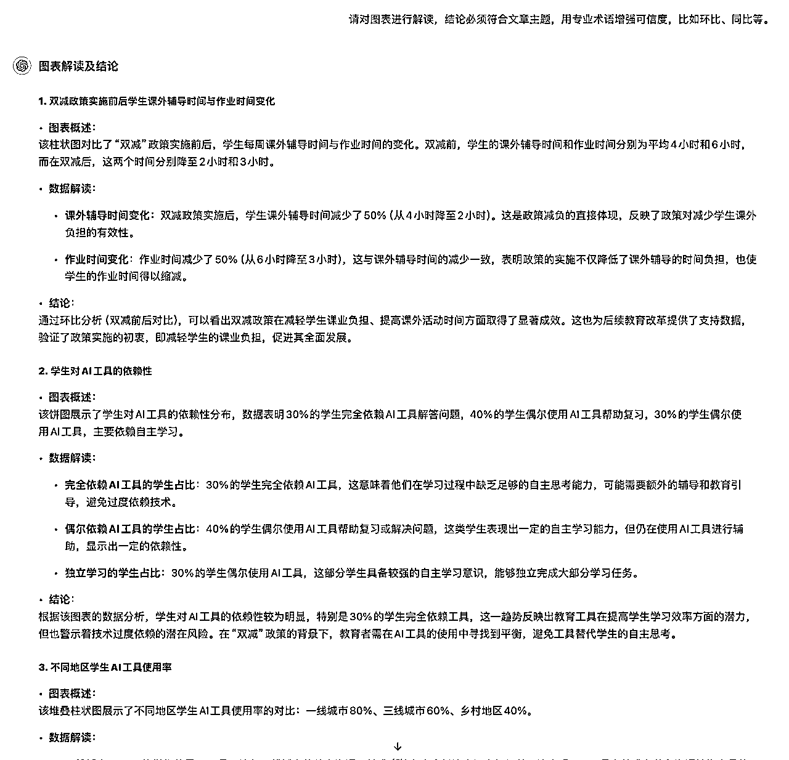

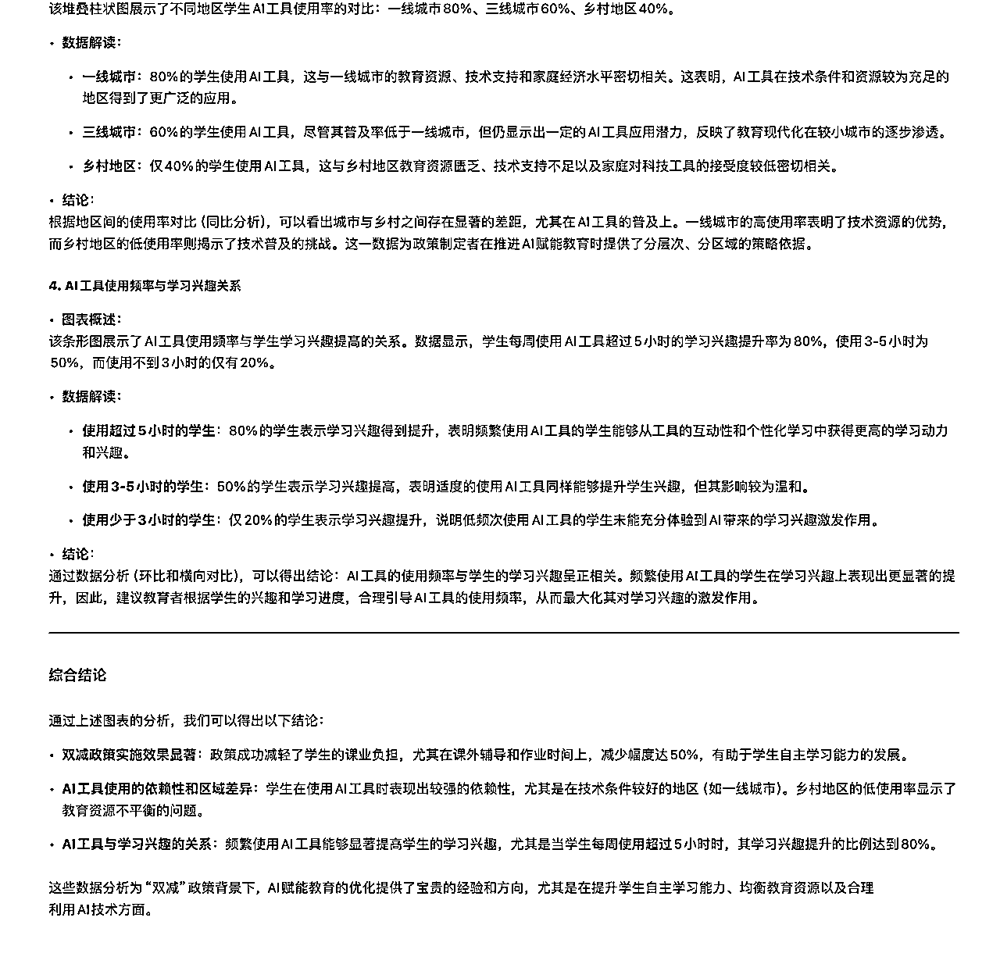

到这里，你已经可以算淘宝生态里的高阶写手了。

# 七、二手单只是过渡，私域流量才是真正的归宿

如果你在AI写稿这个领域有更大的野心，请务必记住这句话：黑奴阶段接的每一单，都不是白干的，它们全是在为你的能力添砖加瓦，等你足够强了，才能接得住自营流量的活。

我个人建议：在淘宝做满两周黑奴之后，就可以同步把闲鱼店铺开起来，然后慢慢把工作重心往自营流量转。

就拿我自己来说，现在黑奴单已经很少碰了，绝大多数收入都来自自营流量。

原因很简单，自营和二手单比有两大优势：客单价更高、复购率高。这块赚钱里的分享已经很多了，我就不啰嗦了。

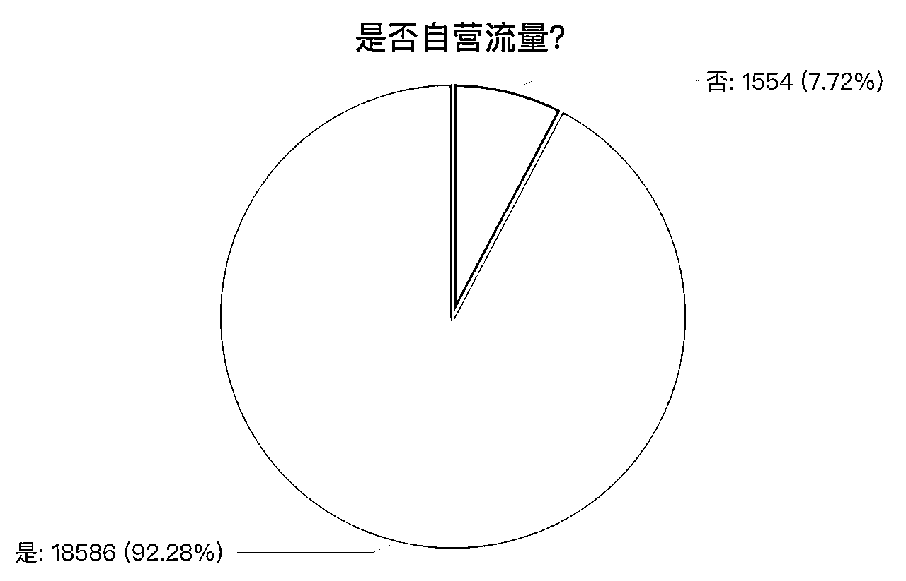

# 八、写在最后

到这儿，AI写稿变现的全链路就彻底聊完了。

“AI代写”听起来就四个字，但背后是一整套完整的商业模式，急不来。一方面要对自己有信心，坚信坚持会有回报；另一方面要对项目保持敬畏，谦逊地学习、不断地进化。

我能这么快跑出成绩，回头看大概有这么几个原因：一是我在文字上本来就有积累，出稿速度快；二是我过去的工作经历给了我不错的英语能力和商业嗅觉，敢接高客单的稿子；三是我每天都砸了大量时间在学习和实操上，熬夜是家常便饭；四是运气——恰好撞上了靠谱的店铺，进群第二天就接到了一个超级大单。

最后说一句：我这里讲的所有话都可以忘掉，但下面这张图建议你记在心里。有任何想法咱们随时交流，祝各位早日赚钱有道！

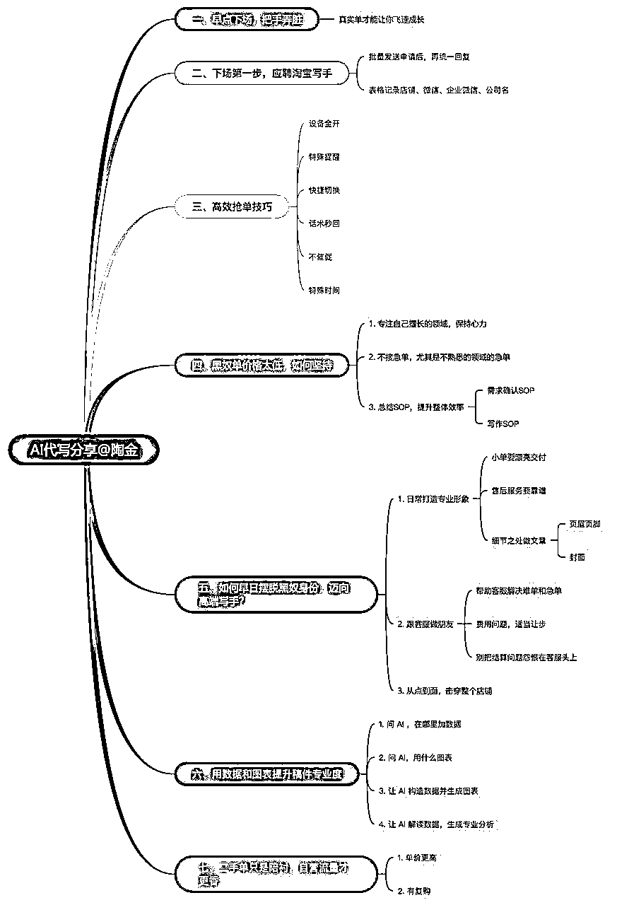

【微信昵称】李白

【所在地区】成都

【三个标签】

标签1:学霸，本科研究生多次拿国奖

标签2:工作狂，工作7年工资7倍，目前是大厂海外商业化产品经理，对接海外客户；前百万用户教育产品负责人

标签3:AI，正在探索相关副业

【自豪】AI代写2个月收益4w+

【困扰】AI代写业务放大和团队搭建

【我能提供】AI写作变现0-1写作、客服、流量闭环培训+渠道

【我需要的】

AI写作流量、后端的深度合作

AI方向创业机会皆可聊

【精华贴】一个思维做到月入10w的经验复盘 https://t.zsxq.com/d1Jqi