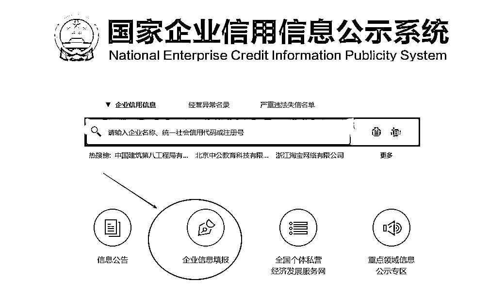
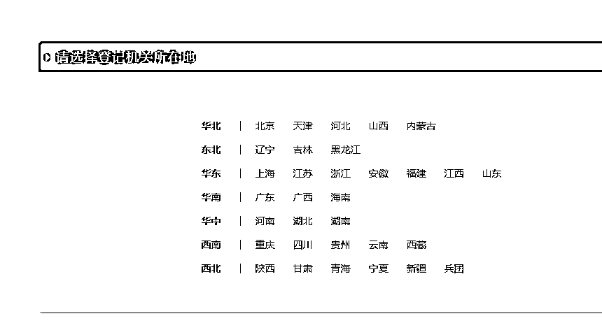
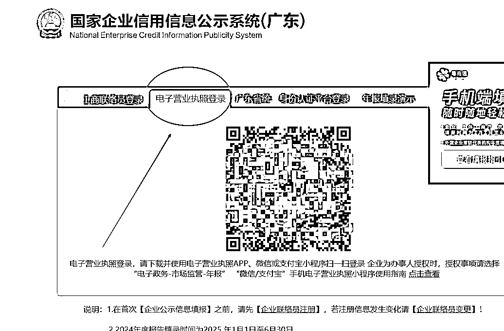
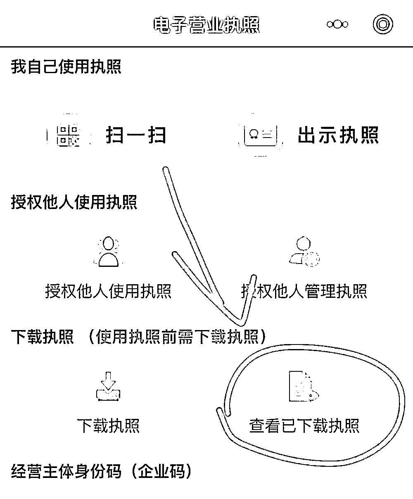
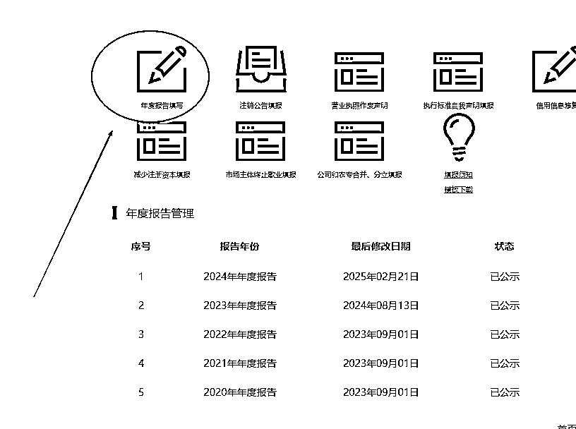
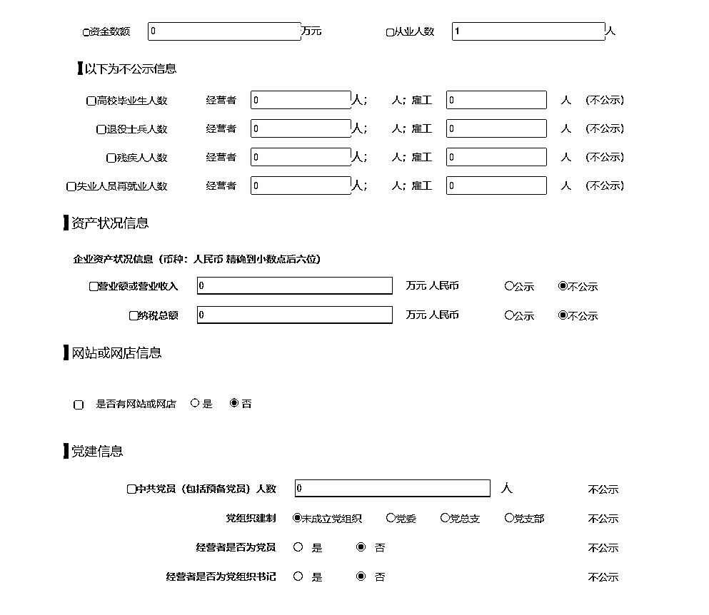

# 个体经营证照年度公示，最快两到五分钟搞定
作者：龙哥

## 个人经营者年度公示操作指南，几分钟内完成

作者： 桔

日期：2025-02-21

🍊 每年六月底前，个独证照都得做一次年度公示，漏做很容易被拉入经营异常。往年我多半走联络员账号或其它入口，登录体验很糟。今年换了一套更顺手的路径，基本两到五分钟就能把流程走完。

1. 先打开国家企业信用信息公示平台，进入信息填报通道

官网：[`www.gsxt.gov.cn/`](https://www.gsxt.gov.cn)

2. 随后挑选证照归属的省份。

我演示的是广东，页面会展示多条认证方式，这里直接选 电子营业执照登录。

这条通道上手最快。若你手机里的电子营业执照小程序尚未同步该证，先在首页点开已下载证照列表，再在底部新增电子营业执照，经人脸校验后按省份选择并导入。

导入完成后重新扫码回国家公示平台。各地呈现细节略有差异，但都能找到年度填报入口，点击进入即可。

下面是我自己长期沿用的填写习惯，仅供参考。

收工。

* * *

评论区：

大河 : 全填 0 行吗

时代 : 想问下社保挂在自己名下的个独，是否能零申报

桔 : 建议找当地的专业财税团队确认，我在杭州的社保最初是挂在个独名下且开了对公结算，杭州地区零申报同时缴纳社保貌似不可行。

时代 : 了解，刚好就是杭州的😂

不懂就问 : 证照是别人代办的，现在商家好像关门了，这种情况也能用这个办法做公示吗？

三生 : 主体是谁

三生 : 如果要报社保，没有营收的话，要做负申报，可以问问 ai

不懂就问 : 我自己