# 给未来掉进黑暗的自己：三个月创业复盘，我靠分享、链接和弱关系熬过来了

> 原文：[`www.yuque.com/for_lazy/zhoubao/ppmh1u8fvy36yysg`](https://www.yuque.com/for_lazy/zhoubao/ppmh1u8fvy36yysg)

## 从迷茫到量产 YPP，三个月里发生了什么

作者：Gary
日期：2025-02-19

十二月底在杭州传术师闭门会上，亦仁和明白老师围着“弱关系”展开过讨论。大致意思是我能真正实现弯道超车的人，往往不是近在咫尺的亲友，而是那些看似疏离的弱连接。当时我觉得有道理，却没当回事。因为 YouTube 的第一桶水，确实是受亦仁老大的超级标和波妮竹子的精华帖启发来的，但我觉得那还算不上质变。

直到此刻回望，才真切明白过去这两个月里，那些曾经的弱关系贵人，对我意味着什么。

若没有在打瓦时结识林老板，后续的油管云创就不会出现，也不会有私域和 IP 的初步探索，更不会撞上培训的坑，从而萌生去杭州当面换资源的想法，也不会在现场克服极度社恐上台自我介绍被亦仁注意到，更不会有之后一系列的连锁反应。

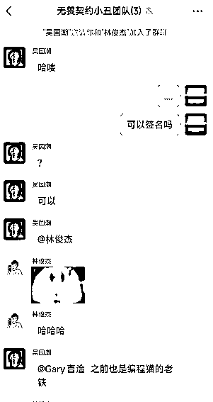

若没有波妮恰好与我组队做私教陪跑，在关键节点不断敲醒我、补足我性格上的缺口，这次陪跑大概率只是把第一版方案再走一遍。近三个月高价重交付的消耗会把我榨干，也没有胆量去试探新赛道、承接不同赛道的学员，更做不出外界看来夸张的陪跑成绩，也链接不到现在的资源池，未来的路也就被提前封死了。

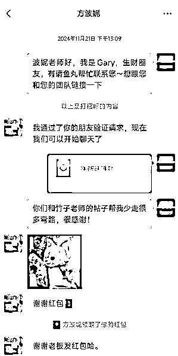

若我没有在生财发那篇精华帖，怅惘也不会透朋友看到我、加我微信，就不会促成我们一起深挖达人秀的机会，也不会被他引荐给朋友遇见进群，进而发现动物示警这条赛道的打法，也不会在私教陪跑中形成领先一个版本的认知和制作能力，也养不出学员批量出结果的局面，自然也没有现在的资源与窗口。

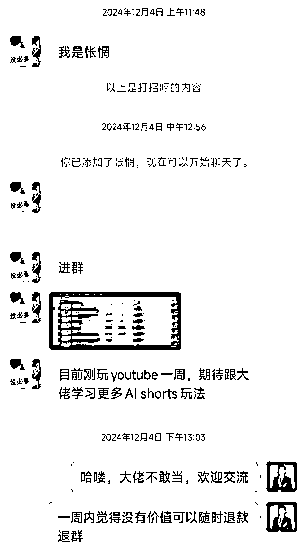

这三个月里，类似的弱关系贵人实在太多。老马、社群里的伙伴、私教陪跑的战友、生财的小伙伴、小挣青年等，出于隐私不逐一公开，真的由衷感激。这些看似不亲近的关系，恰恰在精神和行动层面给我兜底，让我一次次走出低谷。

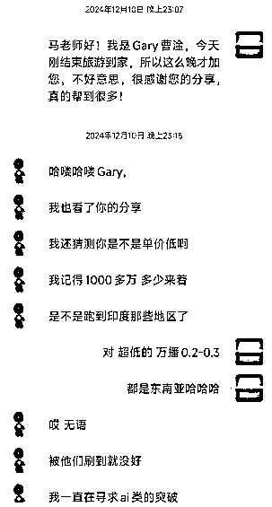

**过去我一直怀疑利他是不是自作多情，怀疑分享是不是自我感动。走完这段才懂，不是期望本身有问题，是期望放在了错误的环境和错误的人身上。**

**

记忆倒带

十月初，四处试错无果，迷茫到不想上班，上班又做不出有价值的东西。没圈子、没环境、没盼头，简历已经在投了，只是运气不佳。附图是某运营商的算力生态产品方向，聊得很顺说尽快二面，结果杳无音信。

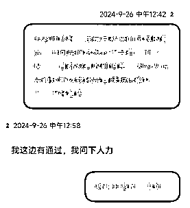

十一月初，被超级标和实操帖点燃，谨慎筛选后在油管发了首条视频，一上来就破万播。当时对播放量没概念，只觉得一晚涨了几十个关注很振奋。 images.zsxq.com/Fp3vn_Il6Vs2R87Ia_3hLw1VWB_9)

十一月中，油管还在爬坡，视频号却突然爆发，三天涨万粉，千万播放到手。久违的正反馈让我重拾干劲，随后对接上林老板，也主动约了几位有国内平台运营经验的朋友交流。

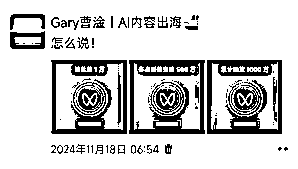

十二月初，沉淀方法论，在航海期发布了生财首帖，一发成精华。风口感清晰后，我开始刻意加势能。

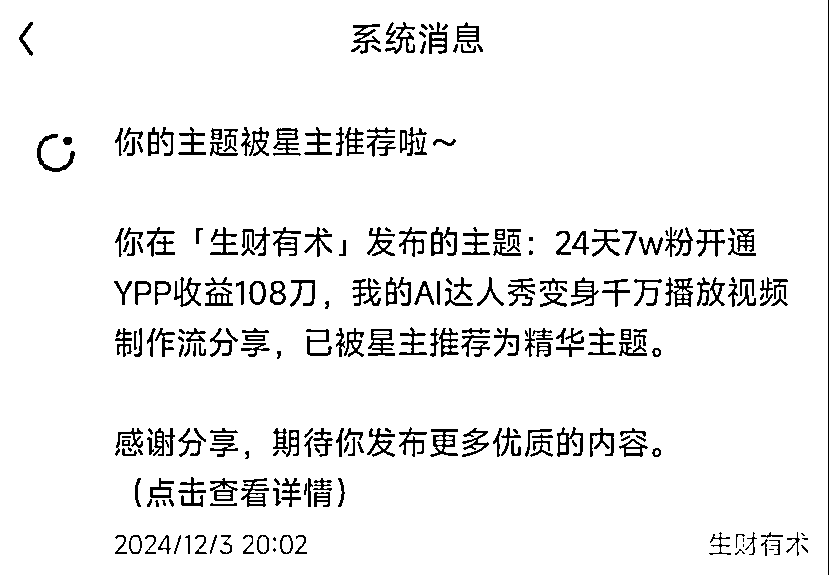

十二月上旬，因精华帖被生财邀请做高手领航直播，相当于半个航海教练。这为后续公域直播和付费环节的测试打下信心基础，也给了我一个重要的身份背书，不再是纯小白。

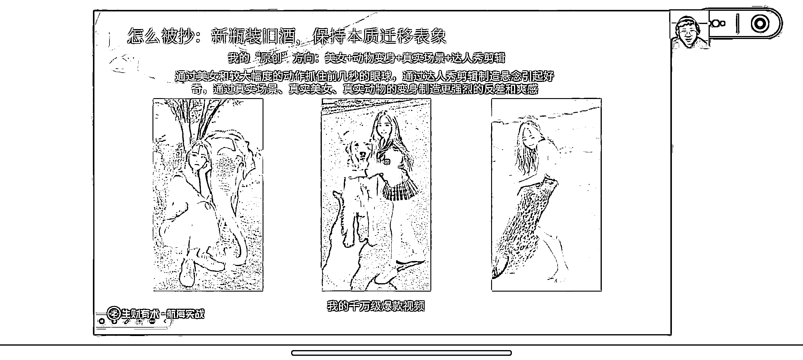

十二月中下旬，借林老板资源，依托航海教练和精华作者的身份启动云创，招募到五十多人的免费引流团队，用来测知识付费闭环。一周内拉三百多人进私域，转化四位998学员，其中两位我主动退费，一位退半额，一位已开 YPP。闭环跑通了，但我很快察觉交付风险巨大，学员未筛选质量堪忧，几乎无法兑现交付，于是及时叫停扩张和招生，为视频制作的打磨和杭州行腾出空间。

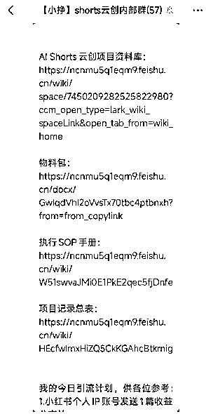

十二月底，飞往杭州参加传术师，这是我第一次近距离感受头部玩家的场域。亦仁老大、李一舟老师、火火老师同台，认知被刷新。最关键的是自我介绍环节，这个极端的I人硬是克服恐惧上台。我原话说自己有五个开了或即将开YPP的账号，还算上三个朋友。亦仁老大听成了我有五个YPP。散场后我犹豫了十几分钟要不要去办公室找他留影，最后还是推门而入，没想到他还记得我，因为那五个YPP。我当时很不好意思解释，其实是一个已开，四个快开。没意识到这个小误会给我打开多大缺口。现在回头看，我们已经五十个YPP了，哈哈。

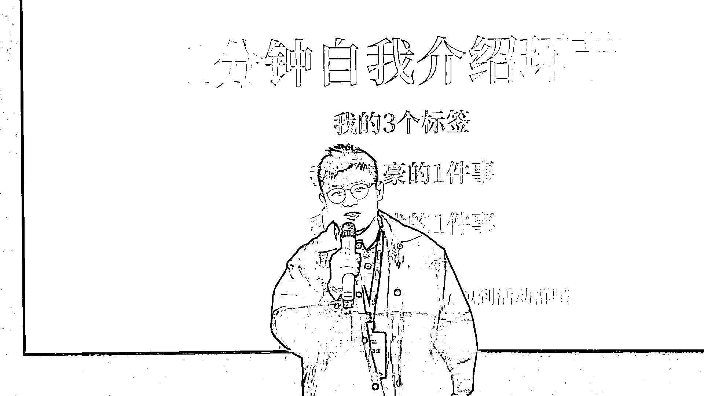

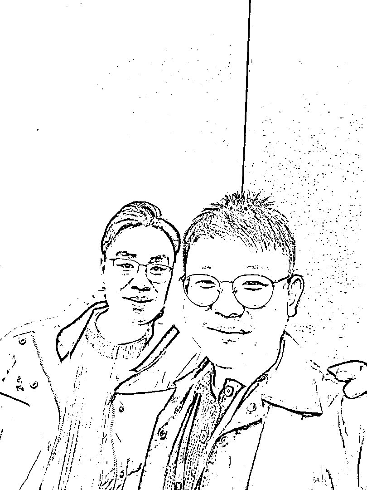

一月初，因为亦仁老大点名，欢欢联系我带队私教陪跑。当时我心虚得很，觉得至少要像老马那样才有资格。波妮和老马给了我很大底气，加上十二月已完整跑通一次招生培训链条，最终我接下了这个艰巨任务。

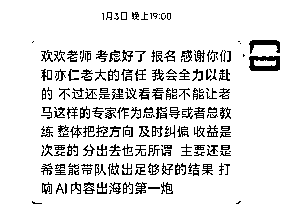

二月初，省略陪跑期间的高强度实操、直播、测试、培训和写作，我和波妮熬了无数个夜，最终沉淀出一套同赛道断层领先的打法和教程。学员的YPP接连开启。复盘帖发出后，加上陪跑圈友的高质量分享，前半段陪跑算是漂亮收官。

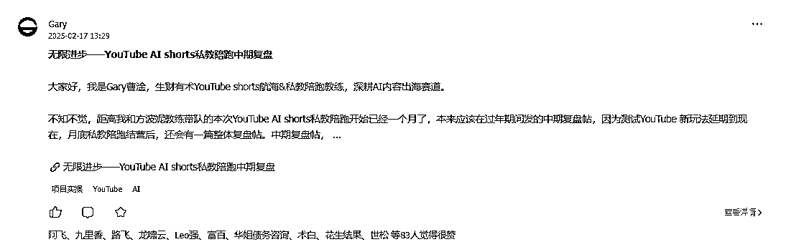

 images.zsxq.com/FpS7wUgo14qJL87vSYsy4jsWQy8j) images.zsxq.com/FpEZ9ZVJhuU0dXqdUDtlr0WqzWCA)目前累计五十多个YPP账号，播放总量接近五亿。我们正式进入新阶段：YPP量产、油管带货、AI长视频、音乐商单、联盟营销……清晰可见。带着一群高手在各自领域开疆拓土，今天我第一次有了拨云见日的踏实感。

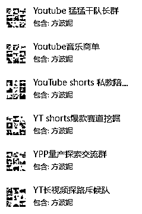

如果必须用几个关键词概括这三个月：

1. **分享，带来好运**
2. **链接，打破圈层**
3. **贵人，源于弱关系**
4. **愿力，有必须赢的理由**

说实话，这还算不上大结果，但我仍想任性地骄傲地写下来。不是炫耀，而是我越来越确信越分享越幸运的分量，越来越学会取悦自己，想写就写。也许这辈子就这么几次能有这种体感。

哪怕这条路最终没走通，哪怕未来有更大的失败等着我，也不妨碍我把今天的拨云见日记下来，把这三个月的心路记下来。**它将来一定会在某个时刻，点亮那个失魂落魄、无以为继的我，也希望能给此刻失去希望的你一点光。**

回头看，轻舟已过万重山。

* * *

评论区：

六只猫 : 感动且鼓舞[666][666][666]教练 666

轻舟 : 昨天链接时的忐忑还记忆犹新，现在看到 Gary 教练的回顾和真情流露，这种感觉真的很奇妙

百哥 : 轻舟已过万重山

Gary : 主打一个真实

拾一 : 公众号里看了一遍，再来星球点个赞[强]

Gary : 哈哈哈，谢谢拾一老师！

Gary : [爱心]

Gary : 你也 666