# 我是怎样用 DeepSeek 写出知乎热榜第一、高赞第一爆文（超详尽复盘）

身为一个完全不懂技术的文科生，我是怎么把一篇文章同时送上知乎回答区第一和热榜第一的？这篇复盘会把每一步都拆开给你看。

先自我介绍：我是马小帅，在社群里大家叫我网黑哥。潜水很久，这次是第一回发干货。下面这篇文章首发在我自己的账号上，是付费内容，数据不错，所以拿过来和大家共享。

事情的起点是某个周二晚上。我刷到一条推送，立刻决定当天加更。用了一个多小时，九点半发出，也就是上篇《号外，马斯克刚发 Grok-3，DeepSeek 就贴脸开大！》。发完顺手同步到知乎，当晚就成了该问题下最高赞的答案。第二天，知乎官方把这条回答选入了平台热榜第一。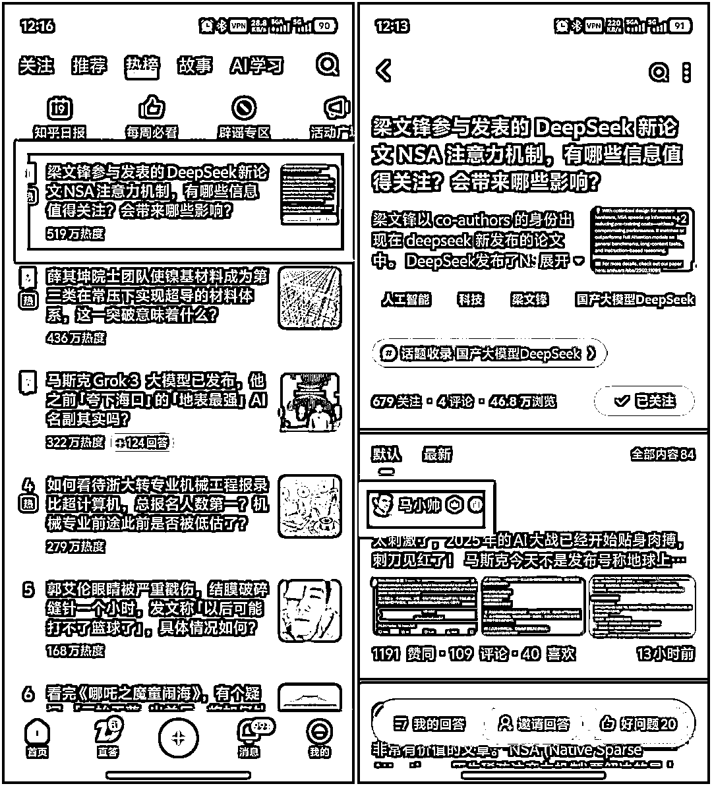 截止目前，知乎那边的数据长这样：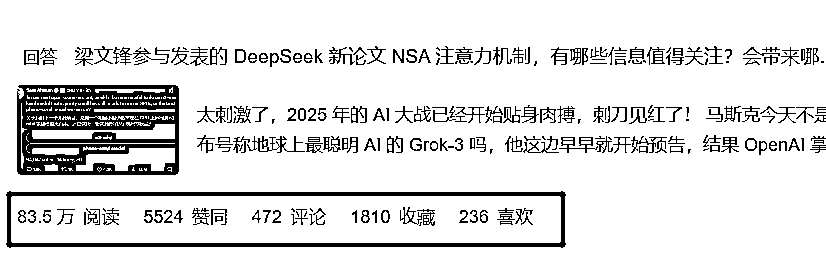

同一个问题下其实有好几位专业答主，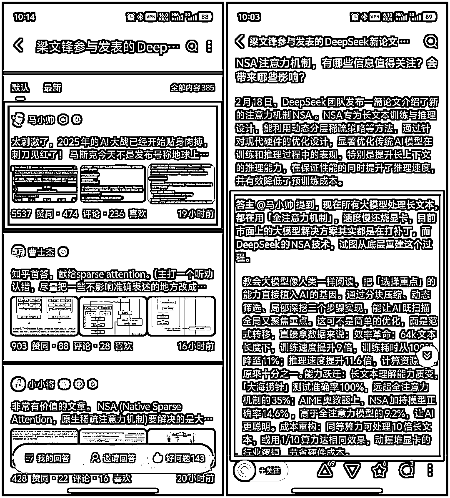 而我的回答却排到了最前面，说实话我挺心虚，也很有压力。请不要误会，我真没觉得自己厉害。功劳主要在 DeepSeek——它让我这个半路出家的人，写出了一个普通人也愿意读完的AI解读。这不就是AI放大普通人能力的绝佳案例吗？

下面，我把当时的完整流程和思考都摊开讲。

**一、选题：在热点缝隙里找一个没人占的位置**

2月18日中午Grok-3发布，下午各家自媒体就开始了刷屏式报道。热点确实热，但个人账号去跟机构拼手速，基本没有胜算。而且如果我只是把发布会流程复述一遍，写出来的东西注定同质化，也没有任何增量信息。再说，想实际体验Grok-3门槛也不低，付费不说，短期内能试玩的部分很有限，我拿不到太多一手素材。

正在发愁怎么切这个热点时，微信弹出了一篇“河南日报”的推送，标题是《DeepSeek，新消息！》。点进去一看，是一篇AI动态汇总：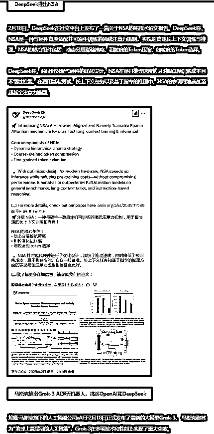 很明显稿子是提前排好的，但在发布前几分钟，编辑用下午三点DeepSeek动态替换了原本的Grok-3相关段落。这说明编辑判断，在傍晚六点那个节点，DeepSeek的新消息比Grok-3发布会更有新闻价值。事实也证明，如果那篇推送只讲Grok-3，我大概率不会点开。

顺着线索，我去X上找到了DeepSeek那条原始帖文，评论区讨论已经相当热烈。这里有个关键背景：DeepSeek的X账号平时几乎不更新，从1月20日发布R1之后，总共只发过两条动态，一条是关于参数优化的设置说明，另一条就是这个新论文。一个很少发声的账号突然更新，这件事本身就极不寻常。再加上论文内容确实重头，那我的判断就变得很简单：刚发生+少出现+强影响=爆款潜质。

再多推一步，DeepSeek显然是故意挑在Grok-3发布后不久放出论文，用来制造节奏上的对冲。于是标题和悬念就有了：马斯克刚发Grok-3，DeepSeek就贴脸开大！Grok-3是流量入口，必须蹭；但文章的重心始终在DeepSeek这边。只有这样，才有可能从满屏Grok-3的稿子里冒出来。当时我搜了一圈，👸号几乎没人写DeepSeek的新论文；知乎上虽然已经有了提问，但下面只有三个回答，最高赞还是个位数。后来的结果你也知道了——那个提问第二天被知乎推上了热榜第一。

为什么把选题这段讲得这么啰嗦？因为一次内容能不能爆，八成在选题阶段就已经决定。写得好，最多在你所在的问题下拿到高赞；选得准，才有资格去争平台级的热榜。大多数普通作者没有能力创造热点，能做的就是借势，在热点周围找一个多数人还没看到的角度，提前落位。

总结：选方向，比埋头写更重要。

**二、动笔：论文读不懂，就让AI先读**

定了题目后，第一步自然是去啃论文。论文链接在这里：[`arxiv.org/abs/2502.11089`](https://arxiv.org/abs/2502.11089) 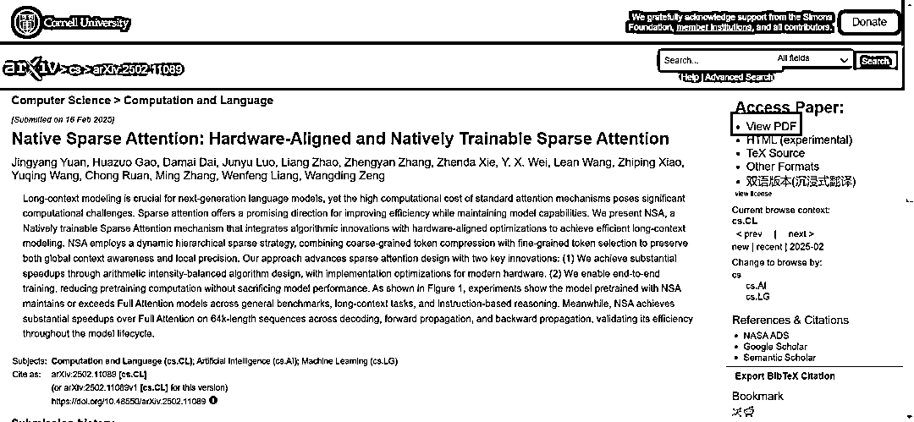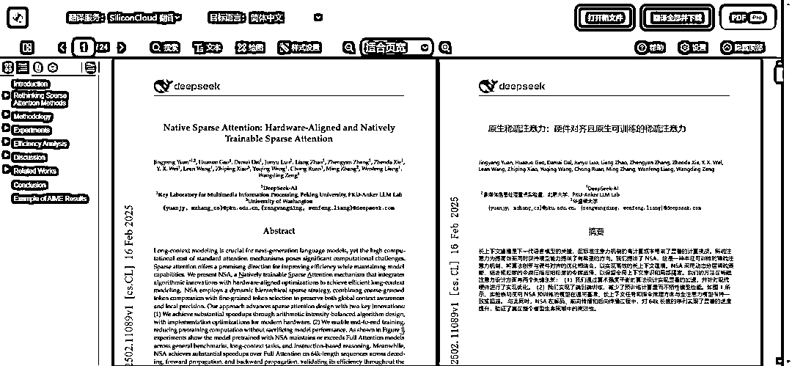 我用沉浸式翻译硬撑了几分钟，还是放弃了——这不是我这个基础能消化得了的。

于是回到DeepSeek官网，让它帮我解读，并且额外提了一个要求：必须说明这项技术会给下一波大模型带来哪些能力上的变化。理由很简单，绝大多数普通读者不关心论文本身，只关心这技术对自己有什么用。我写文章的对象正是没有技术背景的人，所以这点不能漏。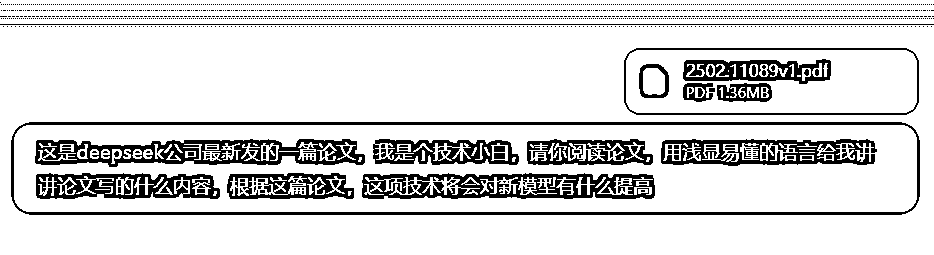 官网给出的回答，就是上篇推文里那段解读：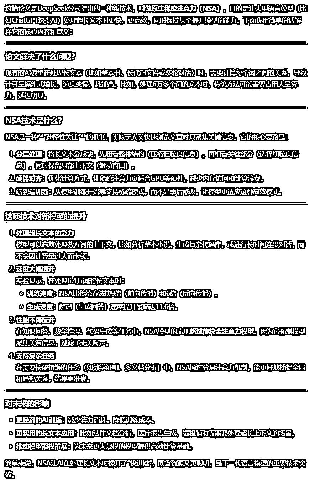

说实话，那段解读能看懂，但我不太满意。它还是显得有点枯燥，术语密度太高，普通读者很容易失去耐心。而知乎同题下其他答主也存在这个问题——内容很专业，但过于硬核，大众消化不动。这里先声明一下：高赞第一并不是质量第一，它只代表“更容易被大多数人看懂”。

当我接着要求官网换个更生活化的说法时，官网居然罢工了。现阶段DeepSeek官网的策略是，同一个用户几小时只能问一次，用完就要等。我只好转到腾讯元宝，把论文上传。要注意，上传本地文件后元宝不能联网，而马斯克的新模型又是刚刚发生的新闻，所以我得先把这些最新信息同步给它，否则它可能胡说八道。第一次给元宝的提示词是这样的：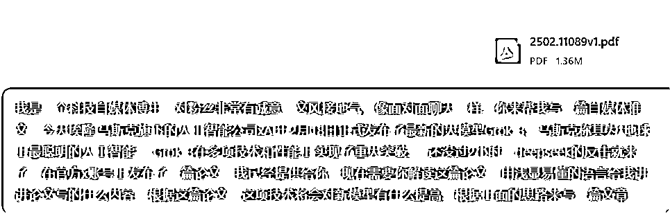

元宝版DeepSeek很快给出了初稿。这一版语言风格太轻佻，很多表达像是营销号标题，还把不少技术细节牺牲掉了。这种风格我完全无法接受，于是又补了一次要求：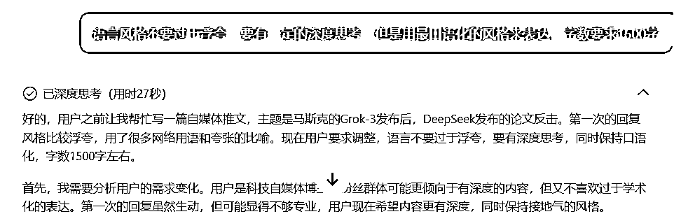

第二版明显沉稳下来，开始认真对比Grok-3和DeepSeek两条技术路线的差异，也把论文中最关键的几个数据点挑出来了。至少从气质上，这才像一篇愿意被深度阅读的内容。

不过，无论AI写得多么有条理，其中仍然藏着一些需要冷静看待的风险。最大的担忧是：当AI自主决定哪些信息值得重点看时，会不会恰恰漏掉那些反直觉但至关重要的内容？论文里的测试环境相对理想，而真实世界里的长文本充满各种干扰，一旦这一步不够可靠，整个方案的实际效果就会大打折扣。

关于这个话题，我后面会继续讲。这篇先到这里，如果大家感兴趣，我再接着往下写。

### 一篇热榜技术稿的背后：AI代笔，人定调

先用几段话，回顾那篇深度解读的核心内容。

**2. 训练开销上的“挪移”**

推理环节的开支确实降下来了，但省下的钱并没有凭空消失，而是换了个位置重新出现。NSA这套架构在训练阶段需要一套全新的课程式学习方法——说白了，要让模型自己在海量信息里学会挑重点。这个“教会机器抓重点”的问题，至今仍没有现成答案。算力压力减轻了，设计复杂度却上去了。

**3. 生态改造的隐藏成本**

目前的主流模型生态很难直接拥抱NSA。以Hugging Face为代表的整个生态，都要从算子层面到部署流程做一轮深度改造。这可不是改个接口那么简单，背后是实实在在的工程投入。

### 七、NSA普及，寻常用户会撞见什么？

如果这项技术开始规模化，大概一到两年内就能看到这些变化：

- 文档分析：把上千页的行业资料丢给AI，十秒左右就能拿到核心走势与风险提示，而不是一堆关键词。
- 教育场景：学生可以借助AI快速通读海量长文献，但也要提防不动脑子的依赖。
- 编码开发：AI不再局限于补全几行代码，而是能读懂一整个代码仓库的架构关系。
- 审核风控：平台能够实时理解长时段视频的完整脉络，而不是只看截取的片段。

比这些场景更重要的是，国内团队这次在算法原生创新上领先了一步。在Attention机制——这个现代模型的心脏地带——我们第一次拿出了受到全球同行认可的基础层改进方案。

### 八、尾声：比拼进入“修炼内功”阶段

过去大家拼参数、堆数据、比显卡，几乎是一场烧钱大战。深度求索的论文却点明一个拐点：未来的输赢，可能要看谁能在底层模块上做出真正的再发明。

燃油年代看排量，纯电车年代看电池调控算法。当算力不再是唯一护城河，创新才刚刚有了土壤。

至于Musk手里的Grok-3？它也许很能打。但至少在今天，掌握定义规则主动权的人，是另一拨。

——以上是那篇热文中被读者讨论最多的几个片段。

写完初稿后，真正的麻烦才开始：怎么把它从“60分模板文”改到“80分可读文”？

拿到第三版草稿时，我心里已经认准了它。后来发出的版本，也基本是以第三版为骨架做精修。用今天的眼光看，那版稿子能打70分。

一句话：模型不可能猜透你脑子里那个模糊的想法。你多花3分钟写清楚指令，后面就能少花3小时改稿。

**润色：把机械腔调转为生活气息**

有了深度求索的帮助，只要需求表达得够具体，任何人都能轻松写出70分的稿子。但想再往上够一够到80分甚至90分，考验的就不是操作技巧，而是文字判断力和审美直觉。

所以，必要的打磨环节绕不开。

落笔之前，我早已定好了文章的入口，因此模型生成的草稿开头必须和我手写的那句衔接：“太刺激了，2025年的人工智能竞赛已经进入近身缠斗阶段！”

这种写法，不少写作课里管它叫“钩子开场”。

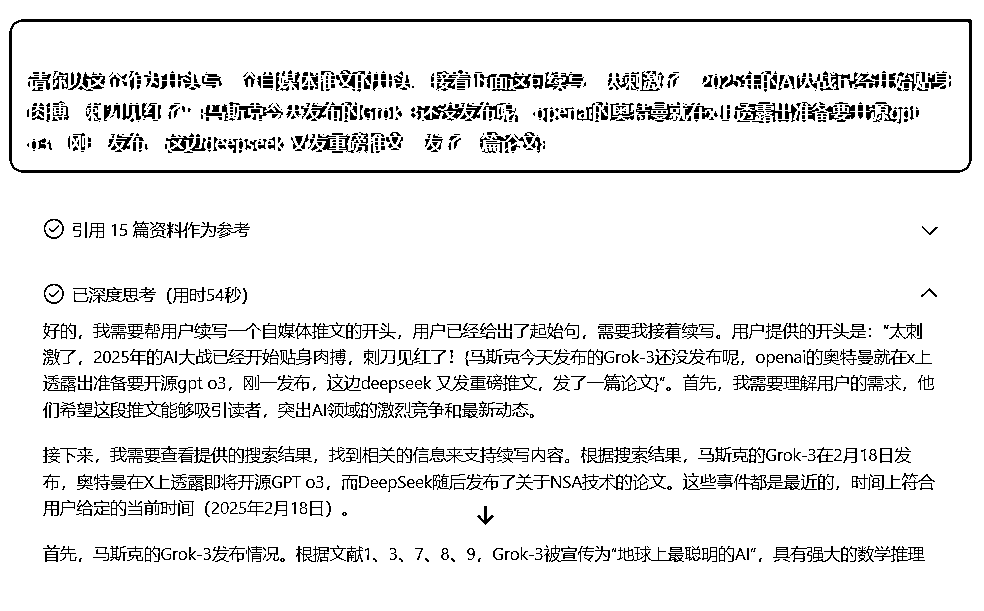

那轮指令允许联网，本意是让模型基于实时资料做补充，可返回的结果，离预期差了很远。

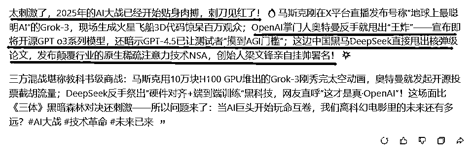

我从那堆输出中只保留了红线圈出的内容，然后在这批内容之上做第二次微调。

继续走。为了让读者读起来不累，我陆续放进了一些配图——例如Altman在X平台的推文截图、论文原页截图等等。图片不单是点缀，也是在补充文字表达不充分的信息。

接下来，聊聊我是怎么做文字剪辑的。

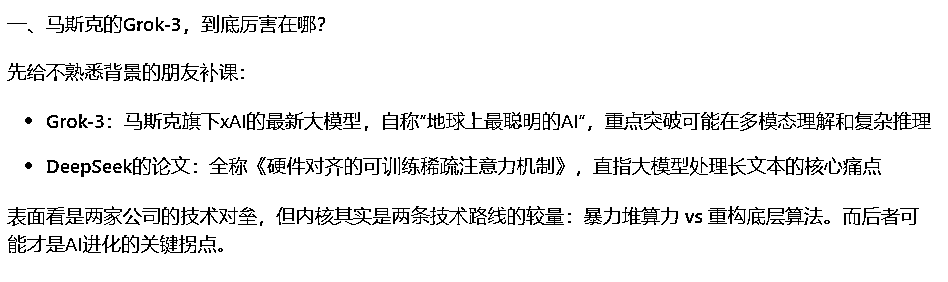

这段话被我直接从第二稿里删掉。它的问题在于，叙事被“对抗”两个字带偏了。模型大概是受了我开头那句“近身缠斗”的影响，把一个单纯的技术发布，写成了两家企业的对决。而我们本意只是搭个热点，并不想放大对立。拿掉这段之后，直接进入论文介绍，节奏顺畅多了。

另外，模型喜欢把内容拆成一条条要点，这种分列式写法在电脑上看还行，放在文章里就显得生硬。我把这些要点全部作了“熔炉式”重写，压成普通段落。

第二稿段落原貌：

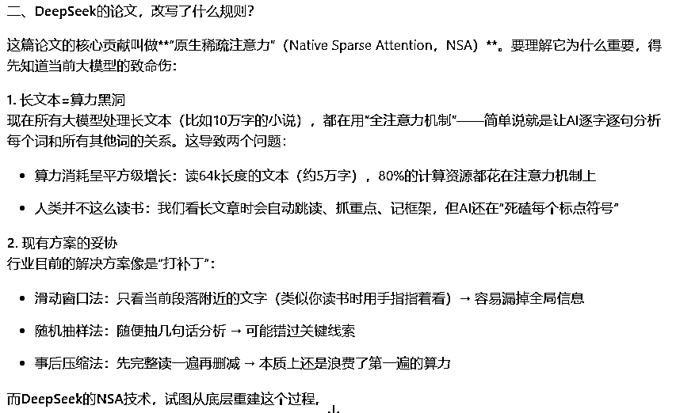

精修后效果：

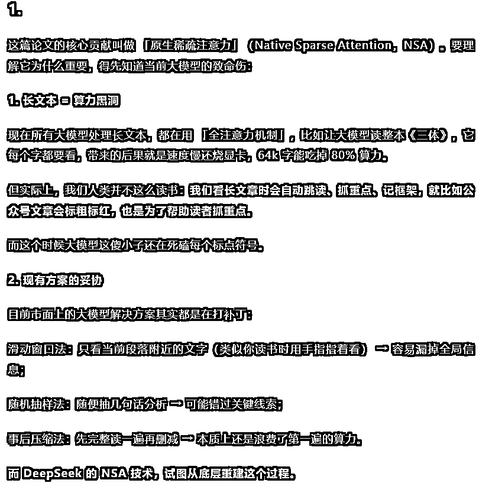

说白了，就是把“机械腔”改成“人话”。能变到什么程度，全凭你对文字的掌控力。

还有，初稿虽然被我批评“太浮夸”，但里面有些句子情绪非常烈。我没舍得扔，而是把它们摘出来，安插到第二稿的对应位置。

拿第二稿中的一段来讲：

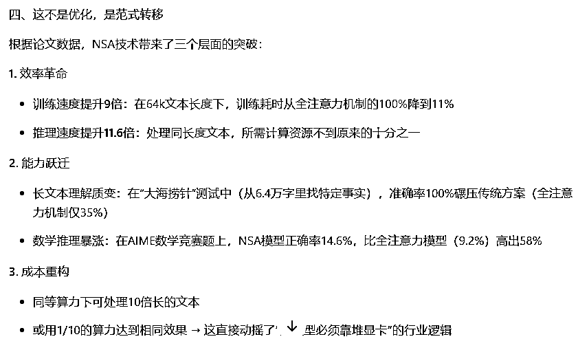

信息没问题，就是缺少情感重量。我从初稿里捞出几句更有冲击力的表达放进去，于是定稿长这样：

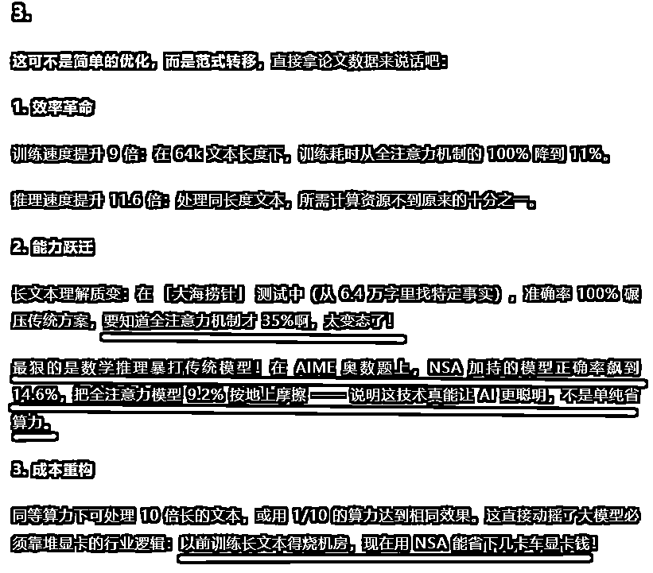

新加入的句子，有些来自初稿，有些是我根据初稿的语感重写的。后面的段落，基本沿用了同样的组合拳。

此外，深度求索这个模型非常爱用类比。一旦频率失控，或者类比不当，AI腔就藏不住了。第二稿里那些不太精彩的类比，我几乎全部删除，文风一下就清爽了。

还有个小技巧：让模型少堆形容词，多安排追问或设问，再加上一点亲身经历，文字的温度会明显不同。

最后，我还跑到X平台搜集了几条有趣的网友评论，截图放进去，整篇稿子才算出炉。

PS：结尾那句带脏字的话，是我自己加的。读那份技术报告读得心潮翻涌，不加一句真的过不去。这也让稿子多了一点家常感。

一句话：去机器腔，留下人的温度。

**查证：给内容上最后一道锁**

到这儿就算完事了吗？不是。

技术解读类文章最怕的事实硬伤，恰恰要用最笨的办法防住。尤其是核心指标、具体金额、日期和人名，必须做三源交叉验证。读者也许能接受你的偏颇判断，但绝不会容忍低级错误。

比如稿子里有一句：“推理环节的吞吐量提高了11.6倍，面对同等长度的文本，所需算力不到原来的十分之一。”我会打开论文原PDF，用检索功能定位“11.6”，再借助带双语对照的翻译工具复核前后文。

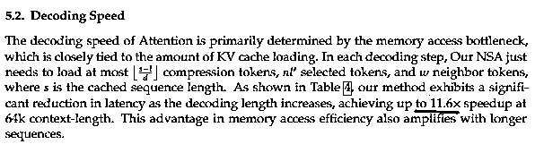

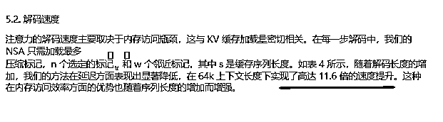

其实关键字眼一旦锁定，验证流程非常快，十分钟足够跑完。但这一步我永远不会跳过。

一句话：保险要上到最后，才算真正保险。

**写在最后**

我估算过，那篇稿子从模型起草到人工打磨，一共用了一小时左右。而这次复盘却耗掉了一整天。它是纯手工敲出来的，内容难免有些碎。我只是想尽量还原当时的思考路径，让大家能走进那个创作场景里，边看边想，然后有所得。

最后说点宏观的：

AI的进化，说到底是为了让每个会用它的人，突破身体和时间的限制，把行动范围扩展到百倍级。那篇登上热度榜的文章，就是最直观的证据。

但越是这种时候，写作者越要握住三样东西不放：

第一，选题层面的新闻时机嗅觉——知道什么时候该发声；
第二，文字上的品味与取舍——知道用什么方式发声；
第三，也是根本的一条——对产出内容兜底全部责任——知道为什么只能由自己发声。

谢谢每一位读到这里的你，愿这篇没什么虚招的复盘，能真正帮到你。

* * *

读者热评：

王威：赞[色][色]
大源：这复盘太实诚了，手打不易[强]
薇薇：学到了，很多细节非常受用[强]
希声：好扎实的复盘！
小朝：太棒了！指导性非常强，已经打算照着实践。纯手写也看得出真心，感动🥹[爱心][强]
✨🍒恋小呆🍒✨：棒
小静静：看完很有收获，可借鉴的地方太多[强]
一颗真诚的芋圆：代入感很强，非常值得收藏💪