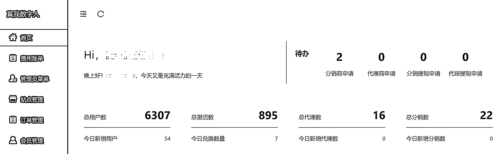

# 从0到0.5：我的数字人项目复盘与反思

> 原文出处：[`www.yuque.com/for_lazy/zhoubao/isb9goxxi0feda3i`](https://www.yuque.com/for_lazy/zhoubao/isb9goxxi0feda3i)

## （精华帖·58赞）从0到0.5：我的数字人项目复盘与反思

作者：新侠  
日期：2025-02-17

去年10月，我盯上了“对口型数字人”这个有点反常的机会。用了一个月搞定工具搭建，勉强跑通了成交闭环。那会儿我做过一次复盘，帖子有幸被加精。

没看过的朋友，可以先去翻翻前传：

[数字人+短视频，工具类细分赛道可行性研究](https://wx.zsxq.com/group/1824528822/topic/2858244212444551)

一晃又过了将近4个月，今天把进度条拉出来晒晒。

刚看了后台数据——累计激活会员895人，剔除体验会员之后，正式会员大概150人。怎么说呢，勉强算是走到了0.5吧，离我心中“从0到1彻底跑通”的及格线，还差着不小的距离。

这几个月，坑是一个接一个地踩，原本以为“站上风口就能起飞”的幻想，也慢慢被现实摁回了地面。

本来打算等完全跑通再一次性复盘，但过年难得给自己放个假，脑子里却不停蹦出关于项目的各种想法和规划。索性就写下来，既算是对过去的总结，也算是对2025年的工作安排。

内容分三块：

一、踩坑反思  
二、回归正轨  
三、项目规划

下面是正文，enjoy。

[`jinhuaclub.feishu.cn/wiki/OxbNw9RWHimZsukRgZbcjNfonXg?from=from_copylink`](https://jinhuaclub.feishu.cn/wiki/OxbNw9RWHimZsukRgZbcjNfonXg?from=from_copylink)

* * *

评论区：  
暂无评论