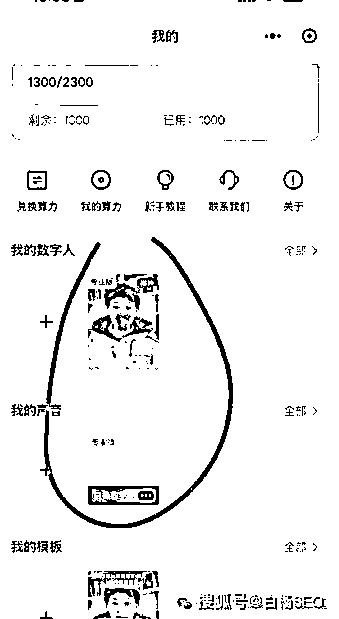
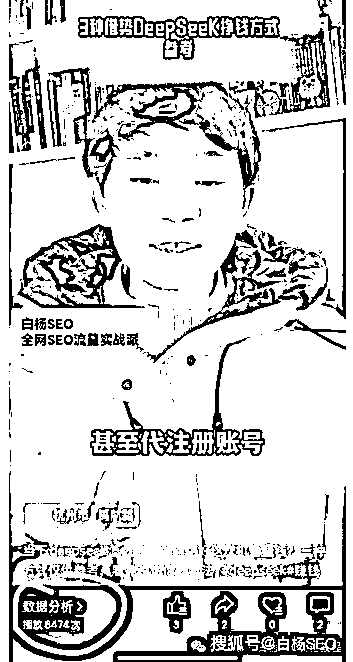
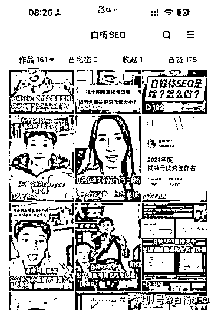
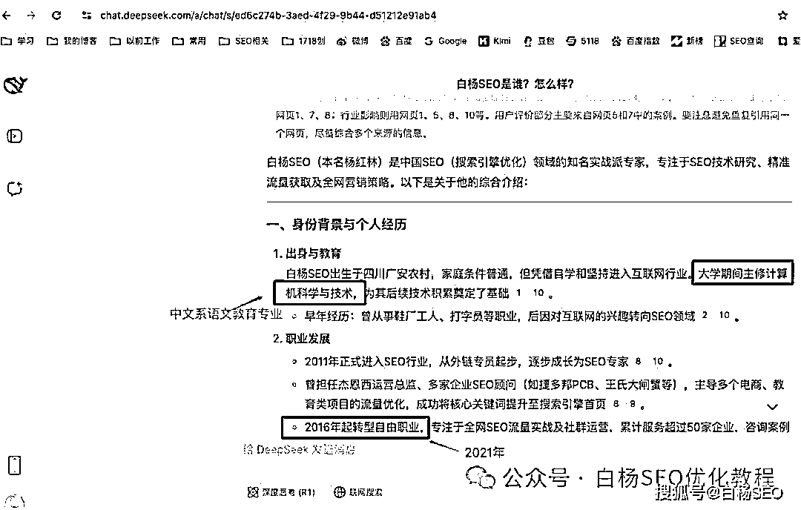

# ('白杨 SEO：数字人做短视频有流量吗？为什么说结合 AI 推广获客转化更高效？', (2, 41))

数字人短视频到底有没有流量？为什么AI加持下获客转化更高效？

去年开始，身边不少人问我数字人做短视频行不行。说实话，我自己一直没用数字人拍视频，但架不住大家好奇。有个群友花了几千块买数字人，后面做视频还要按分钟收费，挺贵的。后来另一个群友推荐了一个平台，里面有免费版，但付费版更逼真。价格只要365，我买来训练了一下，能生成差不多20个视频，效果见图。

视频内容是用我原创的文章，让AI改写一遍，再交给数字人念出来。说实在的，声音我还是不太满意，手的动作也莫名变快了，自动配图更是有点扯。不过整体剪辑居然比我手动剪得好，这点倒是意外。

那有没有流量？我发了一个之后，视频号给了不少推荐流量，快手也有。看截图：

不过我一直做的是精准搜索流量，这种靠推荐的流量，除非是用来做品牌宣传，否则不是我的菜。

那为什么还说值得试试？现在是AI时代，也是内容时代，靠老办法生产内容效率实在太低。数字人虽然不是真人出镜，但核心是内容质量。只要内容对用户有价值，用数字人做短视频完全没问题。我从一开始拒绝，到现在也开始尝试，但未来主力还是真人。这个数字人或许能帮我做带货视频，或者结合飞书生成内容来做短视频，都是可行的路子。

具体哪家数字人我就不推荐了，网上太多，免得有广告嫌疑。真感兴趣的话，可以私下找白杨SEO，我把链接发给你，自己判断。

接下来聊聊为什么AI技术让推广获客和转化效率更高，我觉得主要是三点，供参考：

第一，有了大模型之后，做产品、写内容的思路一下子打开了。以前发愁不知道写什么、产品亮点怎么提炼、用户需求怎么分析，现在这些都有方向了。

第二，AI生成文字、图片、语音、视频的速度比人工快太多，而且还能串起来实现自动化生产。搞流量的人，还会缺内容吗？

第三，对潜在客户的转化也有帮助。不管你是做公域还是私域，评论区回复、公众号自动回复、微信回复、售后客服，都可以接入AI来提升响应效率。转化率自然也能提上去。

所以有人说，2025年以后，AI会淘汰那些不会用AI的人；会用AI做自动化的人，会淘汰只会用基础AI的人。但更重要的是真正能判断AI输出结果对不对的人，因此深耕行业的人依然很吃香。

另外还有一块，就是针对AI搜索、大模型的优化，也就是AIO，这会成为刚需。为什么？连白杨SEO自己的个人介绍，在DS上都是错的。我明明是四川教育学院（现成都师范学院）中文系语文教育专业毕业的，结果AI硬把我专业写成了计算机科技，真是哭笑不得。

关于AIO优化，我还在研究，已经有了一些方向，等有成果了再拿出来跟大家分享。