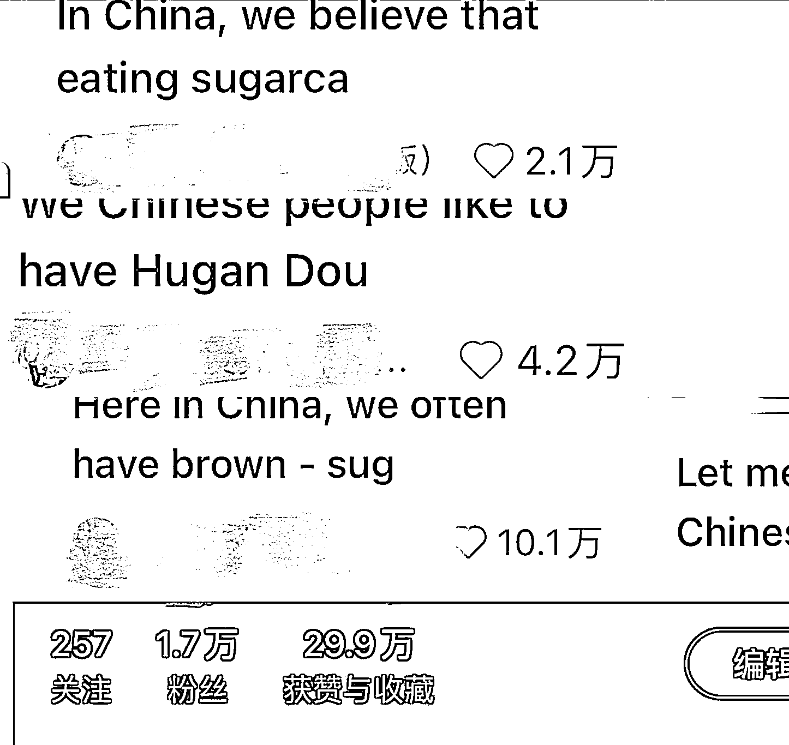

# 靠 TikTok 难民，我 10 天把📕干到 1 万 5 粉，方法有点野

哈喽赚钱的朋友们，我是龙哥，在杭州，前抖音电商运营出身，现在主攻自媒体和达人孵化，去年裸辞出来自己干。📕其实不是我的主战场，但在 25 年我的重点布局里排得很靠前，目标就是做成 IP 账号，再延展个人品牌和电商变现。今年年初其他业务淡季，我就集中火力做中医相关内容。

先上结论，说人话，有图为证。借着 TikTok 难民这波东风，**我用 10 天把账号拉到 1 万 5 粉，最高一条 10 万赞，另外还有 4.2 万、3.9 万、2.1 万赞的视频。报价单已经能开到 700+，但我暂时没接，打算先把内容打磨扎实。**

说说这次是怎么搞起来的，我不太喜欢写那种套路满满的复盘，就讲干货，哪里没讲清楚评论区聊。

## 怎么起来的，分了三步走

发现 TikTok 难民上热搜后，我第一反应不是犹豫，而是先问自己：这波热度怎么给我的事带来增量。当时身边不少人劝退，说📕万一管控怎么办，外国粉太多后续变现怎么办。我的想法很简单：第一，试错成本不高，我本来就是爱折腾的人；第二，就算粉大部分是外网用户，点赞评论率也高，算法会吃这波互动，把内容推得更宽。实测下来，这逻辑是通的。

**第一步：先把字幕英文化。** 视频保留原声，配上英文字幕。效果有，但不算炸，因为信息流里封面和标题还是中文，路人一下子看不懂。

**第二步：直接用英文配音。** 刷到一个哥们一条很普通的口播，纯英文讲，快 5 万赞。我立刻改口风，第一条英文配音就 3000+，第四条直接飙到 10 万赞。语言门槛一打开，传播速度完全不一样。

**第三步：选题对准大众共性痛点。** 平台当时的风向我一直在盯，鸡蛋羹教程疯了我就围绕鸡蛋羹做。姨妈痛也是切口，全女生都懂，第一条 10 万赞就用这个。熬夜、泡脚这类普适型话题，再加点猎奇感，基本都能稳定几万赞。

## 到底学到了什么，能不能抄

**复盘里的坑**

1. **没乘胜追击。** 起号期应该猛更猛推权重，我才更了十来条，临近过年被各种事拖住，回头看挺可惜的。创业就是要守住专注。
2. **第一阶段起号后没及时调转方向。** 理想状态是先用海外用户起盘，再把内容形态优化回来吸中国粉，提升商业价值。我意识到了，但执行没到位。
3. **变现节奏没想透。** 曝光最高的时候有人建议我挂小清单，我没弄。老外在评论区抢着要买东西，我当时没店没人。所以暂时选择先接广告做长线 IP，明年再正式做电商。

**我认为现在还能用的起号思路**

1. **海外用户没走完。** 虽然那波热度过去了，📕上依然有不少海外用户，且互动欲望很强。视频类账号如果用英文解说，挑他们感兴趣的内容，先让他们点赞评论帮你推权，然后再慢慢切回国内受众，是条可行的起号路径。
2. **跟风向比靠创意重要。** 跟一个 MCN 老板聊过，能起来的号基本都站上了红利。比如头部主播减少，小主播就会补位。这次我能起来，核心就是卡住了平台的热点窗口。
3. **自媒体归根结底是模仿。** 📕的同质化治理比抖音要松，算法对素人也更友好。真不会拍就去拆，100 条同类爆款拆完，手感就有了。

这次复盘是在甲流刚好期间写的，思路有点乱，但希望能给你一点启发。先把号做起来，再谈变现，顺序别反了。