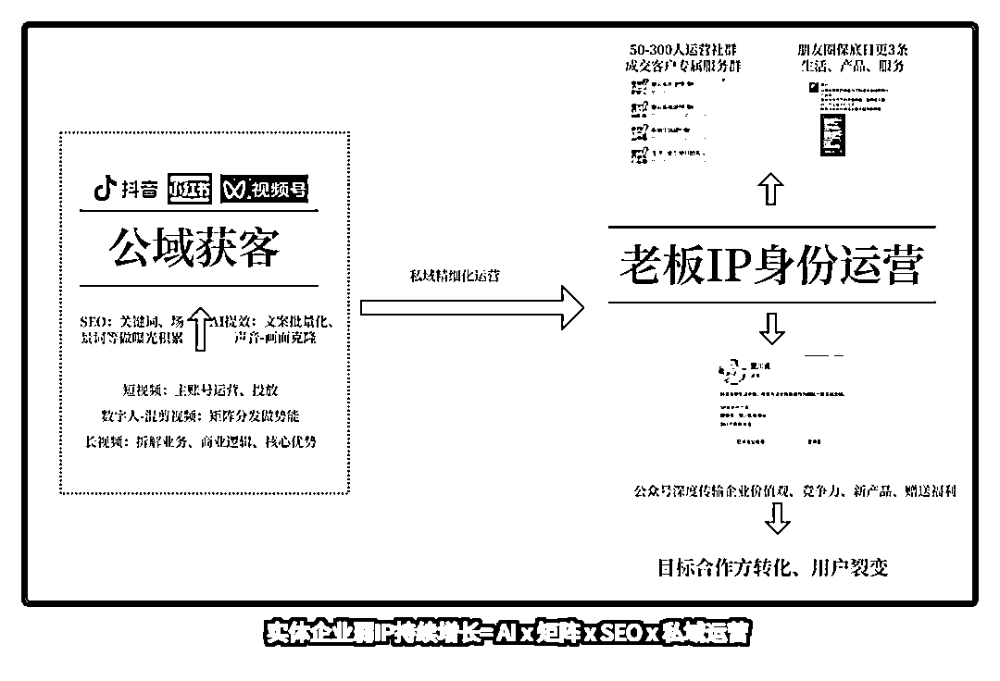

# 2025实体生意翻身仗：别再当“网红老板”，这套打法更省力更能赚

实体行业的老板们，这几年真被“IP”二字折腾得够呛。不做吧，看着同行在短视频里露脸获客，心里发慌；做吧，每天写脚本、拍摄、剪辑、直播，精力被榨干。曾有位做连锁门店的客户跟我吐槽过一句大实话：“拍一天视频，比打理十家店还让人崩溃。” 我自己也亲历过那种状态，被高强度出镜的计划死死拿捏，满脑子只有拍摄内容，生意反而无心照顾。

之所以如此拧巴，本质上是过去那套 **“强人设IP”的打法已经跟不上时代了**。而在2025年，更接地气、更可持续的破局路径其实已经出现：**AI工具 + 短视频SEO + 账号矩阵 + 私域深耕 = 实体企业的确定性增量。**

与其说这是一次运营方法的小调整，不如说是流量底层逻辑的一次大迁移——**从“靠人格魅力圈粉”，走向“靠系统基建复利”。**

过去我们默认的商业路径是：老板成名 → 流量涌来 → 建立信任 → 完成成交。

现在的游戏规则变成了：算法分发效率 × 内容生产规模 × 私域沉淀厚度 = 企业的生存空间。

这篇文章不想绕弯子，直接把“弱IP增长模型”拆开揉碎，聊透三个可能让老板们不太舒服的真相：

1. 那些追求强人设的玩法正在失效，不是人人都有“天选之子”的命；当IP投入产出严重失衡，个人IP就成了一种负资产。
2. 我们已经进入了AI与算法主导的时代——不用AI放大产量，就会被时代抛下；不做短视频SEO，别人根本搜不到、看不见你。
3. 未来实体企业的护城河，就两条：一是内容制造的数量与质量，二是私域客户的密度与忠诚度。

## 第一部分：强IP的坑，很多老板踩了三个

**坑一：总觉得“画面不精致，就不好意思发”。**

我认识一位在杭州做高端女装品牌的R姐，她每次录穿搭视频都像在拍广告片：重新布置展厅、请专业灯光师、写正能量脚本。阵仗很大，结果一个月憋不出十条视频。她把账号过成了展示橱窗，却忘了它本该是引流的入口。

**坑二：坚信“老板必须是出镜的主角”。**

我曾经也被人忽悠着做过一个人设——“开着大G、到处出差、满嘴俏皮话”的老板形象。结果呢？老客户觉得假，评论区一片“戏精、不干正事”。那一刻我彻底想通了：如果你的客户是企业级大客户，纯娱乐化、没干货的内容压根触达不到那些真正拍板的人。

**坑三：幻想“一条爆款能吃一个月”。**

我们服务过一家妇科门诊“爱可索”，一条视频冲上百万播放，来就诊的人一下子爆了。结果呢？医生不够用，服务流程乱了套。流量是脉冲式涌来的，如果你的团队接不住，反而会暴露一屁股经营窟窿。

## 第二部分：弱IP怎么干？五步落地方案直接拿走

### 第一步：顶层设计，先搭好骨架再谈执行

**公域端：** 抖音/📕/视频号是获客前台，靠“关键词布局+场景词覆盖+AI数字人批量产出”去抢搜索和推荐流量。

**私域端：** 视频号/👸号沉淀深度内容 → 社群做分层运营 → 朋友圈每天至少3条 → 专属服务群主攻成交转化。

### 第二步：跑通内容生产的“最小闭环”

- 每天只做一件事：收集门店或工厂里10个真实画面（顾客反馈、产品使用、工作日常）。
- 剪辑原则极简：保留原始环境音，用字幕代替配音，真实感直接拉满。
- 分发逻辑聪明：同一条素材切出横版+竖版两条，投放到不同平台，一次生产，双份收益。

### 第三步：公域突围，用“AI矩阵”打人海战术

先别想着一鸣惊人，先把数量铺起来。至少10个账号起步，分三类：

- **品牌号**（1个）：讲企业价值观、产品研发故事。
- **场景号**（N个）：按用户需求切细分类目，比如“XX家具-小户型改造”“XX餐饮-宵夜档”。
- **员工号**（全员）：用AI克隆老板的声音和形象，批量生成标准化的产品内容。

具体执行时注意三个细节：
- 账号命名公式：品牌+核心品类+地域（如：XX餐饮｜小龙虾｜广州）。
- 每月搭建10套脚本模板库，围绕“痛点+解决方案+福利钩子”循环迭代。
- 别忘了风险隔离：主账号和矩阵账号务必用不同的手机和IP注册。

最关键的是，把成本打到骨折：
- 文案：用AI工具输入行业词自动生成，几百条标题几分钟搞定。
- SEO：植入“本地长尾词+场景词”，比如“天河区办公室装修避坑指南”。
- 数字人：录2分钟真人视频，克隆一个数字分身，一条真人视频500块，AI做一条只要50块。

### 第四步：短视频SEO，抢占搜索红利期

还记得百度、58同城的时代吗？SEO从来没过时，只是换了个地方。现在的抖音、📕、视频号，搜索流量红利期正当时，谁先卡位谁吃肉。

**关键词怎么卡？** 用工具去挖“品牌词+需求词+地域词+场景词”的组合，比如“佛山家具批发”。核心词在账号昵称、简介、合集、标题、文案、字幕、话题里至少出现3次，这就是黄金7要素。

**长尾词怎么截？** 教育行业搜“XX岁孩子厌学怎么办”，餐饮行业截“广州凌晨三点营业的餐厅”。这种精准流量转化率恐怖——天鹅到家的抖音保洁搜索核销率是推荐的2倍；我们团队曾用平均仅50播放量的矩阵视频，做到线索加微率94%，4000元客单的成交率35%。

### 第五步：私域深耕，把流量养成熟客资产

**三级漏斗要搭好：** 短视频评论互动 → 企业微信送福利 → 社群转化（50-300人） → 专属服务群做高客单品。

**钩子要有层次：** 低门槛的用资料包、优惠券；高意向的用线下体验资格来筛选。

**社群运营要细分：**
- 内容线：产品教程+限时秒杀。
- 激活线：AI外呼提醒未核销用户。
- 特权线：闭门直播、新品优先试用。
- 裂变线：带新朋友入群，直接给抵扣券激励。

**朋友圈人设别乱发，按这三大类来：**
- 生活类：仓库实拍、团队故事，制造信任感。
- 产品类：客户使用前后对比，突出真实效果。
- 促销类：倒计时优惠，营造紧迫感。

## 第三部分：回到生意的原点

试想一个画面——深夜关了聚光灯，放下提词器，你随手拿起手机，拍下正在理货的店员、正在擦机器的师傅、正在装车的司机…… 你会发现，那些曾被你忽略的日常，才是流量永不枯竭的源头。

**所谓弱IP，不是技术升级，而是认知觉醒。** 它需要你真正认同三件事：

1. 真实，远远比完美的表演更打动人。
2. 系统，远远比个人英雄主义更长久。
3. 沉淀，远远比一夜爆红更有含金量。

2025年，希望每一位实体老板都能卸下表演的包袱，**把自己从镜头前解放出来，让企业自身成为最好的内容，让每一个经营日常自己长成流量森林。** 这才是真正属于实体人的增长自由。