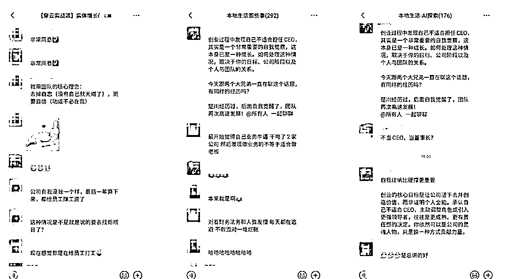

# “我不适合当 CEO”：承认这一点，才是创始人最大的清醒

“我当不好CEO”，可能是创始人最该说的话

创业这条路上，有多少人咬着牙坐在“一号位”上，表面风光，内心却早已兵荒马乱。

直到某个深夜，一个念头突然冒出来：我是不是根本不适合当CEO？

先别急着否定自己。能问出这个问题，恰恰说明你已经有了觉察——而觉察，是改变的开始。

最近，两位老兄也来找我聊同样的话题。其中一位说：“兄弟们还在跟着我，可我总觉得每天是在带他们走弯路。”我反问他：“你的团队在最难的时候，有没有选择离开？”他沉默了几秒：“没有。”你看，这件事本身，就足以证明你的价值。最怕的是，我们总在自己低估自己的时候，顺手把优点也一起否定了。

我自己也曾被这个心魔困住，直到2024年才真正走出来。当年去天鹅到家做营销负责人时，我和高级副总裁周培杰聊起过往的创业经历，直言：“我不适合坐一号位，我是龙哥。”他却认真地说：“你在合伙人离开时，想的是怎么带大家活下去、回购投资款，这已经是绝大多数CEO都做不到的事；你带的团队有凝聚力、有战斗力，更说明你无比称职。”那番话让我重新审视自己：原来我缺的只是方法，不是能力；没找对的只是位置，不是方向。

写代码才是我的主场，为什么非要被按在CEO的椅子上？

这句话，戳中了多少创业者隐秘的痛处。

创业圈里好像有一道魔咒：创始人必须是CEO，否则就是失败者。世俗标准太喜欢非黑即白，于是“成功”与“失败”成了两座大山，压得不少老板喘不过气。这些年，我服务过6000多家实体企业，见过太多老板的拧巴——擅长写代码的人逼着自己去学融资话术，不爱社交的产品经理硬着头皮组局应酬，公司现金流紧张得快断了，还要在朋友圈云淡风轻地配一句“一切尽在掌控”。

数据显示，72%的初创公司栽在团队管理上，其中超过一半的CEO承认，自己从未系统学过领导力。

能力上的短板，尚可借人和来弥补；真正拖垮公司的，往往是那份“非我不可”的执念。所以，比没本事更扎心的，其实是执念。

真正顶级的高手，往往更懂“让位”的艺术。

谷歌的两位创始人——两个25岁的技术宅，在公司走上正轨时主动把CEO的位子交给47岁的施密特，自己转身钻进实验室。结果呢？施密特执掌十年，谷歌市值从230亿美元一路冲到2000亿美元；而佩奇后来重新站上前台时，已经成长为真正的战略家。

Twitter的杰克·多西，两次让出CEO的位置，自己专注产品创新。正是在那段“退居二线”的时期，团队做出了影响整个行业的“话题标签”和“转发键”，而公司股价在他卸任期间上涨了90%。

退一步，不是认怂，而是给更大的格局腾出空间。我不是什么大人物，但也在创业史上有过类似的选择：拿到融资、握有大股权之后，我主动把CEO的身份让给合伙人，并承诺无论发生什么都会为公司兜底。这个决定，最终换来了合伙人的信任、员工的认可，也让我明白——真正的领导力不是攥紧头衔，而是让对的人站在该站的位置上。

如果你也确认“一号位”不是自己的主场，别慌。至少还有三条路可以走：

第一，退回“首席创造官”的位置。雷军说过，他70%的时间都在挖人，把供应链大神周光平、国际业务狂人王翔争取过来，才是小米能够横扫全球的关键。技术或产品出身的创始人，最擅长的是“造物”，那就用股权绑定顶尖操盘手，自己专心做创新引擎。

第二，升维成“精神领袖”。俞敏洪在新东方转型期，把CEO的执行工作交给周成刚，自己专心演讲、出书，为品牌持续镀金，结果公司转型期的影响力反而超过了巅峰时期。你若自带个人IP的势能，不妨让自己成为公司的象征，把打仗的事交给专业的人。

第三，体面地套现离场。我记得一位做蓝领人力资源平台的创始人，亲口跟我说过：“发现自己管理不是长板后，我直接几个亿把平台卖了，现在做投资人，赚得比创业时多十倍。”这不是逃兵，而是理性者的一种优雅转身——在估值高点退出，用资本的力量开启第二次创业。

说到底，比“坚持”更稀缺的，是“清醒”。

张一鸣讲过一句话，我很喜欢：“创业的本质是让正确的事情持续发生，而不是让正确的人一直掌权。”

如果你也开始在深夜怀疑自己，不妨把这几个问题摆在面前，一个一个回答：

我的痛苦，究竟是能力不足，还是角色错位？

如果明天就让出CEO的位子，公司会变得更好，还是更糟？

离开这个位置，我能不能用另一种方式创造更大的价值？

我有没有勇气，在风雨来临时仍然守到最后，给大家兜底？

创业的初心，从来不是为了证明自己无所不能，而是让公司活下去、创造价值。承认自己不适合当CEO，主动调换角色，或者引入更强的人来掌舵，这不是懦弱，而是一种更深层的责任感。你依然可以是这家公司的灵魂——只是换一个姿势继续发光。

真正的勇士，不是把牙咬碎也要硬挺的人，而是能清醒地往后退一步的人。

拼命保住公司的人，比死死攥着CEO名头的人，更值得敬重。

那个还在纠结要不要让位的朋友，看完了吗？这封信，就是写给你的。