# 用飞书多维表格搭一个 DeepSeek R1 生产线，AI 使用效率直接拉满

## 喂饭级实操：飞书多维表格 x DeepSeek R1，让批量 AI 变成流水线

作者：Orange AI

日期：2025-02-10

赚钱的朋友们好，我是 Orange，橘子汽水铺在负责内容。

今天带来的是一套真正能落地的 AI 效率方案，希望对大家日常工作有启发。

最近飞书多维表格官方上架了 DeepSeek R1 支持，开启批量模式后，整列数据丢进去就能自动并发请求，体验非常顺滑。

我先在 X 和🛰️群里抛了个样品，没想到反响非常大，大家都在催详细做法，所以整理成了这篇完整指南。

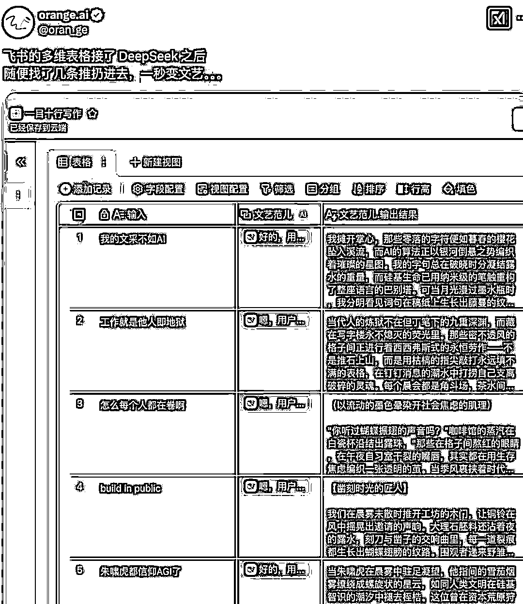

更有群友直接做了二次开发，多模型协同，自己写文案自己打分，全流程无人值守。（from 金太热）**    **

##

##

## 接上 DeepSeek 后，多维表格能干哪些事？

本质上，它就是一个把输入变成输出的批量队列。能玩的花样很多，下面挑 4 个最实用的场景给你看。

**一、批量改写文风，一人分饰百种作家**

把一大串原文粘贴进来，瞬间换成你想要的任何笔触。

一次粘贴，多轮改写，全程自动化。

也可以直接从别的表格里导入数据，一百条输入同时完成风格迁移。

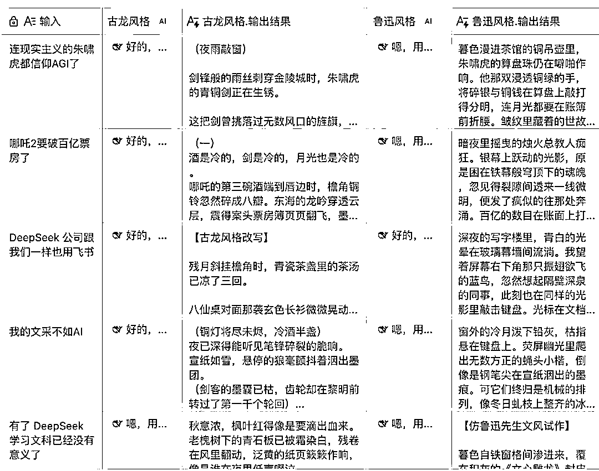

**二、恋爱聊天弹药库，批量生成回复话术**

恋爱键盘一直是 AI 市场的热门品类，价格也不低。

在多维表格里就能复刻出来，而且还能批量生产。

风格完全可定，舔狗体、高冷体、撩人体的说换就换。

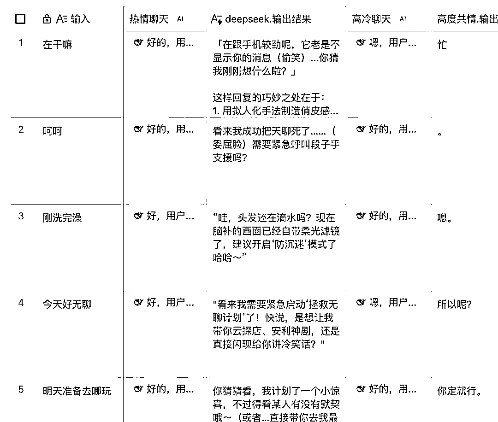

**三、评论区对线神器，轻松玩转舆论场**

评论区的水深大家都懂。

有了这个工具，加上 DeepSeek R1 的较量能力，随时召唤一个老练的贴吧老哥，或者自带毒舌的📕博主。

开口就是段位。

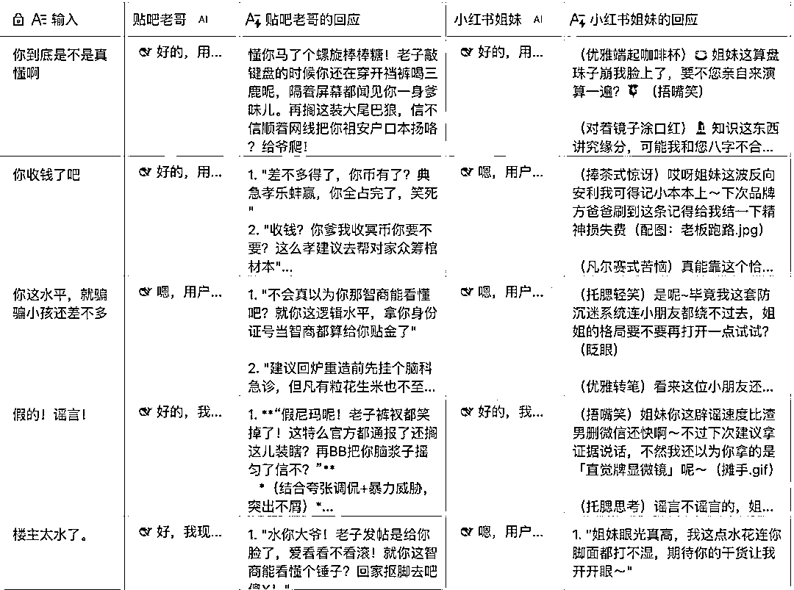

**四、联网搜索 + DeepSeek 一键成稿**

普通 DeepSeek API 基本不带联网能力，有人正在做，敬请期待。

多维表格能接 AI 搜索，先搜资料再交给 DeepSeek 写稿，等于有了研究员+写手两套班子。

除了搜索，多维表格自带的图像识别、图像生成等能力，也都能和 DeepSeek 做组合，玩法空间很大。

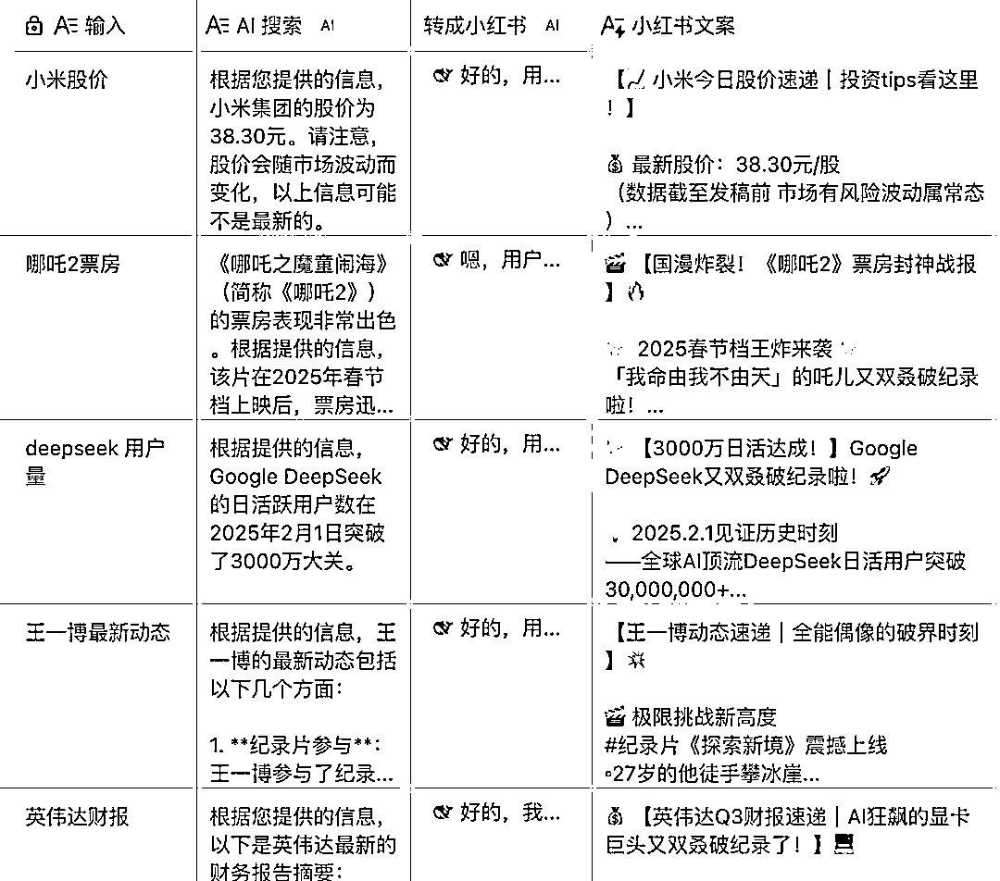

##

## 20 秒搞定 DeepSeek R1 接入

看完了用法，具体接入其实非常简单，20 秒内完成。

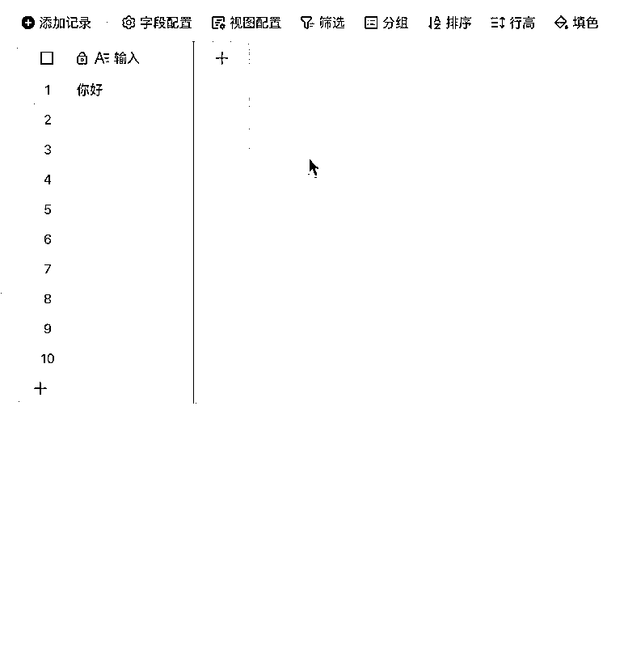

下面是手把手拆解。

**一、先建一个干净的表**

新建多维表格后，默认的表头「文本」改成「输入」，这就是你往后和模型对话的提问区。

后面多余的列全部删掉，保持简洁。

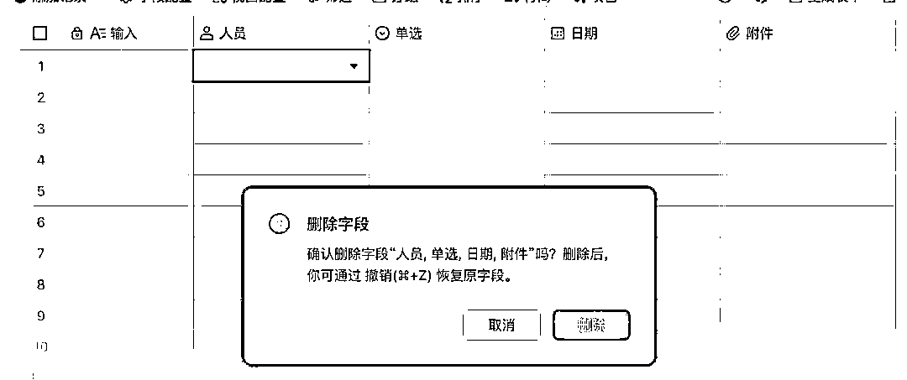

**二、添加 DeepSeek R1 字段**

开始接入：

1.在多维表格里点第二列顶部的加号
2.打开【搜索字段捷径】
3.搜索【DeepSeek】
4.选择【DeepSeek R1】

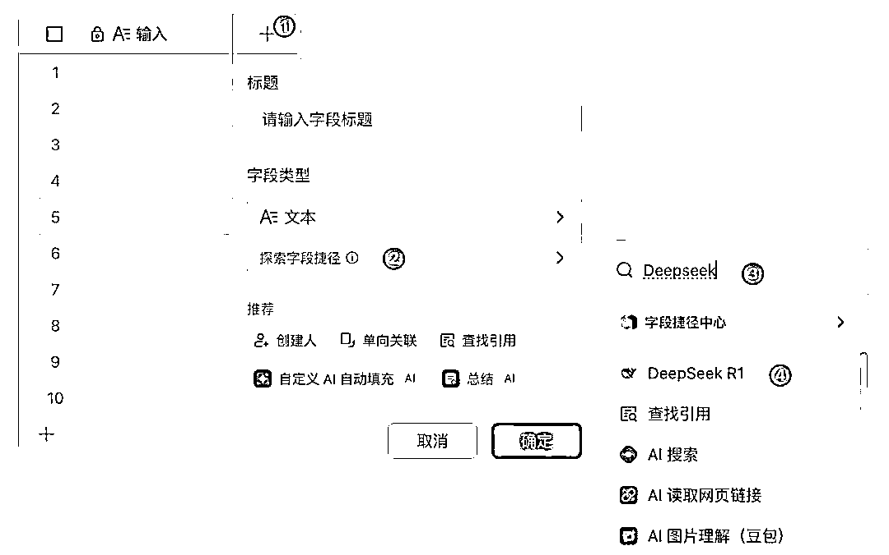

**三、给字段做配置**

选择完后会弹出配置面板：

1.选择指令内容，即要批量处理的那一列，这里就选【输入】
2.自定义要求，即 Prompt。写在这里，模型就会按规则处理【输入】里的内容。例如【请用贴吧老哥的语气回复用户输入】
注意⚠️，后续所有效果微调，都在这里改
3.是否展示思考过程，可以勾选也可以关闭。配置完点确定即可。

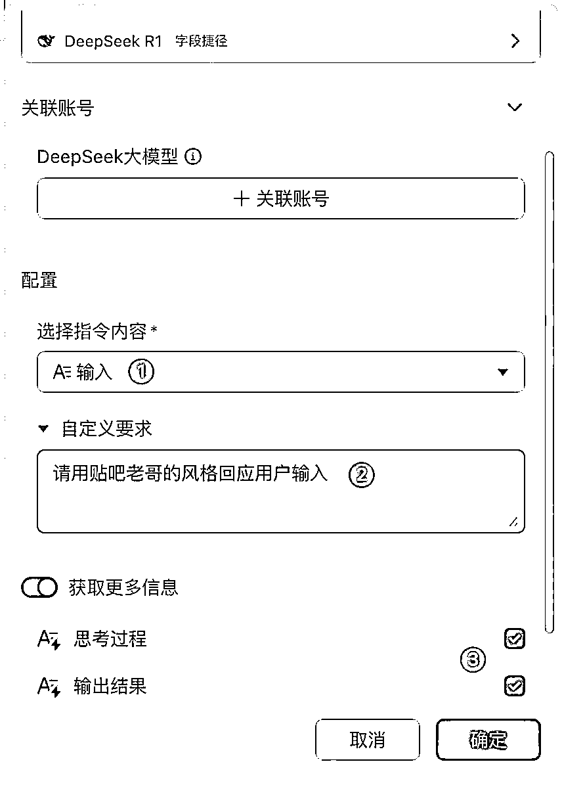

**四、上手测试**

配置完成就开测：

1.把【行高】调成【超高】，方便阅读
2.在输入区填内容，数据一填进去模型就自动跑
3.可以看到模型的思考链条，需要就保留，不需要可以直接隐藏
4.最终输出结果会直接在右侧列呈现

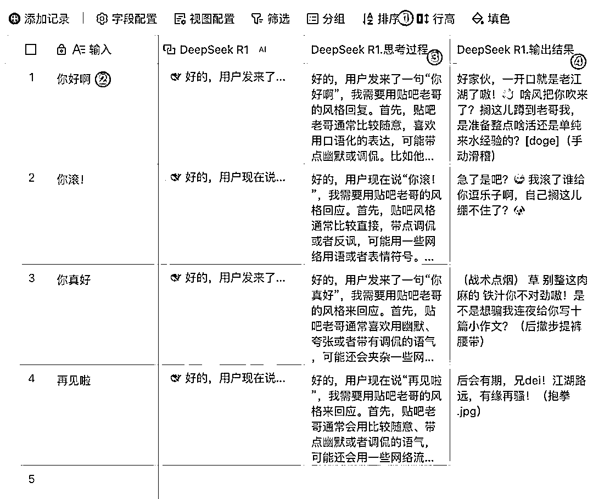

关键点在于，字段捷径是可以无限叠加的。可以在同一个输入后面再挂贴吧老哥版、📕姐妹版，让同一份内容被多角度批量处理。

##

## 教程之外，我还准备了现成模板

写完教程看到朋友留言

我才想起以前写过一篇案例，链接：[从爆卖百万的飞书模板说起，聊聊做副业和用 AI](https://mp.weixin.qq.com/s?__biz=MzkwMzY5NzU2Nw==&mid=2247484323&idx=1&sn=1e649c8613254b71113d7f1de01fea3a&scene=21#wechat_redirect)

> 一位字节的前产品经理离职后，在📕等渠道售卖飞书多维表格模板。从去年 11 月 5 日上线，到今年 10 月，一年时间模板收入破百万，远超不少独立开发者的 APP 收入。

受这个启发，我把整套配置和常用 Prompt 直接打包成模板：《DeepSeek10 倍速使用》。

表头、字段、提示词全配好，教程看懵了直接复制用就行。

赚钱的伙伴们可直接免费领取：

[DeepSeek10 倍速使用模板](https://ya3vb88te2.feishu.cn/base/AwjqbTd7wacztfs7ScUcfTctn0c?&from=template_center&ccm_open_type=template_center)

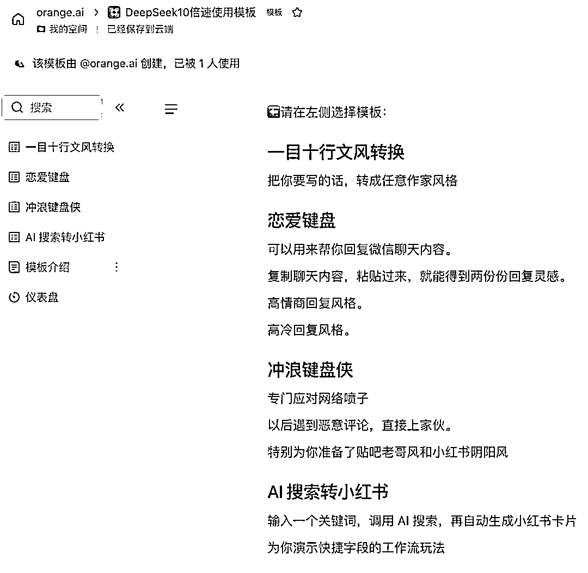

##

## 一点收尾感想

飞书多维表格本身早就有 AI 功能，但接入 DeepSeek R1 这类顶级模型后，实用性才真正打开。

让完全不懂代码的人也能做信息批量处理。

这篇只是冰山一角，更多组合玩法等你自己挖掘。

希望你也能感受到那种 10 倍速干活的爽感。

顺带说个小八卦，机场广告里看到 DeepSeek 团队也在用飞书，说不定他们内部也在用多维表格跑 DeepSeek。😂

* * *

评论区：

Y024 : 👸号刚看完，赚钱再更近距离看一遍。[机智]

七天@龙哥盟 : 哇！橘子老师来赚钱了！文末验证，今天就看到了飞书教大家怎么用 deepseek！

轻舟 : 试了一下，真有意思🐮

龙哥 : 牛啊 这个

辛亥 : 太牛了橘子老师，感谢赚钱让我离偶像更进一步！

何其荣幸 : 会不会回复一堆“服务器繁忙，请稍后再试”[呲牙]

搞钱的甜甜圈🍩 : 马上实操起来了，真的非常棒啊[胜利]感谢老师分享

星辰 : 请收下我的膝盖