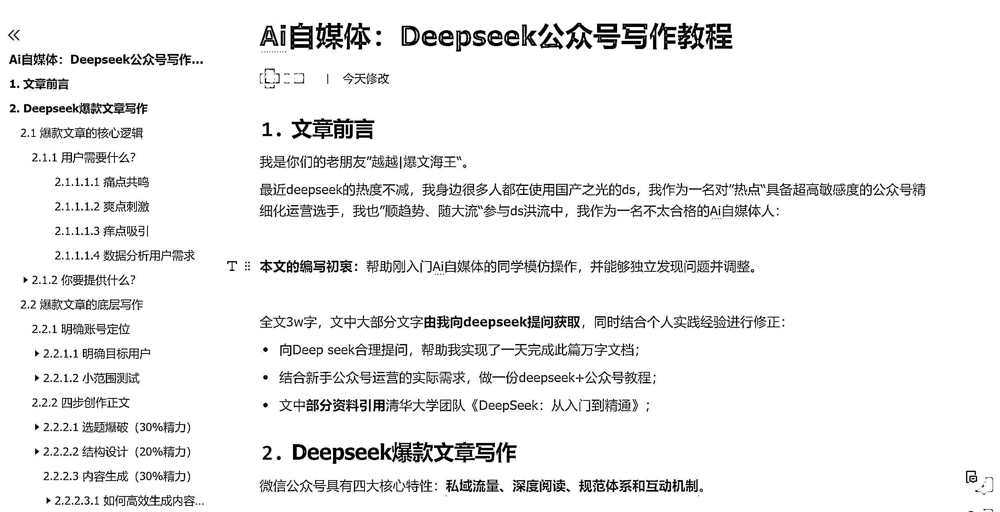

# Ai 自媒体：Deepseek 👸号写作教程

**DeepSeek 正火，我把它揉进了👸号写作流程，3 万字教程一天搞定**

我是越越，也就是大家熟悉的“爆文海王”。最近 DeepSeek 的热度还在往上走，身边不少朋友都在用这个“国产之光”。作为长期深耕👸号精细化运营的人，我对热点一向很敏感，自然也顺势参与了进去。

传术师社群里，七天老师抛出一个问题：做 AI 自媒体，到底可能踩哪些坑？这其实也是我自己正在琢磨的。于是，我把👸号运营的整个环节从头到尾盘了一遍，结合自己那份《👸号精细化运营指南》，和 DeepSeek 做了深度融合，整理出一套面向 AI 自媒体的写作教程。

我的初衷很明确：让刚入圈的同学能先照葫芦画瓢，然后在实践中逐步学会自己发现问题、自己调整。希望能借此把 AI 自媒体的变现效率再往上提一提。

整份文档总共约 3 万字，其中绝大多数文字都是由我向 DeepSeek 提问生成的，我再根据自己的实操经验做了一轮校正。就这样，一天时间就完成了这篇万字长文。额外说明一下，文中部分内容参考了清华大学团队的《DeepSeek：从入门到精通》。

内容量确实不小，强烈推荐用电脑端打开飞书链接阅读：

---

评论区：
易芝 AI|RPA 版：越越老师，请问可以通过鱼丸找到您吗？