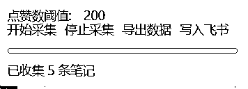

# 0 编程基础，用 gpt 制作📕信息采集器

新年好！我是龙哥。先给各位圈内朋友拜个年，祝你们开工大吉，流量爆棚。

说起来，这几年我在知识付费赛道上也算攒了点经验：累计带过两万多位博主，同时运营着多平台、多账号的矩阵，私域好友将近十万。混这行的都懂，现在内卷到不行，与其硬磕原创，不如把“抄超抄”玩明白——我发了上千条短视频，最大的心得就是：爆款从来不是靠灵光一现，而是靠“复制被验证过的成功”。找出那些已经火过的内容，流量基本就稳了一半。

但以前找爆款真让人头大。我一直用的“八爪鱼”和“后羿采集器”，现在越来越扛不住平台反爬虫机制的升级，基本等于半残。直到最近，AI给我们打开了新思路——团队里一位04年的小伙伴，零编程基础，硬是靠着GPT自己做了一个《📕信息采集器》出来。

这工具一落地就把我们团队的老大难问题解决了，上手极简，拿来就能用，代码放在后面，感兴趣的朋友直接复制跑一跑。我们还在持续迭代，想着把AI、知识付费和团队协作彻底打通。我一直跟团队说：光教别人用AI不够，自己得先当深度用户才行。

开发教程也贴出来了，需要的自己取：

评论区有个朋友说：“代码复制不了，能不能给个下载入口？”——没问题，我这就去开个权限。