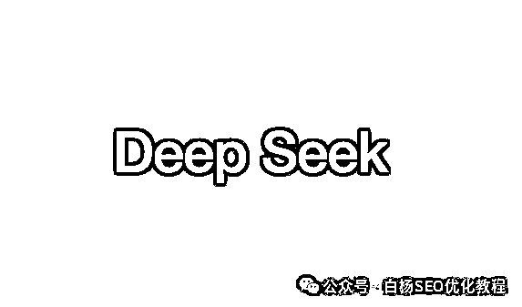
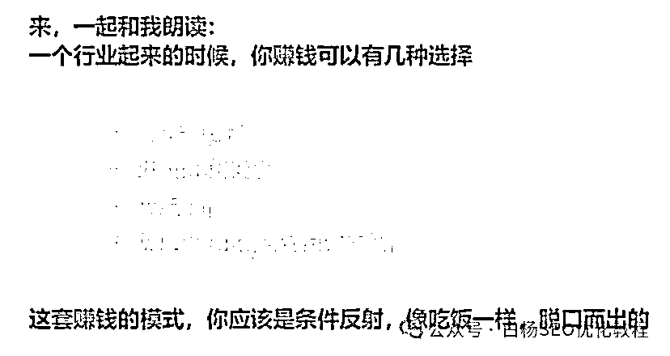
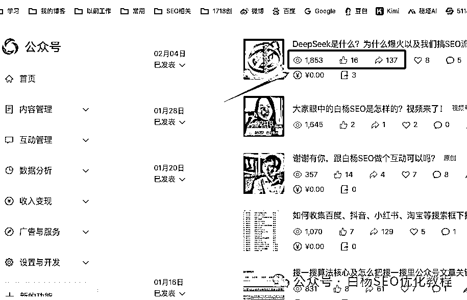
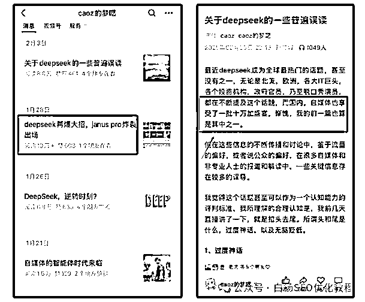
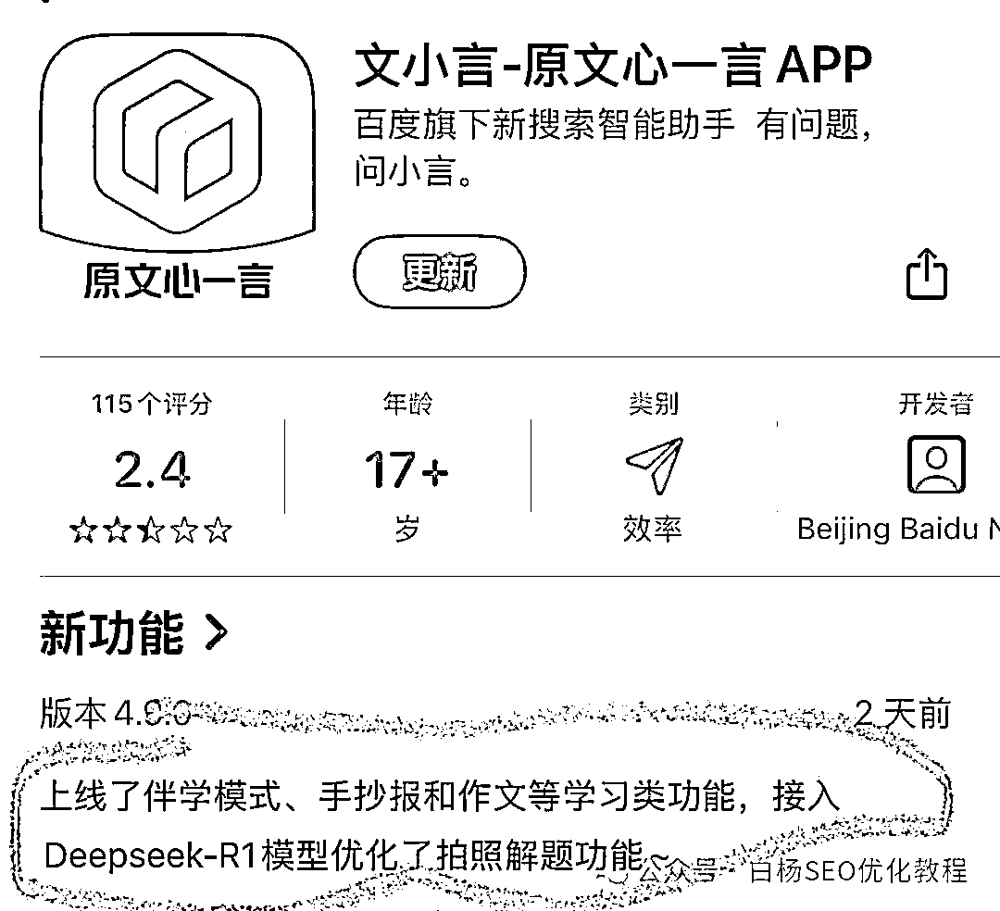
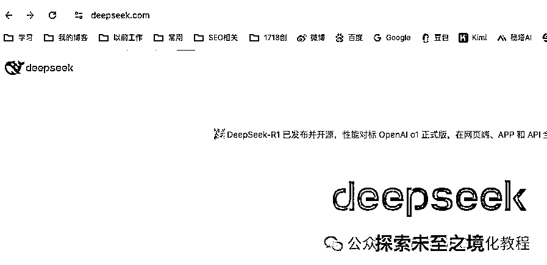
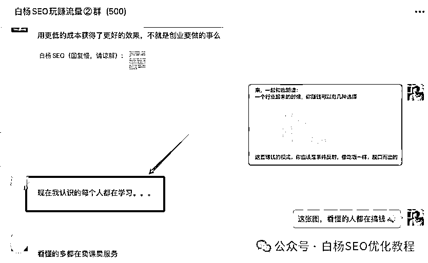
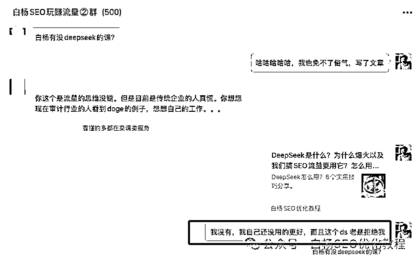
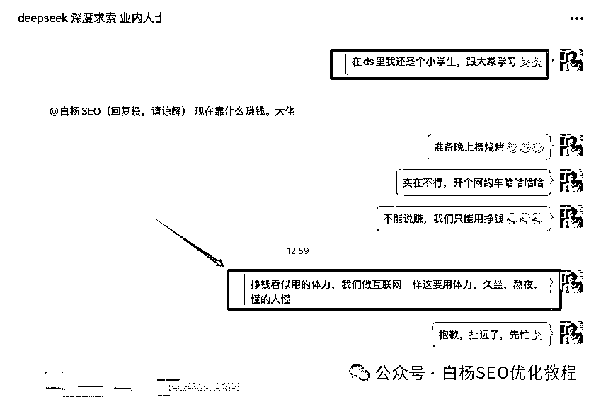
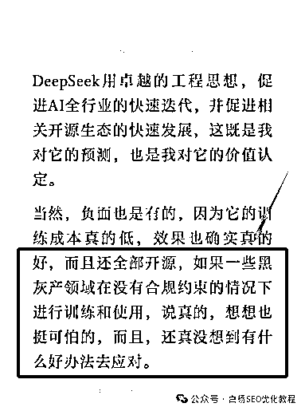

# DeepSeek为什么能成为流量密码和搞钱密码？白杨SEO用实例告诉你
作者：龙哥

先别急着划走，看三张图，你会瞬间明白我在聊什么。

第一张：文章封面；
第二张：网络流传的一句话；
第三张：我上周发的一篇DeepSeek👸号文章的数据。

看完什么感受？我说DeepSeek是当下流量密码，真不是标题党。它同时还是搞钱密码，往下看你就明白了。

先说流量密码。

道理很简单：DeepSeek这个词，本身就是行走的流量包。无论你做搜索关键词，还是做平台算法推荐，只要内容里带上“deepseek”，流量大概率比平时好很多。不信你现在打开🛰️搜一下“deepseek”，切到“文章”再点“最热”，会看到多少篇10W+。抖音、视频号、📕、百度，翻一翻，全是同样画风。

我自己就亲自验证过。上周发的那篇《DeepSeek是什么？为什么爆火以及我们搞SEO流量要用它？怎么用？【必看】》，阅读量和转发量明显高于平时一般内容。这不是我一个人这么说，我关注的“互联网百晓生”曹大老师也亲口说过，带上deepseek确实有流量。

其实我早在年前就进了曹大的核心群，那会儿大家已经热火朝天地聊DeepSeek了，大年初一都没停下来。我也就是那时下载了APP，试了深度思考（R1）模式，感觉比我之前用的豆包、KIMI都更顺手。

可能有人会问：你一个搞SEO的，怎么不提百度文心一言？不是不提，是我今天看到文小言都已经接入DeepSeek模型了，你自己品品。

百度这波AI算是起了大早赶了晚集。但话说回来，入场早不等于做得好。听说阿里新发布的模型实力不输DeepSeek，可热度就是差了意思。

现在网上随便刷刷，到处都在聊DeepSeek，哪怕有些人连APP都没下载，网页版也没打开过。他们只是在文章、视频里看到，然后跟着激动一下，觉得中国又把美国超越了。

其实对咱们每个人来说，懂技术的，可以研究DeepSeek开源的玩法，本地部署、提升效率，甚至对外提供收费服务；不懂技术的，也能拿它来写文章、写报告、拓展思路，看能帮上什么忙。对SEO从业者来说，用DeepSeek辅助生产内容，问问它应该怎么布局关键词、怎么优化文章，这不是现成的助力吗？

我一直说，搜索流量和推荐流量不是非此即彼的关系，它们互相成就。你看看🛰️、抖音、📕，哪个平台不是搜索和推荐一起发力？抖音视频下方有“看后搜”小蓝字，📕做推荐时关键词用对了，推荐流量也能被带动。所以，带不带deepseek这个词，从搜索角度写还是推荐角度写，只要内容质量别太差，流量基本不会差。要是再能给出一些新观点或实用干货，读者很乐意收藏和转发。

说完流量，再聊搞钱。

还记得开头第二张图里那段话吗？行业风口刚起来，普通人能选的路子无非这几条：卖货、买股票、搞导航、做配套服务或培训。

买股票这件事，本金不够的朋友可以先忽略。你没法像有钱人那样，看到新趋势就让钱生钱，而且人家胆子也大，哈哈。

剩下三条，我挨个分析。先说一句，这些仅供参考，我自己现在也没靠DeepSeek赚到钱，哈哈。

第一条，卖货。两年前ChatGPT爆火，多少人靠卖账号赚了一笔，你买过吗？现在DeepSeek虽然免费下载，但官方有TOKEN在卖，价格很便宜。有些人就把TOKEN打包加价卖，因为不是人人都懂怎么接入开源模型。也有人靠卖信息差、帮你下载来赚钱，网上都有人调侃说在“卖空气”了。我年前推荐过的那个“公号矩阵运营管理系统”，朋友已经集成了DeepSeek。百度文心接入DeepSeek也是这个道理，更别说那些科技公司宣布接入后股价起飞的例子了。

第二条，搞导航。说白了，就是做卖水的人，别去挖金子。现在各个群都在流传什么“DeepSeek提示词手册大全”，我就想不通，一个工具而已，还得专门学提问？DeepSeek要是知道，估计会觉得自己挺冤。但话又说回来，确实有人不会提问，比如上来就问“怎么赚100万”，连背景交代都没有。这确实需要补补课。之前AI火的时候，已经出了好多AI导航站，赚钱方式还是老套路——挂广告、卖广告位，这招已经用了二十多年。

第三条，做周边服务或培训。这还真有人在做，某“大佬”联合XXX搞了个几万块的课程，我付费群里也有人问我有没有DeepSeek培训课。我当时都惊了，这是多想交钱啊？虽然我自己没做这个，但不得不承认，这也是一条路子。

看到这，你可能发现我一直在说“挣钱”，没说“赚钱”。为什么用“挣钱”？其实两个词意思差不多，但我在另一个群里有解释，看图。

好了，一不小心又写了2000多字。这篇不算什么干货，就是希望给你搞流量或搞钱一点启发。如果你觉得有用，可以继续关注我，或者全网搜“白杨SEO”，学学怎么搞精准流量。

哦对，前面说的曹大对DeepSeek的理解，里面有一段被圈了出来，你能读懂多少？

DeepSeek也好，ChatGPT也好，甚至SEO也一样，说到底都是工具。工具没有立场，关键是使用它的人。对于DeepSeek这个热点，你怎么看？

我是白杨SEO，专注SEO十年，全网SEO流量实战派，对精准流量有深入研究。全网同名，欢迎交流。