# 2025年，📕还有哪些机会？一份有温度的全年趋势判断

## 写在前面

各位圈友，我是林卿。从2020年起，我把几乎所有精力都投在了📕这条赛道上，一路摸爬滚打走到今天。甲方的预算、乙方的执行、博主的孵化、账号的亲自打理，这些角色我都扮演过。要说唯一没做过的，大概就是去📕公司坐班了。正因为把生态里的各个位置都走了一遍，我看这个平台的视角可能会比别人稍微立体一些。

去年年初，我写过一篇关于📕2024年走向的预判，回头验证了一下，命中率还算不错。到了2025年，我也照例对平台未来的经营格局做了一番推演，整理成这篇文章分享给大家。希望能帮各位打开一些思路，看到一些藏在变化里的机会。

全文约2万字，内容比较长，建议先点赞收藏，再找个安静的时间慢慢读。当然，也可以顺着目录挑自己感兴趣的板块先看。

## 2025年📕经营趋势预判

**一、宏观趋势**

**二、品类机会**

**三、品牌与商家**

**四、服务生态**

**五、个人从业者**

---

## 一、宏观趋势

### 1.1 存量博弈：从“被看见”到“被记住”

增长见顶这件事，已经不需要再论证了。各平台的新增用户都慢了下来，流量红利几乎被消耗殆尽——如果非要找例外，2025年还剩两个：📕和视频号。

与此同时，渠道越来越碎，信息越来越密，用户对广告的抵抗力也越来越强。注意力被切成了无数个小块，转瞬即逝。

这意味着什么？流量的争夺逻辑彻底变了。以前只要把曝光做上去，让更多人看到就赢了。现在不行了——曝光只是起点，用户看完就忘，等于白做。真正重要的是让用户记住你，在你需要做消费决策的那一刻，他脑子里第一个蹦出来的是你。

我自己刷📕的时候也经常刷到Vlog，里面会有品牌植入，甚至有些植入是躲都躲不掉的硬广。可是看完之后呢？说实话，绝大多数我连品牌名都没记住，更别提为它花钱了。

除非那个产品在内容里留下了让人过目不忘的记忆钩子；除非它反复出现，多到你想忘都忘不掉——这不就是心智占领吗？

所以接下来的内容策略，本质上只有两条路：

第一条，把内容做到极致锋利，让人看一遍就烙印在脑子里；
第二条，用足够密度的内容反复触达同一批用户，硬生生刷出存在感。

做不到这两点，投入再多资源都是打水漂。

另外还有一件事值得注意：消费者的决策路径变长了。以前看到广告可能当场就下单了，现在呢？先去📕翻翻别人的使用感受，再去淘宝比个价，来回折腾好几圈才做决定。这就要求品牌在整个链路上的每一个接触点都传递一致的信息，不断加深记忆锚点，才可能把用户导向最终的转化。

### 1.2 “小”字当头

这两年，我越来越感受到一个“小”字的分量。它藏在三个层面里。

先说规模。越来越多的品牌方和服务商不再把企业做得多大当成目标，而是回归到利润本身。仔细想想，真正赚钱的公司，往往不是那些摊子铺得最大的，而是那些小而精的。所以你会看到不少团队在主动缩编，把自己变得更轻盈。

再说收入量级。往后看五年，中国市场里普通人一夜暴富、年赚千万上亿的可能性，已经微乎其微了。但有意思的是，百万级的收入机会反而遍地都是。对普通人、对新个体、对初创团队而言，靠自己的本事加上一点杠杆，年入百万是一件可以够得着的事。

最后是赛道选择。现在的创业者不再盯着大需求看了，而是钻到小需求、细分领域里去深耕。近几年跑出来的新品牌，几乎都是从一条窄缝里挤出来的。

基于以上观察，我有一个可能不太成熟但很坚定的判断：今天的中国市场，已经正式迈入小生意时代。而📕，恰恰就是为小生意而生的土壤——在我眼里，没有比它更适合的场域了。

最近我在读📕官方出品的《rise100经营实录》，里面有句话特别打动我：

> 所有的伟大都源于一个小小的开始，把自己所擅长的一个小领域做好，把一个小概念从构想到落地，最后就能做成一件有壁垒的事情。

与各位共勉。

### 1.3 商业化在快车道上狂奔

如果要给📕这几年的头等大事排个序，“商业化”一定排在第一位。

回看2024年，平台的动作密集得让人眼花缭乱：

1. 外溢电商的模式渐渐跑通；
2. 小红星、小红盟、小红链、CID等产品接连上线；
3. 蒲公英、聚光两个商业平台的功能不断迭代；
4. 站内闭环电商飞速增长；
5. “生活方式电商”的概念被正式提出；
6. 乘风平台亮相；
7. 千帆平台功能持续扩充；
8. 线下选品会一场接一场地组织；
9. 闭环电商的市场盘子肉眼可见地变大。

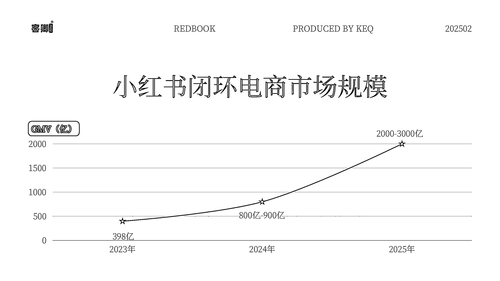

10. 私域电商这边也松了口子——过去想获得私信豁免权，得先花钱投流；现在私信获客工具不仅上线了，使用门槛还大幅降低。

延伸阅读：[私信获客工具整体产品说明及操作手册](https://doc.weixin.qq.com/doc/w3_AfIAXwbzAE83pnWQd9DS86ChBS3D0?scode=ANAAyQcbAAgDc0Zhknz-iMCi7cAL0)

11. 官方对培训的投入也在加码。种草学、电商学习中心陆续在各地落地，种草训练营和招商会一轮接一轮地巡回开讲。

除此之外还有更多动作可以列举，但趋势已经很明显了：迈入2025年，商业化的步伐只会更快、更深入。一些信号其实已经摆在台面上了：

1. 灵犀平台预计在Q1到Q2向所有用户开放；
2. 笔记评论区开始允许挂商品链接了。

这些动作背后都是同一个方向。

### 1.4 基建补课：越来越像抖音和淘宝

商业化跑得快，底层设施也得跟上。过去一年，你能明显感觉到📕的“地基”在一点点浇铸起来：

1. 网页版上线了；
2. APP端功能频繁调整，甚至直接改版；
3. 蒲公英、聚光、乘风、千帆等商家后台持续升级，部分还推出了独立APP。

至于为什么说它越来越像抖音和淘宝，原因其实很简单——天底下的产品设计，基本就是你抄我、我抄你。抖音是内容电商的领跑者，阿里是货架电商的标杆，📕不抄他们抄谁？再说📕团队里本来就有不少前字节、前阿里的员工，产品里带着这两家的基因再正常不过了。

最直观的例子就是前段时间APP端视频观看页面的改版——说跟抖音有八分像，一点不夸张。

投流产品那边就更不用说了，各家平台的底层逻辑几乎都是从淘宝直通车、百度SEM、抖音千川这几个老前辈身上扒下来的，绕来绕去也绕不出那套框架。

至于📕自己接下来会在哪里发力？我得到的消息是：搜索和电商是两大重点方向。而每一次产品调整、功能更新，往往都会带来一波小的红利窗口，值得大家保持关注，多去试试。

### 1.5 生态正在打开大门

从小红星、小红盟、小红链到CID，这一连串动作背后透露出的信号很明确：📕打算把商业生态的门开得更大。

再结合品牌方对📕的价值定位——核心是种草，是全域营销的一环——我几乎可以断定，未来平台会继续开放自己的生态，跟更多的外部渠道做连接。

最近正在放开的是本地生活板块，具体动作有两个：

1. POIx小程序：[【客卿 KeQ】📕 POIx 小程序产品介绍.pdf](https://keqteaml.feishu.cn/file/K9QTbwNR5olhtHxUgBmccdIznRg)
2. 小红团：把📕的阅读数据和美团的交易转化数据打通，模式和当年的小红星、小红盟类似，对做本地生意的商家是个利好。

### 1.6 外溢电商：可能迎来又一次“断臂”

这里的“一刀切”，我的意思不是说外溢电商会被彻底废掉，而是像之前发生过的那样——阶段性暂停相关工具的使用。

小红星、小红盟、小红链、CID这些工具，都有可能在某个时间点被暂时叫停，目的是给平台自己的闭环电商让路。

为什么会有这种判断？一方面，闭环电商眼下正处于蓬勃生长的阶段，平台没理由不倾斜资源去扶持；另一方面，参考抖音当年做闭环的路径，再看看📕此前确实有过暂停小红星和CID的先例——重演一次的可能性，还真不小。

### 1.7 AI正在渗入📕

这里的AI，既指📕产品本身，也指围绕📕展开的各种运营工作流。

#### 1.7.1 AI出现在APP里

目前📕APP里已经有一些AI功能了，但嵌入的深度还很有限，多数处在灰度测试阶段：

1. 搜索结果页接入了“搜搜薯”，能在顶部输出AI总结的经验类内容。

  

2. 搜索结果里灰度测试了自家的AI对话产品“点点”，搜某些关键词时会弹出相关提示。

  

如果你在📕上做内容，我强烈建议去试试“点点”。它是基于📕站内数据训练的对话工具，能快速帮你把某个话题下零散的内容梳理成清晰的脉络，对选题和创作都有不少帮助。

#### 1.7.2 AI进入运营工作流

举两个官方自己的例子：

1. 打开📕APP，点右上角的“＋”，选择「发文字」，输入一段文案后，系统可以一键生成大字报风格的封面。市面上那些大字报封面，很多就是这么来的。这个功能直接把普通人的发布门槛拉低了一大截，也省掉了大量基础制作的时间。

   

2. 千帆平台里新增了「智能批量创作」功能，在笔记发布入口可以找到。生成内容的质量说实话一般，但用来找角度、找灵感还是可以的。

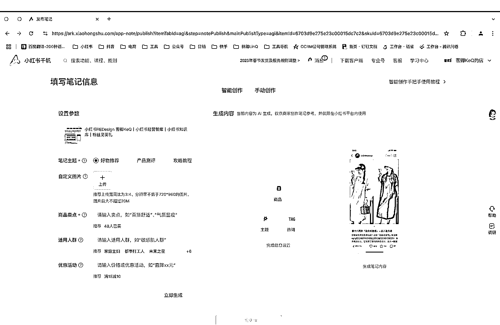

从官方自己把AI嵌入工作流这件事来看，态度已经很清楚了：平台不仅不排斥AI，反而在鼓励大家用AI来提效。

那在📕的运营链条里，具体哪些环节可以交给AI？我结合自己和身边人的实践，梳理了几个方向：

**第一，数据采集与需求洞察，反哺产品研发。** 用AI批量分析评论区的内容，能比较高效地摸到用户真实的声音和诉求。

延伸阅读：[AI 调研篇之批量分析📕评论区数据，懂客户心之所想才能更好的成交客户](https://u604y5x4sg.feishu.cn/wiki/DQOYwUlPhi6GxAkbllfcwnQ3nXf?from=from_copylink)

**第二，产品与包装的视觉设计。** 这里有一个很典型的案例——AI＋玩偶。用AI设计出来的玩偶形象，可以直接变成商品。

  

**第三，策略制定。** 但AI在这块有明显的天花板：它给的信息和数据并不完全可靠，甚至存在凭空编造的情况，需要你带着批判的眼光去看。现阶段比较合适的使用方式是把它当作一个提供框架和思路的辅助工具，帮助延伸思维边界，而不是直接把决策权交给它。

**第四，账号诊断与内容分析。** 以我常用的“豆包”为例，分享一套调教它的方法：

第一步：先问它“你懂得怎么拆解📕上跑出爆款效果的文案吗？”

第二步：再告诉它“我把自己分析爆款文案的完整过程发给你，请参考这套过程来拆解我给到你的新文案，可以吗？”

第三步：把你曾经做过的一次详细分析案例发给它，比如：

> 标题：谁懂口红对人设的冲击力啊。MAC这两支秋冬真的涂不腻！
>
> 内容：826 BRICK-O-LA 光涨粉，豆沙粉简直是富家千金的代名词！既不像正红色那么张扬，也不像裸色那么低调，恰到好处的粉色调给人一种温柔气质的感觉。这支是MAC家新出的轻缎光质地，上嘴超润，高覆盖力深唇也完全无压力！秋冬不喜欢水光镜面、又想让嘴唇看起来饱满透亮的姐妹，它包让你满意的！
>
> 683 CAFÉ MOCHA 大玩咖，秋冬太太太适合涂奶咖色了！不全是土色，而是调进了一丝红调，涂上还是很提气色的，百搭也不挑皮！哑光的质地更是给足了高级感！我是属于沙漠大干唇，但大子弹头的哑光不会显得嘴唇很干，反而很有质感！

第四步：请它像刚才那样，把这篇文案的拆解题纲写出来。它会告诉你：这类文案的常用公式是“情绪化的好奇引子＋产品具体推荐”，结构上是先用有情感张力的开头吸引兴趣，再用生动词汇对比色号，结合不同唇况说明质地效果。

第五步：确认它学会了这套分析框架之后，再丢一篇新的文案让它实战练手，比如：

> 平时完全不喝酒，看了@喵喵咪子 的帖子马上就去买来喝了。原来啤酒还可以有这样的味道，一丁点苦味都没有，完全就是芒果小蛋糕的味道，可以当甜品来品尝了。不愧是顶尖精酿品牌，太太太绝了。

让AI按刚才的口红色号分析模板，把这篇啤酒笔记的创作逻辑也拆给你看。

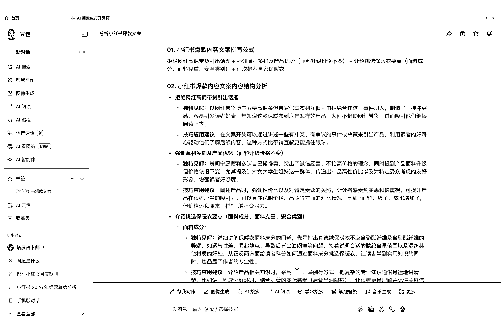

顺着这套思路，你会发现AI并不是什么神秘的东西，它就是一个可以被反复调教、反复使用的效率工具。但也别忘了它的另一面。

#### 1.7.3 AI是把双刃剑

用得好，它是杠杆，是效率放大器；用不好，它也可能让你陷入同质化的泥潭。更值得警惕的是，当所有人都靠AI批量产出内容的时候，真正稀缺的反而是那些带着人味、带着个人判断的东西。但不管怎样，AI已经不是一个“要不要学”的选项了，而是一张必须拿到的入场券。

### 1.8 内容往深里走

浅层的信息已经很难再激起水花了。用户需要的是更有厚度、更能提供决策参考的内容，深度化的趋势会在2025年进一步加速。

### 1.9 “人感”越来越值钱

AI生成的内容越多，“真人感”就越珍贵。真实的经历、真实的情绪、真实的口吻，会是流量争夺里最大的差异化筹码。

### 1.10 向下沉，向海外渗透

📕的用户圈层正在向三四线城市延伸，海外用户的占比也在悄悄增长——这两种增量，都值得密切关注。

### 1.11 在📕上“出海”

#### 1.11.1 做海外用户的生意

直接服务海外用户，赚外币，是一条被验证过的路。

#### 1.11.2 “出口转内销”

还有一种思路是：先在海外市场验证产品，再把成熟的经验带回来打国内市场。

### 1.12 商业流量正式成为主流

无论是投流工具的成熟度还是商家对商业流量的接受度，2025年都会达到一个新的高度。自然流量依然重要，但商业流量已经是绕不开的必修课。

### 1.13 分发越来越精准

算法对用户意图的识别越来越细，流量匹配的精度也在肉眼可见地提升。过去那种靠运气吃饭的流量逻辑，会越来越难走通。

### 1.14 治理趋严

内容审核与平台规则的规范化，只会越来越严格。打擦边球的风险会直线上升，合规经营是底线。

---

## 二、品类机会

### 2.1 产品大众化突围，大众产品📕化

两个方向：一个是原本偏小众的产品，通过📕被大众看见；另一个是原本很大众的商品，在📕上重新做一遍内容包装，获得新的增长曲线。

### 2.2 品类和客单价走向两极化

一边是极致性价比，一边是极致品质和体验，中间地带的生存空间会被慢慢挤压。

### 2.3 AI+

#### 2.3.1 AI＋宠物：人宠AI写真

给自家毛孩子生成一组风格化的写真，是已经被验证过的付费需求。

#### 2.3.2 AI＋玩偶

用AI设计玩偶形象再落地成实物商品，前面已经提到过，是一个小而美的方向。

### 2.4 概念＋

#### 2.4.1 概念＋手链：动物追踪手链

把“万物皆可追踪”的概念做成手链，既有功能性又有话题性。

#### 2.4.2 概念＋酒馆

酒馆本身不新鲜，但叠加了某种新鲜概念之后，就变成了新的社交货币。

### 2.5 2025年📕的重点策略方向

#### 2.5.1 电商方向

闭环电商依然是平台的头号优先级，围绕它的各种基建和扶持政策会持续加码。

#### 2.5.2 线索行业

高客单价、重决策的行业——比如装修、婚纱摄影、教育等——是平台重点扶持的对象，私信工具的放开就是信号。

#### 2.5.3 本地生活

POI、小红团等产品陆续落地，本地生活会是下一个值得重仓的洼地。

### 2.6 我个人比较看好的品类

1. 游戏
2. APP
3. 中华文化向
4. 大健康
5. 周边游
6. 企业游学
7. 家居细分
8. 小众品类

### 2.7 我比较看好的商家类型

这里先留一个悬念，后面会在“品牌商家”和“服务机构”两个章节里分别展开讲。

---

## 三、品牌与商家

### 3.1 从流量思维转向人群思维

以前是拿着货找流量，现在是圈定一群人，为他们定制货。人群思维的底层是理解人、陪伴人，而不只是计算曝光成本。

### 3.2 矩阵账号＋效果广告，成为标配打法

只开一个账号、只靠自然流量的时代已经过去了。矩阵化运营加上聚光投放，已经是品牌在📕上立足的常规配置。

### 3.4 买手笔记带货，可能迎来爆发

种草内容和交易之间的链路正在快速缩短，买手通过笔记直接带货的玩法，会在2025年迎来一波显著的增量。

### 3.5 商品卡：新的增长点

货架场景在站内的权重持续提升，商品卡会是闭环电商里一个值得提前布局的入口。

### 3.6 直播依然是确定性趋势

笔记负责种草，直播间负责收割，这个组合在2025年依然是效率最高的模型之一。

### 3.7 薯条重新变得好用了

官方在薯条这一工具上的投入肉眼可见地增加，中小商家有了一个更轻量级的流量加速器。

### 3.8 从线上走到线下

品牌不再满足于只做线上生意，线下体验、线下活动、线下门店与线上的联动，会成为一个新的内容素材库和转化场。

### 3.9 预售模式常态化

锁定需求再生产，按需定制，这种模式能显著降低库存风险，在📕上会越来越常见。

### 3.10 2C品牌做2B，2B工厂做2C

双方的边界在模糊。做消费品的开始接企业订单，做代工的也开始直面消费者——整个商业形态正在互相渗透。

### 3.11 经营精细化

粗放式投放、粗放式运营的红利已经耗尽，从内容到投放再到客服，每一个环节都值得做细。

### 3.12 从单点爆破到系统经营

不再靠一篇爆文、一场爆直播打天下，而是把种草、投放、直播、私域、复购连成一个整体，打的是体系战。

---

## 四、服务机构

### 4.1 官方服务商的日子会更难过

平台一边扩张自己的服务能力，一边压缩服务商的利润空间，处于中间层的服务商面临的挑战会更大。

### 4.2 纵向：把单一业务做到极致

与其什么都会一点，不如在某个单点上做到全市场最强。

### 4.3 横向：业务多元化

多线布局，分散风险，互相导流，也是一条活路。

### 4.4 业务拼多多化

打价格战、做性价比，在行业越来越卷的背景下，成为很多服务商不得不走的路。

### 4.5 自营品牌与联营模式

服务商不仅帮别人做，自己也下场做品牌，或者以合作联营的方式深度绑定上下游。

### 4.6 AIGC服务

用AI批量产出内容的能力，正在变成服务商的核心竞争力之一。

### 4.7 买手MCN

围绕买手生态做孵化、做运营的MCN机构，会迎来自己的窗口期。

### 4.8 选品服务商

帮买手和商家做供应链选品的专业服务，需求在快速上升。

### 4.9 本地生活服务商

平台的本地生活项目一旦规模化，配套的服务商就会跟着吃肉。

### 4.10 团队精简

利润空间被压缩之后，小而高效的团队比大而全的团队更有生存优势。

---

## 五、新个体

### 5.1 接广告变现

📕是个体接商单门槛最低的内容平台之一，只要内容有调性、有受众，广告收入就是最直接的变现路径。

### 5.2 买手带货，或开店卖货

不依赖平台的流量倾斜，靠自己的品味和信任感把货卖出去，是越来越多个体选择的路。

### 5.3 广告＋带货组合拳

两种模式并行，互相补充，收入结构更稳。

### 5.4 万物皆可卖

人设、审美、品味、生活方式——在📕上，一切能被信任的东西都可以成为商品。关键是，你愿意把自己真正擅长的那个小领域，做到多深。

最近喝到一款果泥啤酒，入口先是很冲的芒果椰子香，但喝起来是酸口的，气泡感特别绵密细腻，我个人一口气就干掉了一整罐。如果你不太能接受酸味，这罐建议直接绕道。顺带问一句，你们还有没有其他口味推荐？我准备把它们挨个试一遍。

——没想到这条随手分享的笔记莫名其妙火了，三十多万人看过。我纯粹就是喝完开心随手发的，真不是广告，大家别误会啊（如果 one drop 看到了，记得把广告费结一下）。

果泥啤酒这玩意儿评价是真的两极分化。爱的人觉得口感层次丰富、好喝到不行，不爱的人从质地到味道都觉得难以下咽。想试的话建议先买一瓶尝尝，别上来就囤。

---

聊完了喝的，想认真聊聊📕这个平台。最近研究了不少案例，也复盘了很多账号，有几点趋势洞察我觉得挺有意思的，分享给你们。

**关于AI，我的态度是：双刃剑，机会和危机并存，但AI在未来一定会是必修课。**

机会不用说，大家都看得见——不管是把AI嵌入📕工作流带来的效率提升，还是跟具体赛道结合长出新的解决方案，又或者简单粗暴地做“卖铲子”的生意，机会到处都是，大大小小都有。

但危机同样摆在眼前。随着AI越来越普及、商业化程度越来越高，一定会有一批行业和岗位被颠覆。哪怕你现在的工作用不上AI，也不代表以后用不上。以后会用AI和不会用AI的人，效率差距绝对会拉到巨大。

还有一句话我很认同：当你凝视深渊的时候，深渊也在凝视你。当AI越来越智能、越来越无处不在，一定会有人开始依赖它。一旦对AI产生了依赖，不再自己观察、思考、实践、创作，AI就会一点一点地腐蚀你，你的能力会全面退化，最后变得一文不值。这才是AI时代最恐怖的危机。

记住，AI只是工具。它最大的价值是让普通人从0分做到60分，是当你的第二大脑去做辅助和延伸，而不是替你思考。一定要保持独立思考，持续锻炼自己的软实力，比如网感、美感、洞察力，别被AI奴役了。

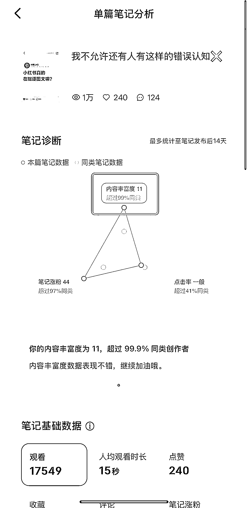

**再说说内容深度化。**

现在📕内容同质化严重，加上AI盛行之后，一定会产生大量低质内容。所以做内容必须深度化。深度化不等于专业化，而是在保证可读性和吸引力的基础上，提高信息密度，让内容丰富但不学术化。这也是📕在流量推荐上的一个衡量指标。

落实到执行上，最直接的方式就是适当把文案写长一点、视频做长一点，这样还能顺带筛选出真正的忠实用户，和他们建立更深的链接。

**接下来是“人感”。**

这也是因为内容同质化、模版化太严重了，再加上AI加速了垃圾内容的产生，所以“人感”变成了稀缺品。📕自己也在推“人感营销”。

我理解的人感，就是不要把用户当成流量，而是当成“人”、当成“朋友”。做自己，多表达真实的情绪和感受；持续向外反馈，持续向大家汇报。

这么说有点抽象。你想一想，哪些账号让你觉得有“人感”？比如养成系账号——你能感受到TA一直在反馈、一直在汇报自己的成长过程，这就是人感。再比如老乡鸡，为什么大家觉得它有温度？因为它把用户当朋友，在表达真实的情绪和感受。

我们之所以这么强调人感，是因为PEOPLE FOLLOW PEOPLE, NOT COMPANIES——人们更愿意追随一个活生生的人，而不是一家公司。人感在某种程度上创造了新的IP、新的情绪温度、新的故事。人感+个人账号=新IP+新故事；人感+品牌账号=品牌人格化=新情绪+新故事。而这些新东西，就代表着新的增量。所以不只是个人需要人感，品牌也一样。这也是为什么品牌主理人和创始人IP正在成为趋势。

**关于📕向下沉和海外用户渗透。**

这是既成事实，也是既定趋势。📕连续两年和春晚合作，春晚覆盖的是全国人民，下沉是必然的。另外从2024年8月开始，📕已经在花钱拉新了，因为原本用户主要集中在一二线城市，想赚拉新的钱，去三四五六七八线城市效果最直接。

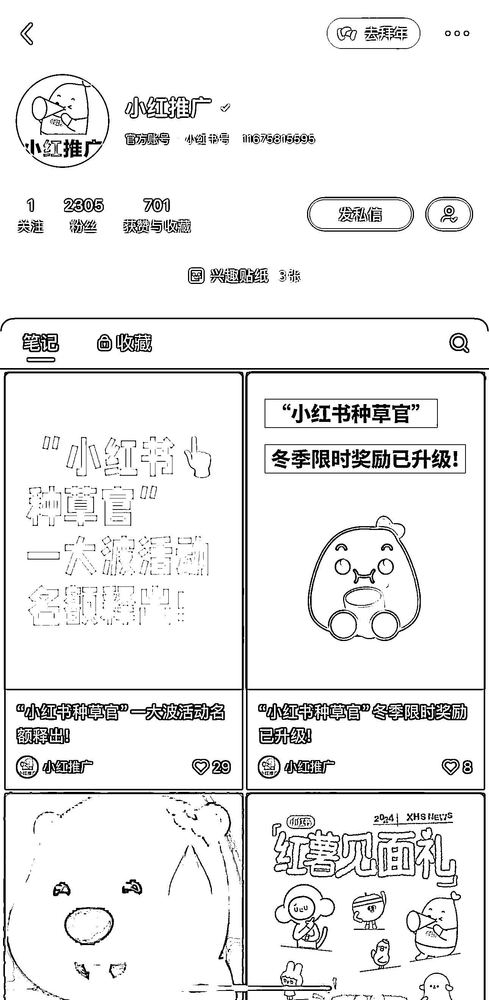

海外用户那边，起因很偶然——TikTok在美国被禁了，不少海外博主来了📕，还自发宣传了一波，带动大量TikTok用户涌入，迎来一场全民狂欢。后来TikTok没真被封，一部分用户回去了，到底留下来多少，目前不好说。当时我用聚光平台看过，海外用户体量大约是622万，估计这个数字还在涨。再加上📕官方发布了好几个海外岗位，还宣布在招募海外MCN机构，看得出他们决心很大。

**顺带说“出海”这件事。**

这里说的出海有不同的含义。一种是做海外用户的生意——不一定非得是外国人，海外华人华侨也是很大的市场。我有个朋友做海外房地产，主要面向海外华人，客单价不低，但在聚光平台投放后效果很好，淡季获客成本只要10到20元，旺季也能控制在50元左右，ROI相当高。还有一个案例挺惊讶的，有人在推特上教海外华人怎么做📕，需求还不少。所以海外用户确实是被很多人忽略的人群，里面有不少没被挖掘的机会。不过要注意，海外用户总共才622万，做之前最好先通过聚光平台的定向功能搞清楚目标人群到底有多大。经营逻辑跟做本地生活其实差不多。另外这里说的海外华人华侨，也不一定是在海外的，准备去留学、旅游、工作的准海外人群也算。

另一种叫“出口转内销”。之前TikTok难民事件的时候我开玩笑说这是个出口转内销的好机会。什么意思呢？去国外搞一个海外品牌，把国内的产品出海走一圈，再卖回国内。听起来有点不地道，但国内平台对海外品牌在宣传上的确更宽松，特别在保健品、护肤品这些品类，有些功效海外品牌能说，国货不能说，所以不少商家愿意这么干。再加上有些国家的个别品类在国内认可度比较高，国内用户也普遍更信任海外品牌，这个策略就有了生存空间。

**再说说流量变化。2024年9月26日之后，📕的自然流量出现了史诗级下滑，到现在也没完全恢复。**

根本原因是自然流量不够分了。平台流量虽然在涨，但总量相对恒定，既要扶持视频和商品笔记，又要给直播流量，还要被商业流量挤压，加上买流量的商家越来越多，剩下的常规内容能分到的流量自然就越来越少。笔记体量还在不断增加，就更不够用了。

现在想恢复原来的流量不太现实。要么增加发布数量，用内容量去换自然流量——但这也是看天吃饭，每篇能拿多少流量谁知道呢，创作成本也不低。哪还有什么更靠谱的办法？答案很直接：花钱买流量，因为它是稳定可预期的。所以📕已经正式进入商业流量时代了。当然也有例外，像服饰、本地生活这些品类，还可以继续走自然流量。

**流量分发也在变精准。**

一个很直观的感受是：同样的小眼睛数，互动和转化都变高了。以前可能100个小眼睛才有1个互动，现在30个就有1个；以前1000个小眼睛才出1单，现在100个就能出1单。原因还是因为流量不够用，只有分得更精准，流量利用效率才能更高、更有价值。

**内容治理会越来越规范、越来越严格。**

📕很重视自己的社区生态，所以对内容治理一定是趋严的。举两个例子：2024年11月18日到12月24日，黑灰产账号治理专项团队处置了160万个账号，而且还在持续治理。

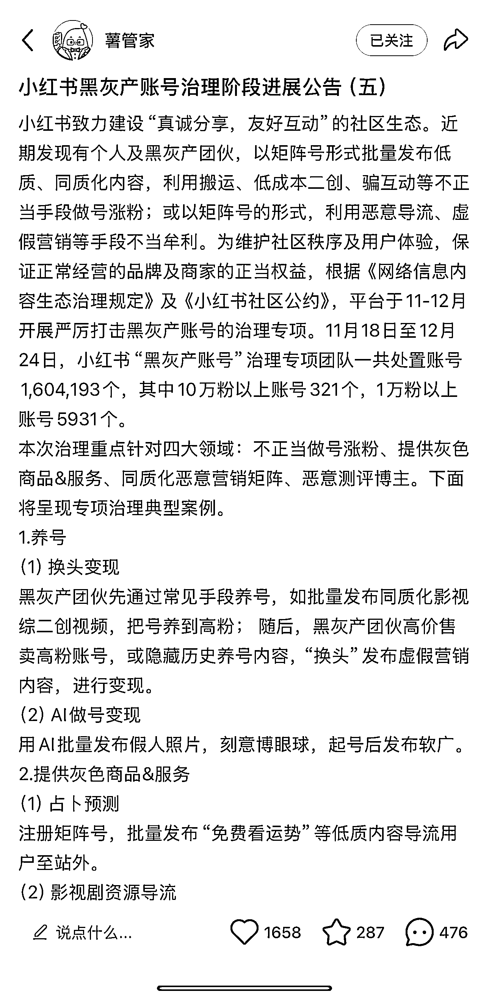

另外，2024年12月13日📕上线了“原创保护”功能，粉丝门槛从50万降到了1万，后面可能还会继续降，降到和蒲公英平台入驻条件一样。

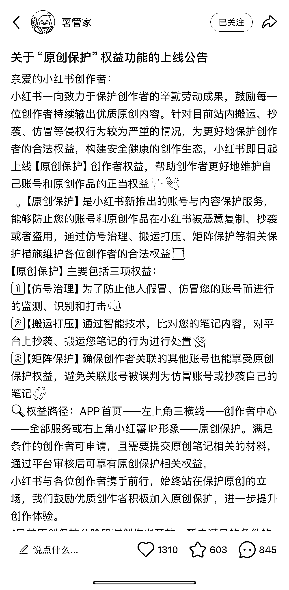

---

**再聊聊品类趋势。**

**第一，产品在向大众化突围，大众产品在“📕化”。**

📕闭环电商起步时间还不长，很多品类，尤其大众化产品，还有空缺——这是可以去深度研究的方向。但并不是所有产品都适合📕，大众产品要卖得好，就得“📕化”。体现在四个方面：

**高颜值。** 📕是审美驱动的平台，颜值即正义，产品好看是基础。但也不是绝对的，有些自带BUFF的产品不需要高颜值，比如地方特产。特产之所以是特产，靠的就是地方属性，用户判断是否正宗最直观的方式就是包装，所以反而要保留地方元素，一味追求好看可能适得其反，让人觉得商业化、不正宗。

**情绪化。** 📕70%是女性用户，她们很看重情绪价值。举个例子：文创品牌“山川海海”的爆款封面，就是快递纸箱撕开之后露出一行字——“重要的，从来都是那些有回应的细节”。再配合送礼的场景，这个情绪化的包装设计撬动了不少UGC自发传播，GMV增长很不错。

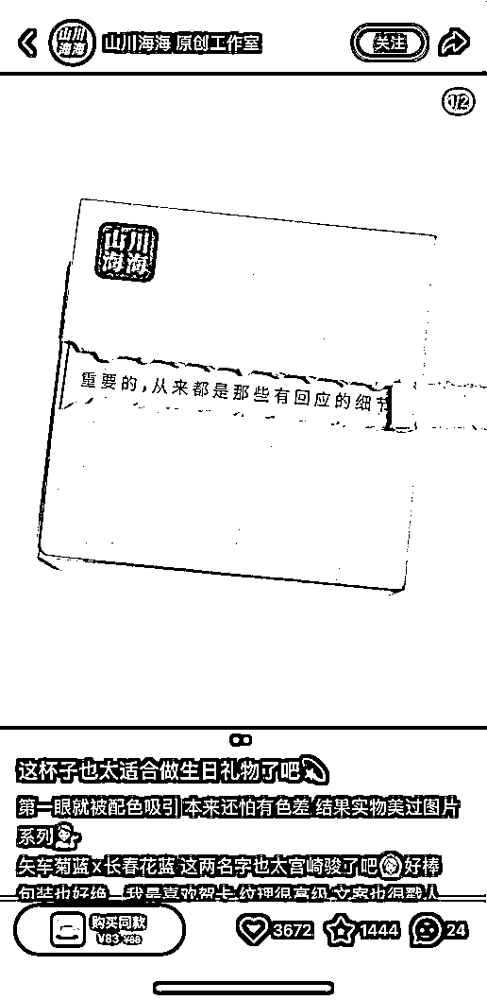

**仪式感。** 同样是70%女性用户，她们也很在意使用过程中的仪式感。最近爆火的“火烧贺卡”就是例子。贺卡附赠一根火柴，点燃后把一面的薄纸烧掉，火一边烧，底下的字一边显现——这就是仪式感。

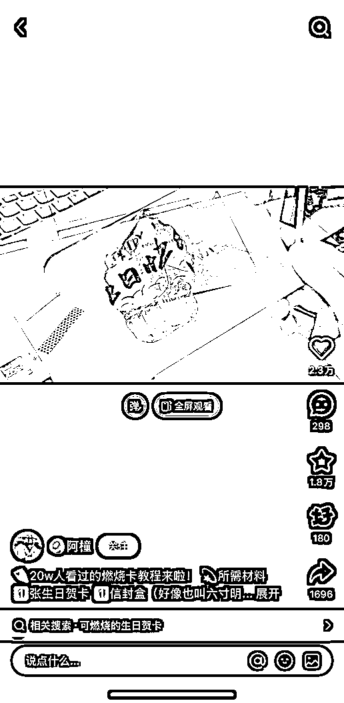

**创意化。** 产品同质化严重的今天，创意能让产品脱颖而出，而且创意本身就等于内容。我有一个观点：所有大众产品都值得用创意重新设计一遍，然后在📕上重新爆一遍。比如有个抽纸盒，把动漫IP“阿呆”和抽纸盒结合，抽纸的位置就在阿呆的鼻子那里，抽纸的样子就像阿呆流鼻涕。更妙的是在重量上有巧妙设计，纸用完的时候阿呆会失去平衡往前倒下，提醒你该换新的了。这个小设计，是不是很妙？

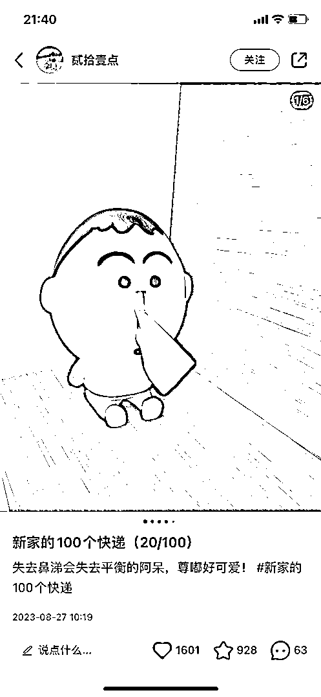

所以我觉得今天的产品创新，不取决于硬核科技层面的专利和技术突破，而是基于对用户使用过程的洞察，做出人性化设计。简单说，就是基于细分人群、细分需求的微创新。

**第二，产品品类和客单价正在两极化。**

卖得好的品类，要么是大众刚需，要么是小众非标。

 

客单价也一样，要么是极致质价比，9.9、19.9，要么是品质生活，1000、10000。

 

这本质上就是📕提过的“M型消费模型”：用户在不同品类上有不同的消费预期。日常刚需追求极致质价比，自我取悦的品类追求品质生活。用一句话说就是：骑着单车去酒吧，该省省、该花花。这还延伸出一个趋势：习惯性自悦品类持续增长，耐用消费品更替周期变长。自悦品类包括茶、酒、咖啡、医疗保健、动漫、IP玩具、游戏和娱乐服务等。

**第三，AI+。**

AI浪潮下，会有越来越多品类和AI结合，也会诞生全新的AI品类。我看到两个有意思的方向：

**AI+宠物：人宠AI写真。** 宠物好动不配合拍照，有些养宠人的宠物已经离开了，想要留个念想。人宠AI写真就解决了这些问题。

 

宠物摄影、宠物殡葬这些行业，完全可以借鉴。

**AI+玩偶。** 有些品牌已经开始用AI设计产品、做内容了。比如“抱抱计划”，先用AI做设计和内容，根据用户反馈确认有需求之后，再反向联系工厂生产。

 

**第四，概念+。**

中国的广告人和营销人很擅长创造新概念，把概念和品类结合去刺激消费。近两年有不少品牌靠这招崛起，最典型的就是玄学+各种品类。这里说的概念比较宽泛，环保、女性议题、公益、动物保护、玄学，都算。

举个例子，动物追踪手链，说是动物保护，本质上是在卖手链。核心概念是，买了这条手链就能云养一只动物，通过小程序随时看它的动向和近况。

       

以上，就是我对📕趋势的一些观察和思考，希望对你们有所启发。

** **ri_KwGBM4n5RHIqCt) **images.zsxq.com/FqtZYZ0mtFe3pZmUMBQrKXtbqdMF)**

### **2.4.2. 概念+酒馆**

杭桃里并没有空喊“女性友好”，而是用一系列细微的门店运营细节把这个定位落到实处，再借由概念去做传播声量和用户深度链接。

** **images.zsxq.com/Fp8rnVAX8ULtVimfXl_AXXjKghM7)**** **images.zsxq.com/Fu_q7zVqjqicdkSPK2FZxOvcH8Xa)**

回到“概念+”的逻辑层面，概念叠加确实能快速搭建品牌印象，用相对低成本撬动增长势能。但若要形成真正的品牌力、实现长期稳定增长，就必须把概念真正吃透、沉入日常经营的每处细节里去做一件事一件事的兑现，而不是停留在口号和噱头。

## **2.5. 2025年📕重点策略方向**

### **2.5.1. 📕电商重点策略方向**

时尚流行、家居家装、家具用品、美食探店、健康管理、美妆护肤、个护用品、文玩收藏、手工艺品、母婴用品。

### **2.5.2. 线索行业**

线索型行业主要指以获取有效客资为核心的教育培训、本地生活服务、婚庆策划等赛道。

### **2.5.3. 本地生活**

2025年📕本地生活极可能是爆发窗口。结合此前信息，📕正在逐步放开本地生活商业生态。

1. **POIx 小程序：**[【客卿 KeQ】📕 POIx 小程序产品介绍.pdf](https://keqteaml.feishu.cn/file/K9QTbwNR5olhtHxUgBmccdIznRg)

2. **小红团：**打通📕内容阅读与美团交易转化的闭环，机制类似小红星、小红盟，对本地生活商家利好明显。

随着商业生态逐步开放，本地生活大概率迎来新一轮增长红利，类比抖音当年放开团购、团长、分销体系，📕同样具备同类机会！

延伸阅读：[【客卿 KeQ】📕商业 WILL 大会高层访谈内容.docx](https://keqteaml.feishu.cn/file/IP4Ab6DPKoQtXox3aelcVJfTnDg)

## **2.6. 我个人比较看好的品类方向**

### **2.6.1. 游戏**

1. 女性向游戏
2. 情侣双人游戏
3. 乙女游戏，例如恋与深空

### **2.6.2. APP**

1. 女性向 APP
2. 与个人成长、精致生活、精英思维、实用工具相关的 APP

### **2.6.3. 中华文化向**

1. 非遗
2. 新中式

### **2.6.4. 大健康**

1. 中医食疗
2. 宠物保健品

### **2.6.5. 周边游**

当下用户可支配的长途旅行时间非常有限，而中秋、国庆、春节等黄金档期又往往人满为患。

因此越来越多人转向短途出行，尤其是城市周边游，比如周末驱车前往周边城市来个2天1夜，玩完即回。

另外，周边游天然具备社交属性，同行者多为周边城市或同城人群。

2024年就已出现“溯溪露营”这类现象级周边游玩法，不少人在📕上组局找搭子共同出行。

### **2.6.6. 企业游学**

2024年我本人组织了两次线下游学，一次赴义乌，一次赴郑州。

义乌之行是去看世界小商品之都的产品丰富度与工厂生态；
郑州之行则是深度了解📕郑州帮，进行经验交流。

反馈都不错，📕上关于游学的内容需求也很旺盛，比如胖东来游学、义乌游学等已有多人持续在做……🌰：只讲真话的大厂小洋姐 MF43ao3P-8p4yjn0cDHBRWWEe3Vx2M=&xsec_source=app_share&xhsshare=CopyLink&appuid=6534b79b000000000d004780&apptime=1739430165&share_id=d43f160a39b6431d9d21db68b2e81887

所以企业游学也是一个值得关注的方向，诸多产业带都可以延展出相应的游学业务。

### **2.6.7. 家居细分**

1. 床上四件套
2. 抱枕
3. 家居装饰画

### **2.6.8. 小众品类**

1. 宠物羊毛毡仿真画/玩偶
🌰：[是只屿手作工作室](https://www.xiaohongshu.com/user/profile/62c533d900000000020005df?xsec_token=AB3f2flSikgQ00utIQF4k4jhLFQfLy1IOHWZ8PIxlBW1E=&xsec_source=pc_note)

1. 高定胸衣
🌰：ZIWU_Artemis KTD7nxmZJdbwK932nTxopb0RXJI0F_9dsK5wrw=&xsec_source=pc_note)

1. 原创设计项链、腰链、身体链
🌰：[🦋我是神奇蝴蝶🦋](https://www.xiaohongshu.com/user/profile/629613630000000021028168?xsec_token=ABC2X3tjwXMxiok147BpYJmhRlANej3I6WJ6CQHAN4meE=&xsec_source=pc_note)

1. 高定绳衣
🌰：[罗缺氧](https://www.xiaohongshu.com/user/profile/5fe43079000000000100bac3?xsec_token=ABpkf6pWJArmQSrs2rKhY81k4zyHXR3dpZSuS4TuVUoZE=&xsec_source=pc_note)

1. 木雕装饰画
🌰：高祥 sR8NKV2gGr7KKMNs=&xsec_source=pc_note)

1. 火漆印章
🌰：[不知名飞飞鱼](https://www.xiaohongshu.com/user/profile/60f755090000000001006ff8?xsec_token=ABYTnLppTeLkkHOVHPZBLIF9oMBoUm6tegmh8Un92F4Rs=&xsec_source=pc_note)

1. 娃衣
🌰：[叁叁猫衫](https://www.xiaohongshu.com/user/profile/676d53ed000000001801eac1?xsec_token=ABn6wV7kVqrpoSQUksx91FqUYCpUcNVgpPF_j4pztuS-k=&xsec_source=pc_note)

## **2.7. 我个人比较看好的商家类型**

1. 原创设计师品牌
2. 品牌主理人本身就是设计师
3. 拥有线下实体门店，且产品具备全国销售能力
4. 自建工厂，并拥有一定产品研发实力

自有工厂本身是优势和壁垒，但真正的核心竞争力在于工厂的产品开发能力、成本管控、品质把控与产能安排。

# **03. 品牌商家**

## **3.1. 从流量思维转向人群思维**

## **3.2. 📕矩阵账号运营+效果广告投放已成标配**

矩阵号运营叠加效果广告投放，已成为品牌商家在📕上的标配打法，也是冷启动成本最低的方式之一。

本质上，所有平台的经营逻辑一致，都是用内容触达用户并达成目标。

过去大量品牌愿意付费投放达人，原因无非两点：认知局限，看到的成功案例多为达人投放；自身缺乏内容生产能力，只能借达人来出内容。

投放后却发现，60%以上的达人并不具备品牌所需的内容生产力，无法基于品牌、产品、人群进行创作，只能套模板。

内容做不了，只能自建；除非团队有能力把控达人内容，否则只能靠砸钱试错。

随着信息差缩小，商家逐渐意识到自营账号的价值，并通过核算发现自建内容团队的性价比远高于达人投放。于是越来越多品牌开始自建矩阵账号生产内容，用效果广告快速验证内容模型，再借助达人投放放大声量。

自建团队后，商家也能更精准识别具备内容能力的达人，进行共创合作；对只会模板化生产的达人，则按已验证模型让其量产即可。

## **3.4. 📕买手笔记带货或将爆发**

这是我基于接触案例及对抖音电商发展的横向对比得出的判断。

我接触到的案例有丸妃和暴肌独角兽，它们深度绑定📕买手，由买手运营KOS账号，按佣金分成，撬动了千万级GMV增长。

** **SF)**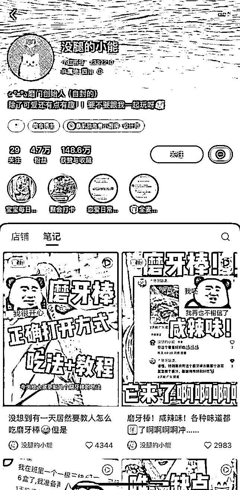

我看到的案例是📕《rise100经营实录》中提到的“[小文梨子](https://www.xiaohongshu.com/user/profile/5f422f1500000000010027cc?xsec_token=YBX3z51TIouEFcvXKS-3zBNY0Ik4fyFNZN8n7ltrOQKVE=&xsec_source=app_share&xhsshare=CopyLink&appuid=6534b79b000000000d004780&apptime=1739436141&share_id=6bedc51974f046a0b13cb3755726cfdd)**”。

2024年买手笔记带货未爆发，主要有三点原因：
一是平台当年更侧重扶持买手直播而非笔记；
二是达人未看到标杆案例，担心收益不稳定，不愿用笔记为品牌免费引流；
三是品牌方关注度不足，不愿投入试错。

如今平台已将买手笔记带货列为重点：
对外向MCN、选品服务商提供流量扶持和投流激励；
对内给买手设KPI，即非直播博主通过小清单月GMV破10万的案例；
平台近期还上线“小清单好物”，提供可拿样高佣商品池。

想做起来的建议：
1️⃣ 先把📕店铺运营打通
2️⃣ 联系过往合作的博主，邀请尝试买手笔记，若不愿可先用原有内容投效果广告跑出销售，用结果说服
3️⃣ 近期投放的博主，可先沟通买手笔记合作，不接受再走投放，用投放结果再说服二次合作

## **3.5. 📕商品卡或迎来新增长**

电商发展到一定阶段必然孵化货架逻辑。当用户习惯在平台购物，就会产生“人找货”需求，这正是货架电商的本质。

所以需要用传统电商逻辑重新梳理并运营好自己的📕店铺。

## **3.6. 📕直播依然是趋势**

平台仍在持续扶持直播，案例不断涌现，依然值得投入。

店铺自播方面，相较抖音，📕自播客单价更高、利润更稳、波动更小。但不能照搬抖音玩法，逻辑完全不同。

买手直播带货也在持续增长，体量虽不及抖音快手，但稳定且有利润。

## **3.7. 📕薯条又好起来了**

过去我一直认为薯条是鸡肋，但最新反馈改变了判断，它似乎重新具备价值。

当前比较有效的场景：
1. 客资线索类商家在投流成本高企时，可用薯条测试，获客成本可能有惊喜
2. 笔记自然流量下滑时，可用薯条撬动二次曝光

## **3.8. 从线上走向线下**

越来越多品牌开始从纯线上走向线下，但线下并非指开门店，而是组织快闪、社群活动等线下触点，与核心用户深度连接，这已成趋势。

线上很难建立深度连接，商家难以听到真实反馈，也难以培养KOC与品牌挚友。

线下则可以近距离与典型用户、忠实用户交流，完成反馈收集与社群沉淀。

## **3.9. 预售模式常态化**

随着养成系品牌增多，品牌与用户共创产品的模式普及，预售也逐渐成为常规打法。

## **3.10. 2C品牌2B，2B工厂2C**

2C转2B有两类动机：
一是追求更稳定的GMV与曝光，例如某香薰品牌向酒店等线下渠道低价供货，既稳收入又提升线下认知；
二是盘活内部能力，例如某品牌依托抖音达人分销能力，为其他品牌提供BD服务，提升现金流并最大化资源利用。

2B工厂转2C，则是看到工厂品牌在各平台表现不错后，为获取更高利润而自建品牌触达消费者。

## **3.11. 经营精细化**

我一直认为📕的底层逻辑并不复杂，绝大多数商家都能做到60分。分水岭在于精细化，即执行颗粒度与细节打磨。

举例：
1️⃣ 凯乐石 MONT X 冲锋衣
基于攀登67座名山的不同人群需求，精细化定制内容，实现种草转化。
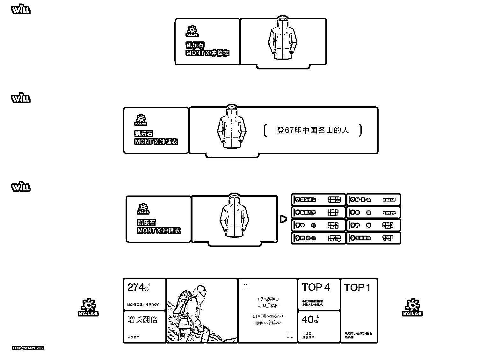

2️⃣ 某品牌烘干机
针对不同地区降雨导致晾晒困难的人群，按地区天气差异化做内容，并用效果广告精准投放，实现转化。

未来随着官方培训普及，信息差会缩小比拼的就是用户洞察、内容洞察与经营精细度。

## **3.12. 从单点爆破走向系统经营**

越来越多品牌发现，单点爆破虽能冷启动并建立短期优势，但难以构筑长期壁垒，必须走向系统经营。

例如一个服饰品牌，早期无内容能力，只能投达人，单点爆破建立领先。但达人投放有阈值，且易被竞品复制，差距迅速缩小。

此时若继续死磕投放，增量有限，且投放数据可被第三方工具轻易追踪。转向系统经营后，覆盖效果广告、矩阵账号、直播带货等多版块，体量提升且难以被模仿，因为投流花费、持续投放笔记、矩阵账号结构、店铺自播数据、团队架构与分工等都是隐性壁垒。

系统经营带来体量增长，并让竞争对手难以复制，这是单点爆破做不到的。

# **04. 服务机构**

先说结论，服务机构要读懂📕 2025 年的风向，先得看清当下市场在怎么变。

**市场在变的三个信号**

**1. 客户要的不再是花哨的品牌曝光，而是看得见的品效和直接成交**
合作诉求从单纯宣传转向品效合一，甚至直接要求带货卖货。

**2. 投放钱包变紧**
不少品牌商家已经开始缩减📕的预算池。

**3. 中小商家更信自己**
越来越多中小商家选择自己组人运营，而不是继续外包给机构。因为预算有限，组建自有团队才能把每一分钱用在刀刃上。

**服务机构的 10 条应对路径**

**4.1 官方服务商的压力在增大**
从我了解到的情况，📕对各端口的合作政策在收紧，但对服务商的 KPI 考核却没松口。结果就是官方服务商被进一步压榨。

**4.2 单点极致，纵向深耕**
就盯一个业务点死磕十年，做成行业天花板。口碑起来了，转介绍自然来，也能挑客户、有议价权。规模可能做不大，但利润会好看很多。

**4.3 横向扩张，多元化运营**
比如从📕业务延伸到抖音等其他平台；比如在📕内部从单项服务升级到全平台全案，提供一站式经营解决方案。

**4.4 拼多多化打法**
降价走量，先用低价抢市场，同时在走量中筛出优质商家做深度绑定。这种模式更适合三四线城市的团队，硬成本下降后才有利润空间。

**4.5 自营品牌+联营**
我个人更看好机构做自营品牌，不用做多大，关键是把品牌经营的全链路跑通，作为案例和背书。实在没精力搞后端，也可以找靠谱的后端做联营，把自己的流量和营销能力赋能出去。

**4.6 AIGC 是新变量**
AI 浪潮下，AIGC 已成趋势。现在已有机构用 AI 创作内容、批量运营账号，再承接商业广告。这种账号具备批量复制的潜力，很值得探索。

**4.7 买手 MCN**
**4.8 选品服务商**
**4.9 本地生活服务商**
买手 MCN、选品服务商、本地生活服务商，都是📕 2025 年的重点战略方向，机会明确。

**4.10 团队做精做省**
机构在团队上的变化就是精简化。
一是地域下沉，从一二线搬到三四五线。很多岗位不需要人才，只需要按 SOP 执行，有执行力就行，下沉能大幅降本。
二是线下转线上兼职合作，部分岗位用柔性用工替代在编人员。

**05 新个体的赚钱地图**

**5.1 商业广告变现**
虽然很多人唱衰，但运营账号做博主接广告，依然是新个体在📕最主流、最吃香的变现方式，门槛相对依然不高。
我把接广告的账号大概分成三类：
一类是有强人设，真人出镜、有生活方式、有情感链接、有故事；
一类是无人设，纯粹做产品推荐和好物种草；
一类是也无人设，靠各种有流量的乱七八糟内容活着。

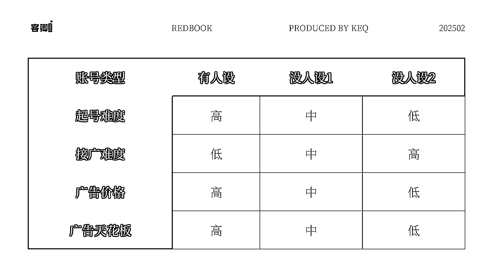
另外要提醒的是，📕自然流量见顶，起号难度在提升。是否能接广告，很受近期内容数据波动影响。0-10万粉的账号反而最好接单，10万粉以上很难接，除非有人设且近期数据稳定。
再加上品牌预算缩减、品牌方更精打细算，广告变现门槛在持续抬升，趁早布局更稳。
赛道建议上，热门赛道里找细分切口，新兴赛道里做融合。

**5.2 买手带货 vs 开店卖货**
买手带货和开店卖货已成为新个体掘金的新路径。但我更建议优先做买手带货。
开店卖货意味着要处理选品、测品、找货源、上下架、客服、打包发货等一堆琐事，极度消耗时间和精力。

普通人开店很容易卡在几个坑里：
货源和议价权，一件代发、订单量小就没价格优势，囤货还会带来资金压力和卖货焦虑。
客服响应，个体精力有限，回复会占用创作时间，不回复又会被考核处罚，可能导致差评和流失，外包又贵又难培训。
售后退货，尤其是服装类，售后和退货率极高。
发货合规，📕已不允许无货源模式，发现就封，要么自己发，要么接入供应链 ERP 合规发货。

钱的逻辑我一直是这样：能躺着赚就不站着赚，能站着赚就不跪着赚，除非钱给的太多。
所以与其苦哈哈搞后端，不如做买手带货，本质是笔记或直播带货的轻模式，只负责选品和内容，不用啃后端琐事。

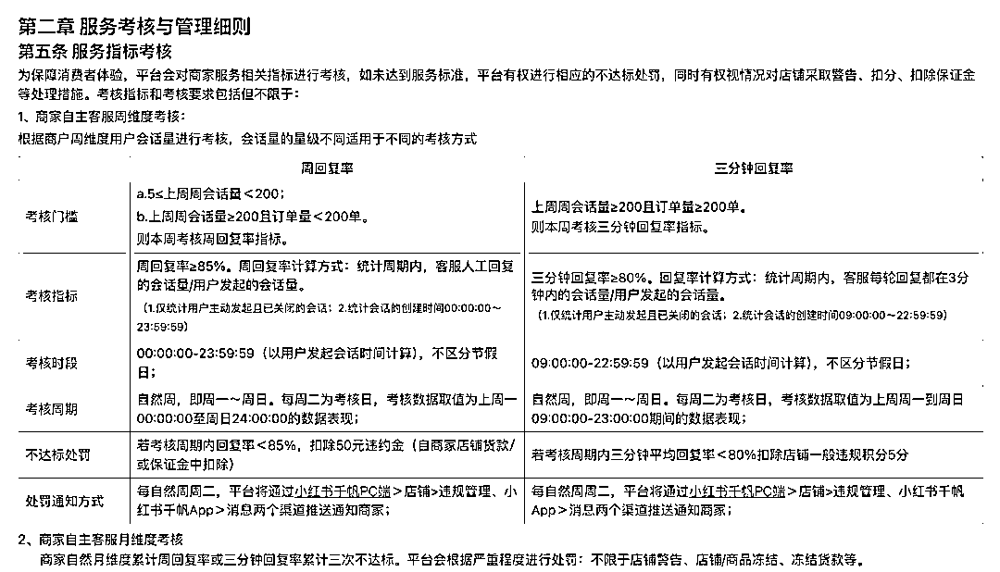

**5.3 广告+带货打包是标配**
基于过往经验，买手带货是📕博主的进阶归宿。
品牌现在要的是确定性增长、可看的 GMV 和利润增长，纯广告给不了确定性收益。
带货可以。
所以对博主尤其是高粉博主来说，带货已成趋势甚至标配，不带货就没性价比、没竞争力，除非赛道还没卷起来。
广告+带货打包已经成为常态。

**5.4 万物皆可卖**
对新个体而言，📕遍地是小钱，只要选对赛道、有执行力，就能赚钱。需求再小也值得被看见。
最后，每个新个体都可以去📕探索各种可能性，找到属于自己的小生意。