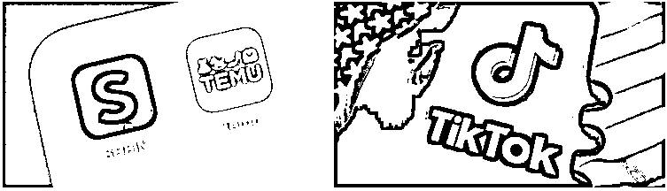
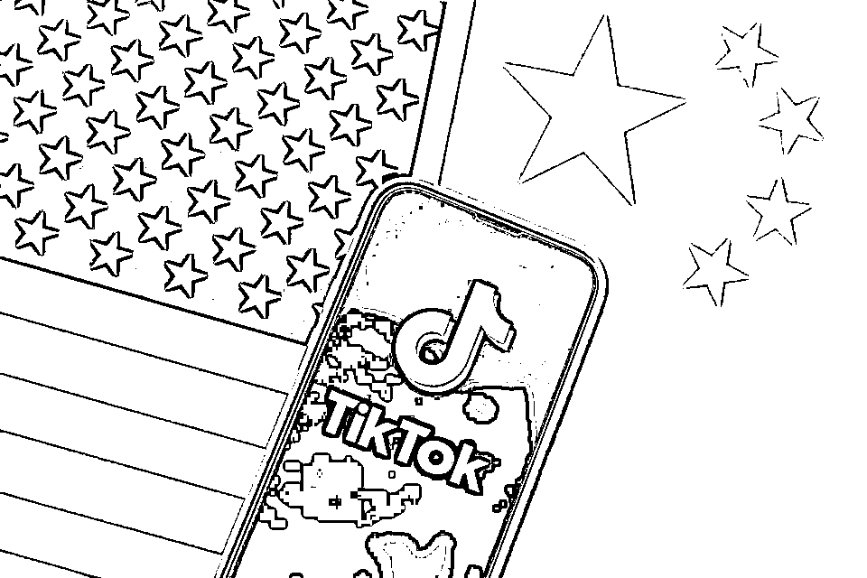
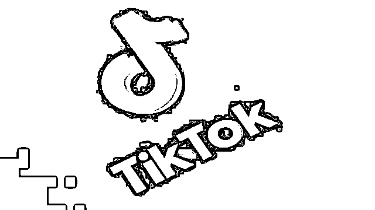
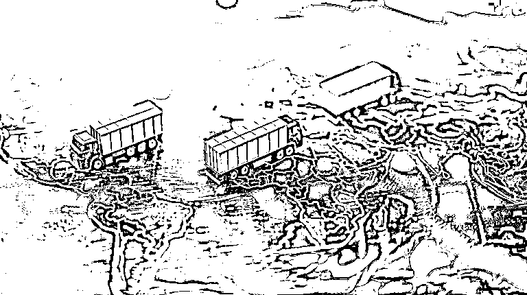

# 2025，TikTok 跨境卖家不做私域，可能真的活不下去

## 2025，TikTok 跨境卖家不做私域，可能真的活不下去

作者： 国民弟弟的跨境十年

日期：2025-02-14

2025 年对跨境电商来说，尤其是押注 TikTok 电商的从业者，注定是极其艰难的一年。美国虽然暂时重启了 800 美元以下免税，但政策反复随时可能发生。未来发往美区的货物大概率都要额外背上关税，成本直接被推高。

过去靠低价抢占市场的打法，无论是 Shein、Temu，还是 TikTok 上的爆品模式，都已难以为继。欧盟那边虽然暂时恢复邮件收寄，美方却在加速收紧。美加墨之间的贸易谈判也在推进，未来想靠绕道墨西哥、加拿大再转进美国的路径，很可能彻底被堵死。

把这些信号串起来看，美国这次的意图非常明确，就是要对跨境卖家形成合围。叠加市场本身在走弱，平台风控在升级，政策又在持续收紧，2025 年很可能成为跨境卖家最难熬的节点。

### 2025 跨境修罗场：三把刀同时压顶

关税围剿在升级  大家还在为“800 美金免税回归”松口气时，后续的税费安排早已在路上。据了解，发往美国的包裹未来将叠加数字服务税、环保税和反倾销税等额外成本。有物流头部企业测算过，去年走墨西哥绕关的 3C 类目，现在综合成本已经上涨了 47%。

北美封锁在收紧  美加墨三国海关实现数据互通，意味着“温哥华贴标”“蒂华纳换箱”这类老套路基本失效。就在上个月，我亲眼看到同行一整柜价值 80 万美金的蓝牙耳机，在洛杉矶港被 AI 扫描出激光暗码里的“Made in China”，直接整柜被扣。

平台生死正在倒计时  TikTok 电商美国区的日均 GMV 已下滑超过 60%。内部流出的应急方案显示，若在 9 月前完不成数据本地化，中国卖家的流量权重将被强制削减 30%。更关键的是，有 TikTok 官方小二透露，新管理团队上任后，可能推出“白名单卖家”机制。

### TikTok 电商的未来充满变数

TikTok 自己也处在风口浪尖。特朗普给出的 75 天缓冲期很快到期，美方与 TikTok 的谈判仍在拉扯。最终结果没人敢打包票，最可能的发展是美方要求 TikTok 大规模整改，甚至更换部分管理层。一旦新团队接手，是否继续拥抱中国卖家，完全是未知数。

所以，眼下所有在做 TikTok 电商的人，都必须开始做风险隔离。如果你把所有资源都押在美区 TikTok 店铺上，一次政策波动就可能让你连撤退的机会都没有，就像年初的美区大面积封店潮一样。

### 2025 年卖家怎么破局？

我们这些做得早的老卖家，今年的核心动作已经转向跨境私域。还在公域里卖货的人，永远要和平台拼价格，掉进无尽的价格战。更致命的是，公域流量不属于你，平台一句话就能让你从高峰跌到谷底。

**如果你正卡在这些问题里：**

→ 平台投流成本越来越高，ROI 持续走低
→ 仓库里塞满了不想丢又卖不动的滞销品
→ 每天被政策变化吓到，却找不到稳定方向

### 绝地求生：私域流量就是这轮寒冬的诺亚方舟

私域的定价空间比公域宽很多，利润率得以提升，正好用来消化关税上涨带来的压力。

客户一旦进入私域，就完全掌握在自己手里，能反复触达、二次成交，长期收益可期。

同时也能降低对单一平台的依赖，规避风控，让生意更稳、更可控。

继续死守公域电商，2025 年很可能就是一场彻骨寒冬。但愿意提前布局私域、拥抱变化的卖家，才有机会在这场行业大洗牌中找到新的活路。

以上！

**国民弟弟相关创业的故事文章推荐：**

**跨境电商认知分享，个人创业者从 0 到 1000w+**

[`articles.zsxq.com/id_8n2o7gax71fr.html`](https://articles.zsxq.com/id_8n2o7gax71fr.html)

**3 分钟搞定美国公司，150 美金，超简单**

[`articles.zsxq.com/id_exggkcb30j69.html`](https://articles.zsxq.com/id_exggkcb30j69.html)

**3 分钟，如何远程开美国实体银行,送 2340 入金奖励。**

[`articles.zsxq.com/id_ubk2osmj6wzb.html`](https://articles.zsxq.com/id_ubk2osmj6wzb.html)

**美国收款工具：**

美版支付宝 Venmo:[`articles.zsxq.com/id_x73bbkhkkzau.html`](https://articles.zsxq.com/id_x73bbkhkkzau.html)

* * *

评论区：

暂无评论