# 9000字复盘 3 年头部视频号达播实操：百万 GMV 大场经验复盘

## 精华帖 9000 字复盘 3 年头部视频号达播实操：百万 GMV 大场经验盘点

作者：河林
日期：2025-02-11

赚钱的朋友们好，我是河林，这是我在赚钱三年里的首篇分享。

先做个自我介绍，我是河林，98 年生，现居杭州，拥有三年头部视频号达人运营经验。

**  **

目前主责视频号直播带货的操盘工作，同时也在做互联网营销的自媒体内容。

自 2022 年起，我先后在头部母婴新媒体公司、头部女装达人公司负责视频号直播的运营工作。

到现在以专场项目负责人+执行运营+中控跟播的身份，**已累计主导近 300 场直播，覆盖全品类，其中多个场次 GMV 达到 100 万以上。**

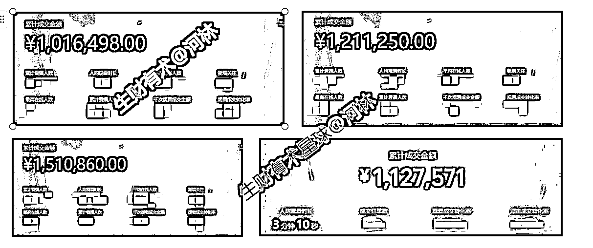

我平时习惯做复盘，擅长营销案例拆解，长期为**零一裂变、鸟哥笔记** 等平台供稿；

**在视频号直播赛道也写过几篇获得关注的分析。**

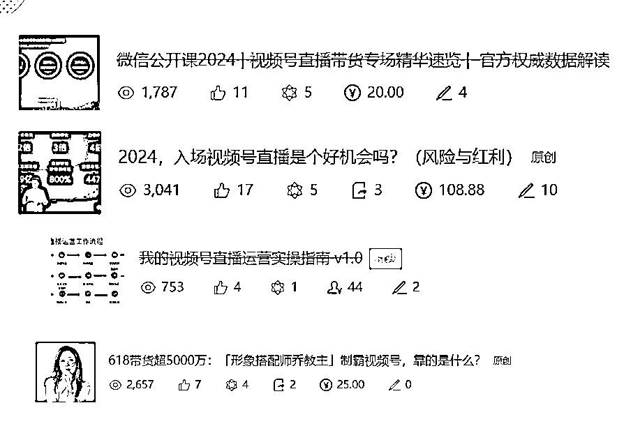

2024 年结束之际，我想把这篇文章作为年度总结，分享一下在视频号直播赛道摸索两年多来的体感、判断和落地打法，也算是对赚钱社区的一点回馈。

本文会围绕以下几个问题展开：

1.  视频号直播电商的生态特质
2.  视频号公私域联动的玩法逻辑
3.  百万级直播专场的拆解
4.  视频号直播的入局建议

前置说明

1.  适合人群：本篇方法论主要面向**视频号达人带货直播、团队配置在 5 人以上、偏正规化运营**的打法；
2.  **不太适合单人操作、追求野路子快赚** 的个体玩家，若想了解无人/半无人直播、口播带货、混剪短视频等轻量玩法，**赚钱精华帖里已有大量分享** 可参考。
3.  大家对视频号的关注点和阶段不同，我的视角难免有偏重，未覆盖到的点欢迎提问，我会在认知范围内尽量回应。
4.  全文不带引流、不推训练营、不收徒、无付费推广。

内容较长，全文超 9000 字，飞书排版更佳，可移步阅读：

[`jid6vvjfdm.feishu.cn/docx/R9zfdm4Q2oVMS2xDneccJdkInxh?from=from_copylink`](https://jid6vvjfdm.feishu.cn/docx/R9zfdm4Q2oVMS2xDneccJdkInxh?from=from_copylink)

# 一、视频号电商营销特质

视频号的底色过去两年大家都已熟悉，我这里只提关键点，归纳为三大特质，也是带货红利的来源。

## 高质量用户+品类机会

根据视频号官方在 2024 微信公开课披露，**以下 4 个赛道是 2023 年电商的主力，也是我判断 2024-2025 年仍值得优先切入的。**

**服饰家居 占比 36% 客单 172 元**

**食品生鲜 占比 21% 客单 160 元**

**家清日用 占比 9% 客单 152 元**

**个护美妆 占比 8% 客单 100 元**

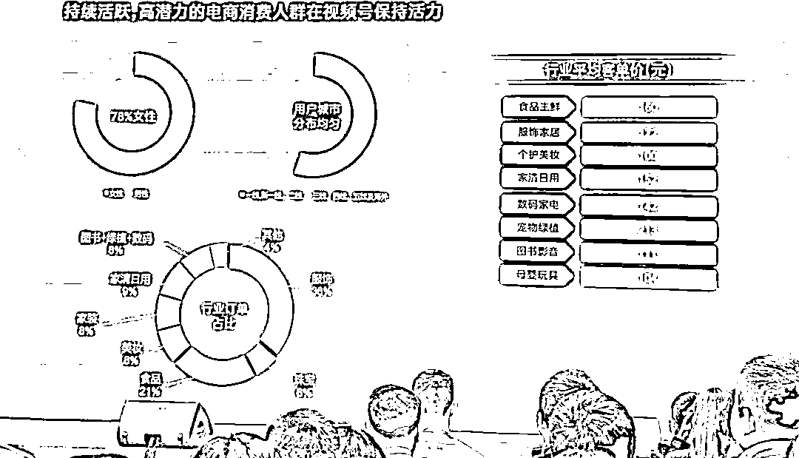

在这几类里，围绕**中老年群体对变美、健康、品质生活的需求下的非标品**，是 2023-2024 年很多品牌起量的方向，这就是当下阶段的品类机会。

除品类外，用户质量更突出，视频号电商的活跃用户在电商行为上优于他平台，呈现**粘性强、复购高、客单高、退货低** 的特征。

官方表述为：“高潜力的电商人群在视频号持续活跃”，人群画像大致为：

1.  女性约占 78%，一线/新一线/二线用户超六成；
2.  **30-50 岁人群贡献了视频号 40% 的增量**，官方定义为「有钱、有闲」，即我们常说的熟龄人群。
3.  视频号的成交机制叠加私域助推，核心粉丝的付费质量更高，**粘性、复购、客单、退货率** 都更优。

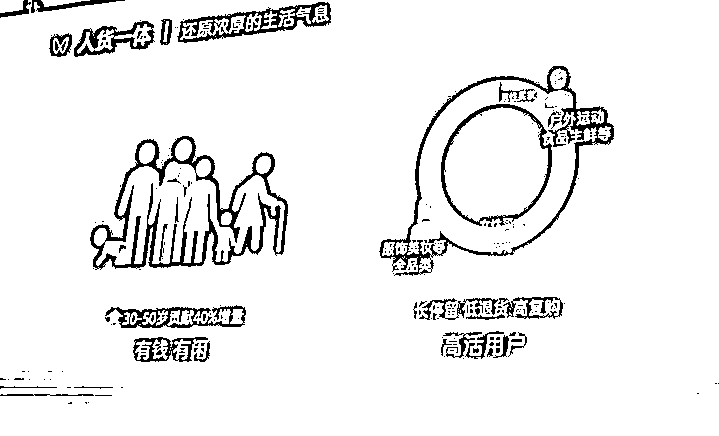

由此可判断，**视频号聚合了体量庞大的高潜优质电商人群。**

官方给出的典型案例是： **2023 年在视频号购买车厘子的用户中，75% 选择的是 3J 以上的高等级。**

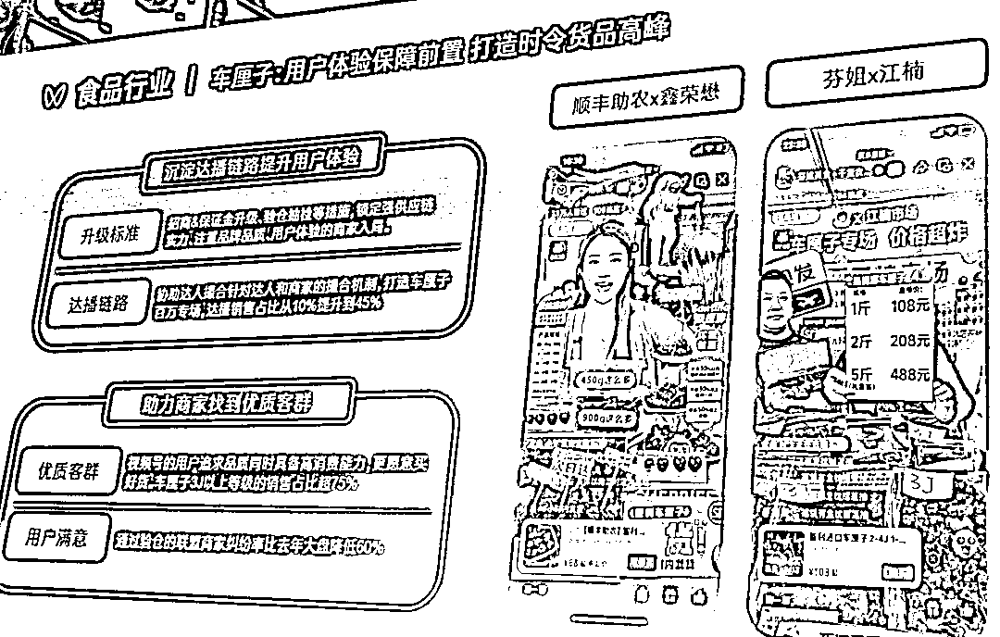

京润珍珠也曾提到：同品在其他平台直播客单 600-800 元，在视频号能做到 1000-1200 元以上，用户还主动要求上更高价位产品。

这充分说明 **视频号用户对商品与生活品质的追求，更适合做高客单转化。**

## 依托微信社交生态的流量分配

视频号与他平台的最大差异是什么？

**就是依托微信社交体系，天生处在高频庞大的社交流量中心，并连接了公域与私域。**

视频号扎根微信，内容传播高度依赖熟人关系，**社交属性和情感价值更强。**

在微信里，**私信、私戳、朋友圈、微信群、好友分享、看一看、直播广场** 等入口，都能见缝插针地分发；在微信内用户停留时长长，触达成本低、入口多、频次高。

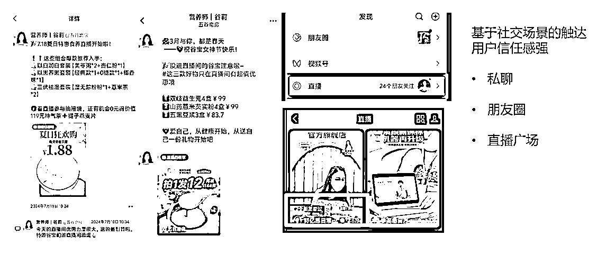

熟人社交对电商的价值在于，用户经由**带有私域属性的社交推荐** 而非平台信息流进入主页或直播间时，会自带社交信任背书，更容易建立信任，从而带来高转化。

 images.zsxq.com/FvXt60h7Si800nSdFNmIwQMtQAER) images.zsxq.com/FoNpKwLpukYjbQwUoTkVowBtAXpO)

这也是达人红利出现的原因之一，粉丝对主理人信任度高，主理人也更愿意回馈，形成了**活跃高、转化高、客单高、退货低** 的特征。

下面这张图很直观，对比了微信和抖音的成交链路差异。

微信的链路可以更长，但能实现无孔不入，各种场景都能植入触达组件，持续提醒用户来看直播、看视频。

**更长的说服链路与更强的信任沉淀，更易带来高客单、高复购、高利润。**

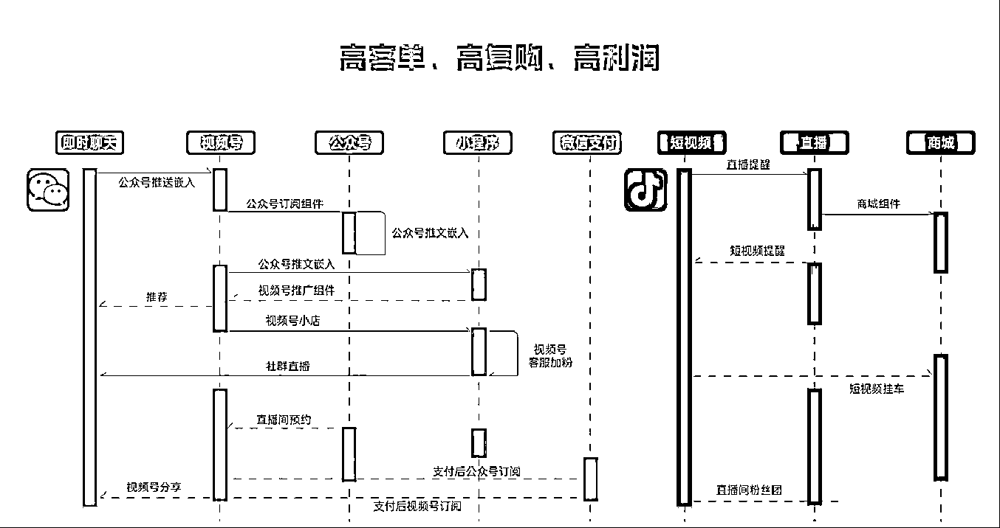

## 竞争不算激烈的生态

视频号平台策略目前呈现：**运营偏保守、电商节奏慢、算法推荐去中心化、数据榜单不公开。**

1.  **去中心化推荐：** 他平台多是二八分化，易形成马太效应；视频号则相反，新人期会多推，头部后反而相对收敛。
2.  **数据榜单不公开：** 平台不鼓励冲榜，做出成绩也不会立刻被同行盯上、抄作业、打压，大家都有闷声发财的空间。

两者叠加，让视频号竞争并不激烈，新品牌、新达人都有相对平静的试错窗口。

我与不少品牌、厂家交流过，很多在抖音做不出结果，因为抖音已白热化，**要么组建六边形团队，要么重度付费投放。**

转战视频号后，发现竞争没那么激烈，投入可见回报，投放成本更低、投产比更好，于是逐步做大。

# 二、策略：视频号公私域联动打法

搞清楚平台特质后，核心问题是：**视频号直播带货怎么做？流量从哪来？如何转化？和抖音有何不同？**

这一部分我主要拆解视频号直播的核心方法论——**公私域联动打法。**

## 流量结构：认识视频号直播流量

视频号直播流量目前可分为三块：公域、私域、付费。

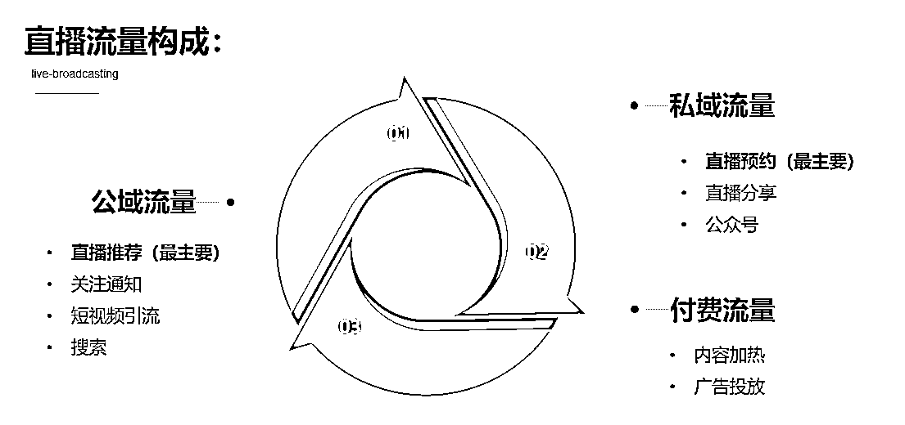

直播数据大盘也按此呈现，做好一整场数据，就是做好三块的流量、成交与转化。

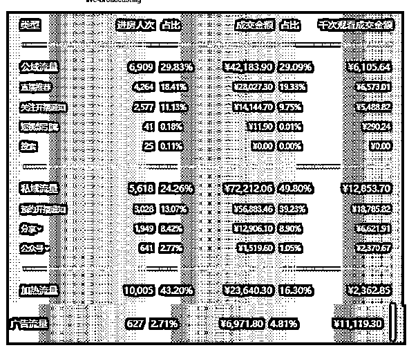

### 公域流量

视频号直播的公域怎么来？

官方在**《视频号商家起量教程》** 中已公开算法：

这个流量公式每个玩家都应烂熟于心。

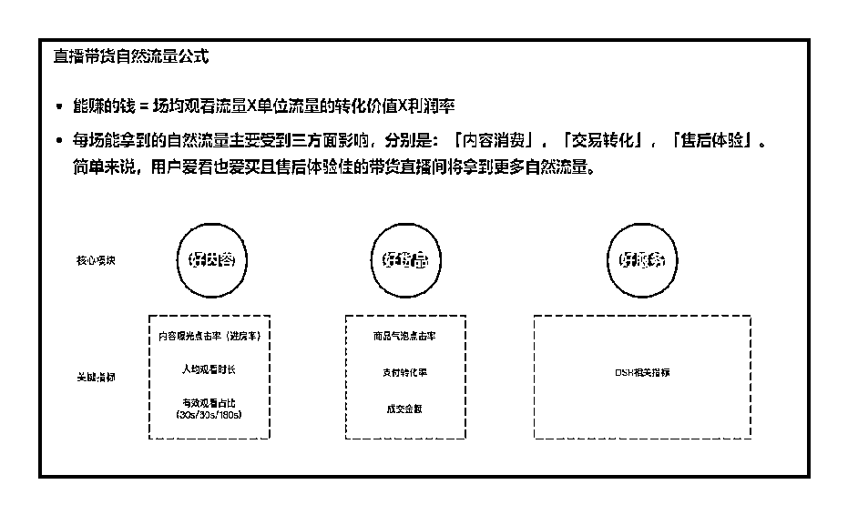

视频号带货直播的流量逻辑是：好内容×好货品×好服务=更多自然流量推荐。

官方概括为：做好人、货、场的组合，在当下时段脱颖而出。

1.  好内容 内容消费 ×好货品 交易转化 ×好服务 售后体验 =更多自然流量推荐

结合前文，视频号流量算法整体去中心化，具体表现为：

1.  无绝对分级流量池，所有直播间都按**当场的內容消费和交易转化**
2.  **叠加主播历史表现与售后体验** 来决定推荐量。
3.  推荐比的是同时间段的相对水位；**同时间段转化更高效的场就会获得更多流量**。

数据后台也对应体现：

1.  内容力：曝光进入率、平均观看时长、互动数、转粉率；
2.  转化力：曝光点击率、成交转化率、千次观看成交金额 GPM

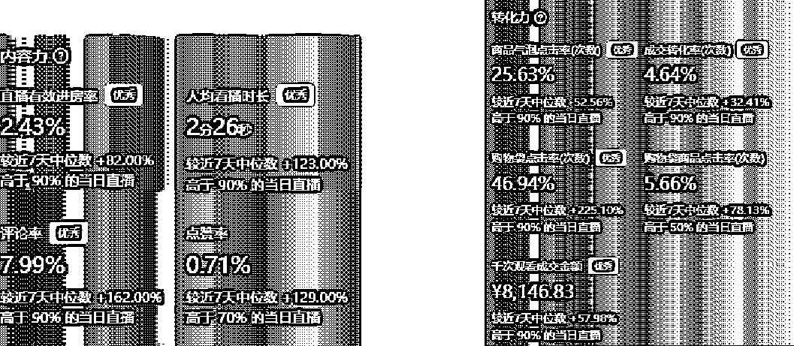

实操规律是：**直播间成交波峰，大概率会带来下一个推荐周期内的流量波峰。**

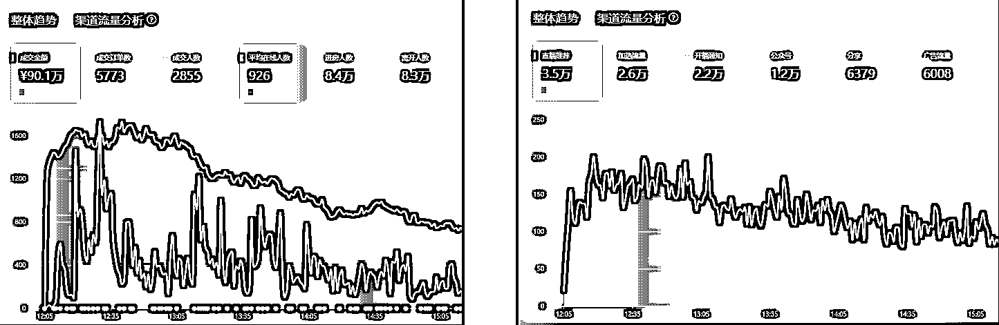

据此推流逻辑，直播中做好下面 3 个指标，基本就能获得更稳定的推流。

1.  5 分钟密集互动数
2.  5 分钟密集成交金额
3.  直播间平均观看时长

做好公域流量的核心思路：

1.  优化人货场模型，做好货盘排序与爆品转化
2.  主动制造成交波峰，撬动推荐流量波峰

### 私域流量

私域对直播的价值体现在两方面：

1.  **预约流量：** 通过前期私域种草，引导沉淀的忠实用户入场，为直播带来冷启动的急速流，撬动公域推荐。
2.  **分享流量：** 直播中把直播间分享到私域，引导成交与裂变。

我们要做的是用尽所有能调动的私域触点，最大化曝光，提升预约数。

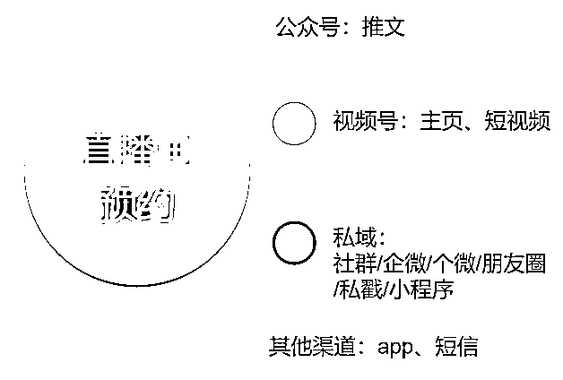

典型做法：

1.  视频×直播联动：用种草、剧情、人设视频反复触达私域粉丝与公域品类人群，为直播拉预约。

 images.zsxq.com/Ft31wrK77fNAlQln64VYjv80BkR7) images.zsxq.com/FtjkosE-9-REdEx329GiCCOGehnj) images.zsxq.com/FhqQfnNNEZrxqcV3jGb0lWBr39V_)

1.  社群×直播联动：在社群分发预约海报、直接转发直播间。

 Ivce3wZoaNP9Y) BXu3YDIEGNHTxMHF7jn) images.zsxq.com/FoQN9n_PcpGtjdyJbVcrpE-nn0oj)

1.  👸号×直播预约：👸号发文露出利益点，提前种草，直接导预约。

 eSh)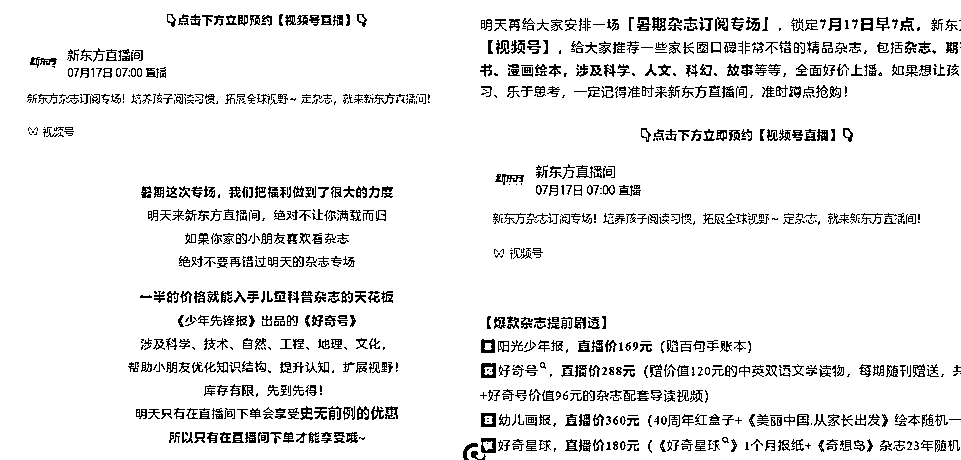

**视频号的直播预约，比其他平台重要得多。**

一场充分预热的直播，私域预约的产出占比很高，**因为私域用户有信任基础，下单果断、互动积极、售后低**，是高利润的 VIP。

私域承接还能反哺公域推荐，机制是**直播预约=商品种草=开播急速流=密集成交=撬动公域推荐。**

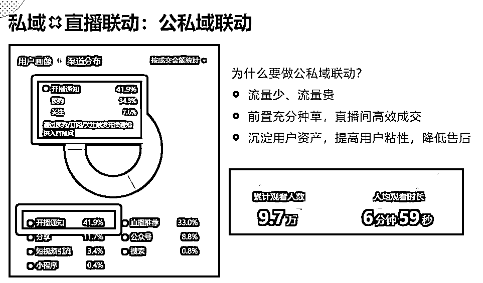

**直播前猛种草，直播中高效承接，直播后做好售后沉淀信任资产，才是视频号做私域+直播的长线打法。**

### 付费流量：adq+内容加热

付费层面，视频号直播可通过微信豆内容加热和微信广告 adq 投放。

两种工具差异如下：

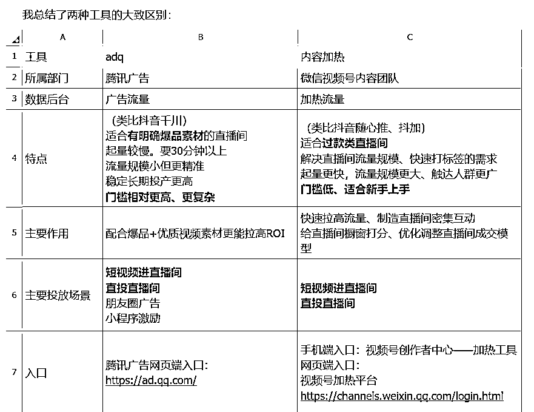

总的来说各有侧重，多数商家用微信豆加热更顺手，也能发挥作用；

无论工具如何，核心逻辑不变：**优质素材+有竞争力的爆品+合理出价=更好的投放效果。**

## 打法总结

**视频号公私域联动打法总结：**

储备私域、导入直播，用好人货场优化制造持续成交，获取稳定公域推流，再用付费工具放大。

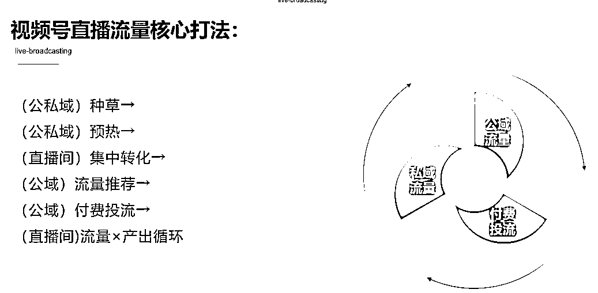

# 三、实操：直播策略拆解实操

接下来是方法论落地的部分，我会以一场真实直播为例，拆解**一个优秀操盘手或运营型主播应具备的素质，以及一个团队管理者该如何选人、用人。**

内容基于真实实操，受篇幅限制不一定面面俱到，但都可落地，欢迎补充。

案例截图部分为本人实操及他人案例参考。

## 货盘准备

### 押注爆款

从货盘里挑出不超过 5 个核心主推爆款，以此为核心做种草内容拉预约。

视频号爆款通常具备以下条件，条件越多越易爆：

1.  **应季刚需+高性价比，是爆款基础。**
2.  **库存/货值充足，能承接购买力。**
3.  **视觉表现好，适合直播间呈现。**
4.  **有数据验证：其他平台或同行数据佐证。**
5.  **需求强或有独特卖点/噱头**：珍稀材质、高品质、进口等，能打动愿意为品质付费的视频号用户。
6.  **中高客单、利润可观。**

各品类都有类似爆品，建议结合自身情况选择，最好有数据背书。

爆款选择是整场关键，决定了后续种草、组盘、过款转款等所有环节，选错则全盘受牵制。

### 组货盘

先定爆款再组盘是更稳的做法。

经验要点：

1.  **思路：** 品类、价格梯度、客单价、库存、顺序都要兼顾。
2.  **结构：** 以爆品为核心，按「福利款——次推款/承接款——主推款」排布，次推款填补品类、风格、款式、场景的空缺，为主推做承接；主推款要反复返场。
3.  **赠品/福利设计：** 价值感优先，用户更在意能与主品搭配使用的赠品，而非花哨周边。
4.  **规格设计：** 尤其美妆护肤，款数有限时可做高客单组合套装，比单品大量囤货更有 GMV 效率。
5.  **库存备货：** 爆品库存、货值必须充足，服装、家纺等 SKU 复杂品类要精确到 SKU 备货。

## 直播种草

### 公域种草

做完直播内容素材后，别急着开播。建议把预约向的视频提前1-2天发出去，给自然推荐留出发酵窗口。也就是说一旦直播档期敲定，就要倒排期去准备拍片、剪片、上线。

预约视频到底能帮到什么：

1. 视频本身的播放量越大，带来的预约基数就越多，但如果选题和直播主推商品贴合度不足，来的多半是泛兴趣用户；

2. 视频内容和当晚直播主题高度一致时，预约进来的用户质量会明显更高；

3. 同时兼顾高播放和高相关，是最理想的状态，但对内容的策划和制作门槛也最高。

视频上线期间，记得在直播预约后台把预约置顶。用户刷到视频时，预约入口才有足够曝光机会，否则很容易错过预约时机。

 images.zsxq.com/FqkoTFdbcZaECNEyK6-4R5QoCU-j) images.zsxq.com/FhqQfnNNEZrxqcV3jGb0lWBr39V_)

公域种草不只是发短视频，👸号也能用。文章里直接挂直播预约组件，预约逻辑和视频是一样的。

相较于视频，👸号还有额外价值。除了直推预约进直播间，还能把高意向用户导到私域社群，先做一次深度沟通再触达，精准度会进一步提升。

### （2）私域种草

公域靠视频做广度，私域靠图文做深度，二者分工不同。

私域内容的最大优势是可以避开公域的限词、敏感词和利益点限制。图文形式更适合放大量细节图、真实使用效果、品牌背书、直播规则预告、营销福利等信息。这也是私域种草不可替代的原因。

所以公域不敢说的卖点和利益点，就要在私域里反复强调、大胆讲清楚，在合规范围内做到极致。

常见做法是：

1. 明确告知粉丝，这款是给知名大牌代工的同一条产线，但价格只有三折左右；这类滋补品具备xx效果等等；
2. 在私域投放直播海报，提前告知粉丝将在xx时间开xx主题直播，会主推xx/xxx等爆品，并拿到专属优惠机制/福利，数量有限，前xx名优先，记得提前预约、早到早得。

可以参考头部达人成熟的私域预约玩法——

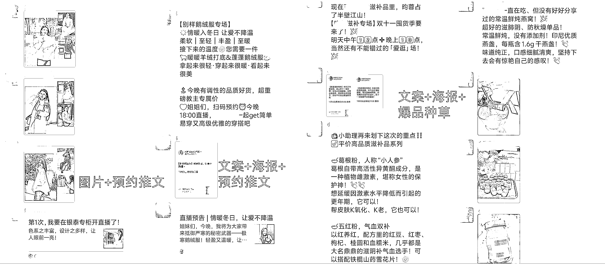

种草期要持续盯直播预约数据。账号进入稳定期后，品类固定，直播最终产出基本与预约量成正比，只是不同账号的转化系数不同。

因此预约总数基本就能预判一场的产出，种草期投入的每一分努力都会在直播结果上体现。

## 目标测算

### （1）目标预估

确定主推爆款、排好货盘后，就能基于全场商品做坑位产出预估，从而设定直播目标并拆解达成路径。

预估方法主要有两种，坑产法和预约法。

1.  基于预约量预估：

预约数直接反映前期种草效果，决定直播流量天花板。数据稳定的账号，通常能根据历史经验把预约量换算成产出规模。

1.  基于坑产预估：

货盘敲定后，按照以下模板逐项测算：

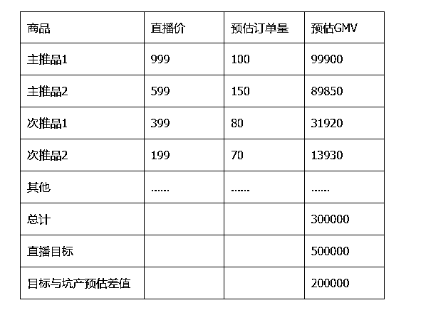

测算出预估坑产后，对比目标间的差距，及时调整策略：

——扩坑位：是否要增加品类数量，提升整体产出；
——提单品：是否要把几个爆款的成交量拉高，带动GMV；
——拉时长：是否需要延播2小时，增加曝光窗口；
——加预算：是否需要追加付费投放补缺口；
……

目标预估的意义在于先有清晰预期，再针对性修正策略。

### （2）投放ROI测算

直播成本里除了人力和营销费用，投放预算是最关键的一项。

付费投放的底线是跑通盈利。必须确保投放带来的实际利润不低于投放花费，设定一个不亏损的ROI目标，实际ROI只要在此之上就是赚的。

算ROI的核心是预估品类的签收率和毛利率。

以例说明：在签收率80%、毛利率30%的情况下，ROI=1意味着投100元带来100元GMV，毛利仅24元，还没覆盖投放成本。

要盈利，就必须放大ROI。如ROI做到5时，投100元带来毛利120元，扣除投放成本后净赚20元，此时才具备持续加投条件。

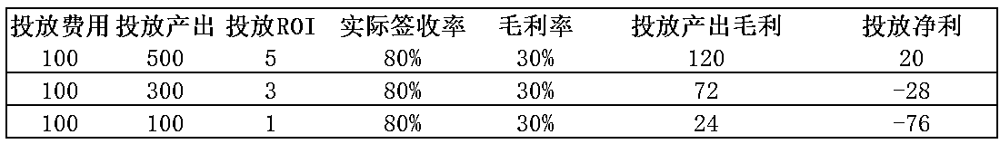

直播前算出这个临界值后，就可以明确告诉投放同事目标ROI，让投放按直播目标去执行。

## 场控运营

### （1）转化侧：盯数据、调策略

直播中要看每个品的转化表现：

1.  点击量和曝光点击率反映用户兴趣度；
2.  成交转化率反映用户真实购买意愿和支付能力；
3.  未支付订单数是做逼单、控库存、踢单节奏的核心，全场跟款节奏都圍繞它展开。

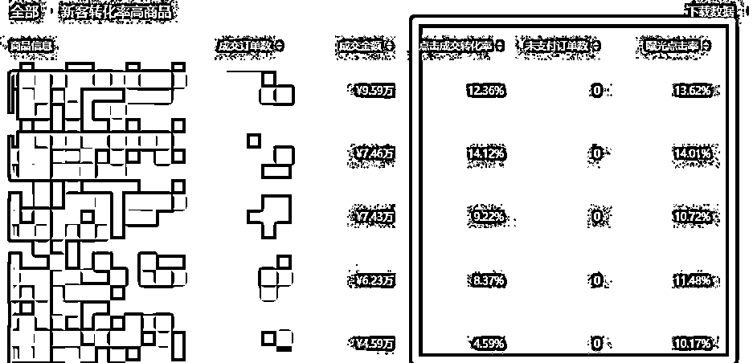

转化数据持续走高，说明品在增长期，是做后台成交密度的最佳窗口。把成交密度峰值做上去，下一个推荐周期会获得更多自然流量。

如果数据持平或下滑，就要考虑转款过款，避免成交密度下滑导致流量断层，一旦大幅下滑很难快速回升。

### （2）流量侧：引流＆承接

视频号直播流量由公域、私域、付费三部分构成。要维持稳定在线，就要为不同流量制定对应引入策略，并做好承接。

1.  公域流量：

对应后台的直播推荐流量，受成交数据、互动、停留等正向影响。

要想拉公域，就要把爆品转化和互动做起来。对爆品要乘胜追击，用互动扣、晒单抽奖、免单抽奖等提升用户参与；配合憋单、卡单、踢单节奏，把转化效率拉高。

公域流量起来后，转化空间就更大，可以再启动一波成交。

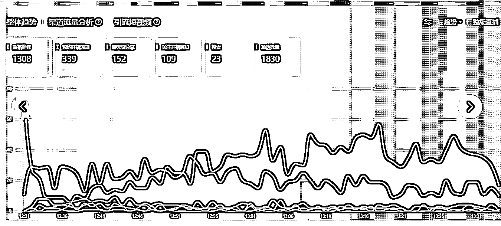

1.  私域流量：

引入重点有两点：一是在爆品成交时，集中私域核心粉丝形成成交势能；二是直播流量低谷时，用私域粉丝稳定在线。

促进爆品成交是核心，因为私域粉丝信任度高、种草深入、转化率更强。这要求在种草期和直播中持续预热爆品。

做法是：种草期以爆品为核心内容；开播前提前公布爆品清单和上场时间；上场前再次用素材预告，锁定期待。

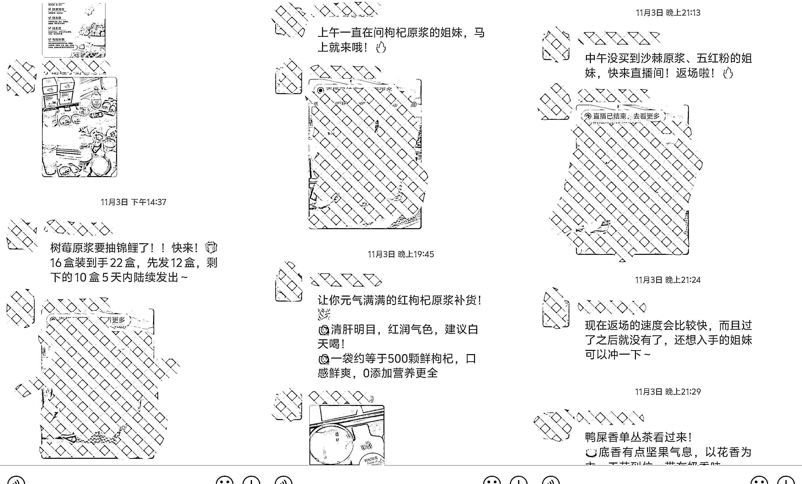

1.  付费流量：

关键是和投手紧密配合，用爆款承接付费流量。

确定主推品上场时间后，和投手协同，在高峰时段把流量导入直播间。主推期运营要实时关注投放流量趋势，投手要看产出反馈，优秀投手还能给出节奏建议，主播和运营则要做好承接。

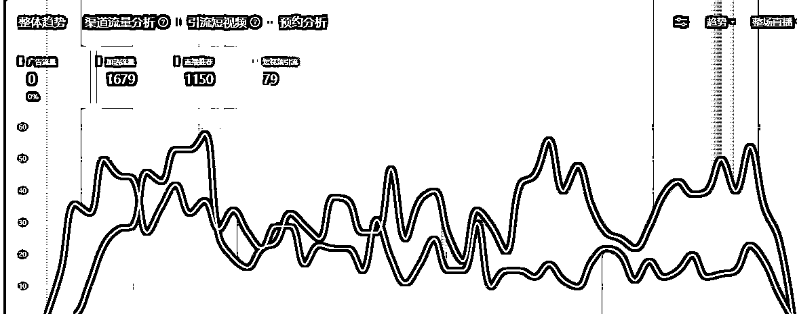

实际直播中三种流量始终交织，无法完全切割。流量引入和承接主要在关键节点做针对性调整。

全场以爆品为核心，保持稳健转化节奏是最稳妥做法，非必要不做过度微操，对直播间流量节奏的感知能力非常重要。

## 数据复盘

直播结束后要做复盘，重点看：

1.  **流量维度：** 全场场观多少，预约多少，流量结构如何，付费占比多少，平均在线和人均观看时长是否达标；
2.  **转化维度：** 全场转化率是否达标，主推商品订单是否完成目标，影响转化的因素在商品端还是运营端；
3.  **人群画像维度：** 本场拉新效果如何，新老客成交占比是否合理，账号当前主要依赖哪类用户，新老客购买习惯有何差异。

把各维度问题梳理清楚，形成优化方案，为下一场提供依据，这就是复盘的价值。

# 四、入局建议

## 个体怎么入局视频号带货？

新手建议循序渐进，先试水搬运混剪挂车，再尝试真人出镜口播，随后逐步融合视频带货与真人直播，最后具备能力后再做IP长期经营，进入达播赛道。

视频号玩法很多，找到适合自己的打法并不断升级赚钱能力最重要。各路经验在赚钱都能找到，遇到卡点时多利用社区资源。

## 选品为王。

我的经验是，视频号达播，选品决定80%结果。掌握选品和优质供应链就掌握主动权，塑品、拉流、做互动技巧都排在后面。无论处于哪个阶段，都要把精力放在研究选品和找货源上。

## 品牌要不要入局视频号？

作为商家或品牌，考虑以下因素：

## （1）类目+人群是否契合

我的品类是否匹配视频号用户画像？是否准入合规？同品类是否已有头部案例跑通？

## （2）盘点资源：微信生态是否有优势

是否有👸号、社群、好友等私域基础？团队能否持续产出短视频？直播能力如何，有无跨平台直播经验，主播带货力怎样？品类利润和预算能否支撑投放？

条件匹配度高且有对标案例跑通，可先小规模试水；否则建议再评估平台适配性。

# 五、欢迎交流

以上分享希望对星友们有帮助，请多指教；

2025开年，一起红红火火、快乐搞钱！

欢迎交流视频号运营项目及各类搞钱心得，也期待前辈大佬多多指导。

* * *

评论区：

龙哥 : 对当下视频号直播玩法非常详细和深入的解读[强]

七天@龙哥盟 : 太干了，太干了，大盘，数据拆解，官方平台意味着啥都有了，建议每一个想通过视频号直播获客的圈友去看看！

沐泽 : 大佬写的真好，可以互相交流学习下吗

河林 : 互相学习[机智]

山而水 : 牛逼大了