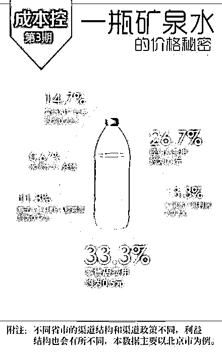
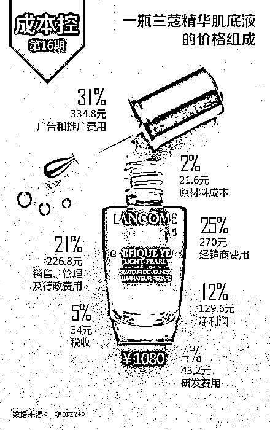

# 价格战，一场没有赢家的“内耗”？看懂这些套路你就明白了
作者：龙哥

最近总有人问：能不能不打价格战？为什么大家一说到竞争，就非得往“低价”这条死路上挤？其实，很多所谓的“低价”背后，根本不是让利，而是精心设计的商业剧本。今天咱们就撕开几个热门案例，聊聊价格背后的真相。

## 那些“惊喜低价”里，藏着什么秘密？

先说红米499元手机。你以为小米在亏本赚吆喝？实际上，供应链被压缩到极致，从螺丝到包装都能省则省；定价策略更是讲究——先用极低门槛把年轻人拉进小米生态，后续再用全家桶慢慢“收割”。零件能用老款就用老款，屏幕、处理器、摄像头，一切以“够用”为底线。真正赚钱的门道在手机壳、预装APP、开机广告上。友商看了直跺脚，山寨机老板更是欲哭无泪——这价格比进货价还低，怎么玩？

再说拼多多的“先用后付”。这招堪称心理战术的巅峰：先让你爽快下单，等还款日才反应过来，原来“白嫖”是有代价的。平台不光赚商家的通道费，还利用你的消费数据精准推荐，甚至靠催收“创收”。你图的是那点小便宜，人家图的是你的消费习惯和现金流。

还有宝马MINI卖到14.9万。听着诱人吧？但仔细一看，配置缩水、选装贵得离谱。你以为捡了豪车的便宜，其实买的是“社交门票”——朋友圈里的C位，闺蜜聚会的谈资。后续保养、维修、配件才是真正的“无底洞”。等车贷还完，二手价跌得比A股还惨。

这些案例共同说明一件事：低价往往不是福利，而是引你入局的钩子。

## 价格战的本质：囚徒困境

从商业逻辑看，价格战就是典型的囚徒困境。你降价抢市场，对手也跟着降，最后大家一起没利润。利润薄了，为了生存就偷工减料，产品品质下滑，品牌信誉受损。更糟的是，消费者被养刁了——谁便宜买谁，忠诚度荡然无存。这时候想靠差异化翻身？难了。

## 怎么跳出价格战的泥潭？答案是重构价格构成

价格不只是数字，它由基础成本、附加价值和利润分配共同决定。

**基础成本**要靠技术硬功夫。比如特斯拉用一体化压铸，大幅压降制造成本，让传统车企压力山大。不是靠降价，而是靠技术把成本打下来。

**附加价值**要能让人心甘情愿多掏钱。戴森吹风机卖得贵，但设计、科技感、品牌调性摆在那儿，消费者就是认。这就是差异化带来的溢价。

**利润分配**可以跳出“卖货赚钱”的单一逻辑。Costco会员费才是利润大头，商品毛利率控制在14%，照样活得滋润。

## 避开价格战的四条路

**第一，价值创新。** 喜茶推副品牌“喜小茶”，用不同定位覆盖不同人群，主品牌形象丝毫不损。与其在同一个战场拼价格，不如开辟新战场。

**第二，生态绑定。** 小米的智能家居把用户牢牢圈住，手机、电视、路由器、扫地机器人……一整套下来，你想换平台都舍不得。用户粘性高了，对价格就没那么敏感。

**第三，情绪价值。** 泡泡玛特的盲盒，成本十几块的塑料小人能卖79，因为用户买的是拆盒的惊喜感、收藏的满足感。你跟他谈性价比，他还嫌你俗。

**第四，反面教材与正面榜样。** 生鲜电商疯狂补贴，最后资金链断裂，一地鸡毛。老干妈呢？不涨价、不上市，品质稳定、口碑扎实，照样畅销多年。可见，靠补贴换来的规模，不如靠信任换来的复购。

## 更高维度的竞争：认知、效率与持久

品牌竞争的终极形态，不是比谁便宜，而是比谁在用户心里更值。

**认知竞争**是塑造品牌价值。苹果卖的是创新、极简、身份认同，消费者愿意为这份“认知”支付溢价。哪怕是一瓶矿泉水，只要把“长白山30年玄武岩过滤”的故事讲好，成本多一毛，售价能多两块。

**效率竞争**是运营和供应链的比拼。SHEIN靠大数据和柔性供应链，小单快反，库存周转快到飞起。众筹定价、会员等级这些玩法，本质都是通过设计机制，让用户参与进来，心甘情愿买单。

**持久竞争**要靠研发和长期主义。华为数十年如一日砸研发，筑起技术护城河。茅台呢？不用比价格，人家比的是“谁更让领导开心”。蜜雪冰城不用比高端，人家比的是“谁更接地气”。每个赛道都有自己的生存哲学。

## 拆解价格魔方：从矿泉水到茅台

价格背后的构成，其实是个“宫斗剧”。

**矿泉水**：原料成本低得可怜，但包装、物流、渠道、品牌溢价才是大头。同一瓶水，贴上依云的标签，就能在高端餐厅卖出天价。你喝的是水，还是身份？

**兰蔻精华肌底液**：原料用的是高纯度活性成分，研发投入巨大，包装奢华还有防伪技术，加上明星代言和专柜体验，每一环都在叠价格。消费者买的不是护肤品，是“贵妇”的仪式感。

**李佳琪的眉笔**：物料成本不高，但“李佳琦推荐”这几个字本身就是溢价。你花钱买的是信任，是大主播替你选品的省心，是社交货币。

**茅台**：工艺复杂、生产周期长，稀缺性加上文化符号，让它成了“硬通货”。喝茅台的人，喝的是尊贵、历史、面子。

## 老字号的启示：贵得有道理

北京六必居的酱菜为什么贵？人家讲究“六必”：产地必真、瓜菜必鲜、甜酱必醇、水必香、罐子必干净、发酵必到位。一罐酱菜，365天发酵、18道工序、6次质检。你买的不是酱菜，是时间和匠心。

再看北冰洋和可口可乐的胜负手。北冰洋输在品牌定位没能走出怀旧情怀，资本运作和市场拓展跟不上时代；可口可乐赢在全球品牌塑造和营销体系。同样是卖饮料，一个停留在回忆里，一个活成了符号。

## 写在最后

价格战是商业竞争中最简单也最危险的策略。它看起来痛快，实则杀敌一千、自损八百。真正聪明的做法，是回到价格构成本身——用技术创新压低成本，用品牌和体验抬高价值，用模式和生态锁定用户。产品贵不贵不重要，重要的是，让用户觉得“值”。

记住：拼多多说“先用后付”是爱你，宝马说14.9万是宠你，但你的钱包永远诚实。与其在价格战里互捅刀子，不如把功夫花在创造真正的价值上。这才是商业世界活到最后的终极答案。

商业世界没有新鲜事，但总有旧套路。今天聊两个汽水品牌和一个厕所清洁剂，顺便说说我对降价的真实看法。

上世纪50年代，新中国有了自己的汽水工业，一款橘子风味的碳酸饮料横空出世，它叫北冰洋。那口甜甜的橘子气，成了无数人的童年符号。可惜这个牌子后来一直把自己绑在“古城标签”上，年轻一代对它越来越无感。

情怀能让人动容，但只靠情怀，品牌就会像旧照片一样泛黄。90年代，它被外资收购后停产，2011年重新回到货架，海报上写着“熟悉的感觉”。可年轻人并不买账。

在大洋彼岸，另一个企业从1886年起就专研“快乐”这门生意。它的广告语从不强调地域，而是说“感受这一刻”“敞开你的快乐”。靠着全球化，它早已不是一个饮料，而是一种文化象征。从纽约到内罗毕，打开一瓶可乐，传递的都是欢聚与分享。这种定位让它突破疆界，俘获了全世界的心。

一边是城市记忆，一边是全球图腾。前者把买家圈在一座城，后者把品牌种进所有人心里。

再看产品逻辑。那款老汽水的看家本领始终是橘子味，经典但单调。后来又出了款酸梅饮料，也没有激起多少水花。包装和口味多年没变，很难打动追逐新潮的年轻人。

那家美国公司则不同。除了经典款，它不断推出无糖版、零度版、樱桃风味的版本，满足各种挑剔的舌头。更狠的是，它通过收购和联盟，把手伸进果汁、茶饮、运动饮料，各种细分品类都有涉足。多点开花，才让它能够在不同赛道上都占据一席。

所以一个在吃老本，一个在造帝国。更别提资本手腕——一个在被动挨打中错失良机，一个靠着主动并购布局全球。

再看浴厕清洁，也是一个讲环保，一个讲效率。一个用天然柠檬和茶树精油，味道像果园，目标客户是那些研究配料表、肯为健康买单的人；另一个用盐酸强攻，污垢一冲就没，价格实惠，快节奏的家庭主妇和都市忙人最爱。一个走心，一个走肾，各有生存空间。

最后说说价格竞争。这几年，多少老板喊着“降价！降出未来”，结果呢？整个行业被搞得乌烟瘴气，顾客手里端着一杯九块九的饮品，还在等五块钱的那一杯。

在我看来，单纯靠低价抢市场，说白了就是蛮横和欺骗。交易如果只看价格，不看额外价值，那整个商业逻辑都退化了。最终受害的，还是全体买家。

那些敢对低价厮杀说“不”的企业，都在偷偷干三件事：第一，把用户养成“非贵不买”的忠诚粉，比如苹果的粉丝；第二，把成本包装成传奇故事，比如一瓶水说自己来自欧洲雪山；第三，把对手逼成“碰瓷专业户”，比如某电动车低价上市，同行只能骂它不守规矩。

从策略上讲，降价只是敲门砖。先用低价撕开入口，再细分需求，把利润慢慢拉高，最后赚得盆满钵满。雷军玩的就是这套。

低价不可能无限持续，因为它和市场规律对着干。低价比拼从来不会有真正的胜者，只有活下来的人。

真正能形成维度碾压的，是综合成本优势；其他花哨手段，不过是营销剧本。

所以奉劝各位老板：压价只能救一时，品牌价值才能管一世。

说到底，败者败在固守一角、产品单调、营销乏力、资本被动；胜者胜在全球视野、品类丰富、持续输出文化和主动整合资源。

最后送你一句话：生意场上没有免费的午餐，只有各取所需的局。要么练出一双火眼金睛，要么学会享受这种局。人生就像一场戏，消费就像一盘棋，落子就不回头。

这是我本人的照片，谢谢大家。

* * *

评论区：

三三 akuri : 这是不是 deepseek[偷笑]