DeepSeek 又崩了？别急，三个备用招，R1 照样聊到飞起

最近 DeepSeek 真是火出了圈，全球用户疯狂涌入，注册量直线飙升，网页端和 API 都被挤到短暂罢工。

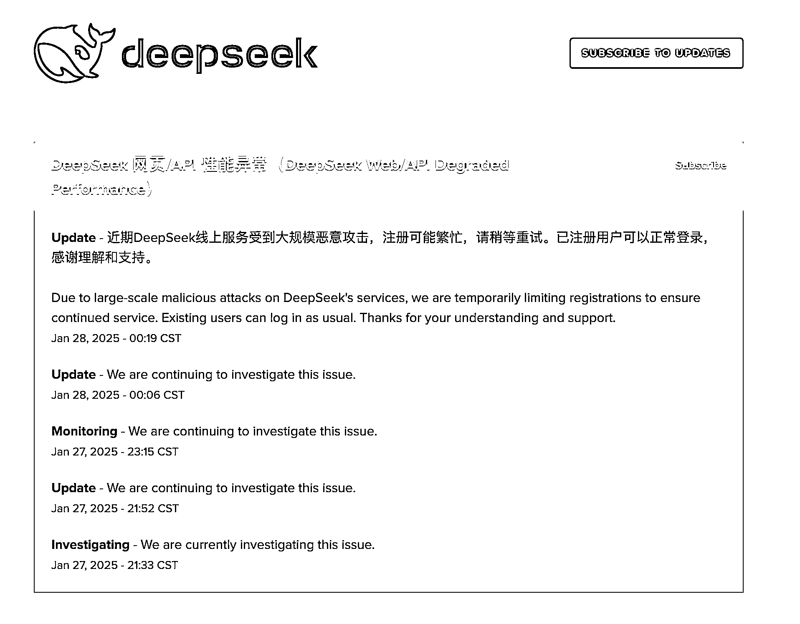

为了给服务降压，官方暂时限制了新用户注册，现在只接受 +86 大陆手机号。不过别慌，就算服务器紧张到崩溃，依然有办法把 R1 聊下去。今天就给你支三招。

第一招：多备几个账号，轮着用

网页版每天免费提供 50 次深度思考（R1 模型）机会，用完就触发限制。

办法非常简单：换号。趁过年用家人手机号多注册一个账号，哪个被限制就换哪个，聊天根本停不下来。

第二招：切换到 API 通道

网页和 API 是两条独立通道，网页崩了 API 不一定挂。想要继续聊，直接改用 API 是不少老手的首选。

先去 DeepSeek 开放平台注册登录，地址放在这：platform.deepseek.com/usage。

登录后，你会看到类似这样的界面。

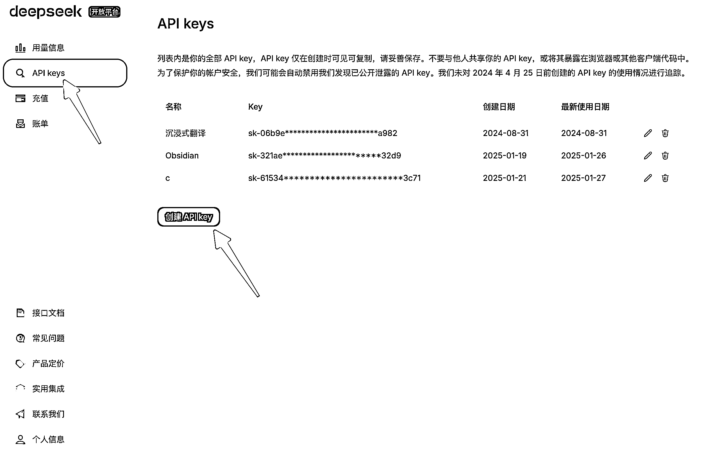

然后，在后台找到 “API Key”，点击创建。

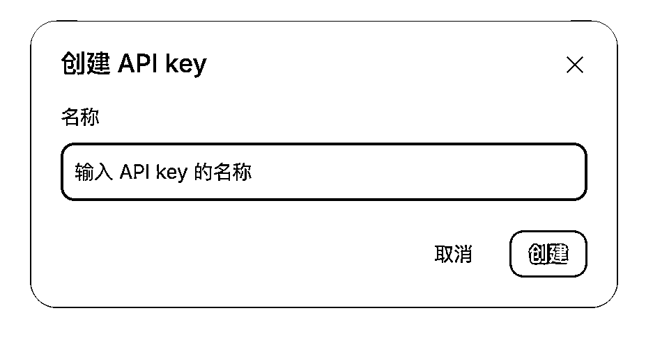

名称随便写，生成后马上把这串 key 复制保存好。它是你的访问凭证，谁拿到手，谁就能用你的余额调模型。

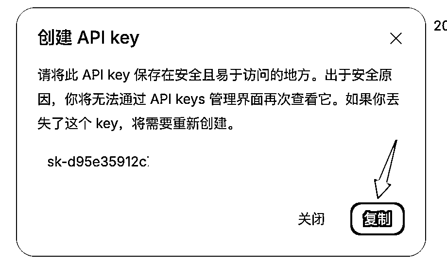

费用别担心，V3 和 R1 的定价低到感人，先充个 20 块基本就能敞开了用。

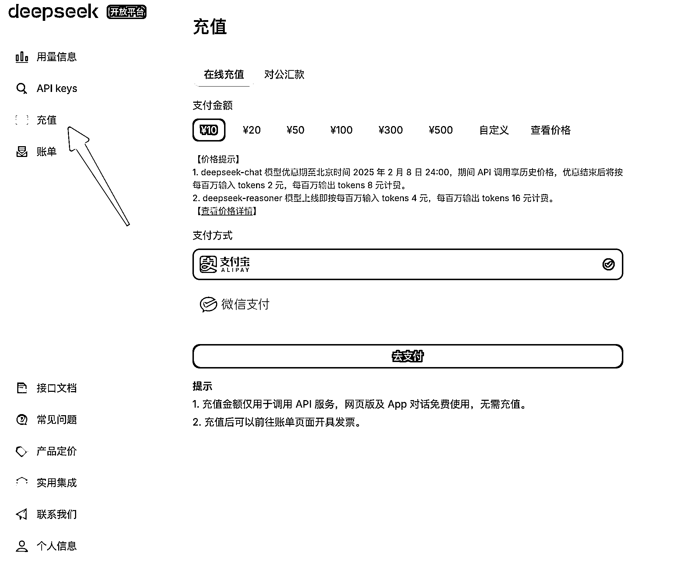

有了 key，还要一个能填 key 的客户端。推荐 CherryStudio，它支持 Windows、macOS 和 Linux，以后还会有移动版。下载地址：cherry-ai.com。

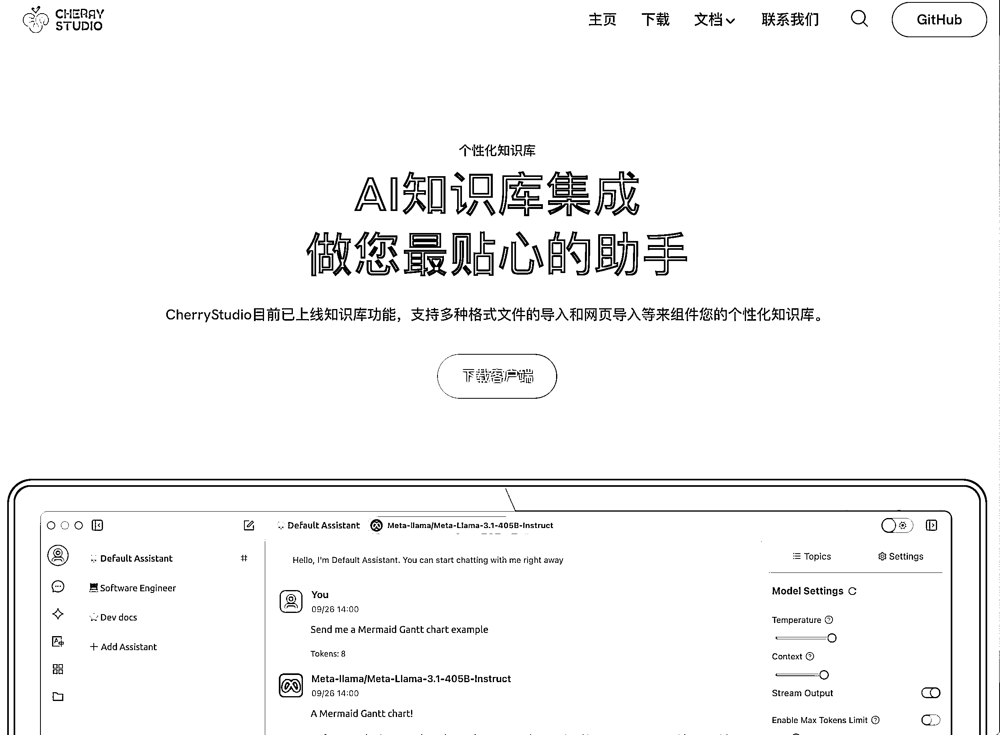

安装好后，在软件设置里把刚才的 API key 填进去。

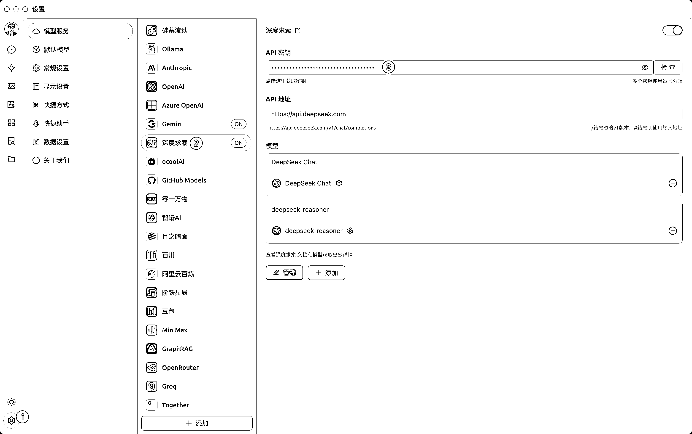

填完就能直接和 DeepSeek 对话。

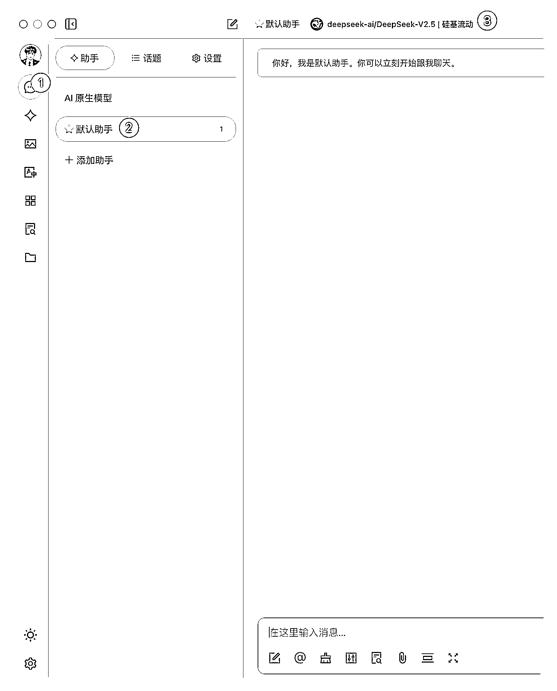

进聊天界面后，把模型选成 DeepSeek。

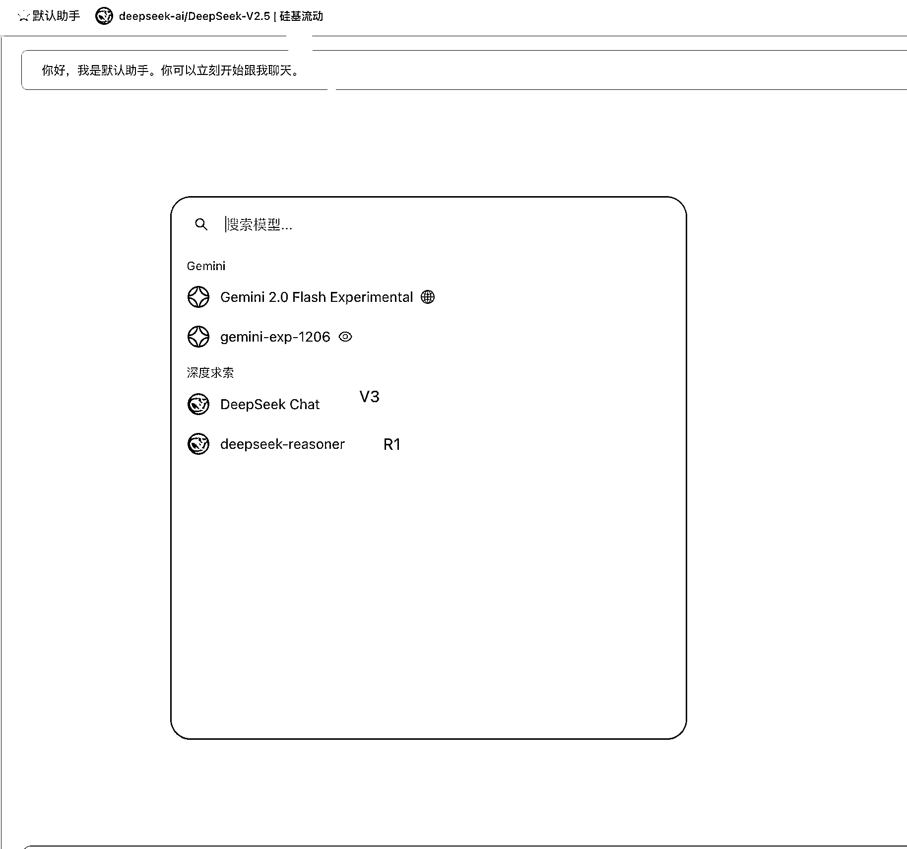

列表里 DeepSeek Chat 对应 V3，DeepSeek-reasoner 对应 R1，认准再点。

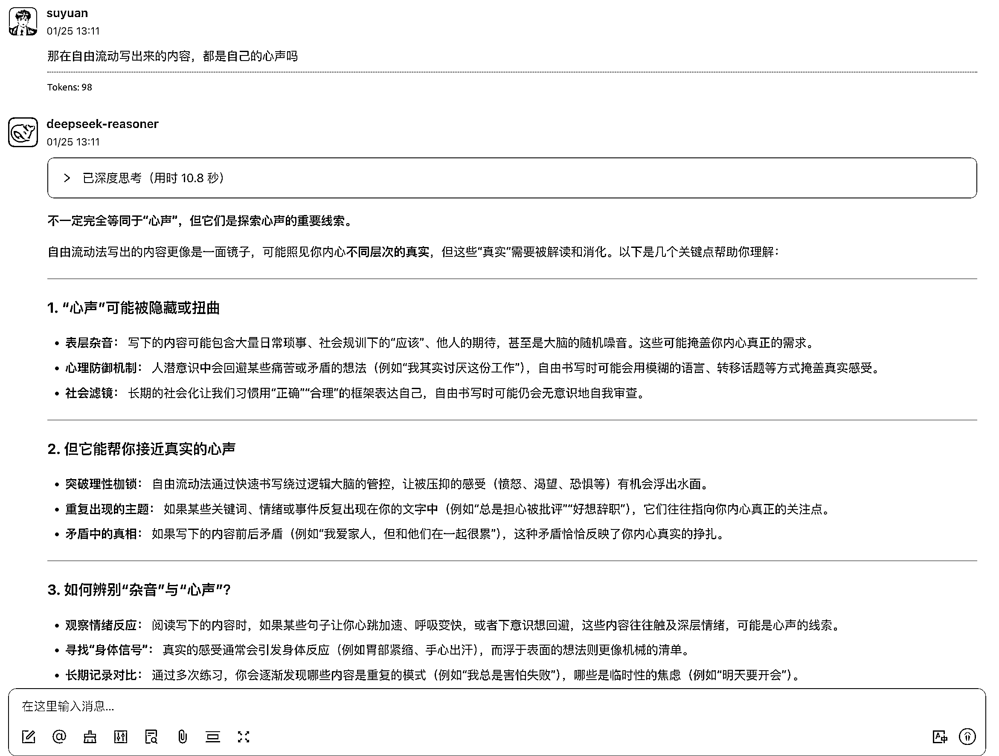

这样，就算官网再挤，你也能稳定聊 R1。

第三招：蹭第三方的免费部署

R1 是开源模型，很多第三方平台已经把它部署在自己的算力上。比如 Together AI，目前可以免费白嫖（不过需要特殊网络）。网址：www.together.ai。

注册并登录后，在后台 Playground 里选择 Chat，再选中 R1 模型，就能直接开整。

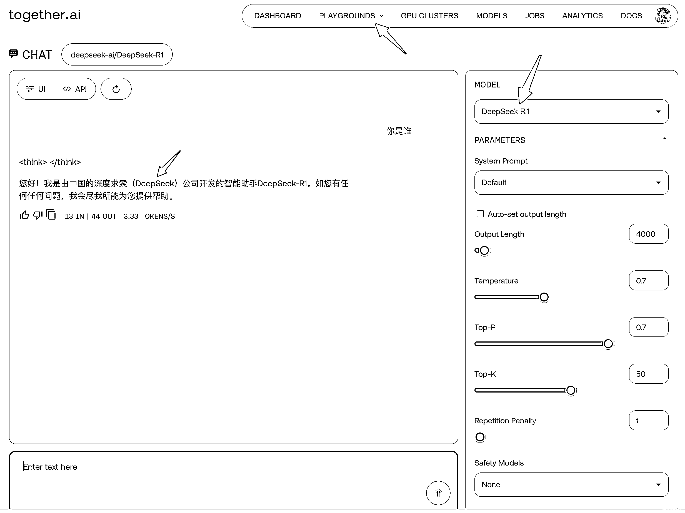

写了这么多，再聊点感想。

除夕的夜空如此璀璨，而我们恰好站在一个不平凡的节点上。DeepSeek 这名字背后，藏着“探索未至之境”的野心。它早已不只是工具，更像一座灯塔，为 AI 探索照亮了新的方向。这个时代，人人都能成为开拓者——无论是开发者、创作者，还是普通用户，都在参与定义 AI 的未来。游戏科学的冯骥甚至用“国运级别”来评价这次突破。

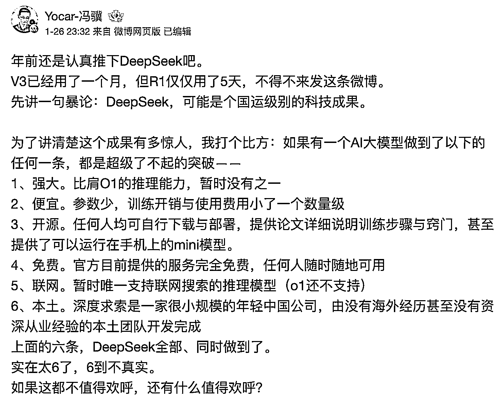

他还留下了三条建议，我帮你转述：

第一，别等着，马上用起来。
第二，放开了用、变着法地用，试着让它逐步取代传统搜索。把 DeepSeek 当成一群随时在线、各领域的顶尖专家朋友，所有你想“请教别人”的事，都先丢给它：比如写一个复杂函数，查查附近哪个游泳池口碑最好，扫一遍合同里的法律陷阱，给新写的歌词润润韵脚，或者帮爸妈验证一下某个保健品到底有没有用。
第三，多看看别人怎么用，也亲自试试其他大模型，搞明白 AI 擅长什么、不擅长什么，学学怎么调教它，然后持续迭代出属于你自己的用法和工具库。

这几招也许不华丽，但关键时刻真能救急。觉得有用的话，点个赞再走，咱们下篇见～