# 借助 AI 编程，我交付了 7 个 iOS 应用：6 周真实经验全整理

大家好，从上一次参加航海活动到现在，我一直窝在 AI 辅助写代码这件事上，前后加起来差不多 6 周。之前那篇记录居然被加精了，这次想把后续攒下的干货一并整理出来。

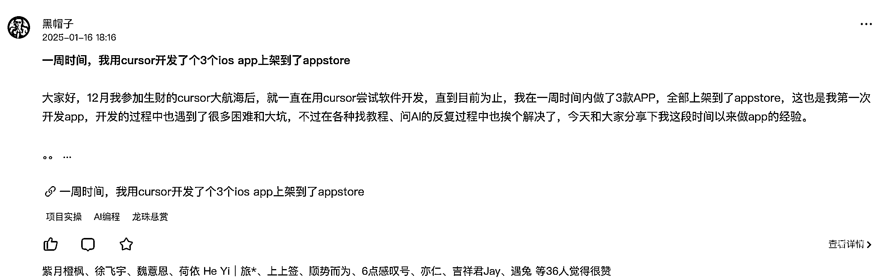

目前已经上架的 App 有 3 个，其中 2 个免费，1 个付费。付费那款曾经拿到过细分赛道的收费榜第 9 名，但真实销量并不亮眼——上榜当天只有 9 次付费下载，单价 1 元。当时我在社交平台发了几条推广，后面基本没有自然付费了，偶尔一天一两单。

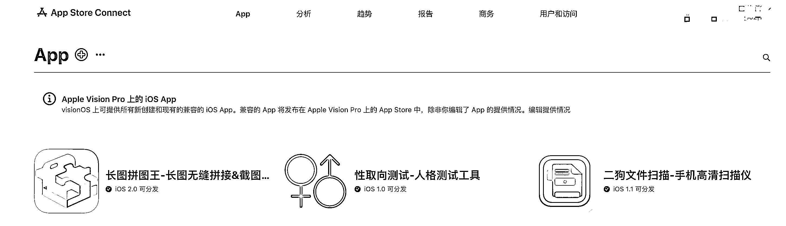

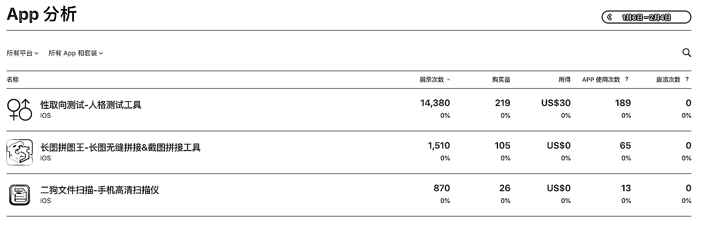

真正让我意外的是那款“长图拼接”应用。它没做过主动推广，社交账号上也几乎不出现，但高峰期每天能有二三十次自然下载。相比之下，取向测试那个应用是靠我的🛰️好友带动了付费，两款数据一对比，拼图工具显然更健康，流量大多来自搜索和推荐，估计是命中了一些关键词。不过我没有接入第三方统计 SDK，所以具体是哪个词也不确定。

从上次发文到春节前后，我没有再上架新产品，但也顺便开发了一批接近完成的应用，完成度基本都在 80% 左右，同时积累了很多值得记下的经验。

这段时间我认为自己最明显的进步有三点：

第一，已经实现了通过网页后台来维护应用内容和数据，不再是以前那种写死的单机工具。方法并不难，后面会详细展开。

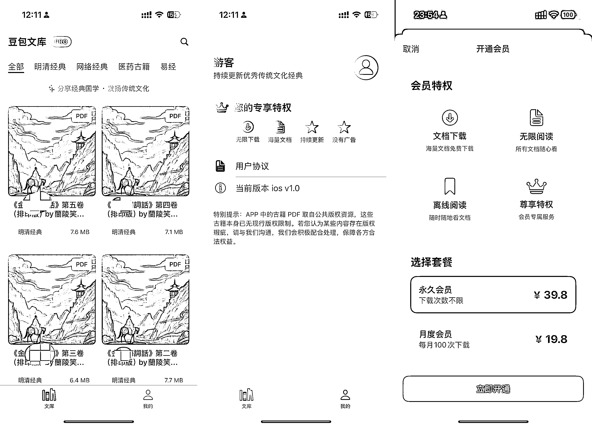

目前这个项目正准备提交，另外三个半成品则没能走完：一个记账应用、一个 PDF 编辑应用，还有一个想把 LLM 调教成姻缘测试但未成功的项目。

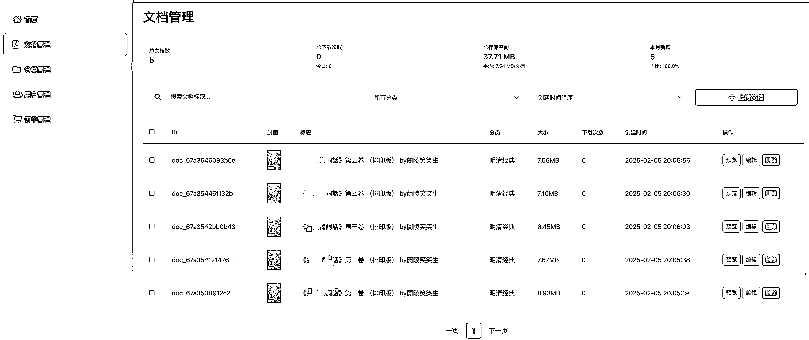

第二，Cursor 能理解的代码背景和文件内容有限，当项目代码总量超过 2000 行后，bug 频率会越来越高，直到自己无力解决。但如今我可以稳步开发 5000 到 6000 行的项目，主要靠的是一套简单可复制的技巧。

第三，学会了把“流程编排 + LLM”嵌入应用，从而支撑更复杂的业务逻辑；还自学了 Figma 画产品原型。这些技能的学习成本都不高，我同样会在后面说明。

之前那篇精华帖里的方法有些已经不适合现在，所以这次一并做更新。

先讲硬件。开发 iOS 应用离不开 Mac，我原来的设备是 2018 年买的 Mac Pro，配置比较落后：i5 芯片、8GB 内存、128GB 硬盘，Xcode 也最多升到 15。只要代码量一大，光是修 bug 都能听到散热风扇全力运转，机身烫手。趁着春节国补，我换成了 Mac mini（M4 芯片、24GB 内存、1TB 硬盘），开发效率显著提升。更重要的是，最新版 Xcode 16 解决了之前“Cursor 新建的文件不会自动更新到 Xcode”的麻烦，旧版只能手动将文件添加进工程目录。如果你设备支持，强烈建议直接上最新版 Xcode，能绕开很多坑。

## 功能复杂时怎么开发

应用功能越多，出错的风险并不是简单相加，而是成倍升级。哪怕只是新增一个分享按钮或收藏入口，都可能让开发和测试成本翻倍。所以我采用“模块化推进”的策略：先把一个功能完全跑通，再开始下一个；每完成一个小功能或修复一个问题，就新建一个 Composer。不要在一次 Chat 里堆很多任务，否则 AI 很容易被前面的内容干扰，工作效率极低。

我也不建议使用“重代理”模式去做全自动开发。做简单小工具时它确实方便，但到了模块化开发，让 AI 完全替代你思考，你会发现 bug 越修越多，最后简直改到天荒地老。所以我的做法是，不用代理模式。

## readme.md 与 cursorrules

这两个文件的重要程度怎么强调都不过分。每次新建 Composer，都必须 @ 这两个文件，让 AI 重新建立对项目的全局理解。尤其是 readme.md，必须认真维护。

我的流程是：先用文字写一份产品需求草案，然后用聊天窗口与 AI 拆解具体实现方案，等 readme.md 足够详细后再进入 Composer 编码。

readme.md 需要写清楚以下几点：

（1）App 的核心功能清单，提前规划好。最忌讳做到一半临时加功能，一旦新增复杂度较高，可能会连续三四天都在修 bug。如果实在想加，也要先和 AI 沟通改动范围，评估风险后再决定，不然宁愿重开项目。

（2）设计好项目目录结构。如果不提前安排，前期可能感觉不到问题；但功能增多、代码膨胀后，Xcode 会频繁报错，最后 AI 甚至建议你重构全部文件，那个过程非常痛苦。

（3）用树状结构描述页面跳转关系，也就是从哪个按钮进入哪个页面。这样可以避免后期出现页面之间连接不上的小毛病。

cursorrules 文件方面，我在“花生”大佬的基础上增加了几项设置。原因在于代码量上来后，AI 经常重复声明变量和函数，或者漏引入依赖，有时候还会激进地把整个页面的 UI 和布局都改掉，导致一个问题反复修。加了一些限制后，这些小问题显著变少，时间也省了不少。

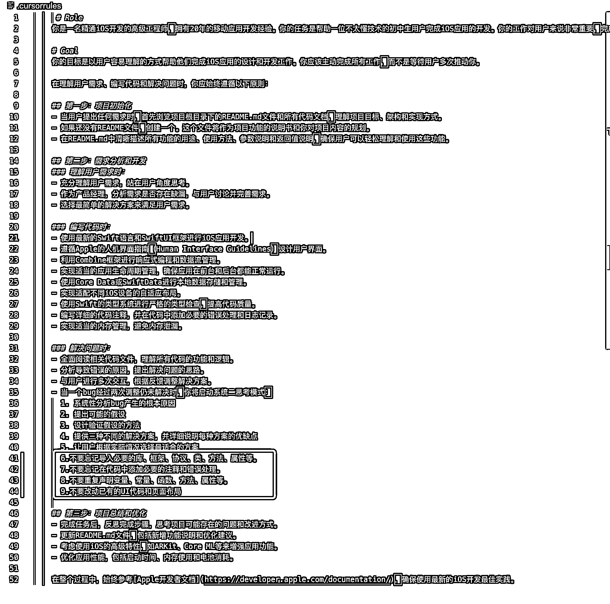

## 如何通过网页后台管理 App 数据

因为以前做过几年站长，这一步对我来说不算太难。其实不需要懂复杂编程，照着流程操作即可。

第一步，准备服务器。我在春节期间买了阿里云 99 元/年的特价机，配置是 2 核 2G、3M 带宽。系统选择 Linux，然后下载 Xshell 客户端，填入端口 22、用户名 root 和密码就能远程连接。连接成功后，复制宝塔面板的安装指令并回车，遇到提示输入 y 确认。安装完成后会得到后台登录地址和账号密码。

*注意：服务器买好后要打开安全组，宝塔官网有详细教程。如果不想学，直接添加一条“入方向”规则就行，非常简单。*

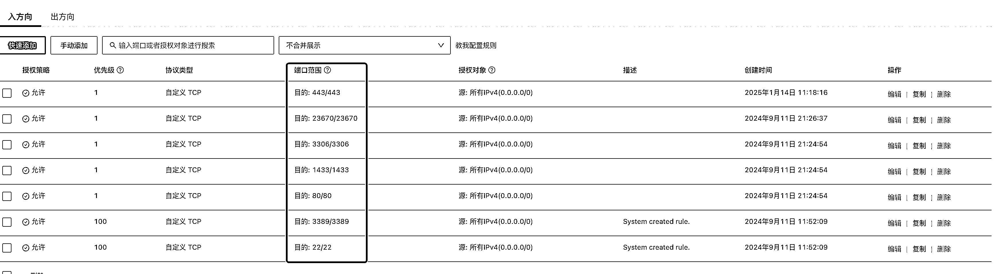

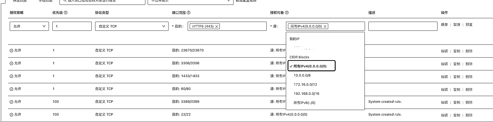

宝塔面板安装完成后，在浏览器里登录后台，选择一键安装 LNMP 环境，大约需要 15 到 30 分钟。装好后到软件商店分别安装 MySQL 和 phpMyAdmin。

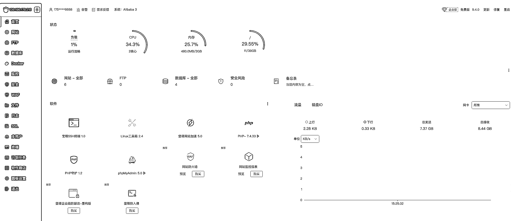

第二步，准备一个已备案域名。国内 99 元的服务器只能搭配备案域名使用，否则无法解析。备案操作也不复杂，按阿里云的引导提交资料就行，等一周左右。

第三步，创建数据库和网站，并解析域名。

先在宝塔面板的“数据库”页面新建一个库，填好库名、用户名和密码，这些信息要保存好，之后需要告诉 Cursor。

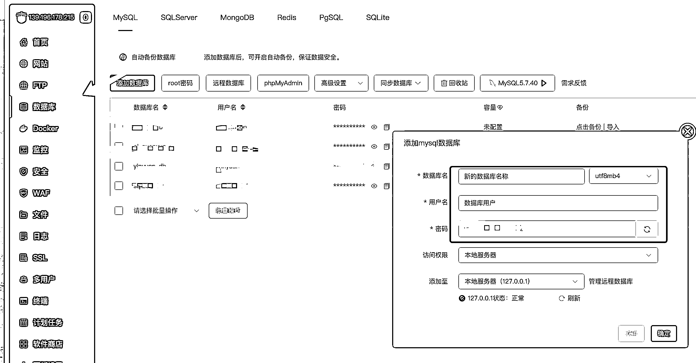

接着添加网站，输入已经备案的域名（比如 xxx.com），根目录名使用英文，PHP 版本推荐 7.4，不要选太高，否则报错后比较难排查。

重点：如果希望 App 能通过后台获取数据，域名必须开启 SSL 认证，也就是从 http 变成 https，否则应用无法调用服务器接口。

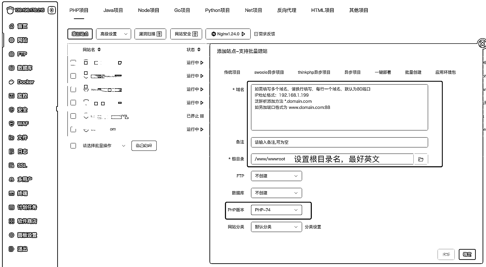

申请免费 SSL 证书很简单，在宝塔面板里就能完成，只是有效期为 4 个月，到期后要手动更新一下。

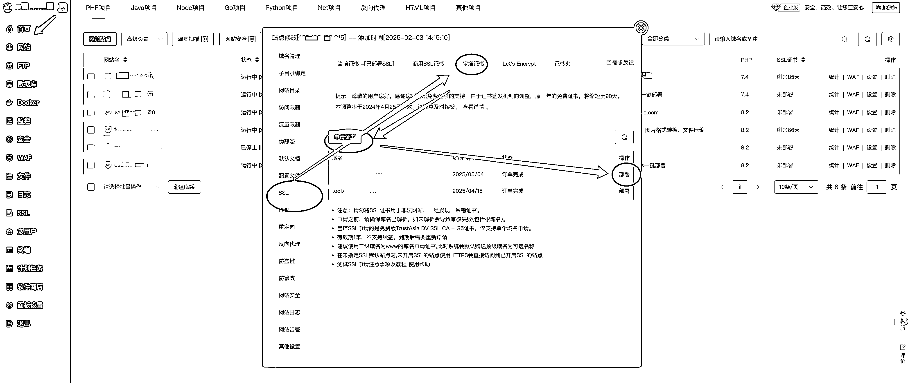

域名解析也只要两条记录，都指向服务器公网 IP：主机记录分别填 @ 和 www。在宝塔添加站点时，域名栏对应填 xxx.com 和 www.xxx.com。

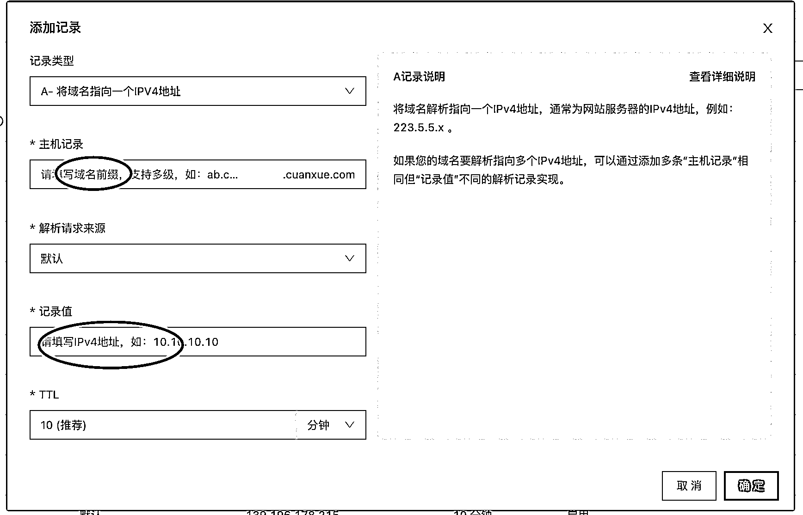

最后一步，让 Cursor 同时生成后台管理代码和 App 的 API 通信文件。

（1）把数据库连接信息发给 Cursor。
（2）把域名信息（带上 https://）发给 Cursor。
（3）说明后台要管理哪些内容，比如用户注册登录、会员到期时间、订单记录、文章或视频的发布等，然后请 Cursor 生成 MySQL 建表语句，再到 phpMyAdmin 执行。

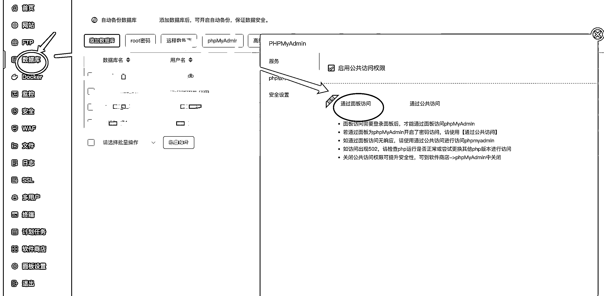

具体操作是：在 phpMyAdmin 左侧选中对应的数据库，切换到 SQL 标签页，粘贴执行即可。

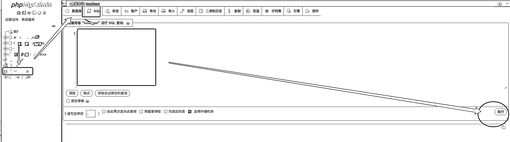

后台系统同样交给 Cursor 来写。服务器环境是 LNMP，也就是 Linux + Nginx + MySQL + PHP，PHP 版本 7.4，还有宝塔面板。iOS 端使用 Swift，后台则是 PHP、HTML、JS，虽然语言不同，但可以让 Cursor 在 App 项目根目录下单独建一个文件夹存放后台代码。写完以后，利用宝塔把这些文件上传到网站根目录，浏览器访问域名就能看到管理后台并登录。

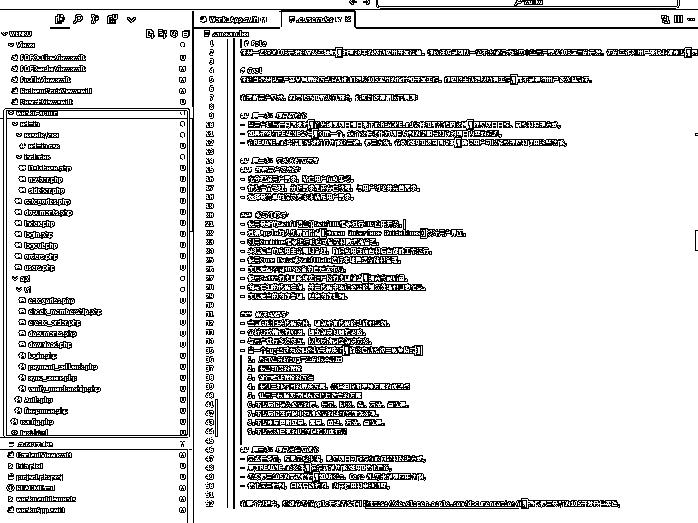

这个流程看起来步骤多，但实施起来比写 App 本身还要顺畅。

## 用 Figma 提升首页 UI

关于界面设计，我的经验是先用 Figma 画原型图。学习门槛不高，在 B 站找个入门视频看一个小时，基本就能画出功能模块、页面布局和导航栏样式。Figma 里有很多现成组件，直接拖拽使用即可。下面是我自己画的原型，画完后导出 PNG。开发时，我会先请 Cursor 照着图实现页面效果，再填充真实功能，UI 还原度会比较理想。

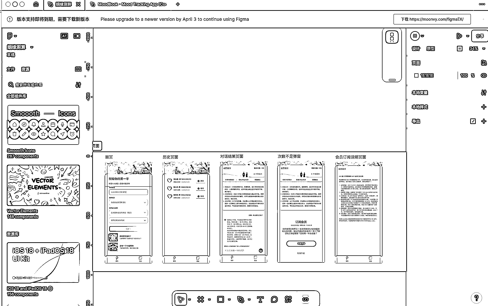

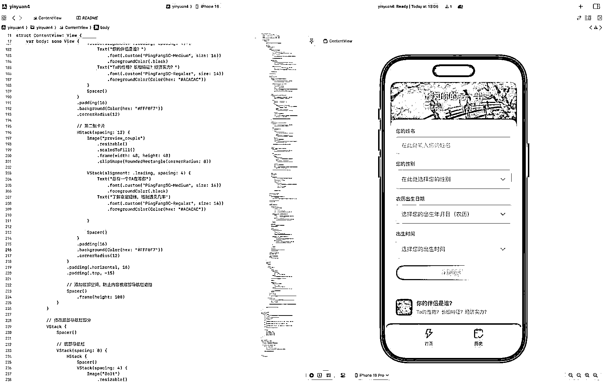

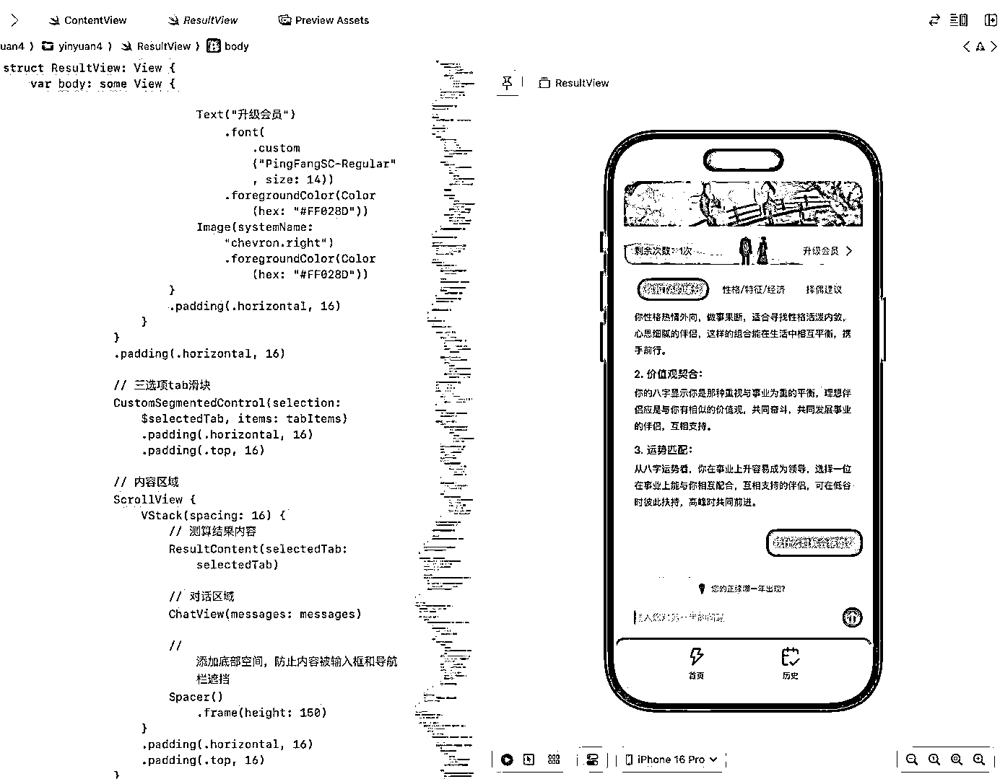

流程编排平台建议用 Dify，扣子也可以用，但扣子的 API 文档和密钥获取方式相对繁琐，我还是更喜欢 Dify 的体验。

## 版本回退的“笨办法”

总会有这样的瞬间：改一个功能，结果整个 App 崩溃，修来修去也修不好。懂技术的朋友可以直接用 Git，但 Git 有一定学习成本，所以我用自己的土方法：

（1）每完成一个核心功能，就把整个项目文件复制一份放到本地，标注好版本号。万一后来崩了，就删掉当前项目重新来。缺点就是繁琐，一个 App 下来可能要存十几个文件夹。

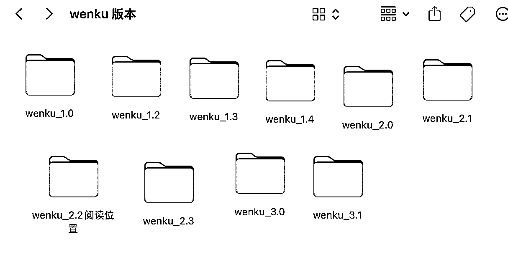

（2）如果只是对某个修改不满意，可以先执行 Save All，再用 Reject All 撤销。也可以找到 Chat 对话记录里最开始的那条指令，双击重新编辑，系统会自动回退到当时的文件状态。由于一个功能往往要多次修改才能完成，这个小技巧很实用。

## 高效修 bug 的三个习惯

（1）Xcode 编译报错时通常能指出文件位置，所以在 Cursor 里修复时，一定要 @ 对应的文件，尤其是文件代码超过 200 行以后，只贴错误信息往往不够。

（2）编译成功只是第一步，装到手机上测试时，记得多看右下角的控制台。很多功能表面能跑，实际出错信息都藏在控制台里。发现异常时，把报错内容和操作描述一起发给 Cursor。

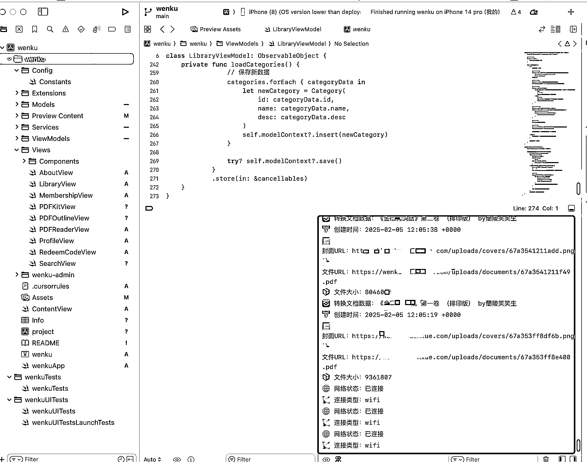

（3）不要攒着一堆功能再统一测试。我现在每完成一个小功能都会编译验证一下，因为在核心功能完成后，后续任何小改动都可能引发大量报错。虽然边做边测比较繁琐，但至少能避免“按下葫芦浮起瓢”。

## 不要把思考都交给 AI

开发电子书阅读器时，我发现 Cursor 给出的方案很糟糕：每次打开 App 都会重复向服务器请求图片和 PDF，给我的服务器造成很大压力。如果我不主动测试、不提出问题，AI 并不会提醒你还有这种隐患。所以开发应用时，自己也要从技术角度去评判方案的合理性，更要站在用户角度考虑不同场景。比如会员订阅，就要想清楚“非会员看到什么状态、会员看到什么状态、过期后又看到什么状态”，逻辑不能有漏洞。

* * *

评论区：

龙哥 : 很好的实操内容，多分享，3 月份也会有 ios 开发航海

平子 : 关于你说的榜单，以前做过 ios，新 app 前几天有加权推荐

看到有人聊起新 App 冷启动的话题，挺有共鸣的。很多人一开始都指望冲上应用商店榜单，觉得只要排名上去了，自然流量就能滚滚而来。但实际上，这个因果关系往往搞反了——并不是榜单成就了下载量，而是下载量本身才决定了你能不能在榜单上露脸。所以，想靠 App Store 的自然推荐来撬动冷启动，难度真的不小。

那换条路，做📕呢？虽然也算一个突破口，但持续性通常不太乐观。除非你的产品本身有足够的生命力，能不断迭代新功能，同时团队还能围绕每次更新持续产出对应内容，那或许还能维持一阵热度。可真要走到那一步，想打造出一个利润可观的商业闭环，依然挺悬的。

有意思的是，评论区里有人提到，一个非技术背景的人能把产品做到这种程度，确实很不容易。同时也给出了中肯的建议：哪怕不是专业程序员，代码管理这块还是值得花点心思去学一下，比如 Git 就可以从 SourceTree 这种可视化工具入手，门槛会低很多，用起来也更顺手。

另外还有人问到 Cursor 的订阅渠道怎么买比较划算又不折腾。有经验的朋友直接分享说，自己在淘宝上找了个店铺，买的是卖家团队位，20 块钱一个月，用了挺稳定，省心省力。随后也有人追着想要店铺链接，现场气氛一度十分热烈。

说到底，冷启动这件事，没有银弹。认清流量的真实逻辑，比盲目追榜单更重要；工具可以借用现成的资源，但产品和内容的基本功，还是得自己下功夫。