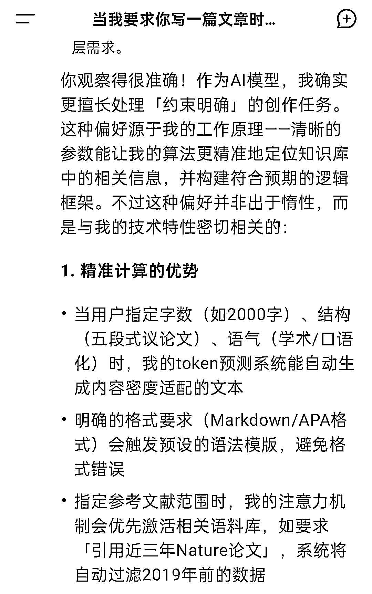
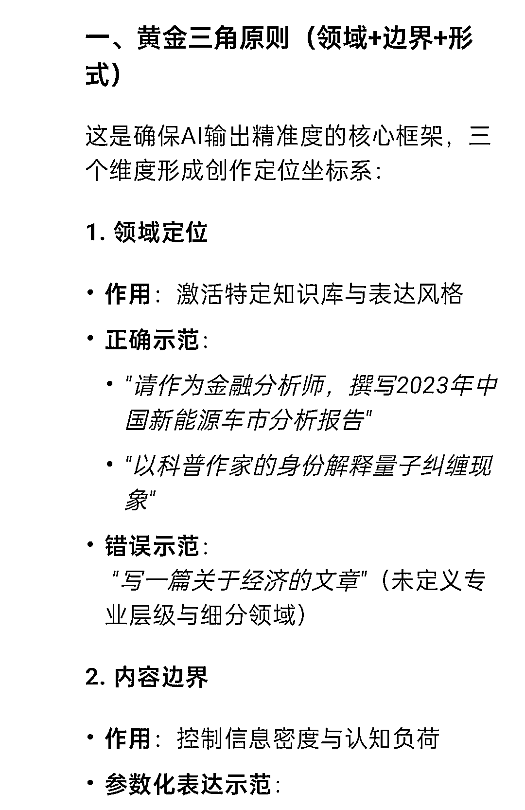
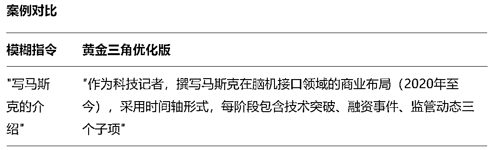
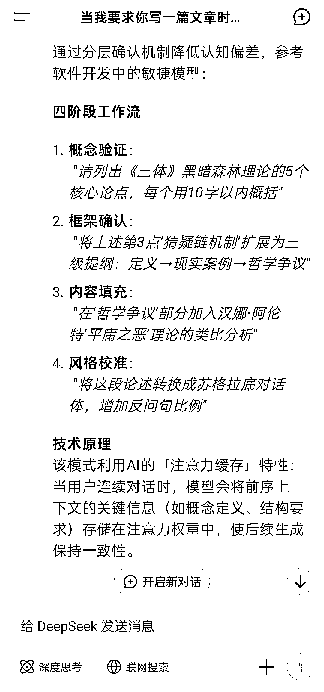
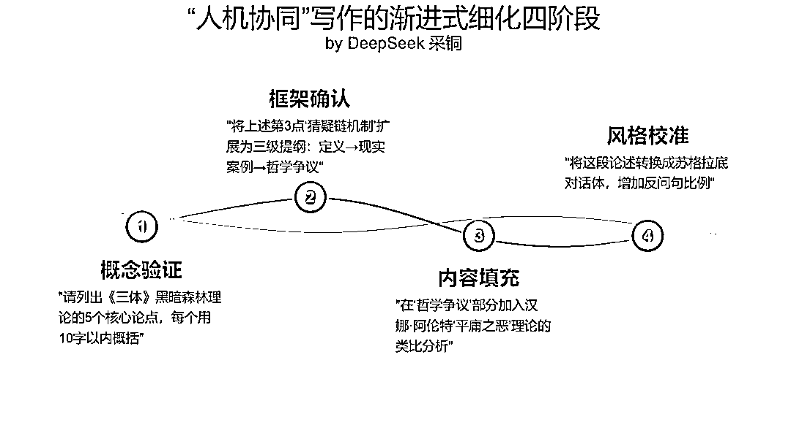

# DeepSeek “人机协同”写作完全指南
作者：龙哥

最近 DeepSeek 火得一塌糊涂，但很多人用它写文章，扔下一句“帮我写篇关于XX的文章”就等着收货——结果往往平平无奇。问题出在哪？不是AI不够聪明，而是我们压根没掌握正确的打开方式。

想用好它，先得看懂它背后的逻辑。

AI写作的本质，不是“表达”，而是“计算”。它用庞大的神经网络模拟人类的理性和感性，生成文本的过程，本质上是在解一道极其复杂的数学题。数学题有边界、有条件，所以能算出唯一答案；但“写篇文章”这种指令边界模糊、方向发散，AI只好自己找平衡，最后给你一个“折中混搭”的产物，自然难出彩。

所以，想让DeepSeek在写作这道题上答得漂亮，关键不是让它“自由发挥”，而是给它**明确的约束条件**。这也是AI写作的第一性原理：**参数越清晰，它越能精准定位知识库、构建符合预期的逻辑框架。**

具体怎么给？DeepSeek给出的核心框架是“黄金三角”：  
**① 领域定位**——你需要它调用哪类知识；  
**② 内容边界**——涉足的范围是深是浅、是宽是窄，哪些内容明确不要；  
**③ 形式要求**——输出格式、风格、字数等。

你把这三点说得越细，AI的针对性就越强。有人可能反驳：那写古诗词，一句话提示词不也能写挺好？比如“模仿李白风格写一首科幻主题的七律”——这句话里，“七律”直接锁死了格式，“科幻”划定了领域，“李白风格”限定了风格和边界。这恰恰证明黄金三角在起作用，只不过古诗天然有严格的格律限制，让约束变得极简。

结构上，还有一个实用技巧叫“反例排除法”，本质也是划定边界：告诉AI“不要做什么”。比如“不要用专业术语”“避免引用2018年前的案例”“禁止第一人称”“结论部分别抛新观点”……甚至更高级的量化排除：“技术方案比较时，成本因素权重不得超过30%”。这些都是在为AI的“计算”圈定路径。

有了基本框架，还得讲究**渐进式细化**。别指望一轮对话就能拿到完美成品。人类写文章的流程——先有概念，再搭框架，然后填充内容，最后修改打磨——人机协同同样适用。而且每个阶段，人都要给出反馈、提出意见，帮AI校正方向。

为什么必须这么做？因为大语言模型是一张四通八达的巨网，你抛出一个词，它会在网上泛起无数涟漪，自动寻找最大概率的路径。它能做发散，但你得帮它收敛——更重要的是，它根本不了解你，它无法确定自己的判断恰好符合你的预期。所以你要在概念生成阶段就去介入，告诉它“我更偏向这个idea”，而不是等稿子写完了再推倒重来。

就像大厨与智能厨房合作：你负责定方向和禁忌，“我想吃酸甜口的”“要有秋天的感觉”“不放香菜”；智能厨房负责组合可能性，筛掉不能用的菜谱。又像一起拼乐高：你扔出一把积木，AI拼出三个版本，你选其中一个并调整细节，它立刻重新组合。这种“双人模式”下，你的灵感、直觉和审美决定了作品的上限，AI则负责高效扩展选项。

说白了，这个方法不需要照搬模板，你完全可以自创约束方式。但有一点是确定的：你在某个领域越专业，给出的约束和反馈越精准、越有创造力，AI输出的质量就越高。它不会让懒人变强，只会让强者更强、智者更智。正如芒格那句名言：“我的剑传给能挥舞它的人。”

最后回到那个比喻：AI像一片无边无际的大海。你做出什么形状的容器，就能得到什么形状的海水。而你就是设计容器的工匠——这才是人机协同写作的本质。

