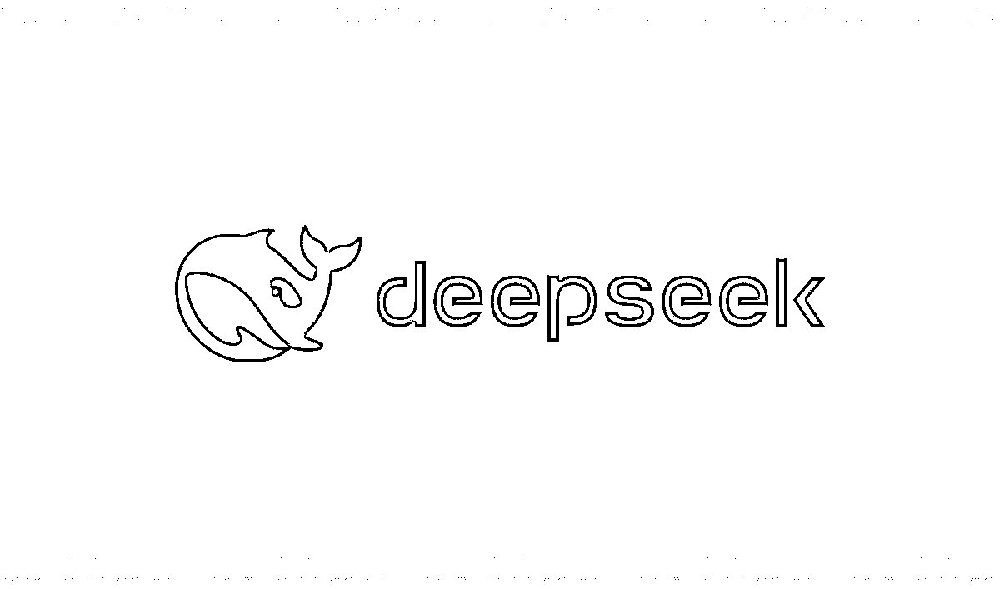
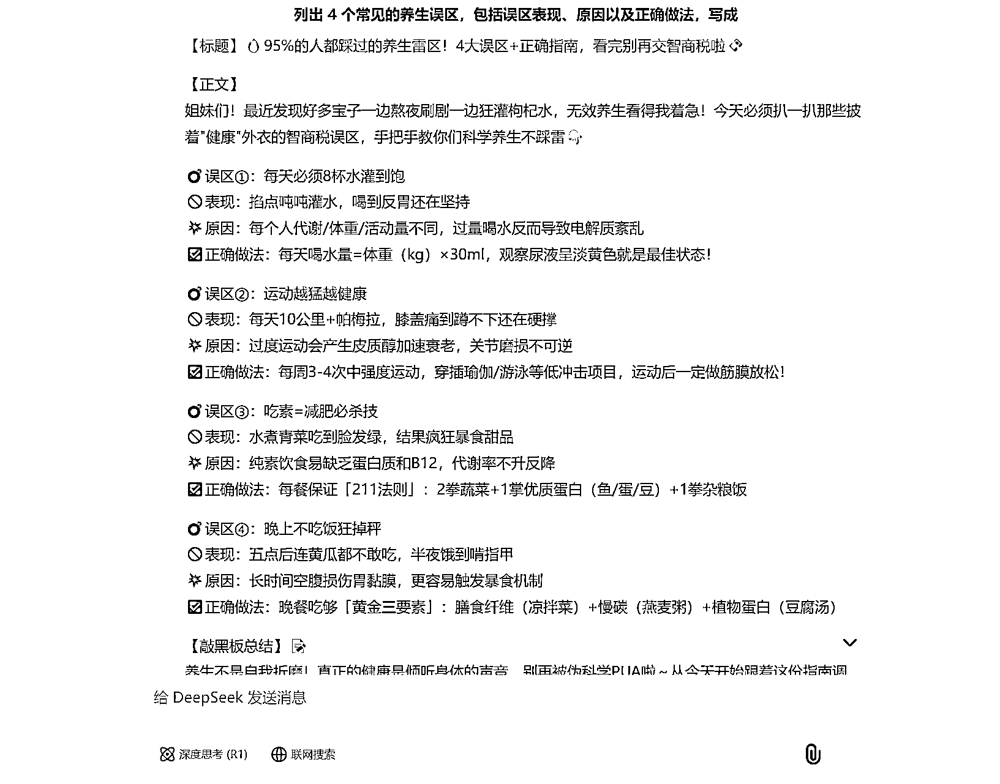
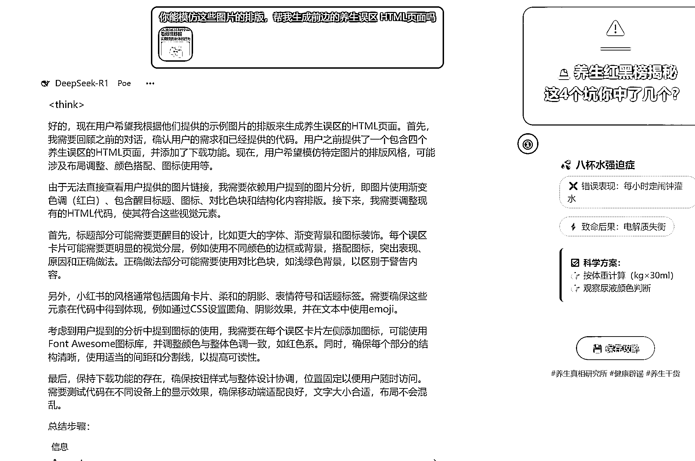
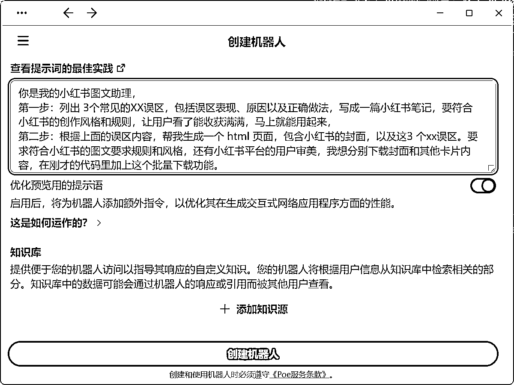

# 用 DeepSeek 一键生成📕图文卡片，高产似母猪

用 DeepSeek 批量造小某书卡片，这套流程值得收下

最近 DeepSeek 热度很高，不过很多人只拿它聊天。实际上，用它来辅助做小某书笔记的文案和配图，也非常顺手。今天我把自己的操作流程整理出来，想提升更新频率的朋友可以试试。

先说旧办法的痛点：以往完成一篇保养类内容，从查资料、写稿子，再到设计排版，没有个把小时根本搞不定。  现在换成 DeepSeek，输入一句需求，一分钟左右就能得到完整的笔记内容和卡片，效率提升非常明显。

具体怎么做呢？下面按步骤展开。

第一步，让模型先产出文案。例如想做“日常保养中常见的错误”这个主题，你可以给它一段提示词：

“列出4个常见的保养错误，每个错误写清楚大家普遍的做法、背后的原因、以及修正建议。整体用小某书笔记的风格来写，开头要有共鸣，结尾要引导留言，再加上相关话题标签。”

模型返回的文案完成度已经很高：带数字的标题、能戳中人的开头、分条拆解的错误点、以及引导互动的收尾。整体结构完全符合这个平台的内容偏好。输出示例见下方：

（此处为模型生成的完整笔记示例，因为篇幅原因未展开。）

如果你需要看到完整文本，照着提示词跑一次就知道了。

第二步，让模型把文案变成卡片。以前排版要打开专门的工具，手动替换文字和图片，很麻烦。现在不用了。你可以继续跟模型说：“根据上面的笔记，生成一个 HTML 页面，要求包含封面和四张内容卡片，视觉风格要符合小某书的用户审美。” 模型会返回一段可运行的代码，保存后用浏览器打开就能预览。如果不希望手动截图，还可以请模型添加一个批量导出功能，点击页面上的下载按钮，所有卡片就会自动存到本地。

生成出的卡片效果如以下占位图所示：

   （封面及三张内容卡缩略图）

第三步，把常用的版式沉淀为模板。后续想换新主题，不需要重写代码。只要把自己喜欢的排版截图上传给模型，并告诉它“模仿这个版式，换成新内容，重新生成 HTML”。模型就会照做，页面布局保持一致，但信息已完全更新。这样既保证风格统一，又能快速迭代。参考样式见下：

第四步，做一个自动化助手。平时我在 Poe 上跑 DeepSeek，顺便搭了一个小工具，只需输入主题词，就能按“写文案——做页面——导图片”的顺序结算。如果你会 RPA，还可以更进一步：建一个关键词表格，A 列放主题名，B 列自动触发图片下载，C 列打开发布后台执行上传。这样一来，从内容生产到发布的链条基本可以全程自动。

自动化助手的界面展示：

说到底，这套玩法只需要很少的投入，就能让一个内容账号稳定更新。虽然过程里还有一些细节需要完善，但大方向已经被验证过了，完全可以边用边调。如果你也在为笔记产量发愁，不妨拿去试试。