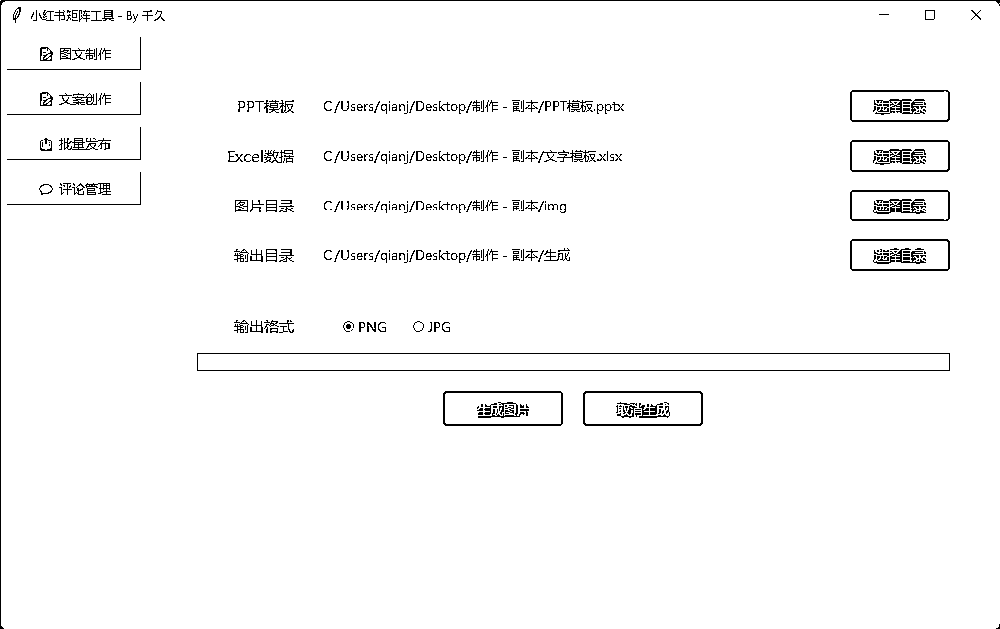

# 如何通过 Cursor 编写📕图文批量生成工具

零基础也能上手！今天分享一个超实用的 Cursor 实操案例——批量产出📕图文的小工具是怎么一步步做出来的。作者千久表示，整个开发过程其实算不上复杂，真正让人头疼的是调试环节，特别容易绕进死循环里出不来。

为什么会这样？因为用 Cursor 搭建这类工具时，通常有两条路线可选：一条是走 Python-pptx 内置模块，但文字排版样式很难做到精准控制；另一条则是调用电脑上已安装的 PowerPoint，借助隐藏窗口执行脚本，可一旦在调试中出问题，就很容易卡住。

先来捋一捋这个工具的核心运行逻辑：

1. 先准备一套通用的 PPT 模板，把图片、文字和背景都放进去；
2. 再借助 PPT 的窗格属性，把参数固定下来；
3. 然后用 Excel 表格去匹配对应的窗格名称；
4. 最后，只要改 Excel 里的内容，就能驱动 PPT 模板自动生成一批批图片。

评论区已经有小伙伴赶来点赞，纷纷表示“感谢分享”，看来这套玩法确实帮到了不少人。

