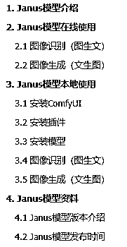

# DeepSeek Janus 全攻略：本地部署到在线体验，图像生成+图像识别一站上手

> 原文：[`www.yuque.com/for_lazy/zhoubao/ea5r0veib4u9y2ew`](https://www.yuque.com/for_lazy/zhoubao/ea5r0veib4u9y2ew)

## DeepSeek Janus 模型：从本地到云端的使用详解，文生图与图生文轻松入门

作者： 来来

日期：2025-02-05

Janus 是由 DeepSeek 深度求索开源的多模态大模型，核心能力聚焦在 AI 绘图和 AI 识图上，可实现文生图、图生文等多种跨模态交互，是其 AGI 体系中不可或缺的一环。**换句话说，这就是一个既能创作图像又能理解图像，并且支持开源定制的 AI 工具。**

**2025.01.27** ：Janus-Pro 正式上线，作为 Janus 系列的升级版，多模态理解与视觉生成效果均有明显提升。

**2024.11.13** ：JanusFlow 发布，是一款面向图像生成的统一架构模型，采用整流流技术。

**2024.10.23** ：VLMEvalKit 引入了复现论文多模态理解结果的评测代码。

**2024.10.20** ：Janus-1.3B 版本对外发布。

**飞书文档：**[`duuxkmjwsy.feishu.cn/wiki/Ra5rwLRg8i5UtLkwdnCcjzSWnrf`](https://duuxkmjwsy.feishu.cn/wiki/Ra5rwLRg8i5UtLkwdnCcjzSWnrf)

**文章目录：**

* * *

评论区：

暂无评论