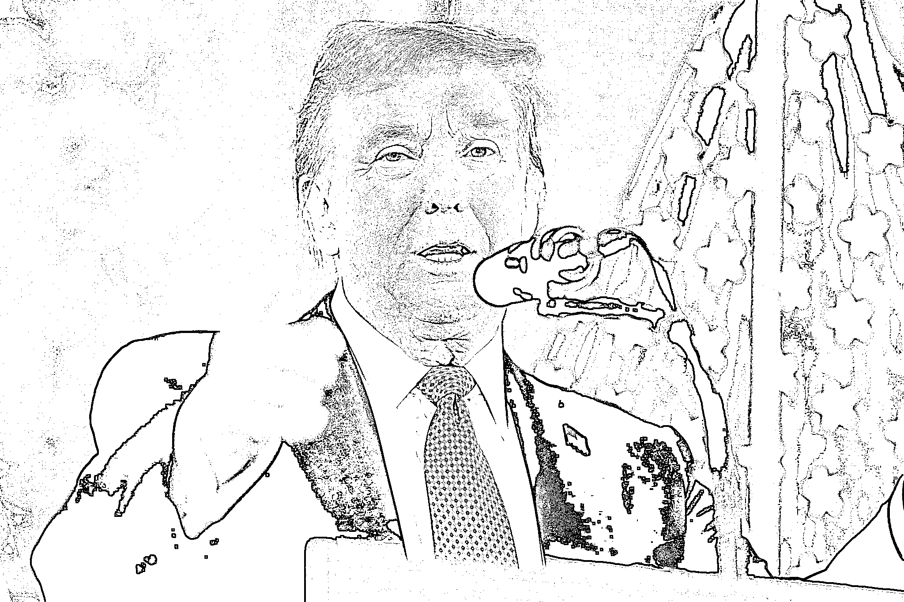
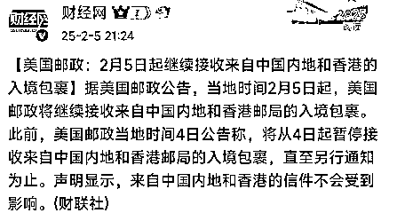
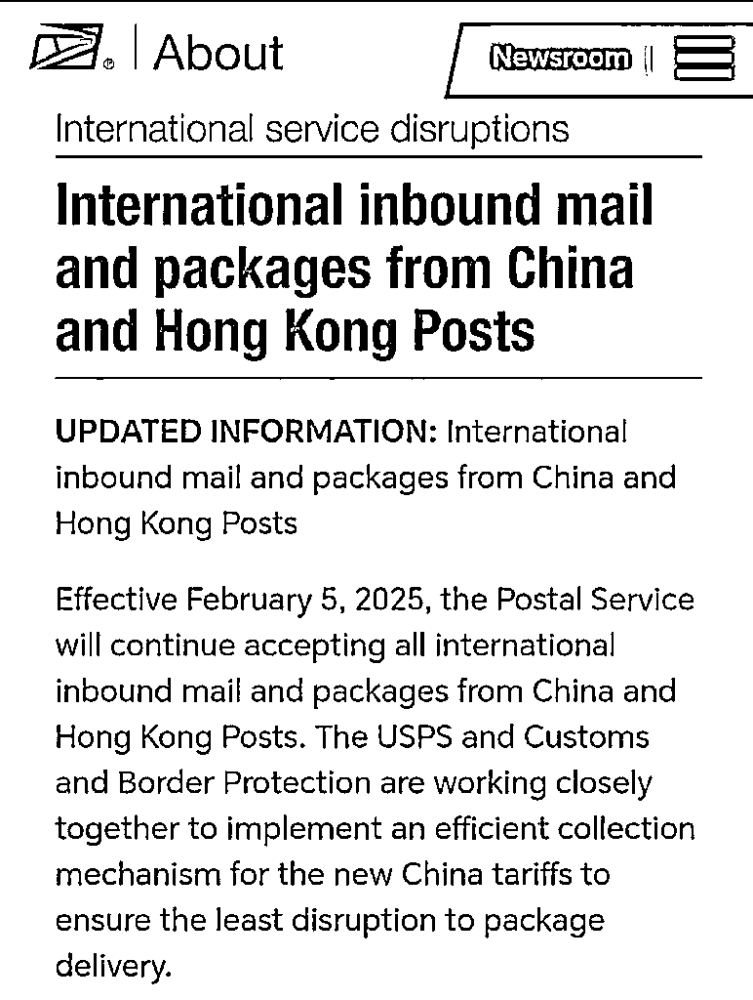
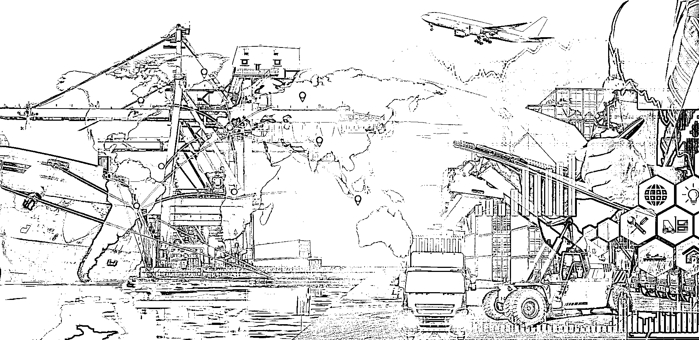
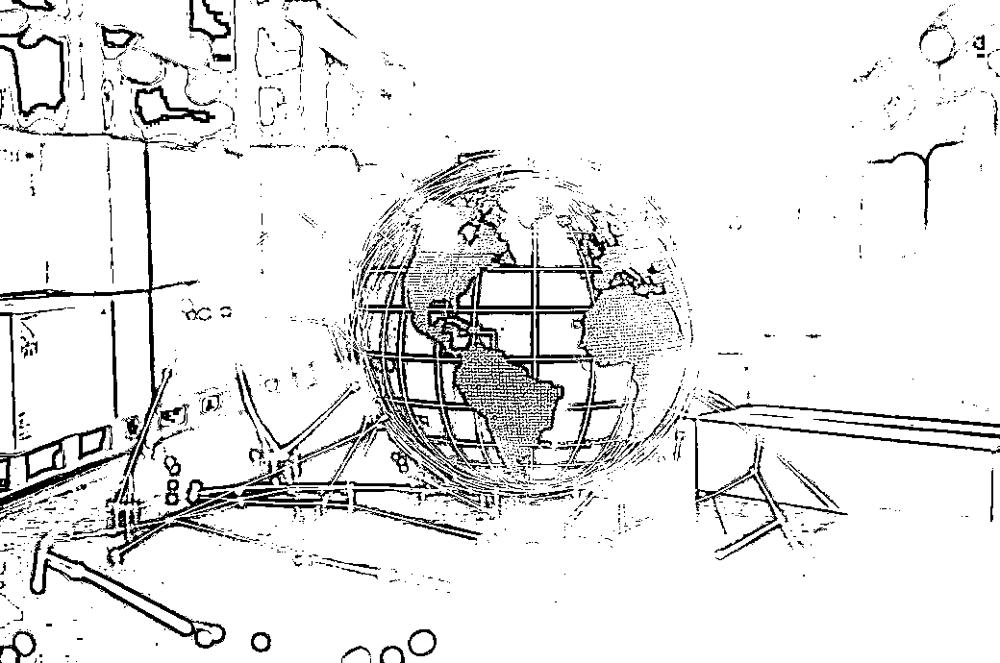
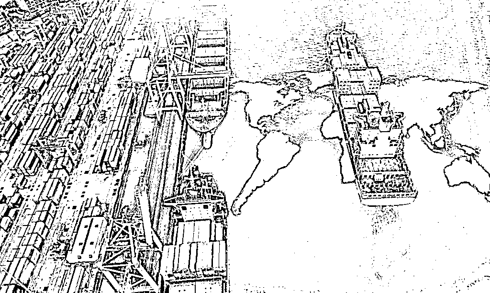
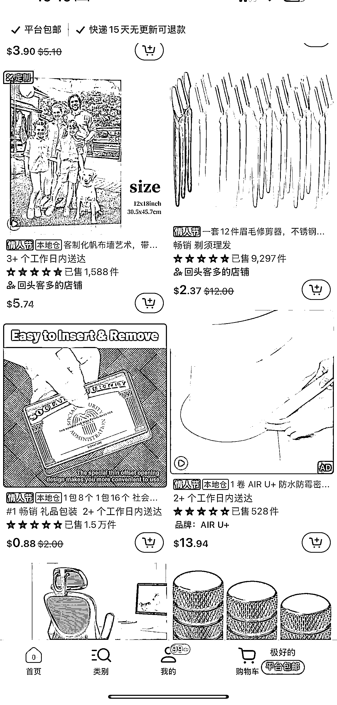

# 关税落地后，跨境外贸还能怎么活？
作者：龙哥

最近美国正式把对华出口关税抬高 10%，这一步靴子终于落地了。十年前我在圈子里就见过太多政策风暴，这次大家等得心力交瘁，怕没事也怕事太大。现在看来，10%只是开胃菜，未来往 60%走的呼声一直没停，走向到底如何，没人敢打包票。

家具板块首当其冲。东南亚承接产能的趋势已经很明显，若美国下一步把矛头也指向东南亚，局势会更扑朔迷离。加拿大、墨西哥也被直接加到 25%，这已不只是针对中国，更像是在逼全球供应链重新洗牌。

客观说，10 个点对中国供应链来说，消化空间是有的。真正让人睡不着的，是不确定性。东南亚会不会被加？进口门槛会不会继续收紧？这些不确定因素就像悬在头顶的剑，随时可能落下。

> **全球博弈，谁在笑到最后**

2025 年 2 月 4 日深夜，USPS 突然放话，全面暂停接收中国内地和香港的入境小包。消息一出，跨境圈瞬间炸锅，国内商家连夜复盘对策，海外的买家拼命囤货，生怕断货。

结果更戏剧化，24 小时后 USPS 悄悄撤回通告，一切恢复正常。这波雷声大雨点小的操作，让人怀疑这到底是试探，还是政策上的失控？

这次闹剧给行业上了一课：贸易版图在重构，玩法必须跟着重构。

短期看，矛头指向中国没错。长期看，互相加税只会把全球经济拖进内耗。美国政策还没定稿，但家具 OEM 大规模搬迁到东南亚，已经成为进行时。

说白了，99% 的家具制造门槛很低，比的是成本。美国市场已经被东南亚货占了大头，中国制造的占比肉眼可见地在萎缩。更关键的是，大采购商内部早有硬性指标：中国供应商的份额不能超过 30%。

这就意味着，即便你把产线搬到越南，质量被嫌弃、成本被推高，最后还是要被压价、被淘汰。

USPS 事件虽然是乌龙，但提醒得很清楚：别押注单一市场，别依赖单一渠道，分散化布局才是生存底线。

> **外贸该往哪走：别只做代工厂，去终端抢话语权**

外贸里，管住的环节越多，议价权就越大。设计、生产、物流、销售，能握在手里的一定要握。

纯代工的路，利润被压到薄如纸，订单还不稳定。转或死，已经是当下的选择题。

拉斯维加斯展会上，华人企业的做法已经在变——不再满足于 OEM，而是自建品牌、开线下店、卡住终端。单打独斗难，但抱团出海、联动国内供应链抢盘子，逻辑就完全不同了。外贸的本质不是造得多好，而是谁掌控全链路。从设计到销售，自己说了算，才能掌握主动。

现在的代工，说穿了就是给美国贸易商打工。利润被拿走，风险全留给工厂。汇率波动、原料上涨，订单就泡汤。

因此，不管是工厂还是跨境卖家，OEM 时代已经走到了尽头，品牌化、渠道化是唯一的出路。

> **我的判断：**

*   墨西哥的北美零关税优势大概率会保留，继续往上加税的可能性不大。把供应链挪到墨西哥，仍是可选项。
*   对华 10% 靴子落地，绕路东南亚转口，比如越南再出口美国，短期是现实的避税路径。
*   真正的高利润，必须在美国本地落地。建品牌、建销售网络、甚至开线下门店，才能摆脱关税和采购商的牵制。

> **新关税下，跨境电商怎么活**

800 美元以下小包免税取消，让一大批卖家慌了神。每单都要加 10%，利润直接被吃掉，美国消费者也要承担涨价，最终销量会受影响。

有人想靠低报关值捞一把，短期可能蒙混过关，长期就是自毁长城。真正的解法只有一条：放弃红海低价，转向高利润赛道。

> **跨境的破局点：**

### 1. 转口 + 海外仓，解决当下成本压力

*   东南亚转口：先到东南亚再入美，短期能一定程度稀释关税。
*   本地仓备货：在美国本土发货，减少进口税环节，还能抬溢价。
*   TEMU 等大平台都在加码本地仓，未来一定是本土化运营为主战场。

这些都是过渡期的可用招，尤其海外仓，既能提速又能提价。

### 2. 低价没戏，直接冲高端

买不起 30 块的会消失，但买得起 200-300 美元的不会在乎多付 30 美元税。

*   精准瞄高端客群：奢侈品平替、潮鞋、轻奢包等人群，对价格不敏感。
*   品牌溢价决定生死：价格战打不动的时候，认知和品牌就是护城河。

TEMU 这次被伤到的主要是低价用户，高端买家依然稳定，他们买的是价值。

### 3. 美国很大，但不是全部

南美、中东、欧洲、东南亚，都在快速崛起。

全球有两百多个国家，不只有美国才是市场。现在已有独立站卖家在日本、中东、南美做到日出 200-300 单，机会窗口已经打开。

> **收束一下**

短线打法：用东南亚转口、墨西哥设厂来降税，只能算权宜之计。

长线打法：必须撕掉 OEM 标签，做品牌、控渠道、直面终端，不然利润永远是别人的。

跨境方向：海外仓、本地化运营是趋势，直邮模式会越来越难。

市场思路：别把所有鸡蛋放在美国，全球化才是抗风险的底座。

规则在变，链路在变，有准备的企业早已在调整。想站稳，你必须握住终端，做自己的生意。

以上！

**国民弟弟相关创业的故事文章推荐：**

**跨境电商认知分享，个人创业者从 0 到 1000w+**

[`articles.zsxq.com/id_8n2o7gax71fr.html`](https://articles.zsxq.com/id_8n2o7gax71fr.html)

**3 分钟搞定美国公司，150 美金，超简单**

[`articles.zsxq.com/id_exggkcb30j69.html`](https://articles.zsxq.com/id_exggkcb30j69.html)

**3 分钟，如何远程开美国实体银行,送 2340 入金奖励。**

[`articles.zsxq.com/id_ubk2osmj6wzb.html`](https://articles.zsxq.com/id_ubk2osmj6wzb.html)

**美国收款工具：**

美版支付宝 Venmo:[`articles.zsxq.com/id_x73bbkhkkzau.html`](https://articles.zsxq.com/id_x73bbkhkkzau.html)

* * *

评论区：

暂无评论