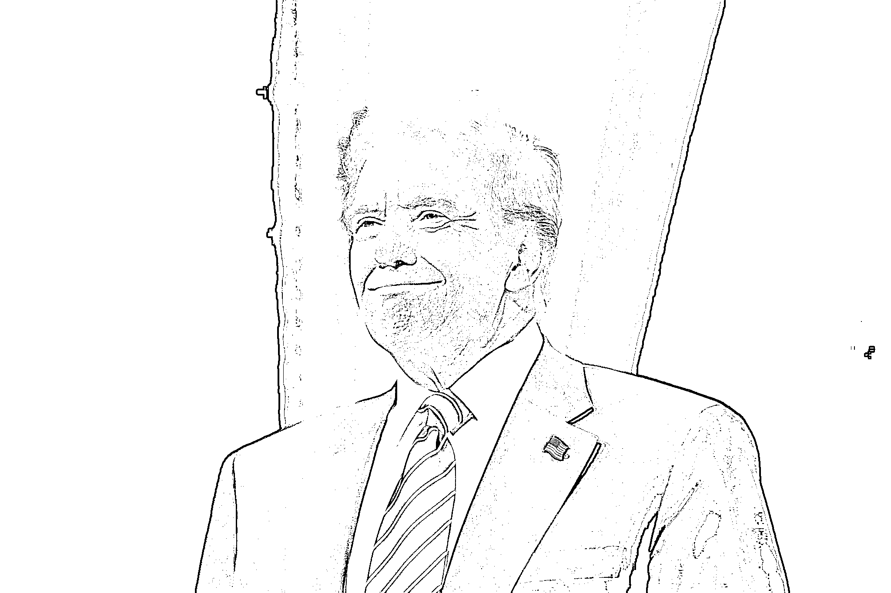
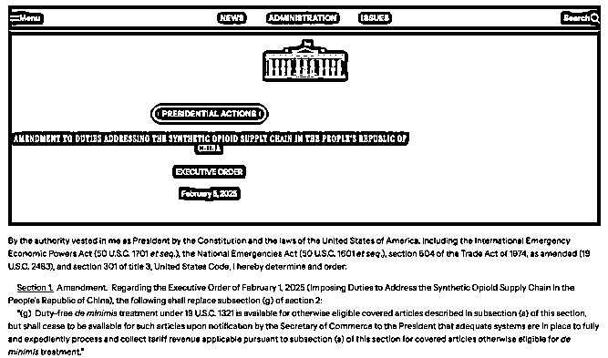
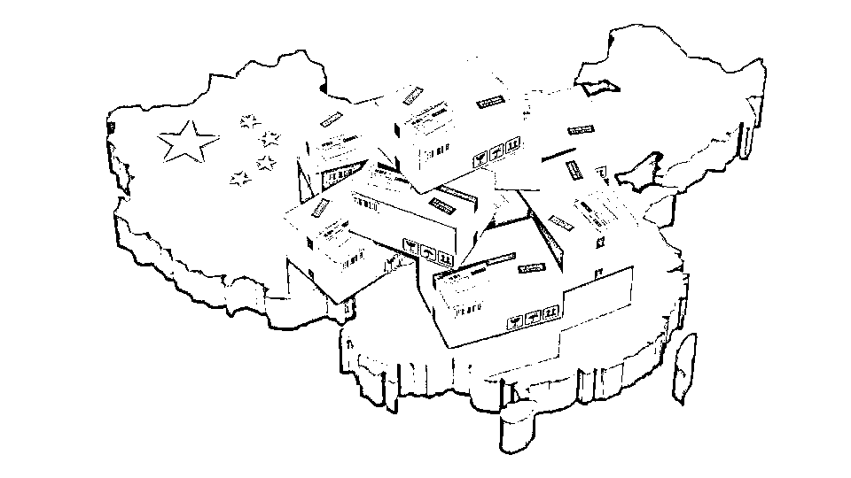
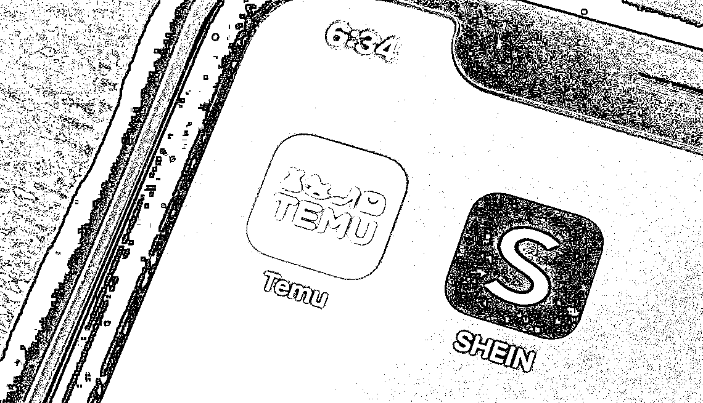
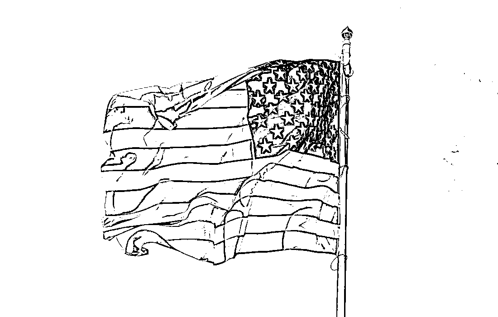

# 特朗普再度“松口”：800美元免税通道暂时重启
作者：龙哥

## 突发！特朗普又把800美元免税给续上了

作者：国民弟弟的跨境十年

日期：2025-02-08

特朗普重启“800美元”免税

据最新消息，美国总统特朗普周五再次宣布延续800美元免税政策，这意味着价值低于800美元的由中国发往美国的小包裹，暂时还能享受零关税入境。这一转向立刻在跨境电商圈炸开了锅，尤其是以中国卖家为主的从业者。对我们这些在跨境赛道里打拼多年的老兵而言，这既像一次短暂的喘息，也像一个需要立刻解读的风向标，因为税务成本的波动会牵动整个供应链的策略。

白宫给出的说法是为了让美国商务部争取更多时间完善征税系统，提升后续对关税的征收效率。换句话说，跨境卖家可以暂时松口气，海关环节的摩擦成本有望缓和。虽然官方并未公布具体截止时间，但政策的反复已经让行业高度敏感。

> **免税门槛重启，对中国卖家意味着什么**

从实战经验看，这条线对中国跨境卖家的重要性不言而喻。多年以来，我们就是靠着800美元免税来压缩成本、守住美国市场的价格竞争力。据统计，美国每年有约13亿个小包裹享受最低免税待遇入境，品类覆盖衣物、家居、3C等，其中中国发货占比极高。

海关与边境保护局的公开数据显示，过去十年享受“800美元”豁免的包裹量持续攀升，2023财年更是突破10亿件。对于中小卖家而言，这条政策相当于一条低成本的生命线，让定价更有弹性。

对于深耕多年的卖家来说，免税就是抢占市场份额的利器。没有税负压身，产品价格更容易调整，营销打法也更灵活，在美国价格敏感的消费群体里更容易站稳脚跟。

> **政策反复背后的应对思考**

免税政策一会儿取消一会儿恢复，波动频率比跨境人本人的心态还快。很多卖家刚准备好应对方案，转头又得重调节奏。这轮恢复到底是利好还是缓兵之计？如何提前布局才是关键。 images.zsxq.com/FqlzrU5q5Gxd1xzNWJP_4i0WI_fV)

这次表面上是给商务部拖延时间，实质暴露了执行层面的硬伤。

### 1. 海关处理能力严重不足

你难以想象的体量：美国每年要处理13亿个免税小包，光是肯尼迪机场一年就吞吐6000万单。要想对全部包裹立刻征税，系统根本扛不住。

就在政策取消的前后，美国海关和部分物流商还在紧急开会商量如何消化堆积的百万级包裹。简单说，就是操作方案没准备好就贸然开闸，结果导致爆仓、系统瘫痪、清关大堵车，最终只能被迫重启免税来稳住物流链。

### 2. 头部平台的出货量让“一刀切”不现实

根据 Xeneta 的追踪，仅 Temu 和 Shein 每天的全球出货量就高达9000吨，相当于88架波音777满载。如此庞大的体量，政策一变，物流商、平台、海关全部跟不上。征税如何执行？如何申报？如何核验？没有配套系统支撑，落地就是空谈。

所以，此次免税重启更像一个缓冲垫，但释放的信号很清晰——美国对小包征税的决心没有变，只是时间问题。

> **小包税务成本上涨已成大势**

免税回归只是阶段性止血，不是长期放水。未来美国完善系统后，对小包征税将进入常态化，跨境卖家必须提前算账。

### 1. 低客单价卖家将最先承压

在贸易摩擦的背景下，800美元免税被视为一个需要堵上的漏洞。中国低价小包在美国市场份额庞大，超过10%的进口品类都在用这项豁免。你觉得美国会长期放任这个税收缺口吗？显然不会。未来低SKU、低客单的模式会首当其冲，税一加上，微薄的利润和价格优势都会被吃掉。

### 2. 平台很可能先行转嫁成本

无论是 Temu、Shein、亚马逊还是独立站品牌，税负增加后平台不可能自行消化。预计会采取：

*   上调平台佣金或新增服务费
*   推动FBA、本地仓等模式，加速本土化
*   将额外关税、清关费等转嫁给商家

### 3. 物流与报关成本双升

政策变动后，报关早已不再是“简报”。现在需要走正式清关流程，人力、时效、报关费用都在上涨，部分物流公司已经开始：

*   额外收取报关服务费
*   在收件时预收关税保证金

等美国系统到位后，小包征税会更严、物流成本也会水涨船高。

## 卖家现在该怎么做

规则在变，但底层逻辑没变——跨境电商不能再单纯赌低价小包红利，要提前做结构性升级。

### 1. 早布局本土化

如果你的业务高度依赖直邮小包，现在正是转型窗口：

*   提前备货到海外仓，降低直发依赖
*   利用美国本地仓配，提升履约稳定性
*   做品牌、提升客单价，降低税负对利润的冲击

### 2. 物流方案多元化

更稳妥的做法是：

*   优先海外本地仓，减少小包直邮风险
*   严格合规报关，避免未来稽查带来的损失
*   多渠道测试，降低单一模式的脆弱性

### 3. 盯紧平台规则，及时调价

关税和物流成本最终都会反映在终端价上。如果你深耕平台，务必关注 Temu、亚马逊等是否上调税务相关费用，并根据市场反馈灵活调整售价，避免被政策打个措手不及。

## 总结

特朗普再度恢复800美元免税，短期看是利好，长期看小包直发征税已成定局。与其被动等待下一次反转，不如现在就开始调整。跨境的核心竞争力，正在从单纯的价格优势，转向品牌力、供应链能力和合规运营。还在押注免税政策的模式，真正的考验才刚刚开始。

以上！

**国民弟弟相关创业的故事文章推荐：**

**跨境电商认知分享，个人创业者从 0 到 1000w+**

[`articles.zsxq.com/id_8n2o7gax71fr.html`](https://articles.zsxq.com/id_8n2o7gax71fr.html)

**3 分钟搞定美国公司，150 美金，超简单**

[`articles.zsxq.com/id_exggkcb30j69.html`](https://articles.zsxq.com/id_exggkcb30j69.html)

**3 分钟，如何远程开美国实体银行,送 2340 入金奖励。**

[`articles.zsxq.com/id_ubk2osmj6wzb.html`](https://articles.zsxq.com/id_ubk2osmj6wzb.html)

**美国收款工具：**

美版支付宝 Venmo:[`articles.zsxq.com/id_x73bbkhkkzau.html`](https://articles.zsxq.com/id_x73bbkhkkzau.html)

* * *

评论区：

暂无评论