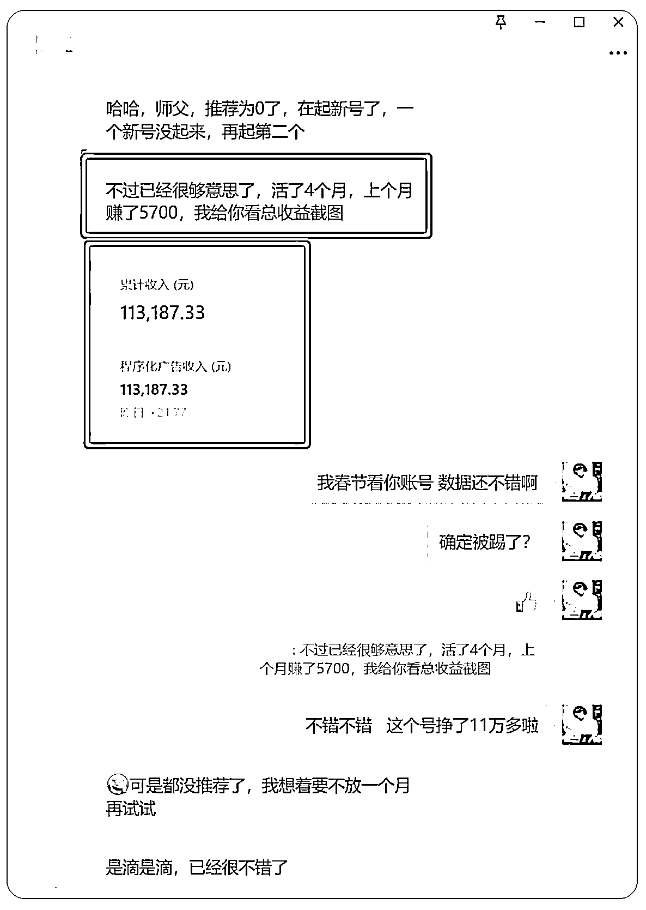
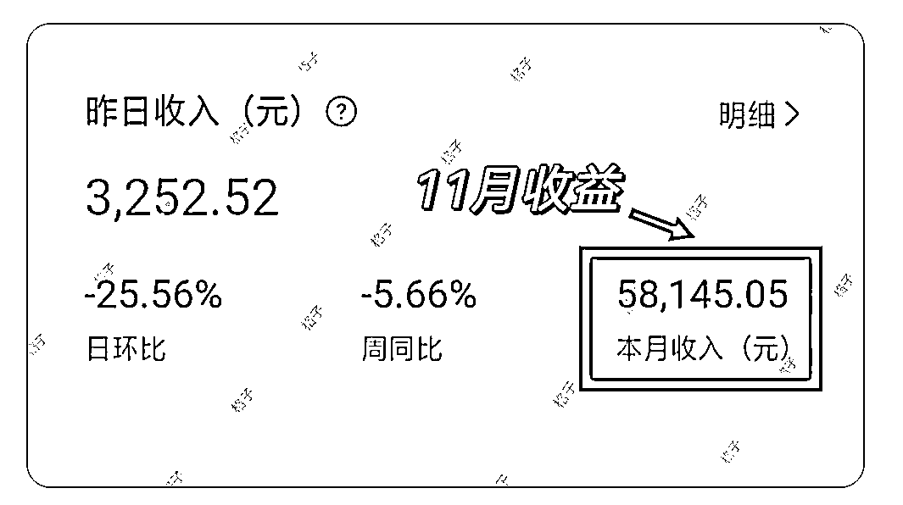
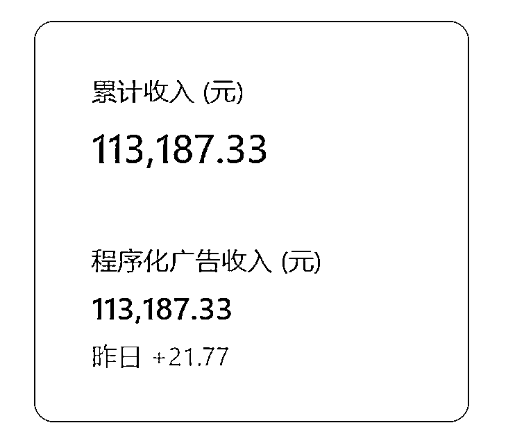
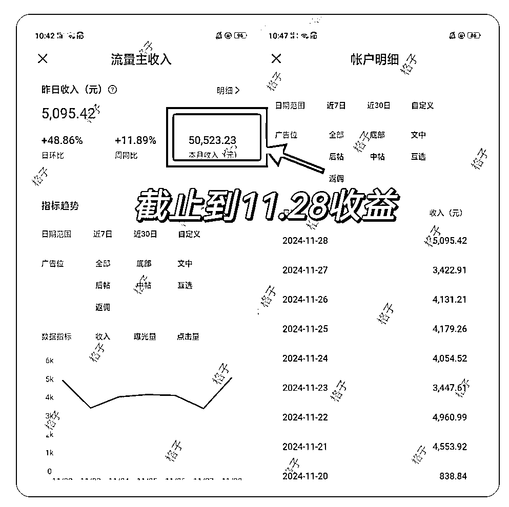

# 👸号流量主：4 个月挣了 11 万，分享几点干货与心得

最近跟一位学员聊天时，她告诉我一个好消息：她的👸号在4个月里赚了11万。不过遗憾的是，这个号后来被踢出了流量池。

说实话，听到这个结果我并不意外。她从一开始就很拼——2023年12月就报名了流量主课程，但前面整整10个月，几乎天天都在“地狱模式”里挣扎：

- 做了好几个号，全都没做起来
- 换了不少领域，始终不见起色
- 家里人不理解，甚至嘲笑她“异想天开”
- 她也动摇过，跑去试了一堆别的项目，都没搞出名堂

最后她想通了：既然别的路走不通，那就死磕👸号。这个号不行就换个号，这个领域不行就换下一个。终于，在2024年11月，她迎来了一次大爆发，单月收入直接冲到58000元以上。

到目前，这个号累计收入已经超过11万。哪怕现在号没了流量，但对她这种月薪三四千的人来说，这4个月已经抵得上过去两年的工资，真的非常厉害了。

很多人看到“4个月11万”就急着开喷，觉得又在割韭菜。但先别急，真正做流量主的人心里都清楚：想在这个领域赚钱，大概率要熬过大半年才有起色，可90%的人在第一个月就放弃了。

那为什么你总是赚不到钱？多半是踩了这三个坑：

**误区一：只顾自嗨，不看同行。** 想写什么就写什么，从不研究别人在写什么，也不拆解爆款逻辑。说白了，跟着数据走，远比跟着感觉走靠谱。爆款往往都是相似的，真正做出成绩的人，都在重复那些被验证过的路子。

**误区二：每天凑数，敷衍了事。** 选题随手抓、内容随便写、标题都发不全，发文像是完成打卡。你敷衍平台，平台就敷衍你，数据和收益自然不会好看。

**误区三：频繁换方向，沉不下心。** 今天写情感，明天写职场，后天又试试别的赛道，到头来哪个领域都没做深。选定一个方向后，先老老实实日更一个月再说。三天打鱼两天晒网，怎么可能捞到鱼？

既然说到这，再分享几个适合新手抄作业的爆文技巧：

**第一，选对赛道就赢了一半。** 目前单价高、流量猛的三个领域：民生法律、养老金、养生美食。

**第二，标题必须抓人眼球。** 新手别自己瞎起标题，直接跟爆款标题走，先别改动。比如《春季养生注意事项》这种，你看有几个点进去的？换一种写法：**《50岁阿姨喝3年黄芪水确诊肝癌！医生怒斥：这些养生法害惨中国人》**，是不是立马不一样了？

**第三，正文要有剧情张力。** 可以用这个经典结构：震惊案例→专家打脸→解决方案→情感共鸣。一环扣一环，读者才愿意看到底。

**第四，善用数字型流量密码。** 标题里加入具体数字，特别容易吸引点击。比如“不管有钱没钱，这4个方面要对娃大方些，别让孩子一生自卑”“孩子是不是读书的料，看这4点就知道，八九不离十”“父母最大的成功，是在3件事上少管孩子，越不管，越有出息”。这类标题在各个领域都适用。

**第五，别管数据，先日更一个月再说。** 流量主不是发第一篇文章就有阅读量的，很多人更了三五天就放弃，其实账号都是靠日更一点点养起来的。先不纠结数据，闷头更新一个月再说。

最后，如果你也想靠👸号流量主月入过万，请先老老实实回答这三个问题：

1. 你能接受连续写出30到90篇零收益文章吗？大多数学员都是熬了半年才等来爆发。
2. 你愿意每天拿出1到3小时专门拆解爆文吗？只有不断拆解，才能真正练出网感。
3. 你能坚持三个月不断更吗？日更是做爆文的最低门槛，连这个都做不到，其他都白搭。

流量主这条路，说残酷也残酷，说公平也公平——吃不了深耕的苦，就只能等着被数据狠狠教育。