# 掌握封红包封面引流技巧，流量暴涨不是梦！
作者：龙哥

红包封面这东西，有人当摆设，有人却拿它当流量开关。我属于后者——昨天就靠“免费红包封面”四个字炸了一波羊毛群，👸号阅读量直接冲上2w+。

其实最近👸号平台没少给博主们撒福利，免费红包封面额度从300到上万不等，白送的好东西。再加上每年到这会儿，红包封面都会掀起一阵热潮，🛰️指数只增不减，热度不容小觑。

可我发现，绝大多数人领完封面就让它躺灰了，压根没想过这玩意儿还能拿来引流。要是能把这波白来的封面变成获客钩子，哪怕只是拉动一批新关注用户，都是稳赚不赔的操作。

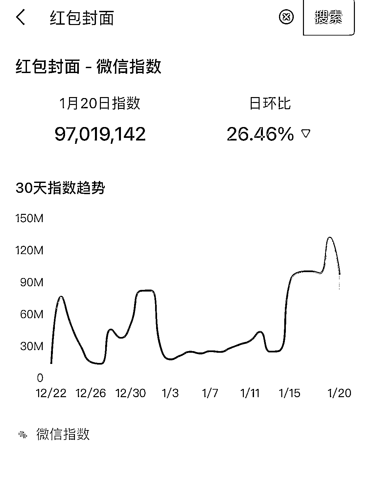

正好，我昨天自己跑通了一轮，把经验拆给你看。

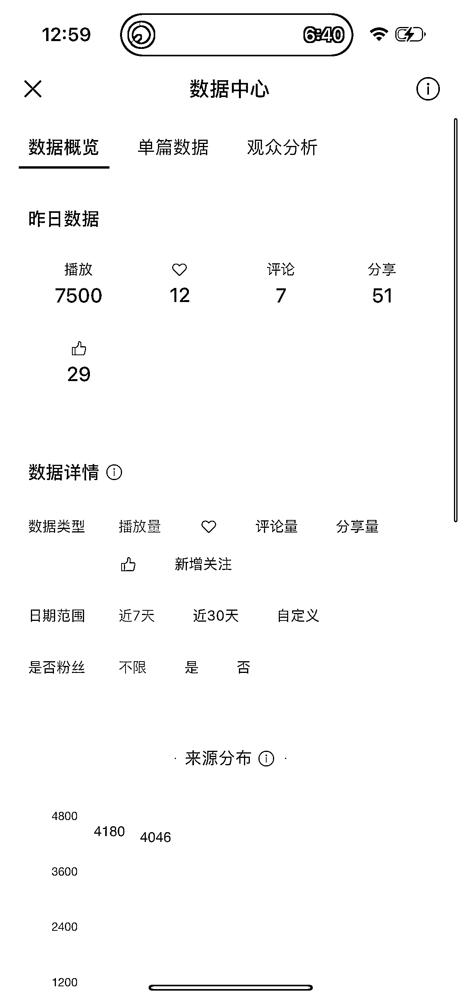

下面从四个方面来聊：

一、哪些人会被红包封面“拿捏”？
二、自己的封面从哪里搞？
三、怎么用封面做引流？
四、素材去哪儿找？

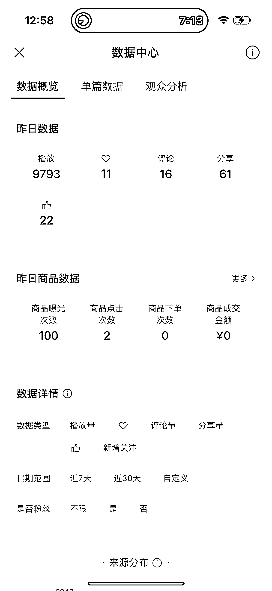

先看第一个，受众。红包封面的覆盖面其实很广，上班族、学生党比比皆是，其中95后、00后尤其吃这一套。为什么它能在短时间内爆发？关键在于传播逻辑——不是靠👸号推流一步一个脚印地走，而是靠社交关系链一路裂变。我发文没几分钟，浏览量就开始往上蹿，没多会儿就爬到了几千甚至破万。说白了，背后全是蹲守封面的羊毛党在推波助澜。

再聊第二块，封面怎么做。我目前摸索出两条路：

第一条，🛰️红包封面开放平台。网页搜一下就能找到入口，登录按指引操作即可。不过这套流程我自己没完全跑通，细节就不乱教了。想学的朋友可以直接抄作业，复制下面这个抖音链接看教程：

【2.84 复制打开抖音，看看【张志豪的作品】🛰️红包封面制作教程，非常详细！看完可自己做专属封... [`v.douyin.com/if22ekNu/`](https://v.douyin.com/if22ekNu) 11/17 WZZ:/ [J@v.FH](http://mailto:J@v.FH)】

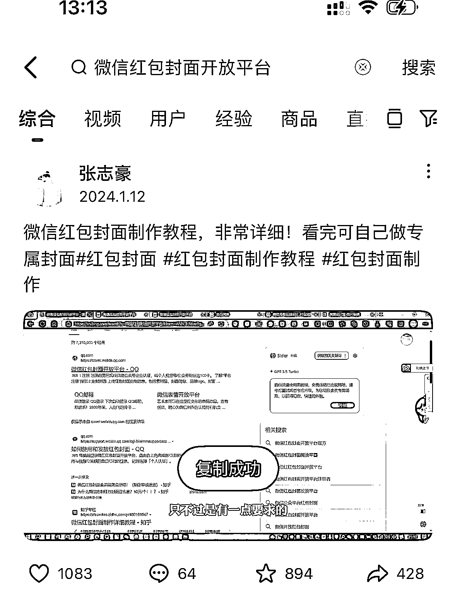

第二条，视频号创作者奖励。这条路我亲自验证过，好使。最初平台只给了我900个封面额度，结果每次都被领得精光，于是视频号又追加到了4000个。我拿这些额度做了专属封面，前后累计跑出2w多浏览量，转发数据相当能打，社交属性拉满。

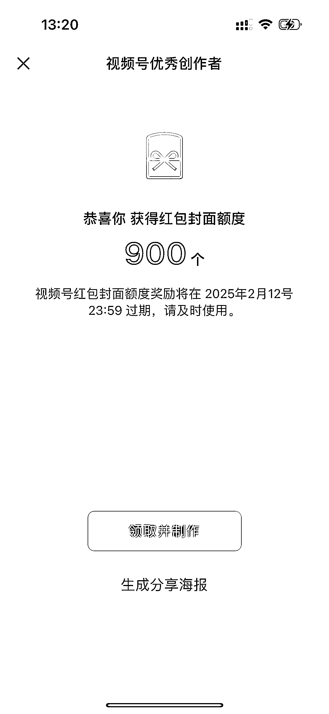

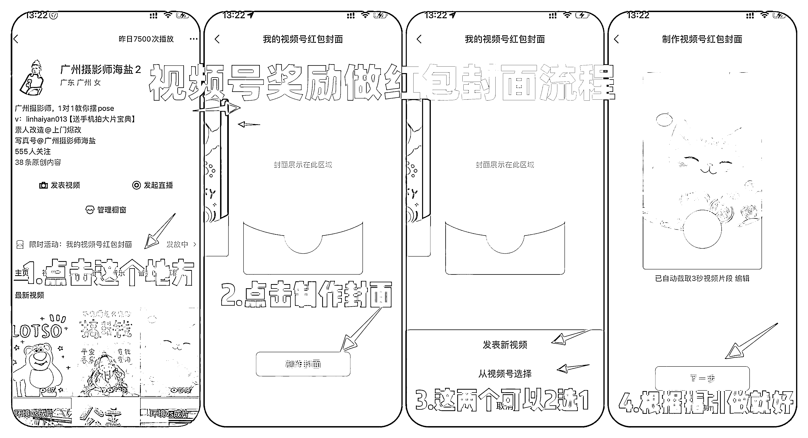

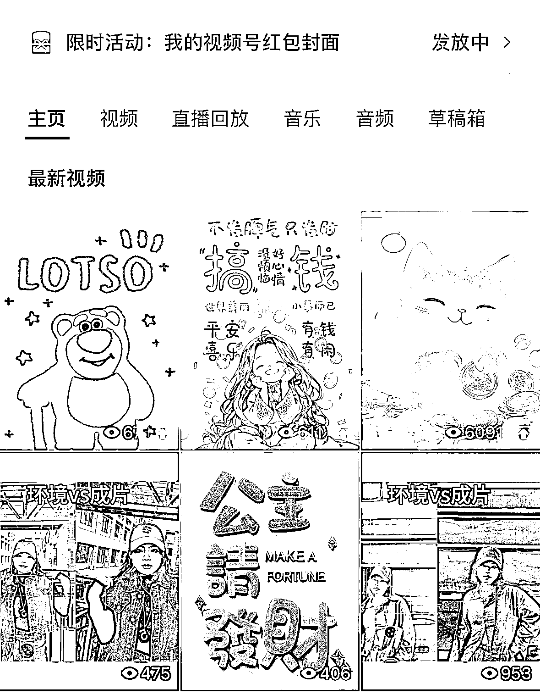

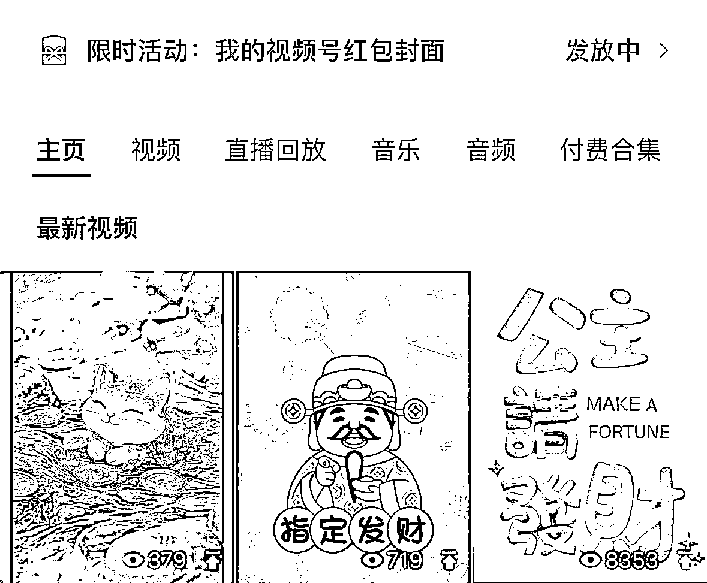

跑出效果后，好几个人私信问我能不能帮代做封面。这个需求确实是机会，但我直接婉拒了。原因很现实：一个账号只给三款封面名额，我帮别人做了，自己这边就没了。我图的是流量，不是眼前那点钱。我的时间得花在更有意义的事上。

重点来了，第三块：怎么把封面变成引流利器？

方法一，视频号。照我的路子来就完事——发一条新年氛围感视频，配上做好的红包封面链接，评论区再埋一条引流话术，齐活。

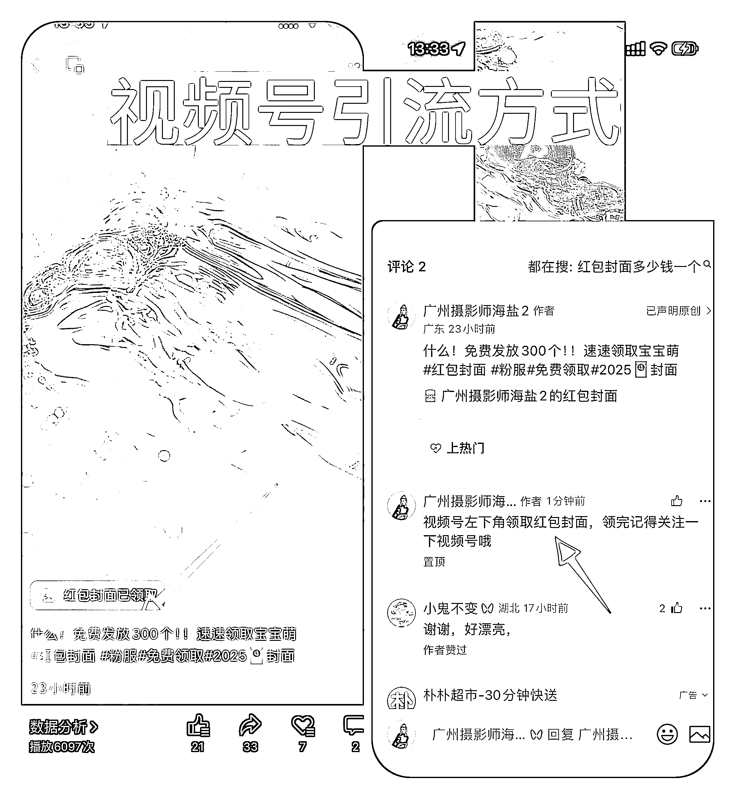

方法二，👸号。具体流程我放在图片里了，照着步骤操作即可。

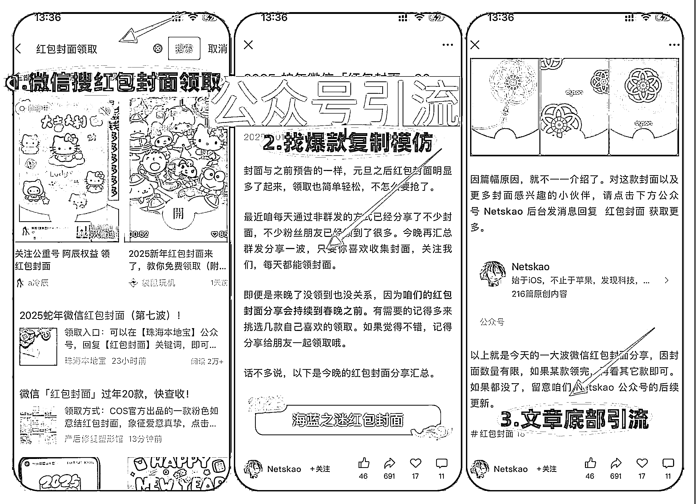

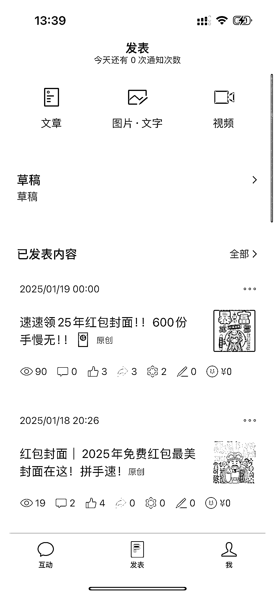

不过说实话，这套玩法我在👸号上试了两遍，数据平平。后来才反应过来，我的内容调性更适合视频号。所以别在一个平台上死磕，多换地方测一测，哪边流量好就把力气往哪边使。

方法三，视频号直播。把封面当作直播间的福利抛出来，吸引关注和互动，效果也相当猛。

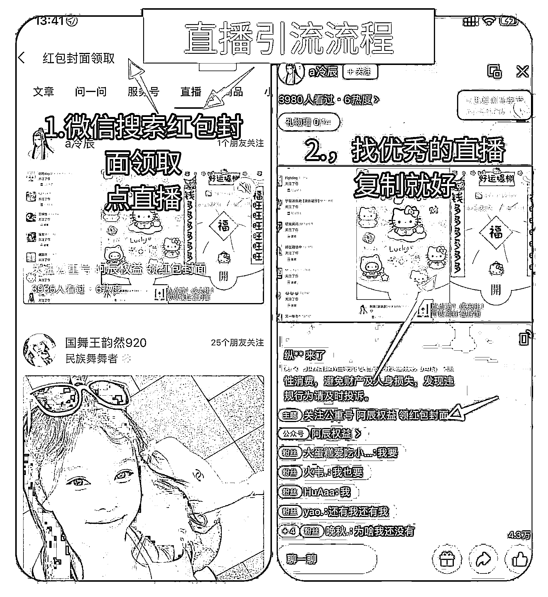

最后说说素材从哪儿来。我常用三个渠道：📕、拼多多、AI工具。📕的图质感好，但水印是硬伤，去起来太烦；拼多多直接买手机壁纸，卷完即用；AI软件也能生成封面图，可惜我还没玩明白，就不班门弄斧了。

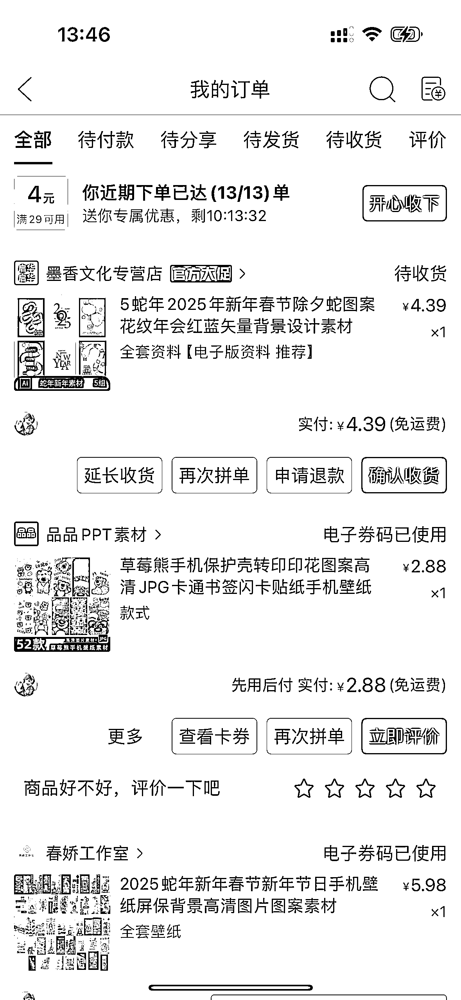

再教一个懒人偷懒的绝招：去抖音翻“过年BGM”，直接把现成的模板拿来，把图换成自己的，配上音乐，一分钟就能产出一条视频，剪辑功底都不用有。

以上就是我对红包封面玩法的全部心得，希望能给各位一点启发。手里的封面别再囤着了，让它们跑起来，说不定你的下一条爆款，就从这里开始。