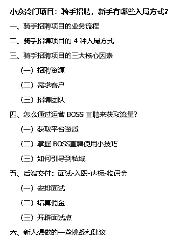

# 被低估的冷门赛道：骑手招聘，新手怎么上手？

原创思路：[`www.yuque.com/for_lazy/zhoubao/tk40rd8s8ynwp2w5`](https://www.yuque.com/for_lazy/zhoubao/tk40rd8s8ynwp2w5)

## 一个被圈外忽视的稳定现金流项目

大家好，我是龙哥，目前在广州负责一家日均完成20万单外卖派送的配送公司。

上回聊到行业蓝海后，私信里很多朋友都问到骑手这块的生意。这次我就把我们内部人熟、圈外人少的这个项目掏出来讲一讲。

项目特点很简单：单人月流水能做到8千到2万，启动资金不高，能长期做，也能当副业做。无论你是想找个自由项目做副业的自由职业者，带娃在家的宝妈，还是想找个创业方向的你，都可以看看。

内容比较多，完整版我放在了飞书文档里，方便大家系统阅读。

本次分享的框架：

* * *

互动补充：

有人问上游资源怎么对接

回复：部分城市我这边能直接帮你牵线，你也可以自己去当地的站点找站长，顺着关系就能联系到城市经理谈合作。

有人问唐山有没有

回复：目前我手上主要是广东，武汉、西安、无锡这几块，线上招聘其实不限定区域，想招哪个城市都行。

有人问怎么加联系方式

回复：联系鱼丸即可对接。

也有圈友说这个赛道很冷门但讲得很透。

回复：是的，这个细分赛道从15年左右就开始做了，至今也有十年的沉淀，上下游已经很成熟了。