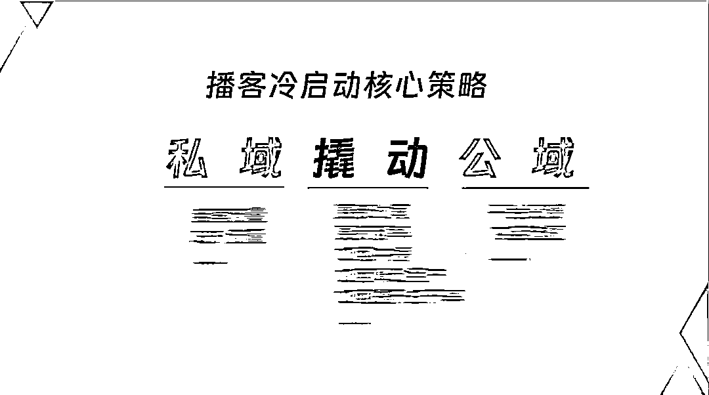
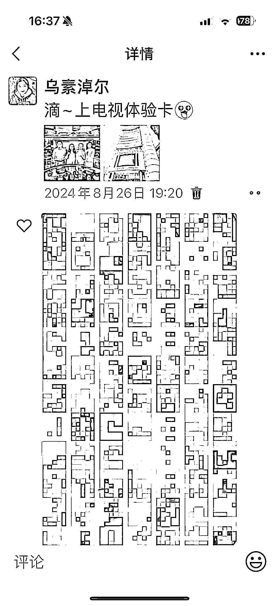
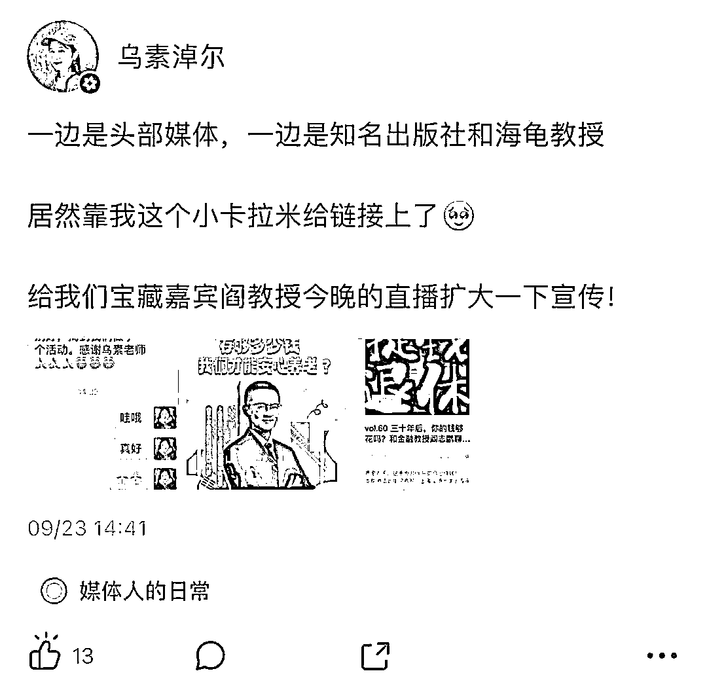

# 播客到底能不能赚钱？我用两年实操拆给你看

## 播客变现内幕全拆解，从广告到私域的真实案例

作者：乌素淖尔

日期：2025-01-20

大家好，我是乌素，《提钱退休》的创作者兼主持人。做播客还不到两年，光在小宇宙一个平台订阅就过了五万，确实赶上了一波红利期。

市面上总有一种声音说播客都是公益性质、不挣钱。但在我看来，这恰恰是一个极具潜力的内容赛道。今天就把我看到的、踩过的、赚到的情况摊开讲，讲清楚播客到底怎么把内容变成收入，以及什么样的人最适合入局。

整体拆成三块来看：

01 播客的两套变现打法和真实报价

02 播客生态里有哪些角色，分别能抓住什么机会

03 稳赚不赔的五类播客人群画像

# **01 播客的两套变现打法和行业案例**

先讲逻辑。变现大致可以分成两类，我习惯叫水上变现和水下变现。

**1、水上变现**

水上就是最直观的广告合作，也就是大家熟悉的本期节目由XX赞助。

这样的合作在我的节目里很常见。说到报价，前段时间给实战营学员分享了手上的广告单价，现场反应基本都是：这么高？

很多人觉得播客不值钱，但实际上单期广告过万已经很普遍了。我自己做播客一年多一点，早就开始稳定接到五位数单子，这块确实很香。

给你一个量级参考，目前小宇宙单个平台20万订阅的一个账号，常规报价大概在6万左右；30万订阅的账号，报价在10万左右。这还没算深度定制。

广告的深度会直接影响价格。我现在接的五位数合作大多是定制化项目，会先结合品牌产品定选题，选嘉宾，设计沟通问题，安排产品露出方式。整个节目从策划到呈现都是围绕品牌做的，所以听感上不像硬广，反而会被用户喜欢。

当然不是只有头部才有机会。新号也很能拿到赞助。新到什么程度？刚注册、刚起步的账号都有。

这里说的赞助不是直接给钱，而是品牌露出+用户福利，比如抽奖。既能提升用户参与感，也能让同行和潜在金主看到你账号的价值：刚起步就有品牌愿意合作。

为什么新号能拿到？

因为新号有平台的流量扶持。网上说新播客没有流量是误区。是有流量，但需要一定的运营方法加内容质量才能撬动。

再说个最新动向。最近做广告投放的朋友告诉我，很多品牌开始把播客纳入投放媒介了。过去主流是小红书、抖音，现在越来越多品牌方在看播客。播客正处在成长期，现在入场时机很好。

水上是相对清晰的，下面讲更广的水下变现。

**2、水下变现**

水下变现更偏广义。它不是靠一期节目直接收钱，而是通过节目积累影响力和信任，最后实现转化。

相比图文短视频，播客转私域的效率很高，听众粘性强，容易把人沉淀到社群里卖货、做服务分享。

我了解到的案例里，有的新号在私域已经做到上百万的体量。这并不夸张。

我自己也常遇到这种情况：听众听完觉得专业度够了，直接来买陪跑服务、课程或做咨询。这些我很少对外明说，但确实是播客带来的间接收入。

这就是典型的公转私路径，属于水下变现的核心。

# **02 播客生态有哪些角色和机会点？**

第二部分聊生态。先拆角色，再看每个角色能抓到什么机会。

### **1、播客有哪些角色？**

**角色1：听众**
最基础也最关键的一环。我们很多人本身就是深度听众，每周会投放好几个小时。

**角色2：主播**
也就是我现在的位置。刚入行的人一旦开播，就成了主播。

**角色3：嘉宾**
没做节目也能参与，被邀约上麦分享，你就是嘉宾。

**角色4：剪辑师**
这是幕后的刚需岗位。很多主播朋友都在找靠谱剪辑外包，需求很大。

播客剪辑和短视频剪辑不太一样，对炫技要求不高，更看重内容审美和结构能力。开头的高光摘要就是剪辑师能力体现，要能提炼亮点、把控节奏。

**角色5：播客制作人**
比剪辑更上层的岗位。部分主播自己就是制作人，比如我本身有内容创作背景就能兼任。

更多时候主播是演员，制作人是总导演，统筹选题、嘉宾、排期、商业化全流程。

**角色6：品牌方**
进入变现环节的核心角色。

**角色7：播客MCN**
随着行业专业化，MCN机构开始入场，承接资源对接和招商。

### **2、角色对应的机会点**

**案例1：听众里藏着甲方，因为认可所以付费**
我多次遇到听众转金主的情况。对方主动来聊：“乌素老师，我是你的听友，听了好几期，这次是代表品牌来探讨合作。”

这种转化至少发生了三次。听众熟悉你的调性、信任感强，沟通成本极低。品牌投放负责人本身就是播客重度用户，他们需要了解渠道，找到合适的账号。播客是长时内容，一听就是一小时，沉淀下来的信任度远高于刷短视频。

抓住品牌负责人的心，合作就成功一半。

**案例2：听众里藏着客户，因为相信所以付费**
前一种是投放逻辑，后一种是水下逻辑。

很多人先在播客里搜索自己感兴趣的领域，比如小红书运营。听完我的分享觉得专业，就来咨询。咨询后满意，再升级成五六位数的陪跑服务。

播客能带来的是后端交付和产品承载能力，这才是真正的变现闭环。

**具体机会点：**

**① 如果你是听众**
去你喜欢的播客兼职或入职。从剪辑切入，积累后转制作人，是非常现实的路径。

**② 如果你是剪辑师**
播客目前竞争小、岗位多。短视频剪辑卷到极致，播客更看重内容逻辑和提炼能力，粗糙一点反而更自然。内容审美好的同学很吃香。

**③ 如果你是品牌方**
建议试试播客投放。成熟渠道价格透明内卷严重，新渠道容易找到洼地。去年一年就已经有几十家品牌在播客投放了。用少量预算撬动新渠道，品牌起势的机会很大。

**④ 如果你是主播**
播客是低成本建立影响力的工具。无需出镜、无需精致妆造、设备门槛低、脚本要求不高。

举个例子，前阵子群里有人约采访邓亚萍，地点在北京，我在上海还要直播，就没赶上。这种链接顶尖人物的机会，主播身份很容易拿到。

还有，8月份我去电视台录制卫视节目，能上去的前提就是我有播客、有一定KOL体量。

即便你现在没变现需求，只要想要更丰富的人际关系和合作机会，播客也很合适。这些机会是我一开始没想到的，随着平台上升期还会越来越多。

# **播客是一种新的社交名片**

我常推荐大家做播客，因为它像一张会说话的名片。

以前的名片没人看了，个人主页又太长。播客不一样，你说我是XX播客的主播，对方点开看看数据，听一段内容，对你的专业、气质、思维就有具象认知，介绍成本极低。

还有一个例子，出版社编辑曾告诉我，我采访过的一位大学教授，因为那期节目被头部媒体看到，后续被约去做直播。出版社特别感谢我，我一个内向的人，竟然成了头部媒体和大佬之间的资源枢纽，这就是播客带来的杠杆。

# **03 做播客稳赚不赔的5类人**

最后说最实在的人群画像。

**1、有自己的产品/服务的人，播客可低成本引流**
如果你已有变现产品，播客就是个低成本获客渠道。特别适合用户画像是一线城市、高消费、高认知的人群，这和播客整体用户高度重合。

做播客也特别适合需要建立信任的行业，比如房产、保险、教练服务。客单价高时，用户不会随随便便买单，但如果主播持续陪伴、专业可信，转化率会明显提升。

**2、朋友多的人，自带嘉宾和多元话题**
人脉广、表达欲强的人很适合。把日常聊天变成内容，既能放大影响力，又能持续产出话题。

身边有位E人朋友，每周见几十个新朋友，做播客后大量嘉宾自然进来，视角多元，节目增长快，广告也好接。你不需要什么都懂，会提问、懂好奇心就够了，影响力和流量自然来。

**3、I人不用出镜，安全感很足，被动获得影响力**
像我这样内向的人也能做。播客不需要出门社交，可以被动建立影响力。做了一段时间后，我反而更愿意和朋友深聊了。很多嘉宾都是老朋友，只是以前没深入聊过。录完还能闲聊，内容和关系都双丰收。

**4、播客非常适合垂类**

最近有个很有意思的现象：越来越多的明星和艺人，都悄悄把播客当成了新的阵地，开始抢占这个“小而美”的赛道。

与此同时，我身边也有不少朋友跑来跟我说：“我想开一档播客，专门聊搞钱”，或者“我想做个自我成长的节目”。每次听到这种想法，我都会给他们泼一盆冷水：这条路，已经挤满了人。

这类话题，说白了都属于“泛娱乐”或“泛生活”的大杂烩品类。内容覆盖面广，受众基数确实大，头部账号也活得相当滋润。可话说回来，你现在想挤进去，跟那些早已站稳脚跟的大号相比，自己的优势在哪里？想靠这个搏流量，难度可想而知。

所以，我更建议大家往垂直细分的方向走。

为什么这么说？道理其实很简单：播客的总体盘子一直在变大，垂直领域虽然听众数量没有泛娱乐那么夸张，但基本盘绝对不小；更重要的是，垂直赛道里目前还没那么多人抢地盘。你完全有机会成为这个细分领域里的头号玩家。这种“宁做鸡头，不做凤尾”的逻辑，在播客这个生态里尤其成立。

垂直赛道还有一个隐形福利——信息差。

就拿玄学、医疗、投资、法律这几类来说，从我的观察来看，它们的涨粉和增长效果都非常亮眼。原因不难理解：这些内容在其他内容平台往往束手束脚，动不动就违规、限流，甚至因为没有资质直接被封号。但播客平台目前还算宽容，给了这类内容很大的生存空间。换句话说，用户对这些话题有实打实的消费需求，可别的平台满足不了，播客却能稳稳接住。这本身就是一种别人抢不走的红利，也解释了为什么这些垂类节目能跑得这么快。

再来说说另一种特别适合做播客的人。

如果你在其他平台已经小有名气，有了自己的粉丝盘，那你做播客几乎等于“高维进场”。我最近接触的好几位客户就是这种情况——他们不缺流量，也不缺信任基础，只是缺一个更贴近用户的阵地。这时候做播客，妥妥的降维碾压。

也许你会说：我全网都没几个粉丝，哪来的优势？

别急。就算你在各大平台默默无闻，只要把微信经营得好，身边能聚起一批高质量的人脉资源，这同样是一张好牌。私域里的信任，有时候比公域里的流量更值钱。

我之所以反复强调“现在就要行动”，是因为窗口期不会永远敞开。眼下的播客还算一片蓝海，等越来越多的知名人物涌入、各路玩家把赛道填满，你再想入场，成本可就不是今天这个价了。

趁着大多数人还没反应过来，先一步占好位置，才能吃到第一波红利。

希望今天的分享，能给你带来一些启发。