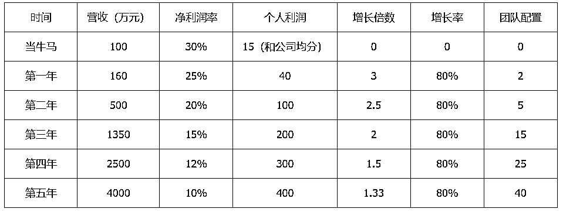

# 从赚钱到生才——我的赚钱创投笔记（二）

## 从赚钱到生才——我的赚钱创投笔记（二）

作者：张昭
日期：2025-02-06

自从我转身做创业制片人，并手把手孵化了一批圈友之后，找我聊天的私信越来越多。大家聊的无非是创业方向、赛道怎么选这类话题。其中有一个提问出现了极高的重复率，我今天就拿出来展开，供有类似焦虑的圈友参考。

这个提问很直白：我想用五年时间拿下1000万净利润，应该怎么走？

为了让这个目标不再是空想，我习惯用一个“做蛋糕模型”来拆解，思路会更清晰。

先说前提，如果你希望1000万这个数字是真实可达而不是自我感动，那第一步要搞清楚你的野心能不能被所在行业兜住。这就回到了一个很残酷的基础盘问题：这个赛道有没有足够高的财务天花板来衡量你。

我做了一张倒推的数据表，把终点拆到起点，逻辑就立起来了：

从这张表里能提炼出三层关键判断：

**1、打工期，你得先是个合格的打工人**

要想五年做成千万利润，你所待的赛道净利润率必须在30%以上，同时你个人要能稳定扛出年均100万左右的产值，这才是起步的最低门槛。

在打工阶段，你没必要想那么多，就把手里的活做到极致。精力越集中，专业壁垒越厚。倘若当牛马时你都做不好，分心创业后事情只会变多，价值贡献只会断崖式下滑。

更重要的是，个人表现是团队的引力。优秀的人才容易聚拢优秀的人，糟糕的样本只会吸引同频的糟糕。古话说男怕入错行，女怕嫁错郎，说的就是选错赛道和选错人，后半生基本就被耗死了。

PS：选赛道别凭感觉，去翻政府工作报告、上市公司招股书、权威行业研报。别稀里糊涂扎进去走了大半年才发现盘子小得可怜。

**2、下场创业后，你要盯住的五大核心变量：年营收、净利润率、增速、增长倍数、团队体量。**

1) 从单兵变成带队，组织效率必然衰减。我给这个衰减系数设了80%，这已经是相当理想的状态了，很多公司都做不到。

2) 组织损耗会随人头和营收同步放大，而净利润率往往掉得更快。办公室政治、管理摩擦、沟通成本，这些都是隐形吞噬。

3) 为了维持增速，你会不得不加人、加投放、加成本，结果心力被掏空，增长反而达不到预期。

所以先想清楚你最舒服的形态是什么，再在这基础上做有限优化。

**3、算总账，5年累计营收约8500万，净利润1000万，平均净利率11.76%。这个水平已远超A股平均。**

PS：截至2024年12月31日，A股纯A公司5160家，计入多上市类型后共5392家。2024年A股总营收约60万亿，总净利润约4.5万亿，综合净利率大约7.5%。你要求的11.76%已高出56.8%。

综合来看，一切取决于你的管理半径，你能平衡到什么程度：

1) 想一个人搞定，做个体户式公司也行，就是遇到坑没人商量；
2) 想小而美，10人以内的精干团队，那你必须挑高毛利、低交付复杂度的赛道，用小营收撬动目标利润；
3) 想做点规模，就必须学会管理、建立体系化运营来降能耗，用机制让别人替你干活。

做蛋糕理论的底层逻辑有三点：

1、以终为始贯穿始终。
最大的果实永远在最后摘，没有根基连开工的资格都没有。目标可以大，入口必须小，否则无从下手。

2、蛋糕大小由人定，也由行业定。
再厉害的师傅也烙不出比锅大的饼。你的认知决定你看到的饼有多大，行业的边界决定你能吃到多少。格局够大的人，往往在一开始就看穿了天花板。

3、用做蛋糕的思维，而不是吃蛋糕的思维看未来。
做蛋糕的人定义上限，吃蛋糕的人只能在存量里抢。做蛋糕是增量思维，吃蛋糕是零和博弈。

最后一句实在话：只有同时满足对的赛道——天花板高、毛利高、交付链条短、操作相对简单，加上一套清晰的战略路径——路径短、试错成本低、能快速拿到市场正反馈，再配上不废话、能扛事、敢闭环的执行力，才能把蛋糕做大并分到一块。缺一个，你就只能捡渣。

备注：想约我聊，请先把你的原生家庭、后天成长、婚育情况、人生规划整理清楚，再附上盖洛普和MBTI结果，把赚钱里跟我相关的帖子全部读完并写份读后感，把认知拉平了再来。别浪费彼此时间。

* * *

评论区：

希平 : 拜读[呲牙][呲牙]