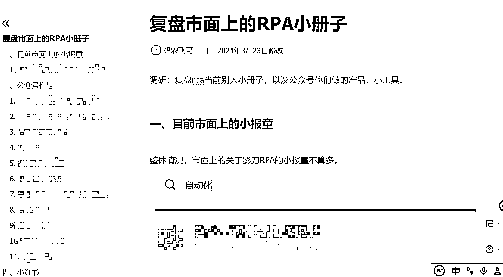
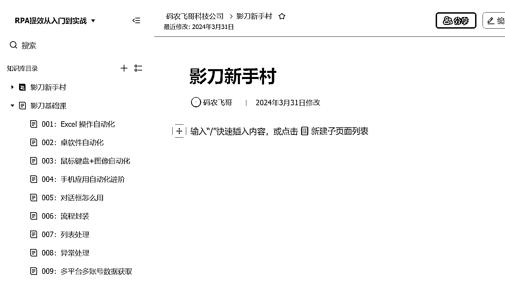
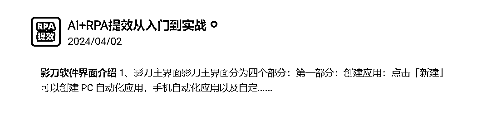
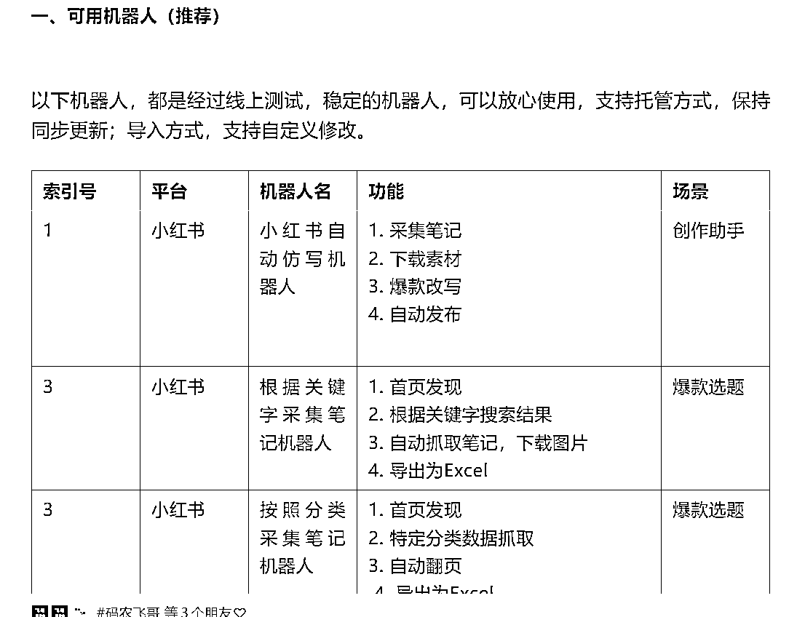
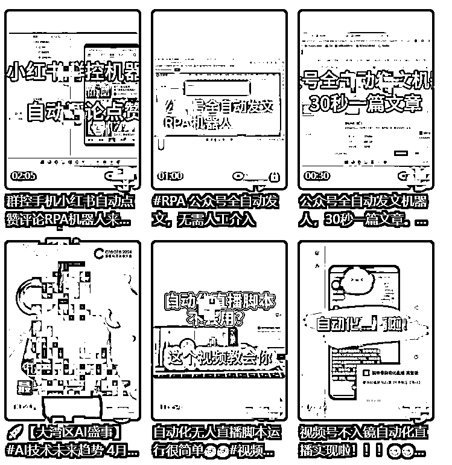

# 2024 年，我用 RPA 穿透副业困局

## 2024 年我的 RPA 赚钱之路

作者： 码农飞哥|RPA 定制

日期：2025-01-21

大家好，我是龙哥，互联网大厂在职工程师，目前主攻大模型应用方向。副业在做毕业设计支持和 RPA 定制开发。

我的身份标签大致是这样：

1. 大厂程序员
2. CSDN 博客专家
3. 热爱折腾的中年工程师

一路走来，说白了就是个普通技术人瞎折腾的记录。

我坚持写了七年博客，粉丝号称十四万，可大部分都是吃灰粉，转化很弱。

我做过毕业设计生意，既卖成品源码也接定制，确实赚到过一些钱。

广告也接过，以前一篇软文能到两千多。

可好景不长，2024 年推广单子锐减，博客流量下滑，我一度很焦虑。于是把自己归零，以新手的心态重新出发。

对我来说，2024 年是副业第一次形成小闭环的一年。站在素人的角度复盘这一年，我做了什么、踩过什么坑，下面慢慢说。

# 一、定方向，先把自己锚定住

## 一）先把定位想清楚

小白做副业，第一件事不是上手做，而是找准赛道。没有锚点的副业就像没有舵的船，最后只会耗尽燃料迷失。

凡事预则立。老师当时让我先梳理过往经历，写一份个人 IP 自述。

那篇文章写完，我对自己有了更清晰的认知，也让更多人认识了我的背景。

写完之后老师给的建议是：继续深耕技术，把👸号里散落的技术文章整理成合集，然后围绕 RPA 出一个小报童专栏，同时承接软件定制单子。

## 二）我的第一个小报童上线了

2024 年我推出了人生中第一个小报童，主题就是 RPA，订阅数目前到六百多。对于一个新手来说，这个体量已经算是个小突破。

下面就聊聊这个产品是怎么从零到一诞生的，也算给这一年的复盘收个尾。

### 1、找准市场痛点

任何产品都是从痛点来的，没有场景的产品很难活下去。

比如人们不想出门吃饭，于是有了外卖；人们想躺着买东西，于是有了电商；人们不想走路，于是有了各种出行工具。

一个产品能否成立，核心在于两点：有真实需求且能被技术实现。两者缺一不可。

诸如长生不老这种需求，古往今来都有，但目前技术上实现不了。

回到我的情况，2024 年大环境大家都感受到了，降本增效、裁员减薪成为主旋律。

职场人被不确定性压得焦虑，左手工作右手副业、打造个人 IP 的呼声越来越高。

于是大量自媒体新人想在内容红海里找到自己的位置，👸号、📕、视频号一起开干。

**找对标、抄同行、挑热门赛道、学头部玩家。**

手动去找笔记对标，手动排版发布，费时费力又容易烦躁。

这时候 RPA 这种能解放双手的工具就有了用武之地。用机器人干重复活，人躺着拿结果，多香。

我的第一个 RPA 应用就是📕爆款笔记采集机器人，市场反响不错，随后我顺势推出了 RPA 小报童专栏。

**给同样起步的小伙伴一句实话：多看赚钱精华帖，多关注赚钱风向标，这个圈子信息很集中。我们要做的就是捕捉需求，快速切入。**

### 2、把产品做出来

需求明确后，就是打磨产品。老办法依然好用：**找对标、抄同行，同行就是活教材。**

这里分享几个实操心得：

#### 1）对标拆解

先找竞品，拆解他们的内容和呈现方式，我做小报童前调研了十几个同行。

拆解能帮你看清市场买什么、不买什么，避免闭门造车。

#### 2）先列大纲

然后在飞书文档里把整本小册子的框架列出来。列完后找大佬过一遍，大佬点头我就按大纲开始更新。

前期建议每天更一篇，更新到十篇左右就能找人帮忙上架了。

#### 3）几个小细节

申请和创建专栏时有几个点可以参考：

1、头像要清晰，推荐蓝底白字或绿底白字，一眼能看懂。
制作工具推荐**稿定设计 或 创客贴**。

2、名字要简洁直白。我的定位是 AI+RPA 提升效率，所以标题取了《AI+RPA 提效从入门到实战》。

3、简介要说清楚：谁做的、做什么的、适合谁、能带来什么帮助。

4、打开合伙人模式。众筹宣传，分销比例建议 50% 及以上，裂变会快很多。

# 二、变现闭环怎么打

产品出来就得卖。小报童客单价低，好卖。

## 一）借势 KOL 发售

自己势能不足时，可以花钱请大 KOL 的合伙人帮推。

常见的发行路径有：

1. 公域直播或公开课引流
2. 拉群集中讲解转化
3. 限时涨价制造紧迫感
4. 制定分佣，分佣比例一般 60% 左右，再加分销奖励。

## 二）公域持续引流

发售结束后要保持持续来客，我的做法是引流在前，成交在后。

### 1、👸号持续输出

我在个人👸号里不断发 RPA 相关文章，把做好的机器人以图文方式展示。

有单篇的使用教程和实现思路，也有 RPA 产品合集。

读者点进来就能清楚知道我能提供什么，有需求直接扫底部二维码找我。

### 2、视频号展示效果

现在是短视频时代，视频号流量不错。用视频直观展示机器人运行效果，比文字更能打动人。

#### 1）视频号的坑

流量大但规则严，我踩过几次雷。

1. 视频里直接留🛰️号，大概率违规。
2. 评论区引导关注、比如评论 666 送机器人，也是违规。

我被限流过几次，最常见的是**账号减少推荐**。

处理方式是我发了十条原创视频并配上申诉文案：

官方大人你好，视频号是一个正能量的短视频平台，很开心可以在这样的平台里展现自己，由于本人自己的疏忽作品中可能存在「与视频号内已发表的视频高度相似」的问题。

现在我已经认识到自己的错误，以后我会好好审核作品内容，做一个正能量的创作者，我已经按照平台规则，发布了十条原创作品，雷同的视频我都已经处理了。

望审核人员给正在努力的我一次机会，帮我账号恢复正常，以后我会认真审查视频内容，遵守视频号社区规范。

### 3、📕图文引流

📕在图文领域依然是头部，上手门槛低，粉丝购买力强。我把机器人关键效果截图拼成图文笔记发布。

从📕过来的客户成交率很高。

公域做完就等客户上门了。

## 三）把朋友圈当门面

朋友圈就是自媒体人的家，装修得体不体面，直接影响信任感和成交率。

朋友圈要清晰传递：你是谁、卖什么、适合谁、有什么成绩。

客户看完觉得靠谱、产品匹配、价格合理，成交就顺理成章了。

## 四）做升单

十块钱的小报童只是入门，后续必须升单。我在小报童积累一批种子用户后，接着开了 RPA 训练营，最终报名人数破百。

# 三、2025 年的打法

新年新目标：

1. 私域粉丝冲到 8000+，现在 4800+。
2. 一年读 20 本书，技术、认知、历史都行。
3. 👸号粉丝破万，视频号粉丝破万，👸号年更 100 篇。

# 四、给同样小白的几条建议

## 一）保持聚焦

选定一个主赛道持续深耕，机会很多，但属于你的只有你能抓住的。别什么都碰，浅尝辄止赚不到钱。跑通一个小闭环再开下一个。

## 二）夯实基本功

基本功就是沟通和输出能力。靠写作锻炼文字表达，靠交流提升沟通能力。

## 三）别急躁

现在到处都在教快速赚钱，天性如此。但基础不牢，不仅赚不到钱，还会交学费。

## 四）谨慎付费

付费前问自己：我真的需要吗？我有时间学吗？拿不准就先问问圈内 KOL，别一年到头都在给别人交学费。

新的一年，祝大家都能赚到心动钱。

* * *

评论区：

小树 : 怎么联系

码农飞哥|RPA 定制 : 联系鱼丸就可以了