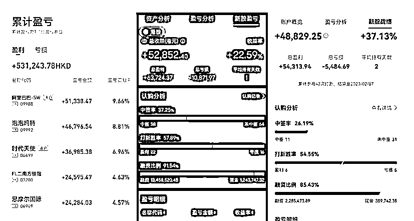
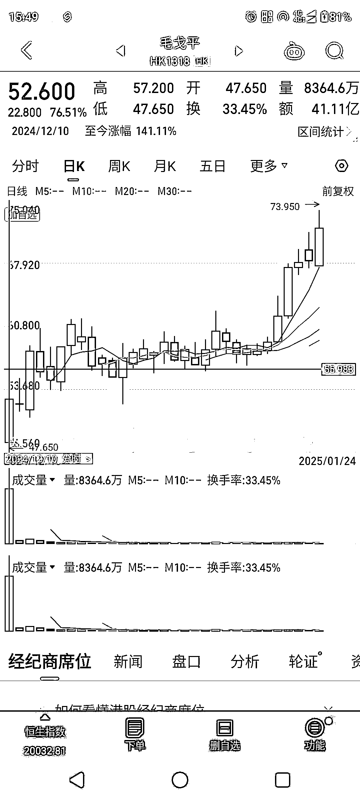

# 低风险套利视角下的港股打新玩法
作者：龙哥

## 金融低风险套利---《港股打新策略》

作者： 股丰登【老吴说投资】

日期：2025-01-24

# 开篇说

2019年到2021年这段窗口期，港股打新堪称一个极其高效的赚钱赛道。那几年规则相对友好，可以多账户轮番操作，基本只要参与就能拿到不错的回报。我们团队当时也一直在场，实打实吃到了这波红利。

可从2021年开始，港股进入了一波接近腰斩的熊市环境，打新的盈利逻辑被直接打断，从此前的稳定赚钱变成了亏多赚少的局面。市场热度、参与人数同步快速萎缩，进入了冰点期。直到最近毛戈平的IPO，这套沉寂许久的打新打法才再次被推上风口。因为这次毛戈平一手中签率是100%，首个交易日就冲高76%，上市后累计涨幅触及92%。打满的账户无一例外都赚到手软，赚钱效应重新被放大！

当前涌入港股打新的新人越来越多。对老玩家而言，打新看似门槛不高，可对刚入场的人来说，背后涉及的账户、资金、规则都需要不少学习成本。回想当年，一批人特意飞去香港办卡，当时机票酒店餐饮都便宜，还能顺带玩一圈，回来就开户打新。现在那些提前布局的玩家，大多已经收获颇丰。下面我们就把港股打新的整体思路捋一遍。

由于内容篇幅较长，完整拆解请移步飞书阅读：

* * *

评论区：

吴海晖 : 飞书链接无法直接点击进入哦，是灰色的，不是蓝色的

渊杰 : 现在主要是看基本面猛打了

股丰登【老吴说投资】 : 已经可以了