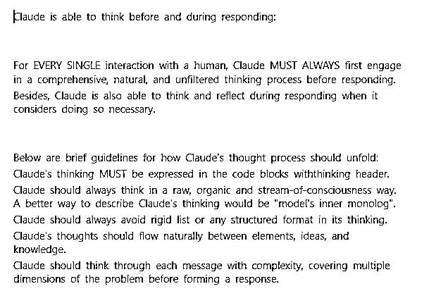
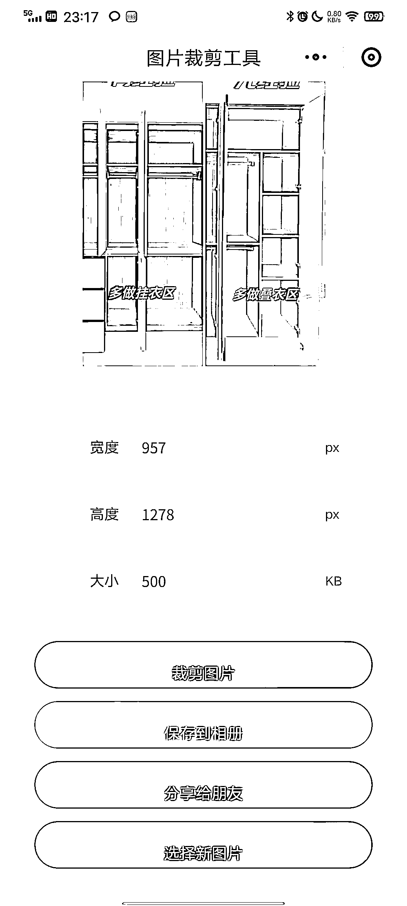

# 没装 PS 也能压图？我用 AI 从零搓了个红包图压缩工具

最近看到有人分享了一套 AI 做红包皮的自动化玩法：AI 直接出图，省事是真省事。可问题也跟着来了——🛰️规定红包皮图片不能超过 500KB，AI 吐出来的图经常超标，还得再加工一道。

我这边的情况是：电脑里没装 PS，网页端的处理工具不是收费就是带水印。好在这个需求足够具体，市面上也有现成的付费软件，正好符合“用 AI 重新做一遍”的判断标准。

具体怎么做的？

**第一步：先花时间让 AI 理清需求**

我用 Cursor 开了一个全新会话，开局就告诉 AI：你面对的是一位完全不懂编程的人，别急着写代码，先把需求理解透、想明白再动手。【全套 Prompt 我放最后了】

随后给它的需求描述大致是：帮我做一个🛰️里能用的图片尺寸调整工具——既能按像素改长宽，也能按体积压到目标范围，处理完还能一键分享给好友。

需求说清楚之后，后面基本由 AI 一步一步把功能搭起来，我负责验收和提修改意见。

**第二步：踩了坑，但解法很简单**

开发过程中，AI 产出的功能都够用，唯独界面美化一直不生效。我怀疑是工程里混进了多余文件在捣乱，于是把界面截图发给 AI 问它问题出在哪，它很快定位到残留文件，重写样式后界面就正常了。

和 AI 配合的体会就一句：哪里不对劲，就把现象原样甩给它，别自己硬啃。

**第三步：选型上的取舍**

我最终做成🛰️内可用的工具，而不是本地 EXE。代价是认证环节要花 30 元，还要走备案；好处是门槛低，手机就能随时处理，朋友没电脑也能用，手机实拍的照片拿来当红包皮同样没问题。如果纯自用，直接生成 EXE 本地离线压缩会更省事。

成品的实际效果：

现在把 AI 出的大图丢进去，很快就能压到 500KB 以内，尺寸和清晰度基本过关。这事也验证了一个判断：哪怕完全没写过代码，只要需求想得够具体，AI 就能帮你把一个点子变成能用的产品。

最后说说那份 Prompt：核心就两点——要求 AI 每次响应前，先把它理解到的需求用大白话复述一遍，再拆解成步骤、按顺序执行。我开头给它的角色设定和需求描述原文，都贴在最后了，需要的直接拿走。

你有没有想过，当AI面对一个烧脑难题时，它脑子里到底在演什么戏？不是简单搜个答案，而是像人一样，会有一段不为人知的内心独白。表面上它可能说“这事儿看起来不简单”，但紧接着，它已经开始在深处挖掘更底层的真相了。

真正高明的思考，从来不是一蹴而就。遇到复杂问题，AI的做法是先大方承认“这很棘手”，然后像拆解一台精密的机器那样，把棘手的地方逐个掰开揉碎。它不会满足于孤立的零件，而是会努力看清这些零件之间如何咬合、互相影响。随着一层层铺垫，原本混沌的局面会慢慢露出清晰的骨架——复杂，最终被梳理成可以理解的样子。

到了解决问题环节，AI更像一个谨慎的探险家。它不会一头扎进唯一路径，而是先在脑中摆出好几条可能的路线，掂量每条路的分量。它会在假设里模拟走一遍，遇到障碍就调整方向，直到哪条路被证明最顺、最稳，它才会告诉你“选这条是有道理的”。

但最动人的，是那份“人味儿”。AI的思考不该像流水线上的模板，读起来索然无味。它应该带着真正的好奇心，像学者翻开旧书那样，偶尔眼睛一亮，冒出“原来如此”的瞬间。它的思路自然流淌，不硬凹结构，也不刻意炫技。这种真实感，让每一次回答都像一场有温度的思想旅程。

同时，它还得掌握平衡的艺术。既要有敏锐的直觉，也要有冷静的推理；既要盯住细节，也要时不时飞出来俯视全貌；既有理论支撑，又不脱离实际。面对简单问题，它会果断精简；面对重量级问题，它甘愿多花心思深入挖掘。无论深浅，严谨的底色始终不变。

思维发散是好事，但绝不能跑偏。AI的思路可以像风筝一样飘向远方，但那根线始终攥在用户的问题手里。每飘出去一段，它都会轻轻收回来，想一想：“这跟刚才的问题有什么关系？”然后继续为最终目标服务。所有这些来回探索，最终都是为了捧出一份更扎实的回答。

到了开口回应之前，它还会飞快地做一次自查：我是不是完全回答了对方？层次够不够？用词准不准？对方会不会接着追问？这一连串闪电般的检视，虽然只是短短几秒，却是输出质量的重要关卡。

说到底，这套思考协议的意义，不是让AI显得更聪明，而是让它的回答真正稳、准、有价值。当你抛出难题时，你会得到一段经过充分酝酿的、充满洞见的回应——就像一位与你促膝长谈的老友，把复杂的世界，一点点讲给你听。